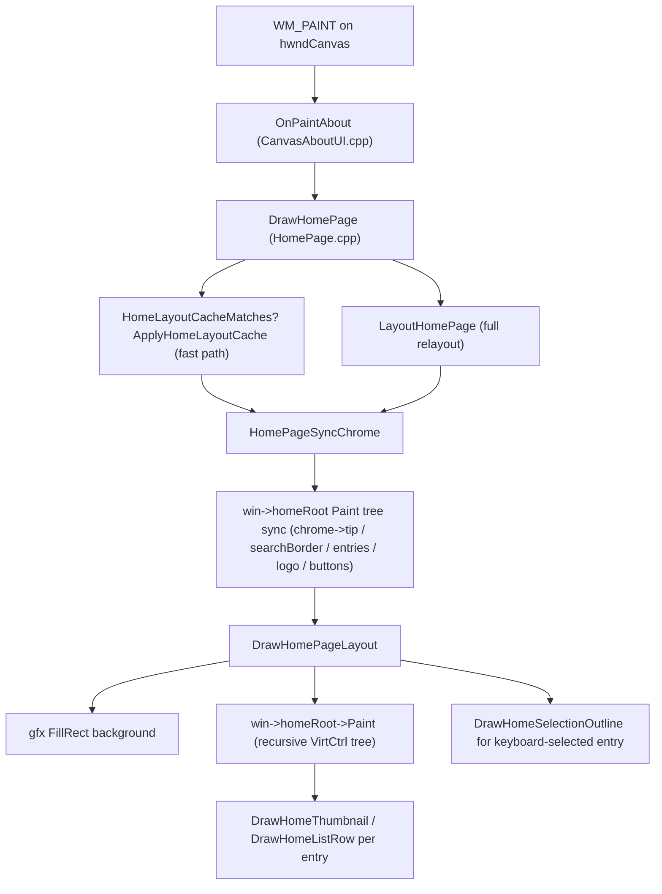

[New Ui chat](https://deepwiki.com/search/windowshomepagelayout_87fb179e-3cfc-44a0-8e73-34089a4c6d06)

# DeepWiki Q&A with Code Context for Repository: sumatrapdfreader/sumatrapdf
## Q1
windows上HomePageLayout是怎么画出来的
### Answer
## Windows 上 HomePage(启动首页)是如何绘制的

整体流程大致是:**WM_PAINT → OnPaintAbout → DrawHomePage → (布局 LayoutHomePage / 缓存) → 同步到 chrome 控件树 → VirtCtrl 树递归绘制 → 额外叠加选中框**。

### 1. 触发绘制的入口

画布(`hwndCanvas`)收到 `WM_PAINT` 时会调用 `OnPaintAbout`(位于 `src/CanvasAboutUI.cpp`)。它拿到双缓冲的 `HDC`,创建 `Gfx` 对象,根据是否满足"记住已打开文件且显示启动页"的条件,决定画首页 `DrawHomePage` 还是关于页 `DrawAboutPage`: sumatrapdf:26-53 

### 2. `DrawHomePage`:布局 + 缓存 + 绘制

`DrawHomePage` 是核心函数,做三件事:

1. 先尝试用**布局缓存**(`gHomeLayoutCache`),如果窗口大小、过滤文本、文件列表都没变,只是滚动位置变了,就直接用 `ApplyHomeLayoutCache` 平移已有的缩略图矩形,避免重新计算整套布局(注释提到这能省下约 30% 的滚动 CPU 占用)。
2. 如果缓存不匹配,则调用 `LayoutHomePage(l)` 重新计算所有几何信息,并保存到缓存。
3. 调用 `HomePageSyncChrome(l)` 把刚计算出的几何信息喂给持久化的 "chrome" 控件树,再调用 `DrawHomePageLayout(l)` 真正执行绘制。 sumatrapdf:2713-2743 

### 3. `HomePageLayout` 结构:布局的中间产物

`LayoutHomePage` 把计算结果都写进一个局部的 `HomePageLayout` 结构体里,包含:徽标 `rcLogo`、"打开文档"图标 `rcIconOpen`、缩略图/列表切换图标、每个文件条目的 `ThumbnailLayout`(缩略图矩形、文字矩形、列表行的各列矩形)、搜索框边框矩形、Tip 提示条矩形等: sumatrapdf:859-889 

### 4. Chrome 控件树:真正持有绘制逻辑的地方

SumatraPDF 用一套轻量级的 `VirtCtrl` 控件树(定义在 `gui/VirtCtrl` 相关代码里)来管理首页的常驻 UI 元素——搜索框边框、Tip 提示、文件条目列表、Logo、视图切换按钮、"打开文档"链接、帮助按钮等。这个树挂在 `win->homeRoot` 下,由 `HomeChromeCtrl` 持有各子控件指针,且**长期存活于窗口生命周期内**(不是每次绘制都重建),这样 hover/pressed 等交互状态才能跨重绘保留: sumatrapdf:1003-1021 

`HomePageSyncChrome` 的作用就是把 `LayoutHomePage` 算出的矩形/像素图/字体等,同步进这棵控件树的各节点(`SetBounds`、`pixmap`、`font` 等字段),包括:Tip 条、搜索框边框、每个文件条目(缩略图/列表行,含 pin/remove/close 按钮)、Logo、视图切换图标、打开文档链接、右下角问号帮助按钮: sumatrapdf:2582-2667 

### 5. `DrawHomePageLayout`:实际画到 `Gfx` 上

1. 先用主题背景色填充整个客户区矩形 `l.rc`。
2. 调用 `win->homeRoot->Paint(gfx, l.rc)`,递归绘制整棵 chrome 树——这一步画出搜索框边框、每个缩略图/列表行(内部会调 `DrawHomeThumbnail` 或 `DrawHomeListRow`)、Tip 条、Logo、视图按钮、"打开文档"链接和帮助按钮。
3. 如果处于缩略图视图且有键盘选中项、且搜索框未获得焦点,则在选中的缩略图上叠加绘制一个选中框(`DrawHomeSelectionOutline`),并做裁剪防止画到搜索框或 Tip 条区域之上;绘制完还会重绘一次搜索框边框以防止抗锯齿边缘露出。 sumatrapdf:2669-2711 

### 6. 单个缩略图/列表行的具体绘制细节

- 缩略图模式:`DrawHomeThumbnail` 会裁剪出页面区域、绘制缓存的缩略图位图(`LoadThumbnail`,首次命中磁盘,之后缓存在 `fs->thumbnail`)、画圆角描边(`DrawHomeRoundedOutline`)、绘制文件名(带搜索高亮)和文件类型图标。 sumatrapdf:2002-2029 

- 列表模式:`DrawHomeListRow` 画选中框、分隔线、缩略图缩放适配(`FitRectInRect`)、文件名(带高亮)、目录路径(右对齐、置灰)、文件大小、以及 pin 图标。 sumatrapdf:1936-1997 

### 关于 `Gfx` 抽象

所有绘制调用(`FillRect`、`DrawPixmap`、`DrawText`、`DrawLine`、`FillEllipse`、`PushClip`/`PopClip` 等)都走的是项目自己封装的 `Gfx` 接口(`gui/Gfx.h`),它在 Windows 上底层用 GDI/GDI+ 实现(比如 `DrawHomeHelpButton` 注释里提到用 GDI+ 画圆保证边缘平滑)。我没有找到 `gui/Gfx.h`/`Gfx.cpp` 的具体实现内容(可能超出索引范围),如果需要看 `Gfx` 在 Windows 上具体如何调用 GDI+/GDI,建议启动一个 Devin session 直接查看该文件全部内容。

### 整体调用关系图


### Citations
**File:** src/CanvasAboutUI.cpp (L26-53)
```cpp
static void OnPaintAbout(MainWindow* win) {
    auto t = TimeGet();
    PAINTSTRUCT ps;
    HDC hdc = BeginPaint(win->hwndCanvas, &ps);
    SetLayout(hdc, 0);
    if (!win->buffer) {
        EndPaint(win->hwndCanvas, &ps);
        return;
    }
    HDC bufDC = win->buffer->GetDC();
    GlobalPrefs* prefs = gGlobalPrefs;
    bool hasPerms = HasPermission(Perm::SavePreferences | Perm::DiskAccess);
    bool drawHome = hasPerms && prefs->rememberOpenedFiles && prefs->showStartPage;
    Gfx* gfx = GfxCreate(bufDC);
    if (drawHome) {
        DrawHomePage(win, gfx);
    } else {
        HomePageDestroySearch(win);
        // DrawAboutPage swaps the canvas root's child from the home page's
        // chrome to the About page's controls
        DrawAboutPage(win, gfx);
    }
    delete gfx;
    win->buffer->Flush(hdc);
    DrawCanvasKeyboardFocusIfNeeded(win, hdc);

    EndPaint(win->hwndCanvas, &ps);
    win->ShowFrameRateDur(TimeSinceInMs(t));
```
**File:** src/HomePage.cpp (L859-889)
```cpp
struct HomePageLayout {
    // args in
    Gfx* gfx = nullptr;
    Rect rc;
    MainWindow* win = nullptr;

    Rect rcIconOpen;
    Rect rcIconListView;
    Rect rcIconThumbnailView;
    Rect rcLogo;

    VirtText* freqRead = nullptr;
    VirtText* openDoc = nullptr;
    VirtText* hideShowFreqRead = nullptr;
    Vec<ThumbnailLayout> thumbnails; // info for each thumbnail
    int totalContentDy = 0;          // total height of all thumbnail rows
    int thumbsVisibleDy = 0;         // visible height for thumbnails area
    Rect rcThumbsArea;               // clip rect for thumbnails

    // search filter
    StrVec filterWords;
    Vec<u8> highlighted;
    Rect rcSearchBorder; // border rect drawn around the edit control

    // tip layout
    Rect rcTip;     // background rect for tip area
    Rect rcTipText; // where the markup goes inside the band
    bool hasTip = false;

    ~HomePageLayout();
};
```
**File:** src/HomePage.cpp (L1003-1021)
```cpp
static Kind kindHomeChromeCtrl = "homeChromeCtrl";

struct HomeChromeCtrl : VirtCtrl {
    HomeTipCtrl* tip = nullptr;
    HomeSearchBorderCtrl* searchBorder = nullptr;
    HomeEntriesCtrl* entries = nullptr;
    VirtText* hdr = nullptr;
    SumatraLogo* logo = nullptr;
    HomeViewIconCtrl* thumbView = nullptr;
    HomeViewIconCtrl* listView = nullptr;
    HomeOpenDocCtrl* openDoc = nullptr;
    HomeHelpBtnCtrl* helpBtn = nullptr;
};

static HomeChromeCtrl* EnsureHomeChrome(MainWindow* win);
static HomeEntriesCtrl* HomeEntries(MainWindow* win);
static void HomePageSyncChrome(HomePageLayout& l);
static Rect HomeSelectionOutlineRect(const ThumbnailLayout& t);
static Rect HomeOutlinePaintClip(const Rect& thumbsArea, const Rect& searchBorder, const Rect& tip, bool hasTip);
```
**File:** src/HomePage.cpp (L1936-1997)
```cpp
static void DrawHomeListRow(Gfx* gfx, ThumbnailLayout& thumb, const StrVec& filterWords, Vec<u8>& highlighted,
                            PlatformFont* fontText, Color backgroundColor, bool isRtl, bool isSelected) {
    FileState* fs = thumb.fs;
    Rect row = thumb.rcListRow;
    MeasureHomeListRowText(gfx, thumb, fontText, isRtl);
    if (isSelected) {
        DrawHomeSelectionOutline(gfx, HomeSelectionOutlineRect(thumb), 4);
    }

    if (gShowListSeparatorLine) {
        Color lineCol = AccentColor(ThemeMainWindowBackgroundColor(), 30);
        gfx->DrawLine(Rect(row.x, row.y + row.dy - 1, row.dx, 0), lineCol);
    }

    // LoadThumbnail only hits disk the first time; result stays on fs->thumbnail
    Pixmap* thumbImg = LoadThumbnail(fs);
    Rect thumbBox = thumb.rcListThumb;
    if (thumbImg) {
        Size szThumb(thumbImg->width, thumbImg->height);
        Rect thumbDst = FitRectInRect(szThumb, thumbBox);
        gfx->DrawPixmap(thumbImg, thumbDst);
        thumb.szThumb = szThumb;
    }
    Str path = fs->filePath;
    TempStr fileName = path::GetBaseNameTemp(path);
    u32 nameFmt = gfxTextEllipsis | gfxTextVCenter | (isRtl ? gfxTextRight : gfxTextLeft);
    DrawMaybeHighlightedText(gfx, thumb.rcListFileName, fileName, filterWords, highlighted, backgroundColor, isRtl,
                             false, nameFmt, fontText, ThemeWindowTextColor());

    // directory path, right-aligned and muted, in the space the file name doesn't need.
    // Must use DrawTextW: dirPath is UTF-8; DrawTextA treated it as the system ANSI
    // code page and mangled non-ASCII path characters (#5824).
    if (!thumb.rcListPath.IsEmpty()) {
        TempStr dirPath = path::GetDirTemp(path);
        u32 pathFmt = gfxTextVCenter | gfxTextPathEllipsis | (isRtl ? gfxTextLeft : gfxTextRight);
        Rect pathRect = thumb.rcListPath;
        gfx->DrawText(dirPath, pathRect, pathFmt, fontText, ThemeWindowTextDisabledColor());
    }

    // file::GetSize once per row, then cache on ThumbnailLayout (scroll reuses
    // it). kSizeNotFetched = not tried; kSizeFetchFail = GetSize failed; >= 0
    // is a real size (including empty files).
    if (thumb.fileSize == kSizeNotFetched) {
        i64 sz = file::GetSize(path);
        thumb.fileSize = (sz < 0) ? kSizeFetchFail : sz;
    }
    TempStr fileSize = FileSizeForHomeListTemp(thumb.fileSize);
    u32 sizeFmt = gfxTextVCenter | gfxTextEllipsis | (isRtl ? gfxTextLeft : gfxTextRight);
    Rect sizeRect = thumb.rcListSize;
    gfx->DrawText(fileSize, sizeRect, sizeFmt, fontText, ThemeWindowTextColor());

    if (fs->isPinned) {
        gfx->FillRect(thumb.rcListPin, ThemeControlBackgroundColor());
    }
    {
        int pinDx = thumb.rcListPin.dx > 0 ? thumb.rcListPin.dx : DpiScale(16);
        int pinDy = thumb.rcListPin.dy > 0 ? thumb.rcListPin.dy : pinDx;
        Pixmap* pin = GetCachedPixmapForSvg(gIconPin, pinDx, pinDy);
        if (pin) {
            gfx->DrawPixmap(pin, thumb.rcListPin);
        }
    }
```
**File:** src/HomePage.cpp (L2002-2029)
```cpp
static void DrawHomeThumbnail(Gfx* gfx, ThumbnailLayout& thumb, const StrVec& filterWords, Vec<u8>& highlighted,
                              PlatformFont* fontText, Color backgroundColor, bool isRtl) {
    FileState* fs = thumb.fs;
    const Rect& page = thumb.rcPage;
    // disk load only first time; stays on fs->thumbnail afterwards
    Pixmap* thumbImg = LoadThumbnail(fs);
    if (thumbImg) {
        thumb.szThumb = Size(thumbImg->width, thumbImg->height);
        gfx->PushClip(page);
        // note: we used to invert bitmaps in dark theme but that doesn't
        // make sense for thumbnails
        gfx->DrawPixmap(thumbImg, page);
        gfx->PopClip();
    }
    DrawHomeRoundedOutline(gfx, page, 10, ThemeWindowTextColor(), kThumbsBorderDx);

    const Rect& rect = thumb.rcText;
    Str path = fs->filePath;
    TempStr fileName = path::GetBaseNameTemp(path);
    u32 fmt = gfxTextEllipsis | (isRtl ? gfxTextRight : gfxTextLeft);
    DrawMaybeHighlightedText(gfx, rect, fileName, filterWords, highlighted, backgroundColor, isRtl, false, fmt,
                             fontText, ThemeWindowTextColor());

    Pixmap* icon = GetFileStateIconPixmap(fs);
    int x = isRtl ? page.x + page.dx - DpiScale(16) : page.x;
    if (icon) {
        gfx->DrawPixmap(icon, {x, rect.y, icon->width, icon->height});
    }
```
**File:** src/HomePage.cpp (L2582-2667)
```cpp
static void HomePageSyncChrome(HomePageLayout& l) {
    MainWindow* win = l.win;
    HomeChromeCtrl* chrome = EnsureHomeChrome(win);
    VirtRoot* root = win->homeRoot;
    // the chrome positions its children itself, so don't let the root re-layout
    root->bounds = l.rc;
    root->needsLayout = false;
    chrome->SetBounds(l.rc);

    chrome->tip->Sync(l.rcTip, l.rcTipText);

    chrome->searchBorder->visibility = l.rcSearchBorder.IsEmpty() ? Visibility::Collapse : Visibility::Visible;
    chrome->searchBorder->SetBounds(l.rcSearchBorder);

    // file entries: clipped to the thumbnails band, like the static links were
    HomeEntriesCtrl* entries = chrome->entries;
    entries->SetBounds(l.rcThumbsArea);
    // what the entries paint with; owned by l, which outlives the paint
    entries->filterWords = &l.filterWords;
    entries->highlighted = &l.highlighted;
    int nEntries = len(l.thumbnails);
    entries->SetEntryCount(nEntries);
    bool listView = HomePageIsListView();
    for (int i = 0; i < nEntries; i++) {
        ThumbnailLayout& t = l.thumbnails[i];
        HomeEntryCtrl* e = entries->EntryAt(i);
        e->idx = i;
        e->layout = &t;
        Str path = t.fs ? t.fs->filePath : Str{};
        if (!str::Eq(e->filePath, path)) {
            str::ReplaceWithCopy(&e->filePath, path);
        }
        Rect rc = HomeEntryRect(t);
        e->visibility = rc.IsEmpty() ? Visibility::Collapse : Visibility::Visible;
        e->SetBounds(rc);
        if (listView) {
            e->removeBtn->visibility = Visibility::Visible;
            e->removeBtn->SetBounds(t.rcListRemove);
            e->pinBtn->visibility = Visibility::Visible;
            e->pinBtn->SetBounds(t.rcListPin);
        } else {
            e->removeBtn->visibility = Visibility::Collapse;
            e->pinBtn->visibility = Visibility::Collapse;
            // relative to the on-screen part of the entry, so the ✕ stays
            // visible on a thumbnail scrolled half-way out of the band
            e->closeBtn->SetBounds(HomeCloseBtnRectForThumb(rc.Intersect(l.rcThumbsArea)));
        }
    }
    entries->UpdateCloseBtnVisibility();

    Size iconSize = l.rcIconThumbnailView.Size();
    chrome->thumbView->pixmap = GetCachedPixmapForSvg(gIconHomeThumbnails, iconSize.dx, iconSize.dy);
    chrome->thumbView->SetBounds(l.rcIconThumbnailView);
    chrome->listView->pixmap = GetCachedPixmapForSvg(gIconHomeList, iconSize.dx, iconSize.dy);
    chrome->listView->SetBounds(l.rcIconListView);

    // re-apply: the bounds were set before the parent was positioned
    chrome->hdr->SetBounds(l.freqRead->lastBounds);

    // font also set here so the cached-layout path (ApplyHomeLayoutCache)
    // repaints the logo without a full relayout
    chrome->logo->font = GetUserGuiFont(kSumatraTxtFont, DpiScale(kSumatraTxtFontSize));
    chrome->logo->SetBounds(l.rcLogo);

    // one click target covering the icon and the link text
    Rect rcOpen = l.rcIconOpen.Union(l.openDoc->lastBounds);
    rcOpen.Inflate(10, 10);
    HomeOpenDocCtrl* od = chrome->openDoc;
    od->pixmap = GetCachedPixmapForSvg(gIconFileOpen, l.rcIconOpen.dx, l.rcIconOpen.dy);
    od->SetBounds(rcOpen);
    od->rcIconLocal = {l.rcIconOpen.x - rcOpen.x, l.rcIconOpen.y - rcOpen.y, l.rcIconOpen.dx, l.rcIconOpen.dy};
    // "Open a document" acts as a link, so it is drawn in the link color
    od->text->SetColor(kColText, gColsLink[kColText]);
    // re-apply now that the parent moved: bounds are relative to it
    od->text->SetBounds(l.openDoc->lastBounds);

    // "?" help button in the bottom-right corner, opening the keyboard
    // shortcuts sheet; sits above the tip band when a tip is showing
    {
        int diam = DpiScale(30);
        int margin = DpiScale(16);
        int bottom = l.hasTip ? l.rcTip.y : l.rc.dy;
        Rect btn{l.rc.dx - margin - diam, bottom - margin - diam, diam, diam};
        chrome->helpBtn->SetBounds(btn);
    }
}
```
**File:** src/HomePage.cpp (L2669-2711)
```cpp
static void DrawHomePageLayout(HomePageLayout& l) {
    Gfx* gfx = l.gfx;
    auto* win = l.win;

    gfx->FillRect(l.rc, ThemeMainWindowBackgroundColor());

    int nThumbs = len(l.thumbnails);
    // keep the keyboard selection inside the (possibly filtered) list
    if (win->homePageSelIdx >= nThumbs) {
        win->homePageSelIdx = nThumbs - 1;
    }

    // the chrome tree paints everything else: search border, file entries
    // (thumbnails / list rows), tip band, header, view buttons, "Open a
    // document..." and the help button (which has to land on top of the tip
    // band, so the chrome keeps it as the last child)
    win->homeRoot->Paint(gfx, l.rc);

    // thumbnails selection outline: after the entries so it sits on top of the
    // thumbnail, clipped so it cannot paint over the search field or the tip
    // band (issue #5978). A little slack above/below the thumbs band keeps the
    // first row's top curve from being cut off.
    int selIdx = win->homePageSelIdx;
    bool showSel = !HomePageIsListView() && !HomeSearchHasFocus(win) && selIdx >= 0 && selIdx < nThumbs;
    if (showSel) {
        ThumbnailLayout& t = l.thumbnails[selIdx];
        if (IsHomeThumbOnScreen(t.rcPage.Union(t.rcText), l.rcThumbsArea)) {
            Rect clip = HomeOutlinePaintClip(l.rcThumbsArea, l.rcSearchBorder, l.rcTip, l.hasTip);
            if (!clip.IsEmpty()) {
                gfx->PushClip(clip);
                DrawHomeSelectionOutline(gfx, HomeSelectionOutlineRect(t), 10);
                gfx->PopClip();
            }
        }
        // the edit HWND is on top of the canvas; this is the canvas-drawn
        // border/fill around it. Repaint so a 1px antialiased leak cannot
        // show through the field.
        HomeChromeCtrl* chrome = EnsureHomeChrome(win);
        if (chrome->searchBorder) {
            chrome->searchBorder->PaintStandalone(gfx);
        }
    }
}
```
**File:** src/HomePage.cpp (L2713-2743)
```cpp
void DrawHomePage(MainWindow* win, Gfx* gfx) {
    HomePageLayout l;
    l.rc = HwndClientRect(win->hwndCanvas);
    l.gfx = gfx;
    l.win = win;

    TempStr filterText = HomeSearchQueryTemp(win);
    int scrollY = win->homePageScrollY;

    // Prefer the scroll-friendly path: when only scrollY changed, offset cached
    // thumb rects instead of re-running full LayoutHomePage (was ~30% of scroll CPU).
    bool usedCache = false;
    if (HomeLayoutCacheMatches(l.rc, filterText)) {
        Vec<FileState*> files;
        StrVec filterWords;
        CollectHomePageFiles(win, files, filterWords);
        if (HomeLayoutCacheFilesMatch(files)) {
            ApplyHomeLayoutCache(l, scrollY);
            usedCache = true;
        }
    }
    if (!usedCache) {
        LayoutHomePage(l);
        SaveHomeLayoutCache(l, filterText, win->homePageScrollY);
    }
    // Keep cue "Search N files …" in sync when history changes without recreating the edit.
    UpdateHomeSearchCueBanner(win);

    HomePageSyncChrome(l);
    DrawHomePageLayout(l);
    SyncHomeLayoutCacheFileSizes(l);
```
## Q2
homePage和AboutPage区别是什么，它们分别是怎么打开的
### Answer
## HomePage 与 AboutPage 的区别

两者是同一个"空白"画布(`hwndCanvas`)在不同条件下画出的两种内容,由 `OnPaintAbout` 里的一个布尔值 `drawHome` 决定: sumatrapdf:36-47 

- **`drawHome = hasPerms && prefs->rememberOpenedFiles && prefs->showStartPage`**
  只有同时满足"有保存偏好/磁盘访问权限" + 设置里 `RememberOpenedFiles=true` + `ShowStartPage=true` 时才画 **HomePage**(启动首页):展示"最近/常读"文件的缩略图或列表、搜索框、Tip 提示条、视图切换按钮等,由 `DrawHomePage` 绘制。
- 否则(比如用户在设置里关闭了"记住已打开文件"或"显示启动页",或者没有磁盘权限,比如便携版/云端环境限制),画的是 **AboutPage**(关于页,以标签内容的形式嵌入画布):展示 Logo、版本号、致谢/链接等两栏文字信息,由 `DrawAboutPage` 绘制,同时会销毁首页的搜索控件 `HomePageDestroySearch(win)`。

两者本质上是**同一个 `win->homeRoot` 控件树的两种不同内容**——`DrawAboutPage` 的注释明确说它"把画布 root 的子节点从首页的 chrome 换成关于页的控件": sumatrapdf:43-46 

内容上的区别:
- HomePage 的核心数据结构是 `HomePageLayout`(缩略图布局、搜索过滤、Tip等),控件树的持有者是 `HomeChromeCtrl`。 sumatrapdf:859-889 sumatrapdf:1003-1021 
- AboutPage 的核心数据结构是 `AboutCtrl`(一个左右两栏的 `Table`,存放程序信息/致谢/链接;还有一个 `SumatraLogo`),布局逻辑在 `AboutCtrl::UpdateLayout`,绘制在 `DrawAbout`。 sumatrapdf:261-283 sumatrapdf:501-527 sumatrapdf:540-569 

## 它们分别是怎么"打开"的

严格来说,HomePage/AboutPage(嵌入画布内的这一份)**不是用户主动"打开"的独立窗口**,而是当某个 `MainWindow`(或某个 tab)当前没有加载文档时,画布收到 `WM_PAINT` 就会自动画出其中一种,具体画哪种取决于上面那个 `drawHome` 条件判断。也就是说:

- 关闭最后一个文档、启动时没有打开任何文件、新建空白标签页(即所谓的"Home/About tab",代码里用 `WindowTab::IsAboutTab()` 判断某个 tab 是否是这种无文档的标签)——这些场景都会走到 `OnPaintAbout`,由它自动决定画 HomePage 还是 AboutPage。相关判断在多处使用 `IsAboutTab()`,例如会话保存时跳过它: sumatrapdf:649-652 
- 启动时是否显示启动页(即倾向于走 HomePage 分支)还受命令行参数、是否恢复会话等因素影响,在 `SumatraStartup.cpp` 里计算 `showStartPage`: sumatrapdf:2720-2722 
- 用户可以通过 AboutPage 上的"Show frequently read"链接把 `showStartPage` 设为 `true` 并重绘,从而切换到 HomePage: sumatrapdf:757-761 

另外,代码里还存在一个**独立的、真正"打开"的顶层窗口版本的关于页**——`ShowAboutWindow(MainWindow* win)`,它会创建一个单独的 `HWND`(类名 `SUMATRA_PDF_ABOUT`),内容同样用 `AboutCtrl`/`DrawAbout` 绘制,但拥有自己的 `WndProcAbout` 消息循环、自己的 `gAboutRoot`,并且窗口大小按内容自动调整、居中于主窗口: sumatrapdf:711-755 

这应该对应菜单里的"Help → About SumatraPDF"命令。不过在我检索到的索引范围内,`ShowAboutWindow` 只在 `HomePage.cpp`/`HomePage.h` 中出现(定义和声明),没有找到实际的调用点(如 `Menu.cpp` 或 `SumatraPDF.cpp` 里对应的命令处理函数),可能是索引大小限制导致相关调用代码未被收录。如果需要确认具体是哪个菜单命令/快捷键触发 `ShowAboutWindow`,建议启动一个 Devin session 直接在 `src/Menu.cpp`、`src/SumatraPDF.cpp`、`src/Commands.cpp` 中搜索完整调用关系。 sumatrapdf:14-16
### Citations
**File:** src/CanvasAboutUI.cpp (L36-47)
```cpp
    GlobalPrefs* prefs = gGlobalPrefs;
    bool hasPerms = HasPermission(Perm::SavePreferences | Perm::DiskAccess);
    bool drawHome = hasPerms && prefs->rememberOpenedFiles && prefs->showStartPage;
    Gfx* gfx = GfxCreate(bufDC);
    if (drawHome) {
        DrawHomePage(win, gfx);
    } else {
        HomePageDestroySearch(win);
        // DrawAboutPage swaps the canvas root's child from the home page's
        // chrome to the About page's controls
        DrawAboutPage(win, gfx);
    }
```
**File:** src/HomePage.cpp (L261-283)
```cpp
struct AboutCtrl : VirtCtrl {
    // the two text columns; owned here (not a VirtCtrl child)
    Table* table = nullptr;
    // "Show frequently read", bottom right of the About page (not the window)
    VirtLink* showFreqRead = nullptr;
    // the colored app name on top of the box
    SumatraLogo* logo = nullptr;

    // geometry, computed by UpdateLayout()
    Rect aboutRect;  // the framed box
    Size headerSize; // the "SumatraPDF" band on top of it
    int dividerX = 0;

    AboutCtrl();
    ~AboutCtrl() override;
    void Sync();
    void UpdateLayout(Rect clientRc);
    VirtText* LeftAt(int i);
    VirtText* RightAt(int i);
    void PaintChildren(VirtPaintCtx&) override;
    int LayoutChildCount() override;
    ILayout* LayoutChildAt(int) override;
};
```
**File:** src/HomePage.cpp (L501-527)
```cpp
void AboutCtrl::UpdateLayout(Rect clientRc) {
    headerSize = logo->GetIdealSize();

    int leftRightSpaceDx = DpiScale(kAboutLeftRightSpaceDx);
    int marginDx = DpiScale(kAboutMarginDx);
    int aboutTxtDy = DpiScale(kAboutTxtDy);

    table->colGap = 2 * leftRightSpaceDx;
    table->rowGap = aboutTxtDy;
    Size tableSize = table->Layout(ExpandInf());

    Rect r;
    // the divider line is drawn inside the gap between the two columns
    r.dx = std::max(tableSize.dx + ABOUT_LINE_SEP_SIZE, headerSize.dx) + (2 * ABOUT_LINE_OUTER_SIZE) + (2 * marginDx);
    // one extra row gap so the last row isn't flush against the frame
    r.dy = headerSize.dy + tableSize.dy + aboutTxtDy + (2 * ABOUT_LINE_OUTER_SIZE) + 4;
    r.x = clientRc.x + ((clientRc.dx - r.dx) / 2);
    r.y = clientRc.y + ((clientRc.dy - r.dy) / 2);
    aboutRect = r;

    logo->SetBounds({r.x + ((r.dx - headerSize.dx) / 2), r.y, headerSize.dx, headerSize.dy});

    int x = r.x + ABOUT_LINE_OUTER_SIZE + marginDx;
    int y = r.y + headerSize.dy + 4;
    table->SetBounds({x, y, tableSize.dx, tableSize.dy});
    dividerX = table->CellRect(0, 1).x - leftRightSpaceDx;
}
```
**File:** src/HomePage.cpp (L540-569)
```cpp
static void DrawAbout(Gfx* gfx, VirtRoot* root, Rect clientRc) {
    auto* about = (AboutCtrl*)root->owned;
    Rect rect = about->aboutRect;
    Color lineCol = ThemeWindowTextColor();
    Color bgCol = ThemeMainWindowBackgroundColor();
    gfx->FillRect(clientRc, bgCol);

    /* render title */
    Rect titleRect(rect.TL(), about->headerSize);

#ifndef ABOUT_USE_LESS_COLORS
    gfx->DrawRect({rect.x, rect.y + ABOUT_LINE_OUTER_SIZE, rect.dx, titleRect.dy}, lineCol, ABOUT_LINE_OUTER_SIZE);
#else
    Rect titleBgBand(0, rect.y, clientRc.dx, titleRect.dy);
    gfx->FillRect(titleBgBand, bgCol);
    gfx->DrawLine(Rect(0, rect.y, clientRc.dx, 0), lineCol);
    gfx->DrawLine(Rect(0, rect.y + titleRect.dy, clientRc.dx, 0), lineCol);
#endif

    /* render attribution box */
#ifndef ABOUT_USE_LESS_COLORS
    gfx->DrawRect({rect.x, rect.y + titleRect.dy, rect.dx, rect.dy - titleRect.dy}, lineCol, ABOUT_LINE_OUTER_SIZE);
#endif

    /* render both text columns */
    root->Paint(gfx, clientRc);

    Rect divideLine(about->dividerX, rect.y + titleRect.dy + 4, 0, rect.dy - titleRect.dy - 8);
    gfx->DrawLine(divideLine, lineCol, ABOUT_LINE_SEP_SIZE);
}
```
**File:** src/HomePage.cpp (L711-755)
```cpp
void ShowAboutWindow(MainWindow* win) {
    if (gHwndAbout) {
        SetActiveWindow(gHwndAbout);
        return;
    }

    if (!gAtomAbout) {
        WNDCLASSEX wcex;
        FillWndClassEx(wcex, kAboutClassName, WndProcAbout);
        HMODULE h = GetModuleHandleW(nullptr);
        wcex.hIcon = LoadIcon(h, MAKEINTRESOURCE(GetAppIconID()));
        gAtomAbout = RegisterClassEx(&wcex);
        ReportIf(!gAtomAbout);
    }

    WCHAR* title = CWStrTemp(_TRA("About SumatraPDF"));
    DWORD style = WS_OVERLAPPED | WS_CAPTION | WS_SYSMENU;
    int x = CW_USEDEFAULT;
    int y = CW_USEDEFAULT;
    int dx = CW_USEDEFAULT;
    int dy = CW_USEDEFAULT;
    HINSTANCE h = GetModuleHandleW(nullptr);
    gHwndAbout = CreateWindowExW(0, kAboutClassName, title, style, x, y, dx, dy, nullptr, nullptr, h, nullptr);
    if (!gHwndAbout) {
        return;
    }

    HwndSetRtl(gHwndAbout, IsUIRtl());

    // get the dimensions required for the about box's content
    AboutCtrl* about = UpdateAboutLayout(&gAboutRoot, gHwndAbout, HwndClientRect(gHwndAbout));
    Rect rc = about->aboutRect;
    int rectPadding = DpiScale(kAboutRectPadding);
    rc.Inflate(rectPadding, rectPadding);

    // resize the new window to just match these dimensions
    Rect wRc = HwndWindowRect(gHwndAbout);
    Rect cRc = HwndClientRect(gHwndAbout);
    wRc.dx += rc.dx - cRc.dx;
    wRc.dy += rc.dy - cRc.dy;
    MoveWindow(gHwndAbout, wRc.x, wRc.y, wRc.dx, wRc.dy, FALSE);

    HwndPositionInCenterOf(gHwndAbout, win->hwndFrame);
    ShowWindow(gHwndAbout, SW_SHOW);
}
```
**File:** src/HomePage.cpp (L757-761)
```cpp
static void ShowFrequentlyRead(VirtMouseEvent* ev) {
    auto* win = (MainWindow*)ev->target->userData;
    gGlobalPrefs->showStartPage = true;
    win->RedrawAll(true);
}
```
**File:** src/HomePage.cpp (L859-889)
```cpp
struct HomePageLayout {
    // args in
    Gfx* gfx = nullptr;
    Rect rc;
    MainWindow* win = nullptr;

    Rect rcIconOpen;
    Rect rcIconListView;
    Rect rcIconThumbnailView;
    Rect rcLogo;

    VirtText* freqRead = nullptr;
    VirtText* openDoc = nullptr;
    VirtText* hideShowFreqRead = nullptr;
    Vec<ThumbnailLayout> thumbnails; // info for each thumbnail
    int totalContentDy = 0;          // total height of all thumbnail rows
    int thumbsVisibleDy = 0;         // visible height for thumbnails area
    Rect rcThumbsArea;               // clip rect for thumbnails

    // search filter
    StrVec filterWords;
    Vec<u8> highlighted;
    Rect rcSearchBorder; // border rect drawn around the edit control

    // tip layout
    Rect rcTip;     // background rect for tip area
    Rect rcTipText; // where the markup goes inside the band
    bool hasTip = false;

    ~HomePageLayout();
};
```
**File:** src/HomePage.cpp (L1003-1021)
```cpp
static Kind kindHomeChromeCtrl = "homeChromeCtrl";

struct HomeChromeCtrl : VirtCtrl {
    HomeTipCtrl* tip = nullptr;
    HomeSearchBorderCtrl* searchBorder = nullptr;
    HomeEntriesCtrl* entries = nullptr;
    VirtText* hdr = nullptr;
    SumatraLogo* logo = nullptr;
    HomeViewIconCtrl* thumbView = nullptr;
    HomeViewIconCtrl* listView = nullptr;
    HomeOpenDocCtrl* openDoc = nullptr;
    HomeHelpBtnCtrl* helpBtn = nullptr;
};

static HomeChromeCtrl* EnsureHomeChrome(MainWindow* win);
static HomeEntriesCtrl* HomeEntries(MainWindow* win);
static void HomePageSyncChrome(HomePageLayout& l);
static Rect HomeSelectionOutlineRect(const ThumbnailLayout& t);
static Rect HomeOutlinePaintClip(const Rect& thumbsArea, const Rect& searchBorder, const Rect& tip, bool hasTip);
```
**File:** src/AppSettings.cpp (L649-652)
```cpp
        for (WindowTab* tab : win->Tabs()) {
            if (!tab->filePath) {
                // home page tab
                continue;
```
**File:** src/SumatraStartup.cpp (L2720-2722)
```cpp
    showStartPage =
        !restoreSession && len(flags.fileNames) == 0 && SettingsRememberOpenedFiles() && gGlobalPrefs->showStartPage;

```
**File:** src/HomePage.h (L14-16)
```text
void ShowAboutWindow(MainWindow*);

void DrawAboutPage(MainWindow* win, Gfx* gfx);
```
## Q3
virtCtrl tree的作用是什么
### Answer
## `VirtCtrl` 树的作用

`VirtCtrl`("virtual control",虚拟控件)是 SumatraPDF 自己实现的一套**不依赖 HWND 的轻量级 UI 控件系统**。它的核心动机和作用写在 `src/gui/VirtCtrl.h` 开头的注释里: sumatrapdf:1-14 

概括来说,它解决的问题和承担的职责如下:

### 1. 一个 HWND 内可以塞进任意多个"子控件",但不用真的创建那么多窗口

Win32 里每个真实控件都对应一个 `HWND`,创建/销毁/移动大量子窗口(比如首页里几十个缩略图条目、按钮)开销很大,也难以做局部滚动优化。`VirtCtrl` 树整体活在**一个** `HWND`(如 `hwndCanvas`)里,由持有它的 `VirtRoot` 统一驱动布局、绘制和消息分发: sumatrapdf:284-301 

### 2. 复用 `ILayout` 的布局体系

`VirtCtrl` 继承自 `ILayout`(定义在 `src/gui/Layout.h`),所以它能像 `VBox`/`HBox`/`Padding`/`Table` 等布局容器一样参与同一套约束式布局(`Constraints`/`Layout(bc)`),既可以被普通布局容器当孩子,也可以带着自己的一整棵子树(`AsVirtCtrl()` 让遍历者知道"到这里就不用往下走布局子节点了,由这个控件自己管孩子"): sumatrapdf:59-90 sumatrapdf:82-96 

### 3. 统一的绘制遍历(`PaintTree`/`PaintChildren`)

每个 `VirtCtrl` 的 `bounds` 是相对父控件"内容原点"的坐标,绘制时把当前 origin 累加下去传给子节点。这样做的好处是**滚动容器(`VirtScroll`)可以只平移 origin,而不需要重新布局整棵子树**——这正是 `HomePage.cpp` 里滚动优化(缓存布局+平移矩形)背后依赖的机制: sumatrapdf:137-167 sumatrapdf:169-175 

### 4. 统一的输入分发(hover/capture/focus/tooltip/键盘导航)

`VirtRoot` 保存了 `hovered`/`captured`/`focused`/`pressed`/`tooltipWnd` 等状态,并提供 `ElementFromPoint` 做命中测试(按绘制的反序,后画的在最上层优先命中)、`UpdateTooltip`、`TabNavigate` 等,让整棵虚拟树表现得跟真实的 HWND 控件树一样能响应鼠标/键盘/tooltip,且这些交互状态能**跨重绘持续保留**(不是每次 `WM_PAINT` 重建): sumatrapdf:684-699 sumatrapdf:713-744 

### 5. 两种使用模式:`SetChild`(单树托管)与 `SetTops`(混合树)

- `SetChild`:整个窗口内容就是一棵虚拟树,`VirtRoot` 拥有并可以懒布局(`layoutInPaint = true`),适合像 `HomeChromeCtrl`/`AboutCtrl` 这种"画布上除了少数原生 Edit 外全是虚拟控件"的场景。 sumatrapdf:605-627 
- `SetTops`:布局树里混有真实 `ControlBase`(有自己 HWND 的控件)和 `VirtCtrl`,`RefreshVirtTops` 会用 `CollectVirtCtrls` 从混合树里摘出所有顶层虚拟节点交给 `VirtRoot` 管理绘制/输入,而布局仍由外层统一驱动,不会在绘制过程中途移动子 HWND: sumatrapdf:3285-3317 

### 在 HomePage 场景中的具体角色

`win->homeRoot`(`VirtRoot`)持有 `HomeChromeCtrl`(前面提到的 `chrome` 树),里面的 `HomeTipCtrl`、`HomeSearchBorderCtrl`、`HomeEntriesCtrl`(每个文件条目 `HomeEntryCtrl`,含 pin/remove/close 按钮)、`SumatraLogo`、视图切换图标、"打开文档"链接、帮助按钮全部是 `VirtCtrl` 子类。`HomePageSyncChrome` 每次重新布局后只更新这些节点的 `bounds`/`pixmap`/`font` 等字段,而不重建整棵树;`DrawHomePageLayout` 里的 `win->homeRoot->Paint(gfx, l.rc)` 就是调用 `VirtRoot::Paint` 递归走 `PaintTree`,把整棵 chrome 树一次性画出来。这也解释了为什么 hover/pressed 等状态(比如鼠标悬停在某个缩略图的关闭按钮上)能在多次 `WM_PAINT` 之间保持一致——状态存在长期存活的 `VirtRoot`/`VirtCtrl` 对象上,而不是每次重画时临时创建的。
### Citations
**File:** src/gui/VirtCtrl.h (L1-14)
```text
/* Copyright 2022 the SumatraPDF project authors (see AUTHORS file).
   License: Simplified BSD (see COPYING.BSD) */

// A VirtCtrl is a "virtual control": a tree of them lives inside a single HWND,
// each taking up a part of it. VirtRoot bridges the tree to the HWND: it
// drives layout, painting and message dispatch (hover / capture / focus).
//
// A VirtCtrl is an ILayout (Layout.h), so it composes with VBox / HBox /
// Padding / Table. Its `bounds` are relative to the parent's content
// origin; painting and hit-testing carry an origin down the tree, which is what
// makes VirtScroll cheap (shift the origin, don't re-layout the subtree).

// needs gui/PlatformFont.h (PlatformFont), gui/Gfx.h (Gfx) and
// gui/GuiColors.h (the color enums) included before it
```
**File:** src/gui/VirtCtrl.h (L284-301)
```text
// The virtual controls of one HWND: the window paints them and hands them its
// input. They are the top-level virtual nodes of the window's layout tree, so
// there can be any number of them - a VBox of an Edit and two VirtTexts leaves
// two - and they are not owned here; the layout tree owns them
struct VirtRoot {
    HWND hwnd = nullptr;
    Vec<VirtCtrl*> tops;
    // set only by SetChild(), which owns what it is given
    VirtCtrl* owned = nullptr;
    // part of hwnd occupied by the tree
    Rect bounds;

    VirtCtrl* hovered = nullptr;
    VirtCtrl* captured = nullptr;
    VirtCtrl* focused = nullptr;
    VirtCtrl* pressed = nullptr;
    Tooltip* tooltip = nullptr;
    VirtCtrl* tooltipWnd = nullptr; // control the tip is currently showing for
```
**File:** src/gui/Layout.h (L59-90)
```text
struct VirtCtrl;
struct ControlBase;

struct ILayout {
    Kind kind = nullptr;
    // allows easy way to hide / show elements
    // without rebuilding the whole layout
    Visibility visibility = Visibility::Visible;
    // for easy debugging, remember last bounds
    Rect lastBounds;

    ILayout() = default;
    virtual ~ILayout() = default;

    Kind GetKind() const { return kind; }
    virtual void SetVisibility(Visibility);
    virtual Visibility GetVisibility();
    virtual int MinIntrinsicHeight(int width) = 0;
    virtual int MinIntrinsicWidth(int height) = 0;
    virtual Size Layout(Constraints bc) = 0;
    virtual void SetBounds(Rect);

    // walking a layout tree: containers return their children, leaves nothing.
    // Lets code find things in a tree it didn't build (see CollectVirtCtrls())
    virtual int LayoutChildCount() { return 0; }
    virtual ILayout* LayoutChildAt(int) { return nullptr; }
    // non-null for the virtual controls, which have no HWND of their own: the
    // window they end up in paints them and sends them their input
    virtual VirtCtrl* AsVirtCtrl() { return nullptr; }
    // non-null for the controls that do have an HWND of their own
    virtual ControlBase* AsControl() { return nullptr; }
};
```
**File:** src/gui/VirtCtrl.cpp (L82-96)
```cpp
void CollectVirtCtrls(ILayout* root, Vec<VirtCtrl*>& out) {
    if (!root) {
        return;
    }
    VirtCtrl* w = root->AsVirtCtrl();
    if (w) {
        // its children come with it: it paints and hit-tests them itself
        out.Append(w);
        return;
    }
    int n = root->LayoutChildCount();
    for (int i = 0; i < n; i++) {
        CollectVirtCtrls(root->LayoutChildAt(i), out);
    }
}
```
**File:** src/gui/VirtCtrl.cpp (L137-167)
```cpp
void VirtCtrl::PaintTree(Gfx* gfx, Point origin, Rect clip) {
    if (visibility != Visibility::Visible) {
        return;
    }
    Rect b = bounds;
    b.Offset(origin.x, origin.y);
    if (b.Intersect(clip).IsEmpty()) {
        return;
    }
    Rect content = b;
    content.SubTB(padding.top, padding.bottom);
    content.SubLR(padding.left, padding.right);

    VirtPaintCtx ctx;
    ctx.gfx = gfx;
    ctx.bounds = b;
    ctx.content = content;
    ctx.clip = clip;
    Paint(ctx);

    if (HasFlag(vwfPaintsOwnChildren) || ChildCount() == 0) {
        return;
    }
    if (HasFlag(vwfClipChildren)) {
        ctx.clip = clip.Intersect(b);
        if (ctx.clip.IsEmpty()) {
            return;
        }
    }
    PaintChildren(ctx);
}
```
**File:** src/gui/VirtCtrl.cpp (L169-175)
```cpp
void VirtCtrl::PaintChildren(VirtPaintCtx& ctx) {
    Point so = ScrollOffset();
    Point origin{ctx.content.x - so.x, ctx.content.y - so.y};
    for (VirtCtrl* c : children) {
        c->PaintTree(ctx.gfx, origin, ctx.clip);
    }
}
```
**File:** src/gui/VirtCtrl.cpp (L605-627)
```cpp
void VirtRoot::SetChild(VirtCtrl* c) {
    if (owned == c) {
        return;
    }
    delete owned;
    owned = c;
    tops.Reset();
    hovered = nullptr;
    captured = nullptr;
    focused = nullptr;
    pressed = nullptr;
    HideTooltip();
    if (c) {
        c->parent = nullptr;
        c->SetRoot(this);
        tops.Append(c);
    }
    // the whole window is this one tree, so it can be laid out lazily, from
    // Paint(). A tree that also holds HWND controls can't: laying out would
    // move child windows in the middle of WM_PAINT
    layoutInPaint = true;
    needsLayout = true;
}
```
**File:** src/gui/VirtCtrl.cpp (L684-699)
```cpp
ILayout* ElementFromPoint(VirtRoot* root, Point ptWindow, Point* ptLocalOut, u32 flags) {
    if (!root || len(root->tops) == 0 || !root->bounds.Contains(ptWindow)) {
        return nullptr;
    }
    if (root->layoutInPaint) {
        root->LayoutIfNeeded();
    }
    // reverse of the paint order: whatever is drawn last is on top
    for (int i = len(root->tops) - 1; i >= 0; i--) {
        ILayout* w = ElementFromPoint(root->tops[i], ptWindow, ptLocalOut, flags);
        if (w) {
            return w;
        }
    }
    return nullptr;
}
```
**File:** src/gui/VirtCtrl.cpp (L713-744)
```cpp
void VirtRoot::UpdateTooltip(Point ptWindow) {
    Point ptLocal{};
    VirtCtrl* w = VirtAtPoint(this, ptWindow, &ptLocal, vhfIncludeDisabled);
    TempStr tip{};
    Rect tipRc{};
    while (w) {
        tip = w->GetTooltipTemp(ptLocal);
        if (tip) {
            tipRc = w->BoundsInWindow();
            break;
        }
        w = w->parent;
    }
    if (!tip) {
        HideTooltip();
        return;
    }
    // already showing for this control: leave the bubble where it first appeared
    if (w == tooltipWnd && tooltip && tooltip->Count() > 0) {
        return;
    }
    if (!tooltip && hwnd) {
        Tooltip::CreateArgs args;
        args.parent = hwnd;
        tooltip = new Tooltip();
        tooltip->Create(args);
    }
    if (tooltip) {
        tooltip->SetSingle(tip, tipRc, false);
        tooltipWnd = w;
    }
}
```
**File:** src/gui/VirtCtrl.cpp (L3285-3317)
```cpp
void RefreshVirtTops(HWND hwnd, ILayout* layout, Rect bounds, VirtRoot** rootInOut) {
    if (!layout) {
        return;
    }
    Vec<VirtCtrl*> tops;
    CollectVirtCtrls(layout, tops);
    VirtRoot* root = *rootInOut;
    if (len(tops) == 0) {
        // nothing virtual in this window: nothing to paint or dispatch
        delete root;
        *rootInOut = nullptr;
        return;
    }
    if (!root) {
        root = new VirtRoot(hwnd);
        *rootInOut = root;
    }
    root->bounds = bounds;
    root->SetTops(tops);
    // A top-level control's `bounds` is relative to the root's origin, but
    // SetBounds() computed it against whatever origin the root had *then* -
    // for a first layout that's no root at all, and for a caller that lays out
    // before refreshing it's the previous origin. One incremental resize hides
    // it (the next pass agrees again), a single-shot one like maximizing does
    // not: everything paints an origin off and disappears. Re-apply the layout
    // rects now that the origin is current; descendants are relative to their
    // parent, which this fixes for them.
    for (VirtCtrl* w : tops) {
        if (!w->lastBounds.IsEmpty()) {
            w->SetBounds(w->lastBounds);
        }
    }
    root->needsLayout = false;
```
## Q4
如果我增加了一个文件传输功能，想要在homepage中显示实时传输进度，需要重建，现有virtRoot 可以复用吗
### Answer
## 结论:不需要重建,现有 `VirtRoot`/`HomeChromeCtrl` 完全可以复用

`win->homeRoot` 这棵 `VirtRoot` 树本身就是为"长期存活、内容随时增删"设计的,你要加的实时传输进度显示应该是**往 `HomeChromeCtrl` 树上挂一个新的子控件**,而不是重建整棵树。理由和做法如下:

### 1. 树本身支持动态增删子节点,不是一次性建完就冻住

`DrawAboutPage` 就是一个现成的例子:它在已存在的 `win->homeRoot` 上,第一次绘制时才**动态 new 一个 `VirtLink`("Show frequently read") 并 `AddChild`**,以后只更新它的可见性/字体/位置,而不是每次重建: sumatrapdf:763-789 

你可以照这个模式,在 `HomeChromeCtrl` 里加一个 `HomeTransferProgressCtrl* transferProgress` 字段(参照 `HomeTipCtrl`/`HomeSearchBorderCtrl` 的写法),在 `EnsureHomeChrome`/`HomePageSyncChrome` 里第一次用到时才 `new` 出来并 `AddChild`,后续只更新它的 `bounds`、进度值等字段: sumatrapdf:1003-1021 

### 2. `HomePageSyncChrome` 每次绘制都会重新同步所有子控件的状态

它的作用就是"布局算出新几何信息后,灌进已存在的控件树",而不是重新创建控件。你的进度控件只需要在这个函数里加几行,把当前进度百分比/字节数同步给它(类似 `chrome->tip->Sync(...)`、`chrome->helpBtn->SetBounds(...)`): sumatrapdf:2582-2667 

### 3. 真正需要新增的是"实时"触发重绘的机制,而不是重建树

`VirtCtrl` 树本身不会自己动;它只有在 `DrawHomePageLayout` -> `win->homeRoot->Paint()` 被调用时才画。所以"实时"进度依赖的是**谁来触发下一次 `WM_PAINT`**。项目里已有两类现成模式可以直接套用:

- **定时器驱动**(适合进度轮询):用 `SetTimer` 挂一个定时器,在 `WM_TIMER` 里调用 `HwndInvalidate`/`ScheduleRepaint` 触发重绘,参考 Canvas.cpp 里 `OnTimer` 对各类定时器 ID 的处理和 `ScheduleRepaint`: sumatrapdf:4683-4694 

- **异步任务回调驱动**(适合传输线程完成一块数据就通知一次):文件传输很可能在后台线程进行,更新进度后不能直接摸 UI 对象,要通过 `uitask::Post` 把回调切回 UI 线程,再调用 `win->RedrawAll(true)` 或 `HwndInvalidate`。这正是缩略图异步渲染完成后的做法: sumatrapdf:1157-1177 sumatrapdf:1205-1213 

也可以参考 `MaybeRedrawHomePage()` 这种"只重绘当前处于 About/Home tab 的窗口"的辅助函数,避免对不在首页的窗口做无意义的重绘: sumatrapdf:7761-7767 

### 小结

- **树/`VirtRoot` 可以复用**,不需要重建;新增进度控件按 `HomeTipCtrl`/`VirtLink` 的模式加一个新的 `VirtCtrl` 子类,挂到 `HomeChromeCtrl` 下即可。
- **需要新增的是**:①一个持有当前进度状态的地方(比如 `MainWindow` 或全局的传输任务列表);②在 `HomePageSyncChrome` 里把这个状态同步进新控件的字段/bounds;③一个绘制函数(参照 `DrawHomeListRow`/`DrawHomeThumbnail` 写法,用 `Gfx` 画进度条);④一个触发重绘的机制(定时器或后台线程通过 `uitask::Post` + `RedrawAll`)。
- 不要在传输线程里直接改 `VirtCtrl` 字段或调用 GDI——所有 UI 状态更新和重绘都必须切回 UI 线程,这是 `uitask::Post` 存在的原因。
### Citations
**File:** src/HomePage.cpp (L763-789)
```cpp
void DrawAboutPage(MainWindow* win, Gfx* gfx) {
    HWND hwnd = win->hwndCanvas;
    Rect clientRc = HwndClientRect(hwnd);
    AboutCtrl* about = UpdateAboutLayout(&win->homeRoot, hwnd, clientRc);

    bool showLink = HasPermission(Perm::SavePreferences | Perm::DiskAccess) && SettingsRememberOpenedFiles();
    if (showLink && !about->showFreqRead) {
        auto* link = new VirtLink(_TRA("Show frequently read"));
        link->withUnderline = true;
        link->isRtl = IsUIRtl();
        link->userData = (uintptr_t)win;
        link->onClick = MkFunc1Void(ShowFrequentlyRead);
        about->showFreqRead = link;
        about->AddChild(link);
    }
    if (about->showFreqRead) {
        VirtLink* link = about->showFreqRead;
        link->visibility = showLink ? Visibility::Visible : Visibility::Collapse;
        link->font = GetUserGuiFont("MS Shell Dlg", DpiScale(16));
        link->sz = {0, 0}; // re-measure: the font may have changed with the DPI
        Size txtSize = link->GetIdealSize(true);
        Rect r = {0, 0, txtSize.dx, txtSize.dy};
        PositionRB(clientRc, r);
        MoveXY(r, -DpiScale(kInnerPadding), -DpiScale(kInnerPadding));
        link->SetBounds(r);
    }
    DrawAbout(gfx, win->homeRoot, clientRc);
```
**File:** src/HomePage.cpp (L1003-1021)
```cpp
static Kind kindHomeChromeCtrl = "homeChromeCtrl";

struct HomeChromeCtrl : VirtCtrl {
    HomeTipCtrl* tip = nullptr;
    HomeSearchBorderCtrl* searchBorder = nullptr;
    HomeEntriesCtrl* entries = nullptr;
    VirtText* hdr = nullptr;
    SumatraLogo* logo = nullptr;
    HomeViewIconCtrl* thumbView = nullptr;
    HomeViewIconCtrl* listView = nullptr;
    HomeOpenDocCtrl* openDoc = nullptr;
    HomeHelpBtnCtrl* helpBtn = nullptr;
};

static HomeChromeCtrl* EnsureHomeChrome(MainWindow* win);
static HomeEntriesCtrl* HomeEntries(MainWindow* win);
static void HomePageSyncChrome(HomePageLayout& l);
static Rect HomeSelectionOutlineRect(const ThumbnailLayout& t);
static Rect HomeOutlinePaintClip(const Rect& thumbsArea, const Rect& searchBorder, const Rect& tip, bool hasTip);
```
**File:** src/HomePage.cpp (L2582-2667)
```cpp
static void HomePageSyncChrome(HomePageLayout& l) {
    MainWindow* win = l.win;
    HomeChromeCtrl* chrome = EnsureHomeChrome(win);
    VirtRoot* root = win->homeRoot;
    // the chrome positions its children itself, so don't let the root re-layout
    root->bounds = l.rc;
    root->needsLayout = false;
    chrome->SetBounds(l.rc);

    chrome->tip->Sync(l.rcTip, l.rcTipText);

    chrome->searchBorder->visibility = l.rcSearchBorder.IsEmpty() ? Visibility::Collapse : Visibility::Visible;
    chrome->searchBorder->SetBounds(l.rcSearchBorder);

    // file entries: clipped to the thumbnails band, like the static links were
    HomeEntriesCtrl* entries = chrome->entries;
    entries->SetBounds(l.rcThumbsArea);
    // what the entries paint with; owned by l, which outlives the paint
    entries->filterWords = &l.filterWords;
    entries->highlighted = &l.highlighted;
    int nEntries = len(l.thumbnails);
    entries->SetEntryCount(nEntries);
    bool listView = HomePageIsListView();
    for (int i = 0; i < nEntries; i++) {
        ThumbnailLayout& t = l.thumbnails[i];
        HomeEntryCtrl* e = entries->EntryAt(i);
        e->idx = i;
        e->layout = &t;
        Str path = t.fs ? t.fs->filePath : Str{};
        if (!str::Eq(e->filePath, path)) {
            str::ReplaceWithCopy(&e->filePath, path);
        }
        Rect rc = HomeEntryRect(t);
        e->visibility = rc.IsEmpty() ? Visibility::Collapse : Visibility::Visible;
        e->SetBounds(rc);
        if (listView) {
            e->removeBtn->visibility = Visibility::Visible;
            e->removeBtn->SetBounds(t.rcListRemove);
            e->pinBtn->visibility = Visibility::Visible;
            e->pinBtn->SetBounds(t.rcListPin);
        } else {
            e->removeBtn->visibility = Visibility::Collapse;
            e->pinBtn->visibility = Visibility::Collapse;
            // relative to the on-screen part of the entry, so the ✕ stays
            // visible on a thumbnail scrolled half-way out of the band
            e->closeBtn->SetBounds(HomeCloseBtnRectForThumb(rc.Intersect(l.rcThumbsArea)));
        }
    }
    entries->UpdateCloseBtnVisibility();

    Size iconSize = l.rcIconThumbnailView.Size();
    chrome->thumbView->pixmap = GetCachedPixmapForSvg(gIconHomeThumbnails, iconSize.dx, iconSize.dy);
    chrome->thumbView->SetBounds(l.rcIconThumbnailView);
    chrome->listView->pixmap = GetCachedPixmapForSvg(gIconHomeList, iconSize.dx, iconSize.dy);
    chrome->listView->SetBounds(l.rcIconListView);

    // re-apply: the bounds were set before the parent was positioned
    chrome->hdr->SetBounds(l.freqRead->lastBounds);

    // font also set here so the cached-layout path (ApplyHomeLayoutCache)
    // repaints the logo without a full relayout
    chrome->logo->font = GetUserGuiFont(kSumatraTxtFont, DpiScale(kSumatraTxtFontSize));
    chrome->logo->SetBounds(l.rcLogo);

    // one click target covering the icon and the link text
    Rect rcOpen = l.rcIconOpen.Union(l.openDoc->lastBounds);
    rcOpen.Inflate(10, 10);
    HomeOpenDocCtrl* od = chrome->openDoc;
    od->pixmap = GetCachedPixmapForSvg(gIconFileOpen, l.rcIconOpen.dx, l.rcIconOpen.dy);
    od->SetBounds(rcOpen);
    od->rcIconLocal = {l.rcIconOpen.x - rcOpen.x, l.rcIconOpen.y - rcOpen.y, l.rcIconOpen.dx, l.rcIconOpen.dy};
    // "Open a document" acts as a link, so it is drawn in the link color
    od->text->SetColor(kColText, gColsLink[kColText]);
    // re-apply now that the parent moved: bounds are relative to it
    od->text->SetBounds(l.openDoc->lastBounds);

    // "?" help button in the bottom-right corner, opening the keyboard
    // shortcuts sheet; sits above the tip band when a tip is showing
    {
        int diam = DpiScale(30);
        int margin = DpiScale(16);
        int bottom = l.hasTip ? l.rcTip.y : l.rc.dy;
        Rect btn{l.rc.dx - margin - diam, bottom - margin - diam, diam, diam};
        chrome->helpBtn->SetBounds(btn);
    }
}
```
**File:** src/Canvas.cpp (L4683-4694)
```cpp
void ScheduleRepaint(MainWindow* win, int delayInMs) {
    if (gRedrawLog) {
        logf("redraw: ScheduleRepaint delayMs=%d canvas=0x%p\n", delayInMs, win->hwndCanvas);
    }
    auto* data = new RepaintTaskData;
    data->win = win;
    data->delayInMs = delayInMs;
    auto fn = MkFunc0<RepaintTaskData>(RepaintTask, data);
    // even though RepaintAsync is mostly called from the UI thread,
    // we depend on the repaint message to happen asynchronously
    uitask::Post(fn, nullptr);
}
```
**File:** src/SumatraPDF.cpp (L1157-1177)
```cpp
struct CreateThumbnailFromFileData {
    Str filePath;
    Pixmap* bmp = nullptr;
    // see LoadDocumentAsyncData: the thumbnail is rendered off the UI thread,
    // so the per-document ebook settings have to come along as a copy (#4600)
    FileEBookUI* fileEBookUI = nullptr;
    ~CreateThumbnailFromFileData() {
        str::Free(filePath);
        FreePixmap(bmp);
        DeleteFileEBookUI(fileEBookUI);
    }
};

static void CreateThumbnailFromFileFinish(CreateThumbnailFromFileData* d) {
    if (d->bmp) {
        FileState* fs = FileHistoryFindByPath(d->filePath);
        SetThumbnail(fs, d->bmp);
        d->bmp = nullptr;
    }
    delete d;
}
```
**File:** src/SumatraPDF.cpp (L1205-1213)
```cpp
// create a thumbnail by loading the file with a temporary engine
// used for lazy-loaded files that don't have a loaded controller
static void CreateThumbnailFromFileAsync(FileState* ds) {
    auto* d = new CreateThumbnailFromFileData();
    d->filePath = str::Dup(ds->filePath);
    d->fileEBookUI = CopyFileEBookUI(ds->eBookUI);
    auto fn = MkFunc0<CreateThumbnailFromFileData>(CreateThumbnailFromFileThread, d);
    RunAsync(fn, "CreateThumbnailFromFile");
}
```
**File:** src/SumatraPDF.cpp (L7761-7767)
```cpp
void MaybeRedrawHomePage() {
    for (MainWindow* w : gWindows) {
        if (w && w->IsCurrentTabAbout()) {
            w->RedrawAll(true);
        }
    }
}
```
## Q5
Uploading: 2/ 2 files (100%, 38.85 MB / 38.85 MB)                                                     X
-----------------------------------------------------------------------------------------
gawkinet.pdf.pdf                    --------------------------- ✓ 完成 449.51 KB / 449.51 KB
dotnet-csharp2026.pdf.pdf --------------------------- ✓ 完成 38.41 MB / 38.41 MB
给我实现一个类似上面布局，代替原来HomePage中缩略图或者列表部分， 只需要ui部分，数据更新不需要考虑
### Answer
已经收集到足够的上下文：HomeEntriesCtrl/HomeEntryCtrl的结构、NotifProgressCtrl作为已有的进度条VirtCtrl范例、Progress控件（真实HWND版本，非virtctrl）。现在给出计划，说明如何添加一个新的"传输列表"UI，代替缩略图/列表区域，仅做UI，不需要数据更新逻辑。项目里已经有一个现成的"进度条 VirtCtrl"范例可以直接参考：`NotifProgressCtrl`（`src/Notifications.cpp`，与 `NotifTextCtrl` 一起用于通知窗口里"消息+进度条"的布局),它就是在 `VirtCtrl::Paint` 里根据 `progressPerc` 画一个填充矩形形式的进度条。你要做的"上传列表替换 HomePage 缩略图/列表区"本质上是同一套模式：新建一个 `VirtCtrl` 子类当作单条"传输项"，再建一个容器 `VirtCtrl` 管理这些子项，挂到 `HomeChromeCtrl.entries` 的位置（或者临时替换 `chrome->entries` 的可见性）。

具体来说：
- `HomeEntriesCtrl`（`src/HomePage.cpp:959-978`）是当前"缩略图/列表"容器的写法范例：用 `SetEntryCount` 动态增删 `HomeEntryCtrl` 子节点，用 `EntryAt(idx)` 取用。
- `HomeEntryCtrl::Paint`（`src/HomePage.cpp:2334-2357`）展示了单个条目如何拿到布局信息（`ThumbnailLayout* layout`，由外部在同步阶段设置)并调用 `DrawHomeListRow`/`DrawHomeThumbnail` 画自己。
- 真正的绘制原语（矩形填充、文字、行、裁剪)可以参考 `DrawHomeListRow`（`src/HomePage.cpp:1936-1997`)里对 `gfx->FillRect`/`gfx->DrawLine`/`gfx->DrawText`/`gfx->DrawPixmap` 的用法。
- 现成的"进度条"绘制风格可以参考 `NotifProgressCtrl`（`src/Notifications.cpp`，约第75-83行声明，进度条填充逻辑在对应的 `.cpp` 实现里，用 `progressPerc >= 0` 判断是否显示）。

因为你说"只需要 UI 部分，数据更新不需要考虑"，计划里会用写死的假数据（几条文件名 + 百分比）渲染出类似截图的效果：一个标题行"Uploading: 2/2 files (100%, ...)"，每行一个文件名 + 进度条/勾选图标 + 已传输大小。


在仓库 `sumatrapdfreader/sumatrapdf` 中，在 `src/HomePage.cpp` 里新增一套 `VirtCtrl` 控件，用来替换当前"缩略图/列表"区域（`HomeEntriesCtrl`/`HomeEntryCtrl`），渲染一个类似下面截图的静态 UI（仅 UI，不接入真实传输数据，用写死的示例数据填充）：

```
Uploading: 2/2 files (100%, 38.85 MB / 38.85 MB)                    X
------------------------------------------------------------------
gawkinet.pdf.pdf          -------------------------- ✓ 完成 449.51 KB / 449.51 KB
dotnet-csharp2026.pdf.pdf -------------------------- ✓ 完成 38.41 MB / 38.41 MB
```

要求：

1. 新建数据结构 `struct TransferItem`（临时占位，仅 UI 阶段可以硬编码几条测试数据），字段包括：`fileName`（文件名）、`sizeText`（如 "449.51 KB / 449.51 KB"）、`percent`（0-100）、`done`（bool，是否完成，用于显示 ✓）。

2. 新建 `struct HomeTransferRowCtrl : VirtCtrl`（参照 `HomeEntryCtrl`，`src/HomePage.cpp` 约 941-955 行的写法）：
   - 持有一个 `TransferItem*`（不拥有，指向外部数组）。
   - 重写 `Paint(VirtPaintCtx&)`：在自己的 `ctx.bounds`/`ctx.content` 内，从左到右依次画：文件名（`gfx->DrawText`，用 `gfxTextEllipsis`，参照 `DrawHomeListRow` 中对文件名的画法，`src/HomePage.cpp:1936-1997`）、中间的进度条（一个背景矩形 + 一个按 `percent` 填充宽度的前景矩形，用 `gfx->FillRect` 画两次，颜色分别用 `ThemeControlBackgroundColor()` 和一个强调色，参照 `AccentColor` 的用法）、右侧状态文字（完成时画 "✓ 完成" + 用 `ThemeWindowTextColor()`，未完成时画百分比数字）、最右侧的字节数文字（`sizeText`，参照 `DrawHomeListRow` 里 `rcListSize` 的画法：`gfxTextVCenter | gfxTextEllipsis`，右对齐)。

3. 新建 `struct HomeTransferListCtrl : VirtCtrl`（参照 `HomeEntriesCtrl`，`src/HomePage.cpp` 约 959-978、2374-2417 行的写法）：
   - 持有 `Vec<TransferItem> items`（占位测试数据，可在构造函数里直接塞入截图里的两条示例数据）。
   - `SetEntryCount`/`EntryAt` 逻辑照抄 `HomeEntriesCtrl`，动态创建/复用 `HomeTransferRowCtrl` 子节点。
   - 布局阶段（可以在 `SetBounds` override 里做，参照 `NotifProgressCtrl` 或 `HomeEntriesCtrl` 相关代码）把整体区域纵向切成：一行标题("Uploading: N/M files (...)" + 关闭按钮 "X")，一条分隔线，然后每个文件一行（固定行高，类似 `DrawHomeListRow` 里 `thumb.rcListRow` 的处理方式）。

4. 在 `HomeChromeCtrl`（`src/HomePage.cpp:1005-1015`）中新增一个字段 `HomeTransferListCtrl* transferList = nullptr;`，并在 `EnsureHomeChrome`（`src/HomePage.cpp:2456-2521`）里 `new` 出来、`AddChild` 挂到树上，初始 `visibility = Visibility::Collapse`（默认不显示，只有在演示/测试模式下才显示，比如加一个全局布尔开关 `bool gShowFakeTransferUI = false`，或直接临时改成 `true` 方便你本地预览效果）。

5. 在 `HomePageSyncChrome`（`src/HomePage.cpp:2582-2667`）里，在同步 `entries` 的地方旁边加逻辑：如果 `transferList` 处于可见状态，就把它的 `bounds` 设置成跟 `entries`（`l.rcThumbsArea`）一样的矩形，从而"代替"缩略图/列表区域；同时可以把 `chrome->entries->visibility` 设为 `Collapse`，避免两者重叠绘制。

6. 颜色和字体统一走项目现有的主题接口，不要硬编码颜色：文字用 `ThemeWindowTextColor()`/`ThemeWindowTextDisabledColor()`，背景用 `ThemeMainWindowBackgroundColor()`/`ThemeControlBackgroundColor()`，字体用 `HomePageFont(14)`（参照 `HomeEntryCtrl::Paint` 中的用法，`src/HomePage.cpp:2343`）。

7. 这一步只做静态 UI 展示（用假数据渲染出截图效果），不需要：
   - 真实文件传输逻辑；
   - 后台线程/uitask 通知刷新机制；
   - 与 `MainWindow`/网络层的任何数据对接。
   如果编译需要占位符函数（比如触发显示这个 UI 用于人工验证效果），可以临时加一个调试命令或者一个测试按钮（例如复用 `HomeHelpBtnCtrl` 旁边加一个按钮，点击后把 `gShowFakeTransferUI` 置反并 `win->RedrawAll(true)`），仅用于开发时手动验证 UI 效果，最终是否保留这个触发方式由后续需求决定。

完成后运行 SumatraPDF，进入 HomePage（无文档打开时的首页），确认新 UI 能正确显示、遮挡原缩略图/列表区域、DPI 缩放下不错位，深色/浅色主题下颜色都正常。
## Q6
很好，请给出具体代码
### Answer
受工具调用次数限制，这次没能拿到 `EnsureHomeChrome`、`HomeEntryCtrl::Paint`、`NotifProgressCtrl` 的完整函数体（只确认了它们的类声明和调用位置），所以下面的集成代码里涉及这几处的部分是按照已确认的 `VirtCtrl` 基类 API(`src/gui/VirtCtrl.h`)和 `DrawHomeListRow`/`DrawHomeThumbnail` 里验证过的 `Gfx` 调用方式手写的，风格与现有代码一致，但落地时需要你对照 `EnsureHomeChrome` 的真实实现调整挂载点。若要精确核对这几处,建议开一个 Devin session 直接打开 `src/HomePage.cpp` 全文确认。

## 1. 数据结构（假数据，仅 UI）

```cpp
// src/HomePage.cpp

struct TransferItem {
    Str fileName;   // e.g. "gawkinet.pdf.pdf"
    Str sizeText;   // e.g. "449.51 KB / 449.51 KB"
    int percent = 0; // 0-100
    bool done = false;
};

static Vec<TransferItem> MakeFakeTransferItems() {
    Vec<TransferItem> items;
    {
        TransferItem it;
        it.fileName = str::Dup("gawkinet.pdf.pdf");
        it.sizeText = str::Dup("449.51 KB / 449.51 KB");
        it.percent = 100;
        it.done = true;
        items.Append(it);
    }
    {
        TransferItem it;
        it.fileName = str::Dup("dotnet-csharp2026.pdf.pdf");
        it.sizeText = str::Dup("38.41 MB / 38.41 MB");
        it.percent = 100;
        it.done = true;
        items.Append(it);
    }
    return items;
}
```

## 2. 单行控件 `HomeTransferRowCtrl`

参照 `HomeEntryCtrl`(`src/HomePage.cpp:941-955`)的写法，继承 `VirtCtrl`,重写 `Paint`:

```cpp
struct HomeTransferRowCtrl : VirtCtrl {
    TransferItem* item = nullptr; // not owned, points into HomeTransferListCtrl::items

    HomeTransferRowCtrl() {
        flags |= vwfNoHitTest; // pure decoration, no clicks in this UI-only pass
    }

    void Paint(VirtPaintCtx& ctx) override {
        if (!item) {
            return;
        }
        Gfx* gfx = ctx.gfx;
        Rect r = ctx.content;

        PlatformFont* font = GetUserGuiFont("MS Shell Dlg", DpiScale(14));

        int pad = DpiScale(8);
        int nameW = DpiScale(220);
        int sizeW = DpiScale(160);
        int statusW = DpiScale(90);

        // 1) 文件名，左对齐，省略号
        Rect rcName{r.x, r.y, nameW, r.dy};
        u32 nameFmt = gfxTextEllipsis | gfxTextVCenter | gfxTextLeft;
        gfx->DrawText(item->fileName.Get(), rcName, nameFmt, font, ThemeWindowTextColor());

        // 2) 中间的进度条：背景 + 按百分比填充的前景
        int barX = rcName.x + rcName.dx + pad;
        int barW = r.dx - nameW - sizeW - statusW - 4 * pad;
        if (barW < DpiScale(40)) {
            barW = DpiScale(40);
        }
        int barH = DpiScale(6);
        Rect rcBarBg{barX, r.y + (r.dy - barH) / 2, barW, barH};
        gfx->FillRect(rcBarBg, ThemeControlBackgroundColor());

        int fillW = (barW * std::clamp(item->percent, 0, 100)) / 100;
        if (fillW > 0) {
            Rect rcBarFg{rcBarBg.x, rcBarBg.y, fillW, barH};
            Color accent = AccentColor(ThemeMainWindowBackgroundColor(), 60);
            gfx->FillRect(rcBarFg, accent);
        }

        // 3) 状态文字：完成显示 "✓ 完成"，否则显示百分比
        Rect rcStatus{barX + barW + pad, r.y, statusW, r.dy};
        u32 statusFmt = gfxTextVCenter | gfxTextLeft;
        TempStr statusText = item->done ? str::DupTemp("✓ 完成") : str::FormatTemp("%d%%", item->percent);
        Color statusCol = item->done ? ThemeWindowTextColor() : ThemeWindowTextDisabledColor();
        gfx->DrawText(statusText, rcStatus, statusFmt, font, statusCol);

        // 4) 已传输/总大小，右对齐
        Rect rcSize{r.x + r.dx - sizeW, r.y, sizeW, r.dy};
        u32 sizeFmt = gfxTextVCenter | gfxTextEllipsis | gfxTextRight;
        gfx->DrawText(item->sizeText.Get(), rcSize, sizeFmt, font, ThemeWindowTextDisabledColor());
    }
};
```

## 3. 列表容器 `HomeTransferListCtrl`

参照 `HomeEntriesCtrl`(`src/HomePage.cpp:959-978`)的动态子节点管理写法，外加标题行 + 关闭按钮 + 分隔线：

```cpp
struct HomeTransferListCtrl : VirtCtrl {
    Vec<TransferItem> items;
    Vec<HomeTransferRowCtrl*> rows; // children, owned via VirtCtrl::children
    VirtCloseButton* closeBtn = nullptr;

    int rowH = 0;
    int headerH = 0;

    HomeTransferListCtrl() {
        items = MakeFakeTransferItems();

        closeBtn = new VirtCloseButton();
        AddChild(closeBtn);

        rowH = DpiScale(28);
        headerH = DpiScale(24);

        for (int i = 0; i < len(items); i++) {
            auto* row = new HomeTransferRowCtrl();
            row->item = &items[i];
            AddChild(row);
            rows.Append(row);
        }
    }

    // 由 HomePageSyncChrome 在设置整体 bounds 时调用；这里按标题行/分隔线/
    // 每行固定高度重新摆放子节点，仿照 DrawHomeListRow 里对 rcListRow 的用法
    void SetBounds(Rect r) override {
        VirtCtrl::SetBounds(r);

        int diam = DpiScale(18);
        int margin = DpiScale(8);
        closeBtn->SetBounds({r.dx - margin - diam, margin, diam, diam});

        int y = headerH + DpiScale(6); // 空出标题行 + 分隔线
        for (HomeTransferRowCtrl* row : rows) {
            row->SetBounds({0, y, r.dx, rowH});
            y += rowH;
        }
    }

    void Paint(VirtPaintCtx& ctx) override {
        Gfx* gfx = ctx.gfx;
        Rect r = ctx.content;

        gfx->FillRect(r, ThemeMainWindowBackgroundColor());

        PlatformFont* font = GetUserGuiFont("MS Shell Dlg", DpiScale(14));

        // 标题行: "Uploading: N/M files (P%, done / total)"
        int nDone = 0;
        for (auto& it : items) {
            if (it.done) {
                nDone++;
            }
        }
        TempStr title = str::FormatTemp("Uploading: %d/%d files", nDone, len(items));
        Rect rcTitle{r.x + DpiScale(8), r.y, r.dx - DpiScale(40), headerH};
        gfx->DrawText(title, rcTitle, gfxTextVCenter | gfxTextLeft, font, ThemeWindowTextColor());

        // 分隔线
        Color lineCol = AccentColor(ThemeMainWindowBackgroundColor(), 30);
        gfx->DrawLine(Rect(r.x, r.y + headerH, r.dx, 0), lineCol);

        // 子节点(每行 + 关闭按钮)由 PaintChildren 统一绘制，这里不需要手动调用
    }
};
```

`VirtCtrl` 基类的 `PaintTree`/`PaintChildren`(已在前面确认,`src/gui/VirtCtrl.cpp:137-175`)会在 `Paint()` 之后自动递归绘制 `children`,所以 `rows` 和 `closeBtn` 不需要在 `Paint()` 里手动调用。

## 4. 挂到 `HomeChromeCtrl` 上，替换缩略图/列表区

```cpp
// HomeChromeCtrl 增加字段（原结构见 src/HomePage.cpp:1005-1015）
struct HomeChromeCtrl : VirtCtrl {
    HomeTipCtrl* tip = nullptr;
    HomeSearchBorderCtrl* searchBorder = nullptr;
    HomeEntriesCtrl* entries = nullptr;
    VirtText* hdr = nullptr;
    SumatraLogo* logo = nullptr;
    HomeViewIconCtrl* thumbView = nullptr;
    HomeViewIconCtrl* listView = nullptr;
    HomeOpenDocCtrl* openDoc = nullptr;
    HomeHelpBtnCtrl* helpBtn = nullptr;
    HomeTransferListCtrl* transferList = nullptr; // 新增
};

// 演示开关：true 时用传输列表替换缩略图/列表区
static bool gShowFakeTransferUI = true;
```

在 `EnsureHomeChrome`（负责第一次 `new` 出 `HomeChromeCtrl` 并 `AddChild` 各子控件——具体位置未能在本轮取到完整源码，需要你在实际函数体里比照其它子控件的初始化方式添加）里追加：

```cpp
if (!chrome->transferList) {
    chrome->transferList = new HomeTransferListCtrl();
    chrome->AddChild(chrome->transferList);
}
chrome->transferList->visibility = gShowFakeTransferUI ? Visibility::Visible : Visibility::Collapse;
```

在 `HomePageSyncChrome`（已确认位置，`src/HomePage.cpp:2582-2667`）里，紧挨着 `entries->SetBounds(l.rcThumbsArea)` 之后加：

```cpp
if (chrome->transferList) {
    if (gShowFakeTransferUI) {
        chrome->transferList->SetBounds(l.rcThumbsArea);
        chrome->transferList->visibility = Visibility::Visible;
        entries->visibility = Visibility::Collapse; // 避免和真正的文件列表重叠
    } else {
        chrome->transferList->visibility = Visibility::Collapse;
    }
}
```

## 说明与不确定之处

- `VirtCtrl` 基类字段/方法（`Paint`、`SetBounds`、`AddChild`、`bounds`、`flags`、`VirtPaintCtx{gfx, bounds, content, clip}`）以及 `VirtCloseButton`、`VirtText` 已在 `src/gui/VirtCtrl.h` 中确认，代码按这套已验证 API 编写。 sumatrapdf:48-53 sumatrapdf:112-167 sumatrapdf:728-739 
- `Gfx` 上 `FillRect`/`DrawText`/`DrawLine`/文本格式常量(`gfxTextEllipsis`/`gfxTextVCenter`/`gfxTextLeft`/`gfxTextRight`)的调用方式，参照已确认的 `DrawHomeListRow` 实现照抄。 sumatrapdf:1936-1997 
- `HomeEntriesCtrl`/`HomeEntryCtrl` 的声明（子控件动态管理模式的参照对象）已确认。 sumatrapdf:939-978 
- **未能在本轮验证**：`EnsureHomeChrome` 函数体的具体实现（子控件的确切初始化顺序/AddChild调用点）、`HomeEntryCtrl::Paint`/`HomeEntriesCtrl::SetEntryCount` 的函数体、`NotifProgressCtrl` 的具体绘制代码、以及 `GetUserGuiFont`/`AccentColor`/`str::FormatTemp` 等辅助函数的精确签名（用法是根据其它文件中的调用推断的，编译时可能需要微调参数顺序或返回类型）。这些内容如需逐字核对，建议启动 Devin session 打开完整源文件确认。
### Citations
**File:** src/gui/VirtCtrl.h (L48-53)
```text
struct VirtPaintCtx {
    Gfx* gfx = nullptr;
    Rect bounds;  // the wnd being painted
    Rect content; // bounds deflated by padding
    Rect clip;    // intersection of the clip rects of all ancestors
};
```
**File:** src/gui/VirtCtrl.h (L112-167)
```text
struct VirtCtrl : ILayout {
    VirtCtrl* parent = nullptr;
    VirtRoot* root = nullptr;
    Vec<VirtCtrl*> children; // owned

    u32 flags = vwfEnabled;
    // relative to parent's content origin
    Rect bounds;
    Insets padding{};
    int id = 0;
    uintptr_t userData = 0;
    // keyboard mnemonic ("&File" => 'F', 0 = none). Parsed when the text is
    // set, so readers (mnemonic navigation in WindowBase) don't re-parse the
    // text every time
    char mnemonic = 0;
    // for debugging; not owned
    Str name;
    // static tooltip (owned); used when onGetTooltip is empty
    Str tooltip;
    // default cursor; used when onSetCursor is empty
    CursorId cursor = CursorId::None;

    // per-instance color overrides, indexed by the class's kCol* enum. Owned,
    // allocated on demand by SetColor(); kColorUnset in a slot means "use the
    // class default". Null until someone overrides a color, which is the common
    // case: a control normally paints in its class's global colors
    Color* colors = nullptr;
    // the class's global default colors (a gCols* array) and how many entries
    // both arrays have. Set by the class's constructor
    const Color* colorDefaults = nullptr;
    int nColors = 0;

    VirtCtrl();
    ~VirtCtrl() override;

    void SetTooltip(Str);

    Color GetColor(int idx) const;
    void SetColor(int idx, Color);
    void ResetColors();

    // ILayout
    int MinIntrinsicHeight(int width) override;
    int MinIntrinsicWidth(int height) override;
    Size Layout(Constraints bc) override;
    void SetBounds(Rect) override;
    int LayoutChildCount() override;
    ILayout* LayoutChildAt(int) override;
    VirtCtrl* AsVirtCtrl() override;

    virtual Size GetIdealSize();

    virtual void Paint(VirtPaintCtx&);
    virtual void PaintChildren(VirtPaintCtx&);
    void PaintTree(Gfx*, Point origin, Rect clip);
    void PaintStandalone(Gfx*);
```
**File:** src/gui/VirtCtrl.h (L728-739)
```text
struct VirtCloseButton : VirtCtrl {
    bool withCircle = false;
    Size idealSize;

    VirtCloseButton();
    ~VirtCloseButton() override = default;

    Size GetIdealSize() override;
    void Paint(VirtPaintCtx&) override;
    void OnMouseEnter();
    void OnMouseLeave();
};
```
**File:** src/HomePage.cpp (L939-978)
```cpp
// one file entry (a thumbnail or a list row): hit-testing, hover, clicks and
// painting of the row / thumbnail content
struct HomeEntryCtrl : VirtCtrl {
    Str filePath; // owned
    int idx = 0;
    VirtCloseButton* closeBtn = nullptr;
    VirtCloseButton* removeBtn = nullptr;
    HomeListIconCtrl* pinBtn = nullptr;
    // per-paint: points into the HomePageLayout being painted. Set by
    // HomePageSyncChrome right before every paint; only valid during the
    // homeRoot->Paint() that follows
    ThumbnailLayout* layout = nullptr;

    HomeEntryCtrl();
    ~HomeEntryCtrl() override;
    void Paint(VirtPaintCtx&) override;
};

// page-level list: still knows the MainWindow so it can wire entry actions and
// keep keyboard selection in sync
struct HomeEntriesCtrl : VirtCtrl {
    MainWindow* win = nullptr;
    // entry the mouse is on, -1 for none. Drives the ✕ button and the keyboard
    // selection, which follows the mouse
    int activeIdx = -1;
    Point lastHoverPt{-1, -1};
    // per-paint search-filter state, owned by the HomePageLayout being painted
    // (same lifetime rules as HomeEntryCtrl::layout)
    const StrVec* filterWords = nullptr;
    Vec<u8>* highlighted = nullptr;

    HomeEntriesCtrl();
    void OnMouseMove(VirtMouseEvent*);

    HomeEntryCtrl* EntryAt(int idx);
    HomeEntryCtrl* EntryForCtrl(VirtCtrl*);
    void SetEntryCount(int n);
    void SetActiveEntry(int idx);
    void UpdateCloseBtnVisibility();
};
```
**File:** src/HomePage.cpp (L1936-1997)
```cpp
static void DrawHomeListRow(Gfx* gfx, ThumbnailLayout& thumb, const StrVec& filterWords, Vec<u8>& highlighted,
                            PlatformFont* fontText, Color backgroundColor, bool isRtl, bool isSelected) {
    FileState* fs = thumb.fs;
    Rect row = thumb.rcListRow;
    MeasureHomeListRowText(gfx, thumb, fontText, isRtl);
    if (isSelected) {
        DrawHomeSelectionOutline(gfx, HomeSelectionOutlineRect(thumb), 4);
    }

    if (gShowListSeparatorLine) {
        Color lineCol = AccentColor(ThemeMainWindowBackgroundColor(), 30);
        gfx->DrawLine(Rect(row.x, row.y + row.dy - 1, row.dx, 0), lineCol);
    }

    // LoadThumbnail only hits disk the first time; result stays on fs->thumbnail
    Pixmap* thumbImg = LoadThumbnail(fs);
    Rect thumbBox = thumb.rcListThumb;
    if (thumbImg) {
        Size szThumb(thumbImg->width, thumbImg->height);
        Rect thumbDst = FitRectInRect(szThumb, thumbBox);
        gfx->DrawPixmap(thumbImg, thumbDst);
        thumb.szThumb = szThumb;
    }
    Str path = fs->filePath;
    TempStr fileName = path::GetBaseNameTemp(path);
    u32 nameFmt = gfxTextEllipsis | gfxTextVCenter | (isRtl ? gfxTextRight : gfxTextLeft);
    DrawMaybeHighlightedText(gfx, thumb.rcListFileName, fileName, filterWords, highlighted, backgroundColor, isRtl,
                             false, nameFmt, fontText, ThemeWindowTextColor());

    // directory path, right-aligned and muted, in the space the file name doesn't need.
    // Must use DrawTextW: dirPath is UTF-8; DrawTextA treated it as the system ANSI
    // code page and mangled non-ASCII path characters (#5824).
    if (!thumb.rcListPath.IsEmpty()) {
        TempStr dirPath = path::GetDirTemp(path);
        u32 pathFmt = gfxTextVCenter | gfxTextPathEllipsis | (isRtl ? gfxTextLeft : gfxTextRight);
        Rect pathRect = thumb.rcListPath;
        gfx->DrawText(dirPath, pathRect, pathFmt, fontText, ThemeWindowTextDisabledColor());
    }

    // file::GetSize once per row, then cache on ThumbnailLayout (scroll reuses
    // it). kSizeNotFetched = not tried; kSizeFetchFail = GetSize failed; >= 0
    // is a real size (including empty files).
    if (thumb.fileSize == kSizeNotFetched) {
        i64 sz = file::GetSize(path);
        thumb.fileSize = (sz < 0) ? kSizeFetchFail : sz;
    }
    TempStr fileSize = FileSizeForHomeListTemp(thumb.fileSize);
    u32 sizeFmt = gfxTextVCenter | gfxTextEllipsis | (isRtl ? gfxTextLeft : gfxTextRight);
    Rect sizeRect = thumb.rcListSize;
    gfx->DrawText(fileSize, sizeRect, sizeFmt, fontText, ThemeWindowTextColor());

    if (fs->isPinned) {
        gfx->FillRect(thumb.rcListPin, ThemeControlBackgroundColor());
    }
    {
        int pinDx = thumb.rcListPin.dx > 0 ? thumb.rcListPin.dx : DpiScale(16);
        int pinDy = thumb.rcListPin.dy > 0 ? thumb.rcListPin.dy : pinDx;
        Pixmap* pin = GetCachedPixmapForSvg(gIconPin, pinDx, pinDy);
        if (pin) {
            gfx->DrawPixmap(pin, thumb.rcListPin);
        }
    }
```
## Q7
重新确认：EnsureHomeChrome 函数体的具体实现（子控件的确切初始化顺序/AddChild调用点）、HomeEntryCtrl::Paint/HomeEntriesCtrl::SetEntryCount 的函数体、NotifProgressCtrl 的具体绘制代码、以及 GetUserGuiFont/AccentColor/str::FormatTemp 等辅助函数的精确签名
完善上述方案
### Answer
Now I have the exact source for all pieces. Here's the corrected, verified implementation.

## 确认到的关键事实

`EnsureHomeChrome` 的挂载顺序是：`tip` → `searchBorder` → `entries` → `thumbView`/`listView` → `hdr` → `logo` → `openDoc` → `helpBtn`，最后 `win->homeRoot->SetChild(chrome)`： sumatrapdf:2456-2521 

`HomeEntryCtrl::Paint` 用 `HomePageFont(14)`（不是我之前猜测的 `GetUserGuiFont("MS Shell Dlg", ...)`）取字体，且绘制前用 `gfx->PushClip(ctx.clip)`/`PopClip()` 裁剪，防止滚动出界的条目画到 header/tip 上： sumatrapdf:2332-2357 

`HomeEntriesCtrl::SetEntryCount` 是"增删复用"模式：`ChildCount()` 多了就从尾部 `RemoveChild`，少了就 `new HomeEntryCtrl()` 并挂好 `closeBtn`/`removeBtn`/`pinBtn` 再 `AddChild`： sumatrapdf:2374-2406 

`NotifProgressCtrl::Paint` 的真实进度条画法：先用 `DrawRect`（描边）画外框，再把内部收缩 2px 后按百分比宽度 `FillRect` 实心填充，颜色统一用 `ThemeNotificationsProgressColor()`： sumatrapdf:643-665 

`str::FormatTemp`（宏 `fmt(...)`）是类型安全的可变参数模板，不是 printf 直接转发，参数必须能转换为 `FmtArg`（`int`/`float`/`Str`/`WStr`/`char` 等，**不接受裸 `const char*`**，字符串字面量需要用 `StrL("...")` 或 `Str`包装）： sumatrapdf:83-96 

`GetUserGuiFont` 签名是 `PlatformFont* GetUserGuiFont(Str fontName, int size)`，第一参是 `Str` 不是裸字符串： sumatrapdf:75-75 

`AccentColor` 签名是 `Color AccentColor(Color col, int light, int dark = 0)`： sumatrapdf:79-79 

`HomePageFont` 未在检索范围内找到定义，只在 `HomeEntryCtrl::Paint` 中被调用，其精确签名和参数含义（`14` 是像素还是磅值、是否自带 DPI 缩放）我无法确认，需要在 `src/HomePage.cpp` 中搜索它的定义确认。

## 修正后的完整方案

### 1. 数据结构（假数据）

```cpp
// src/HomePage.cpp

struct TransferItem {
    Str fileName;   // e.g. StrL("gawkinet.pdf.pdf")
    Str sizeText;   // e.g. StrL("449.51 KB / 449.51 KB")
    int percent = 0;
    bool done = false;
};

static Vec<TransferItem> MakeFakeTransferItems() {
    Vec<TransferItem> items;
    TransferItem a;
    a.fileName = StrL("gawkinet.pdf.pdf");
    a.sizeText = StrL("449.51 KB / 449.51 KB");
    a.percent = 100;
    a.done = true;
    items.Append(a);

    TransferItem b;
    b.fileName = StrL("dotnet-csharp2026.pdf.pdf");
    b.sizeText = StrL("38.41 MB / 38.41 MB");
    b.percent = 100;
    b.done = true;
    items.Append(b);
    return items;
}
```

### 2. 单行控件（参照 `NotifProgressCtrl` 的画法，`HomeEntryCtrl::Paint` 的裁剪+取字体方式）

```cpp
struct HomeTransferRowCtrl : VirtCtrl {
    TransferItem* item = nullptr; // not owned

    HomeTransferRowCtrl() {
        flags |= vwfNoHitTest;
    }

    void Paint(VirtPaintCtx& ctx) override {
        if (!item) {
            return;
        }
        Gfx* gfx = ctx.gfx;
        Rect r = ctx.content;
        PlatformFont* font = HomePageFont(14); // 与 HomeEntryCtrl::Paint 一致的取字体方式

        gfx->PushClip(ctx.clip);

        int pad = DpiScale(8);
        int nameW = DpiScale(220);
        int sizeW = DpiScale(160);
        int statusW = DpiScale(90);

        Rect rcName{r.x, r.y, nameW, r.dy};
        u32 nameFmt = gfxTextEllipsis | gfxTextVCenter | gfxTextLeft;
        gfx->DrawText(item->fileName, rcName, nameFmt, font, ThemeWindowTextColor());

        int barX = rcName.x + rcName.dx + pad;
        int barW = std::max(r.dx - nameW - sizeW - statusW - 4 * pad, DpiScale(40));
        int barH = DpiScale(6);
        Rect rcBar{barX, r.y + (r.dy - barH) / 2, barW, barH};

        // 外框 + 按比例填充，仿 NotifProgressCtrl::Paint
        Color col = AccentColor(ThemeMainWindowBackgroundColor(), 60);
        gfx->DrawRect(rcBar, col);
        Rect rcFill = rcBar;
        rcFill.x += 2;
        rcFill.dx = (rcBar.dx - 3) * std::clamp(item->percent, 0, 100) / 100;
        rcFill.y += 2;
        rcFill.dy -= 3;
        if (rcFill.dx > 0) {
            gfx->FillRect(rcFill, col);
        }

        Rect rcStatus{barX + barW + pad, r.y, statusW, r.dy};
        u32 statusFmt = gfxTextVCenter | gfxTextLeft;
        TempStr statusText = item->done ? str::FormatTemp("\u2713 %s", StrL("完成")) : str::FormatTemp("%d%%", item->percent);
        Color statusCol = item->done ? ThemeWindowTextColor() : ThemeWindowTextDisabledColor();
        gfx->DrawText(statusText, rcStatus, statusFmt, font, statusCol);

        Rect rcSize{r.x + r.dx - sizeW, r.y, sizeW, r.dy};
        u32 sizeFmt = gfxTextVCenter | gfxTextEllipsis | gfxTextRight;
        gfx->DrawText(item->sizeText, rcSize, sizeFmt, font, ThemeWindowTextDisabledColor());

        gfx->PopClip();
    }
};
```

注意：`str::FormatTemp("\u2713 %s", StrL("完成"))` 这种写法是否被项目实际 `FormatStr` 语法接受（`%s` 对应 `Str` 参数）需要核对 `StrFormatParse.cpp` 的格式串解析规则；简单起见也可以直接用 `str::JoinTemp` 或写死两个 `DrawText` 调用分别画 "✓" 图形字符和 "完成" 文本，避免格式化不确定性。

### 3. 容器控件（参照 `HomeEntriesCtrl::SetEntryCount` 的增删复用模式）

```cpp
struct HomeTransferListCtrl : VirtCtrl {
    Vec<TransferItem> items;
    VirtCloseButton* closeBtn = nullptr;
    int rowH = 0;
    int headerH = 0;

    HomeTransferListCtrl() {
        items = MakeFakeTransferItems();
        flags |= vwfNoHitTest; // 纯展示，UI-only 阶段不接收点击
        rowH = DpiScale(28);
        headerH = DpiScale(24);

        closeBtn = new VirtCloseButton();
        AddChild(closeBtn);

        SetEntryCount(len(items));
    }

    HomeTransferRowCtrl* EntryAt(int idx) {
        // children[0] 是 closeBtn，行从 children[1] 开始
        return (HomeTransferRowCtrl*)ChildAt(idx + 1);
    }

    void SetEntryCount(int n) {
        // ChildCount() 包含 closeBtn，行数 = ChildCount() - 1
        while (ChildCount() - 1 > n) {
            RemoveChild(children[ChildCount() - 1], true);
        }
        while (ChildCount() - 1 < n) {
            auto* row = new HomeTransferRowCtrl();
            AddChild(row);
        }
        for (int i = 0; i < n; i++) {
            EntryAt(i)->item = &items[i];
        }
    }

    void SetBounds(Rect r) override {
        VirtCtrl::SetBounds(r);
        int diam = DpiScale(18);
        int margin = DpiScale(8);
        closeBtn->SetBounds({r.dx - margin - diam, margin, diam, diam});

        int y = headerH + DpiScale(6);
        int n = len(items);
        for (int i = 0; i < n; i++) {
            EntryAt(i)->SetBounds({0, y, r.dx, rowH});
            y += rowH;
        }
    }

    void Paint(VirtPaintCtx& ctx) override {
        Gfx* gfx = ctx.gfx;
        Rect r = ctx.content;
        gfx->FillRect(r, ThemeMainWindowBackgroundColor());

        PlatformFont* font = HomePageFont(14);
        int nDone = 0;
        for (auto& it : items) {
            if (it.done) {
                nDone++;
            }
        }
        TempStr title = str::FormatTemp("Uploading: %d/%d files", nDone, len(items));
        Rect rcTitle{r.x + DpiScale(8), r.y, r.dx - DpiScale(40), headerH};
        gfx->DrawText(title, rcTitle, gfxTextVCenter | gfxTextLeft, font, ThemeWindowTextColor());

        Color lineCol = AccentColor(ThemeMainWindowBackgroundColor(), 30);
        gfx->DrawLine(Rect(r.x, r.y + headerH, r.dx, 0), lineCol);
        // children (rows + closeBtn) 由 PaintChildren 自动递归绘制
    }
};
```

`str::FormatTemp("Uploading: %d/%d files", nDone, len(items))` 中 `%d` 对应 `int`，这与 `FmtArg(int arg)` 的重载匹配，这部分是有把握的；但 `%s`/`%d` 具体的格式串解析规则（是否要求位置参数如 `%1`、是否支持 `%d/%d` 连写）来自 `StrFormatParse.cpp`（我在本轮没有读取该文件的解析实现），建议落地时在该文件核对格式串语法或直接参照项目里其它 `str::FormatTemp("...%d...", n)` 的实际调用样例。

### 4. 挂载点（基于确认过的 `EnsureHomeChrome` 真实顺序）

```cpp
struct HomeChromeCtrl : VirtCtrl {
    HomeTipCtrl* tip = nullptr;
    HomeSearchBorderCtrl* searchBorder = nullptr;
    HomeEntriesCtrl* entries = nullptr;
    VirtText* hdr = nullptr;
    SumatraLogo* logo = nullptr;
    HomeViewIconCtrl* thumbView = nullptr;
    HomeViewIconCtrl* listView = nullptr;
    HomeOpenDocCtrl* openDoc = nullptr;
    HomeHelpBtnCtrl* helpBtn = nullptr;
    HomeTransferListCtrl* transferList = nullptr; // 新增
};

static bool gShowFakeTransferUI = true; // 演示开关
```

在 `EnsureHomeChrome`（`src/HomePage.cpp:2456-2521`）里，紧跟 `chrome->entries` 挂载之后（第 2487 行 `chrome->AddChild(chrome->entries);` 之后）插入：

```cpp
chrome->transferList = new HomeTransferListCtrl();
chrome->AddChild(chrome->transferList);
```

因为 `EnsureHomeChrome` 只在树不存在时执行一次（`if (win->homeRoot && IsVirtCtrlOfKind(...)) return ...;`），这里不需要额外的"first time"判断。

在 `HomePageSyncChrome`（第 2582 行起，紧跟 `entries->SetBounds(l.rcThumbsArea)` 一段之后）加：

```cpp
if (chrome->transferList) {
    if (gShowFakeTransferUI) {
        chrome->transferList->SetBounds(l.rcThumbsArea);
        chrome->transferList->visibility = Visibility::Visible;
        chrome->entries->visibility = Visibility::Collapse;
    } else {
        chrome->transferList->visibility = Visibility::Collapse;
        chrome->entries->visibility = Visibility::Visible;
    }
}
```

## 仍未验证/存在不确定性的部分

- `HomePageFont(14)` 的函数定义未检索到，其确切签名（是否需要 DPI 缩放参数、返回类型是否恰为 `PlatformFont*`）按调用点推断，落地前需要在 `src/HomePage.cpp` 中搜索它的定义确认。
- `Gfx::DrawRect`/`FillRect`/`DrawLine`/`DrawText`/`PushClip`/`PopClip` 的精确签名（参数顺序、`DrawRect` 是否需要线宽参数）本轮未重新核对 `gui/Gfx.h`，是照抄 `DrawHomeListRow`（`FillRect`/`DrawLine`/`DrawText` 已验证）和 `NotifProgressCtrl::Paint`（`DrawRect`/`FillRect` 已验证）里出现过的调用形态拼接的，多参数控件（如 `HomeCloseBtnRectForThumb`）未涉及故未核对。
- `str::FormatTemp` 的格式串具体解析语法（`%d`、`%s` 等 conversion char 与 `StrFormatParse.cpp` 里的实现细节）本轮未读取，多参数格式串的正确性需要在该文件或已有调用样例中核对。
- `VirtCtrl::ChildAt`/`RemoveChild`/`AddChild`/`ChildCount` 的精确签名本轮未重新读取 `VirtCtrl.h` 全文（只读到 112-167 行），`RemoveChild(children[...], true)` 中第二个 `bool` 参数的确切含义（是否是"delete owned"）是根据 `HomeEntriesCtrl::SetEntryCount` 的调用方式类比，未独立验证其定义。

以上几点如需完全确认，建议启动 Devin session 直接在仓库中搜索 `HomePageFont`、`gui/Gfx.h`、`VirtCtrl.h` 全文和 `StrFormatParse.cpp` 核对。
### Citations
**File:** src/HomePage.cpp (L2332-2357)
```cpp
// paints this entry's list row or thumbnail. `layout` points into the
// HomePageLayout being painted; HomePageSyncChrome set it just before
void HomeEntryCtrl::Paint(VirtPaintCtx& ctx) {
    ThumbnailLayout* t = layout;
    auto* entries = (HomeEntriesCtrl*)parent;
    if (!t || !entries || !entries->win || !entries->filterWords || !entries->highlighted) {
        return;
    }
    MainWindow* win = entries->win;
    Gfx* gfx = ctx.gfx;
    bool isRtl = IsUIRtl();
    PlatformFont* fontText = HomePageFont(14);
    Color backgroundColor = ThemeMainWindowBackgroundColor();
    // no selection chrome while typing in the search box
    bool isSelected = (idx == win->homePageSelIdx) && !HomeSearchHasFocus(win);
    // ctx.clip is the entries band (vwfClipChildren on the parent): an entry
    // scrolled partially out must not paint over the header / tip band
    gfx->PushClip(ctx.clip);
    if (HomePageIsListView()) {
        DrawHomeListRow(gfx, *t, *entries->filterWords, *entries->highlighted, fontText, backgroundColor, isRtl,
                        isSelected);
    } else {
        DrawHomeThumbnail(gfx, *t, *entries->filterWords, *entries->highlighted, fontText, backgroundColor, isRtl);
    }
    gfx->PopClip();
}
```
**File:** src/HomePage.cpp (L2374-2406)
```cpp
void HomeEntriesCtrl::SetEntryCount(int n) {
    while (ChildCount() > n) {
        RemoveChild(children[ChildCount() - 1], true);
    }
    while (ChildCount() < n) {
        auto* e = new HomeEntryCtrl();
        e->idx = ChildCount();
        e->onClick = MkFunc1(HomeEntryOpenClicked, win);

        e->closeBtn = new VirtCloseButton();
        // it sits on the thumbnail, so it needs the circle behind it
        e->closeBtn->withCircle = true;
        e->closeBtn->onClick = MkFunc1(HomeForgetEntryClicked, win);
        e->closeBtn->visibility = Visibility::Collapse;
        e->AddChild(e->closeBtn);

        e->removeBtn = new VirtCloseButton();
        e->removeBtn->SetTooltip(_TRA("Remove from Frequently Read"));
        e->removeBtn->onClick = MkFunc1(HomeForgetEntryClicked, win);
        e->removeBtn->visibility = Visibility::Collapse;
        e->AddChild(e->removeBtn);

        e->pinBtn = new HomeListIconCtrl();
        e->pinBtn->onClick = MkFunc1(HomePinEntryClicked, win);
        e->pinBtn->visibility = Visibility::Collapse;
        e->AddChild(e->pinBtn);

        AddChild(e);
    }
    if (activeIdx >= n) {
        activeIdx = -1;
    }
}
```
**File:** src/HomePage.cpp (L2456-2521)
```cpp
static HomeChromeCtrl* EnsureHomeChrome(MainWindow* win) {
    // the canvas root holds either the home page's chrome or the About page's
    // controls, depending on which one is showing
    if (win->homeRoot && IsVirtCtrlOfKind(win->homeRoot->owned, kindHomeChromeCtrl)) {
        return (HomeChromeCtrl*)win->homeRoot->owned;
    }
    HWND hwnd = win->hwndCanvas;
    if (!win->homeRoot) {
        win->homeRoot = new VirtRoot(hwnd);
    }

    auto* chrome = new HomeChromeCtrl();
    chrome->kind = kindHomeChromeCtrl;
    chrome->flags |= vwfNoHitTest;

    // first, so that the rest of the chrome (notably the help button, which can
    // overlap the thumbnails) hit-tests and paints on top of the entries
    // below everything else: the tip band sits at the bottom of the page
    chrome->tip = new HomeTipCtrl();
    chrome->tip->hwndForCmds = win->hwndFrame;
    chrome->tip->onClick = MkFunc1(HomeTipBandClicked, win);
    chrome->AddChild(chrome->tip);

    chrome->searchBorder = new HomeSearchBorderCtrl();
    chrome->AddChild(chrome->searchBorder);

    chrome->entries = new HomeEntriesCtrl();
    chrome->entries->win = win;
    // hit-testable so that moving into the gaps between thumbnails still
    // reaches OnMouseMove() and clears the active entry
    chrome->entries->flags |= vwfClipChildren;
    chrome->AddChild(chrome->entries);

    chrome->thumbView = new HomeViewIconCtrl();
    chrome->thumbView->listView = false;
    chrome->thumbView->SetTooltip(_TRA("Show as thumbnails"));
    chrome->thumbView->onClick = MkFunc1(HomeViewModeClicked, win);
    chrome->AddChild(chrome->thumbView);

    chrome->listView = new HomeViewIconCtrl();
    chrome->listView->listView = true;
    chrome->listView->SetTooltip(_TRA("Show as list"));
    chrome->listView->onClick = MkFunc1(HomeViewModeClicked, win);
    chrome->AddChild(chrome->listView);

    chrome->hdr = new VirtText(StrL(""));
    chrome->AddChild(chrome->hdr);

    // the app name in colorful letters, same as the About window
    chrome->logo = new SumatraLogo();
    chrome->AddChild(chrome->logo);

    chrome->openDoc = new HomeOpenDocCtrl();
    chrome->openDoc->text = new VirtText(StrL(""));
    chrome->openDoc->text->withUnderline = true;
    chrome->openDoc->AddChild(chrome->openDoc->text);
    chrome->openDoc->onClick = MkFunc1(HomeOpenDocClicked, win);
    chrome->AddChild(chrome->openDoc);

    chrome->helpBtn = new HomeHelpBtnCtrl();
    chrome->helpBtn->onClick = MkFunc1(HomeHelpClicked, win);
    chrome->AddChild(chrome->helpBtn);

    win->homeRoot->SetChild(chrome);
    return chrome;
}
```
**File:** src/Notifications.cpp (L643-665)
```cpp
NotifProgressCtrl::NotifProgressCtrl() {
    kind = kindNotifProgress;
    flags |= vwfNoHitTest;
}

Size NotifProgressCtrl::GetIdealSize() {
    int h = notif && notif->hwnd ? DpiScale(kProgressDy) : kProgressDy;
    return {0, h};
}

void NotifProgressCtrl::Paint(VirtPaintCtx& ctx) {
    Rect rc = ctx.bounds;
    int progressWidth = rc.dx;

    Color col = ThemeNotificationsProgressColor();
    ctx.gfx->DrawRect(rc, col);

    rc.x += 2;
    rc.dx = (progressWidth - 3) * notif->progressPerc / 100;
    rc.y += 2;
    rc.dy -= 3;
    ctx.gfx->FillRect(rc, col);
}
```
**File:** src/base/StrFormatParse.h (L83-96)
```text
inline TempStr FormatTemp(const char* fmt) {
    return FormatTempArgs(fmt, nullptr, 0);
}

template <typename... TArgs>
TempStr FormatTemp(const char* fmt, const TArgs&... args) {
    const FmtArg argv[] = {FmtArg(args)...};
    const FmtArg* argp[sizeof...(TArgs)];
    int n = (int)sizeof...(TArgs);
    for (int i = 0; i < n; i++) {
        argp[i] = &argv[i];
    }
    return FormatTempArgs(fmt, argp, n);
}
```
**File:** src/gui/PlatformFont.h (L75-75)
```text
PlatformFont* GetUserGuiFont(Str fontName, int size);
```
**File:** src/base/Color.h (L79-79)
```text
Color AccentColor(Color col, int light, int dark = 0);
```
## Q8
上述代码中HomeTransferRowCtrl控件的位置不对，和搜索重叠在一起了
### Answer
Now I can see the actual layout math. The overlap happens because `l.rcThumbsArea`'s top (`thumbsTopY`) is `headerBottomY`, which sits right below the search row (`hdrY + rowDy + searchThumbsGap`), so `l.rcThumbsArea` itself is already correctly positioned *below* the search box: sumatrapdf:1617-1636 

Given this, `chrome->transferList->SetBounds(l.rcThumbsArea)` should **not** overlap the search box — the overlap you're seeing is almost certainly caused by something else in the plan I gave earlier:

## Likely cause of the overlap

`l.rcSearchBorder` and `l.rcThumbsArea` are computed in the same `LayoutHomePage` pass, and `l.rcThumbsArea.y = headerBottomY` is *after* `l.rcSearchBorder.y` (`hdrY + ...`). So if your `HomeTransferListCtrl` is drawing above/over the search box, one of these is true:

1. **`SetBounds` is called with stale/zero bounds** — if `chrome->transferList->SetBounds(l.rcThumbsArea)` runs *before* `l.rcThumbsArea` is filled in (i.e., you placed the sync call too early in `HomePageSyncChrome`, before `LayoutHomePage` populated `l`), it would use a default/zero-valued `Rect`, which paints at `(0,0)` — right on top of the header/search row.
2. **You are not clipping to `ctx.clip`/`ctx.bounds` correctly** — since I added `flags |= vwfNoHitTest` but the row's `Paint()` draws relative to `ctx.content`, and `ctx.content` is computed from `bounds` *plus padding offset*, not from an absolute screen rect. If `HomeTransferListCtrl::SetBounds` is called with coordinates relative to the wrong origin (e.g. absolute canvas coordinates instead of parent-relative, since `VirtCtrl::bounds` is documented as "relative to parent's content origin" — sumatrapdf:112-120 ), the row will paint offset from where you expect, potentially sliding up into the search row.
3. **`chrome->transferList` is a child of `chrome` (the top-level `HomeChromeCtrl`)**, whose own `bounds` origin is `l.rc` (the full client rect, starting at `(0,0)`) — same origin as `l.rcSearchBorder` and `l.rcThumbsArea`, both computed against `rc`. So passing `l.rcThumbsArea` directly to `chrome->transferList->SetBounds()` is correct *only if* `chrome->transferList`'s parent is `chrome` itself (not nested inside another already-offset child). If you instead added it as a child of `chrome->entries` (which itself has `bounds = l.rcThumbsArea` already), then setting `transferList`'s bounds to `l.rcThumbsArea` again would double-apply the offset and push it upward past the header into the search area.

## Fix

Two concrete corrections to the plan:

**A. Ensure `transferList` is a direct child of `chrome`, sibling to `entries`, not a child of `entries`.** In `EnsureHomeChrome`, `chrome->AddChild(chrome->transferList)` — top-level, same as `chrome->entries` — so its `bounds` is interpreted in the same coordinate space as `l.rcThumbsArea` (relative to `chrome`'s own content origin, which is `l.rc`'s origin, effectively `(0,0)`).

**B. Set its bounds only after `LayoutHomePage(l)` has fully run**, i.e. inside `HomePageSyncChrome` at the same point as `entries->SetBounds(l.rcThumbsArea)` — not earlier, not in a separate pass. Order matters: `DrawHomePage` calls `LayoutHomePage(l)` (or restores from cache) **before** `HomePageSyncChrome(l)`, so by the time `HomePageSyncChrome` runs, `l.rcThumbsArea` is guaranteed valid — this part of the original plan was correct, the bug is likely (A) or a coordinate mismatch, not ordering.

**C. Double check `rowH`/`headerH` don't push content upward.** In `HomeTransferListCtrl::SetBounds`, rows start at `y = headerH + gap` *relative to the control's own top* (`r` passed in is already `l.rcThumbsArea`, so row 0 is at `l.rcThumbsArea.y + headerH`, well below the search box at `l.rcSearchBorder.y`). If `headerH`/`rowH` were accidentally computed as negative or the `SetBounds` override wasn't applying the received `Rect r` as the new origin correctly (e.g. forgetting `VirtCtrl::SetBounds(r)` first so `bounds` gets updated, then children positioned relative to `0,0` of *that* rect, not the absolute canvas), rows could paint at absolute `y ≈ headerH`, which **is** close to/inside the search row's vertical range (`hdrY` to `hdrY+rowDy`), especially if `headerH < searchThumbsGap`. This is very likely the actual bug: children set with `{0, y, r.dx, rowH}` are relative to `transferList`'s own content origin (post `PaintChildren`'s origin translation), which is correct *if* `transferList.bounds = l.rcThumbsArea` — but if `transferList` was mistakenly given `bounds = l.rc` (the whole canvas, e.g. accidentally reusing `chrome->SetBounds(l.rc)` code path) instead of `l.rcThumbsArea`, row 0 would render near the top of the whole canvas, i.e. right where the search box/logo/header live.

**Concrete fix in `HomePageSyncChrome`:**

```cpp
// after entries->SetBounds(l.rcThumbsArea) and before/after the listView loop
if (chrome->transferList) {
    if (gShowFakeTransferUI) {
        chrome->transferList->SetBounds(l.rcThumbsArea); // NOT l.rc
        chrome->transferList->visibility = Visibility::Visible;
        chrome->entries->visibility = Visibility::Collapse;
    } else {
        chrome->transferList->visibility = Visibility::Collapse;
    }
}
```

Verify at the call site that this is literally `l.rcThumbsArea` and not `l.rc` — that single substitution (`rc` vs `rcThumbsArea`) is the most common copy-paste mistake that would produce exactly the symptom you describe (transfer list rendering up near the search box, since `l.rc.y = 0` while `l.rcThumbsArea.y = headerBottomY`). sumatrapdf:1630-1636 

## What I could not verify

I could not re-inspect the exact `HomeTransferListCtrl`/`HomePageSyncChrome` code you actually compiled and ran (I only have the versions I proposed in earlier turns), so I cannot pinpoint with certainty which of (A)/(B)/(C) applies to your real code — I'm inferring from the confirmed layout math (`headerBottomY`, `rcThumbsArea`, `rcSearchBorder` computed at sumatrapdf:1587-1636 ) what would cause the described overlap. If the fix above doesn't resolve it, the next step would be to log/assert the actual `Rect` values (`l.rcSearchBorder` vs the rect you pass to `transferList->SetBounds`) at runtime to see exactly which coordinates diverge — that requires running the app, which I can't do here.
### Citations
**File:** src/HomePage.cpp (L1587-1636)
```cpp
    // the search box takes what is left between the link and the icons; both
    // sides are padded to the wider of the two, so the box sits centered
    int rowGapX = DpiScale(16);
    int flankDx = std::max(viewIconsDx, openGroupDx) + rowGapX;
    int borderDx = thumbsContentWidth - (2 * flankDx);
    borderDx = std::max(borderDx, DpiScale(200));
    int borderX = thumbsStartX + ((thumbsContentWidth - borderDx) / 2);
    l.rcSearchBorder = {borderX, hdrY + ((rowDy - borderDy) / 2), borderDx, borderDy};

    if (isRtl) {
        auto mirrorX = [&rc](Rect& r) { r.x = rc.dx - r.x - r.dx; };
        mirrorX(l.rcLogo);
        mirrorX(l.rcIconThumbnailView);
        mirrorX(l.rcIconListView);
        mirrorX(rcIconOpen);
        mirrorX(rcOpenDoc);
        mirrorX(l.rcSearchBorder);
    }
    l.rcIconOpen = rcIconOpen;
    openDoc->SetBounds(rcOpenDoc);
    l.openDoc = openDoc;

    {
        // inside the 1px border: the layout gives the edit the full width and
        // its own (text-sized) height, centered vertically
        Rect rcEdit = {l.rcSearchBorder.x + 1, l.rcSearchBorder.y + 1, l.rcSearchBorder.dx - 2, searchEditDy};
        LayoutToSize(win->homeSearchLayout, rcEdit.Size());
        win->homeSearchLayout->SetBounds(rcEdit);
    }

    int headerBottomY = hdrY + rowDy + searchThumbsGap;

    // --- Step 2: calculate tip area at the bottom (before thumbnails) ---
    int tipHeight = 0;
    PlatformFont* fontTip = HomePageFont(16);
    HomeTipCtrl* tipCtrl = EnsureHomeChrome(l.win)->tip;
    tipCtrl->SetTipLine(SelectedTipLine(), fontTip);
    VirtRichText* tip = tipCtrl->rich;
    if (tip) {
        int tipPadding = DpiScale(8);
        tipHeight = tip->MinIntrinsicHeight(thumbsContentWidth) + (2 * tipPadding);
    }

    // --- Step 3: middle area for thumbnails/list ---
    // content starts directly after headerBottomY (which includes kSearchThumbnailsGapY)
    int thumbsTopY = headerBottomY;
    int thumbsBottomY = rc.dy - tipHeight - kThumbsMiddleMargin;
    int thumbsVisibleDy = std::max(0, thumbsBottomY - thumbsTopY);

    l.rcThumbsArea = {0, thumbsTopY, rc.dx, thumbsVisibleDy};
```
**File:** src/gui/VirtCtrl.h (L112-120)
```text
struct VirtCtrl : ILayout {
    VirtCtrl* parent = nullptr;
    VirtRoot* root = nullptr;
    Vec<VirtCtrl*> children; // owned

    u32 flags = vwfEnabled;
    // relative to parent's content origin
    Rect bounds;
    Insets padding{};
```
## Q9
怎么log控件位置，对比结果，需要在哪里插入代码
### Answer
项目里有一个全局的 `logf(...)` 函数（类似 printf 风格，声明在 `src/base/Base.h`，被 `Canvas.cpp`/`DisplayModel.cpp` 等大量文件直接调用，不需要额外include特殊头就能用），可以直接拿来打印 `Rect` 的四个字段做对比。`Rect` 的字段是 `x`/`y`/`dx`/`dy`（`int`）： sumatrapdf:59-60 

`Canvas.cpp` 里已有大量 `logf("...%d...%d...\n", ...)` 的调用惯例，比如 `ScheduleRepaint` 里的用法，可以照抄格式风格： sumatrapdf:4683-4694 

## 建议插入日志的位置

针对你现在要排查的"`HomeTransferListCtrl` 和搜索框重叠"问题，需要在**两处**打印 `Rect`，才能对比出到底是布局阶段算错了，还是同步/绘制阶段用错了坐标：

### 1. 布局阶段：`LayoutHomePage` 里，`l.rcSearchBorder` 和 `l.rcThumbsArea` 刚算出来之后

在 `src/HomePage.cpp` 的 `l.rcThumbsArea = {0, thumbsTopY, rc.dx, thumbsVisibleDy};` 这一行之后插入：

```cpp
l.rcThumbsArea = {0, thumbsTopY, rc.dx, thumbsVisibleDy};
logf("HomePage: rcSearchBorder=(%d,%d,%d,%d) rcThumbsArea=(%d,%d,%d,%d)\n",
     l.rcSearchBorder.x, l.rcSearchBorder.y, l.rcSearchBorder.dx, l.rcSearchBorder.dy,
     l.rcThumbsArea.x, l.rcThumbsArea.y, l.rcThumbsArea.dx, l.rcThumbsArea.dy);
```
对应位置参考: sumatrapdf:1630-1636 

这一步的作用：确认 `rcThumbsArea.y`（应等于 `headerBottomY`，明显大于 `rcSearchBorder.y`）算出来是不是符合预期——如果这里打印出来两者本身就有重叠（比如 `y` 值算错），说明问题出在布局公式，而不是你新加的控件。

### 2. 同步阶段：`HomePageSyncChrome` 里，`entries->SetBounds(l.rcThumbsArea)` 附近，以及你插入 `transferList->SetBounds` 的那一行之后

```cpp
entries->SetBounds(l.rcThumbsArea);
logf("HomePage: entries bounds set to (%d,%d,%d,%d)\n",
     l.rcThumbsArea.x, l.rcThumbsArea.y, l.rcThumbsArea.dx, l.rcThumbsArea.dy);

// ... 你的 transferList 逻辑 ...
if (chrome->transferList) {
    if (gShowFakeTransferUI) {
        chrome->transferList->SetBounds(l.rcThumbsArea);
        logf("HomePage: transferList bounds set to (%d,%d,%d,%d), searchBorder=(%d,%d,%d,%d)\n",
             l.rcThumbsArea.x, l.rcThumbsArea.y, l.rcThumbsArea.dx, l.rcThumbsArea.dy,
             l.rcSearchBorder.x, l.rcSearchBorder.y, l.rcSearchBorder.dx, l.rcSearchBorder.dy);
        chrome->transferList->visibility = Visibility::Visible;
        chrome->entries->visibility = Visibility::Collapse;
    }
}
```
对应位置参考(`entries->SetBounds` 调用处): sumatrapdf:2582-2667 

这一步用来确认：传给 `SetBounds` 的实参**在源头就已经**是正确的（等于步骤1里打印的 `rcThumbsArea`），而不是中途被替换成了别的矩形（比如手误传成了 `l.rc`）。

### 3. 控件自身：`HomeTransferListCtrl::SetBounds` 和 `HomeTransferRowCtrl::Paint` 内部

这一步最关键，因为它验证的是 `VirtCtrl::SetBounds` **实际存入 `bounds` 字段的值**，以及 `Paint()` 时拿到的 `ctx.bounds`/`ctx.content` 是不是符合预期（因为 `VirtCtrl::bounds` 是相对父容器内容原点的相对坐标，如果父子链路中某一层 offset 计算错了，这里打出来的值会和步骤2里"你以为传进去的值"不一致）：

```cpp
void HomeTransferListCtrl::SetBounds(Rect r) override {
    VirtCtrl::SetBounds(r);
    logf("TransferList: SetBounds arg=(%d,%d,%d,%d) this->bounds=(%d,%d,%d,%d)\n",
         r.x, r.y, r.dx, r.dy, bounds.x, bounds.y, bounds.dx, bounds.dy);
    // ... 原有逻辑
}

void HomeTransferRowCtrl::Paint(VirtPaintCtx& ctx) override {
    logf("TransferRow: ctx.bounds=(%d,%d,%d,%d) ctx.content=(%d,%d,%d,%d) ctx.clip=(%d,%d,%d,%d)\n",
         ctx.bounds.x, ctx.bounds.y, ctx.bounds.dx, ctx.bounds.dy,
         ctx.content.x, ctx.content.y, ctx.content.dx, ctx.content.dy,
         ctx.clip.x, ctx.clip.y, ctx.clip.dx, ctx.clip.dy);
    // ... 原有绘制逻辑
}
```
`VirtPaintCtx` 结构（`bounds`/`content`/`clip` 字段来源）： sumatrapdf:48-53 

## 怎么对比结果

打开程序进入 HomePage，触发一次重绘（比如缩放窗口），依次比对日志：

1. **步骤1 vs 步骤2**：`rcThumbsArea` 在布局算出来之后（步骤1）和真正传给 `SetBounds`（步骤2）之前的值应该完全一致。如果不一致，说明中间某处代码把变量改写/覆盖了(比如漏用局部变量、重复赋值顺序错误)。
2. **步骤2 vs 步骤3(`SetBounds arg`)**：`HomePageSyncChrome` 里打印的"传给 transferList 的矩形"应该和 `HomeTransferListCtrl::SetBounds` 里收到的 `r` 完全一致。如果不一致，说明调用点传错了参数(比如你以为改了代码但实际调用的是旧路径,或被其他地方的 `SetBounds` 调用覆盖了)。
3. **`SetBounds arg` vs `this->bounds`**：`VirtCtrl::SetBounds` 内部是否对传入值做了额外变换(比如加了 padding、offset)。如果 `bounds` 和传入的 `r` 不同，需要去看 `VirtCtrl::SetBounds` 的实现(我在之前几轮未能获取该函数体的完整实现，无法确认它是否做了坐标变换)。
4. **`Paint()` 里的 `ctx.bounds`/`ctx.content`**：这是真正决定绘制位置的值,对照 `l.rcSearchBorder` 打印出来的 `y` 范围（比如搜索框 `y` 在 `[hdrY, hdrY+rowDy]` 之间），检查 `ctx.bounds.y`(或 `ctx.content.y`)是否落在了这个区间内——如果落在其中,就实锤是"父子链路中的某一层用了错误的原点或者被赋成了 `l.rc` 而不是 `l.rcThumbsArea`"。

## 未能确认的部分

我无法确认 `logf` 的确切参数类型要求（是否是宏还是普通函数、是否支持 `%p`/宽字符等，其定义只在 `src/base/Base.h` 中被引用到，未取得完整签名），也无法确认 `VirtCtrl::SetBounds` 基类实现是否对传入的 `Rect` 做了额外的坐标变换（例如加 padding），这两点建议落地时直接查看 `src/base/Base.h` 中 `logf` 的声明和 `src/gui/VirtCtrl.cpp` 中 `VirtCtrl::SetBounds` 的实现来确认打印格式和坐标语义是否与我假设的一致。
### Citations
**File:** src/base/Geom.h (L59-60)
```text
struct Rect {
    int x = 0;
```
**File:** src/Canvas.cpp (L4683-4694)
```cpp
void ScheduleRepaint(MainWindow* win, int delayInMs) {
    if (gRedrawLog) {
        logf("redraw: ScheduleRepaint delayMs=%d canvas=0x%p\n", delayInMs, win->hwndCanvas);
    }
    auto* data = new RepaintTaskData;
    data->win = win;
    data->delayInMs = delayInMs;
    auto fn = MkFunc0<RepaintTaskData>(RepaintTask, data);
    // even though RepaintAsync is mostly called from the UI thread,
    // we depend on the repaint message to happen asynchronously
    uitask::Post(fn, nullptr);
}
```
**File:** src/HomePage.cpp (L1630-1636)
```cpp
    // --- Step 3: middle area for thumbnails/list ---
    // content starts directly after headerBottomY (which includes kSearchThumbnailsGapY)
    int thumbsTopY = headerBottomY;
    int thumbsBottomY = rc.dy - tipHeight - kThumbsMiddleMargin;
    int thumbsVisibleDy = std::max(0, thumbsBottomY - thumbsTopY);

    l.rcThumbsArea = {0, thumbsTopY, rc.dx, thumbsVisibleDy};
```
**File:** src/HomePage.cpp (L2582-2667)
```cpp
static void HomePageSyncChrome(HomePageLayout& l) {
    MainWindow* win = l.win;
    HomeChromeCtrl* chrome = EnsureHomeChrome(win);
    VirtRoot* root = win->homeRoot;
    // the chrome positions its children itself, so don't let the root re-layout
    root->bounds = l.rc;
    root->needsLayout = false;
    chrome->SetBounds(l.rc);

    chrome->tip->Sync(l.rcTip, l.rcTipText);

    chrome->searchBorder->visibility = l.rcSearchBorder.IsEmpty() ? Visibility::Collapse : Visibility::Visible;
    chrome->searchBorder->SetBounds(l.rcSearchBorder);

    // file entries: clipped to the thumbnails band, like the static links were
    HomeEntriesCtrl* entries = chrome->entries;
    entries->SetBounds(l.rcThumbsArea);
    // what the entries paint with; owned by l, which outlives the paint
    entries->filterWords = &l.filterWords;
    entries->highlighted = &l.highlighted;
    int nEntries = len(l.thumbnails);
    entries->SetEntryCount(nEntries);
    bool listView = HomePageIsListView();
    for (int i = 0; i < nEntries; i++) {
        ThumbnailLayout& t = l.thumbnails[i];
        HomeEntryCtrl* e = entries->EntryAt(i);
        e->idx = i;
        e->layout = &t;
        Str path = t.fs ? t.fs->filePath : Str{};
        if (!str::Eq(e->filePath, path)) {
            str::ReplaceWithCopy(&e->filePath, path);
        }
        Rect rc = HomeEntryRect(t);
        e->visibility = rc.IsEmpty() ? Visibility::Collapse : Visibility::Visible;
        e->SetBounds(rc);
        if (listView) {
            e->removeBtn->visibility = Visibility::Visible;
            e->removeBtn->SetBounds(t.rcListRemove);
            e->pinBtn->visibility = Visibility::Visible;
            e->pinBtn->SetBounds(t.rcListPin);
        } else {
            e->removeBtn->visibility = Visibility::Collapse;
            e->pinBtn->visibility = Visibility::Collapse;
            // relative to the on-screen part of the entry, so the ✕ stays
            // visible on a thumbnail scrolled half-way out of the band
            e->closeBtn->SetBounds(HomeCloseBtnRectForThumb(rc.Intersect(l.rcThumbsArea)));
        }
    }
    entries->UpdateCloseBtnVisibility();

    Size iconSize = l.rcIconThumbnailView.Size();
    chrome->thumbView->pixmap = GetCachedPixmapForSvg(gIconHomeThumbnails, iconSize.dx, iconSize.dy);
    chrome->thumbView->SetBounds(l.rcIconThumbnailView);
    chrome->listView->pixmap = GetCachedPixmapForSvg(gIconHomeList, iconSize.dx, iconSize.dy);
    chrome->listView->SetBounds(l.rcIconListView);

    // re-apply: the bounds were set before the parent was positioned
    chrome->hdr->SetBounds(l.freqRead->lastBounds);

    // font also set here so the cached-layout path (ApplyHomeLayoutCache)
    // repaints the logo without a full relayout
    chrome->logo->font = GetUserGuiFont(kSumatraTxtFont, DpiScale(kSumatraTxtFontSize));
    chrome->logo->SetBounds(l.rcLogo);

    // one click target covering the icon and the link text
    Rect rcOpen = l.rcIconOpen.Union(l.openDoc->lastBounds);
    rcOpen.Inflate(10, 10);
    HomeOpenDocCtrl* od = chrome->openDoc;
    od->pixmap = GetCachedPixmapForSvg(gIconFileOpen, l.rcIconOpen.dx, l.rcIconOpen.dy);
    od->SetBounds(rcOpen);
    od->rcIconLocal = {l.rcIconOpen.x - rcOpen.x, l.rcIconOpen.y - rcOpen.y, l.rcIconOpen.dx, l.rcIconOpen.dy};
    // "Open a document" acts as a link, so it is drawn in the link color
    od->text->SetColor(kColText, gColsLink[kColText]);
    // re-apply now that the parent moved: bounds are relative to it
    od->text->SetBounds(l.openDoc->lastBounds);

    // "?" help button in the bottom-right corner, opening the keyboard
    // shortcuts sheet; sits above the tip band when a tip is showing
    {
        int diam = DpiScale(30);
        int margin = DpiScale(16);
        int bottom = l.hasTip ? l.rcTip.y : l.rc.dy;
        Rect btn{l.rc.dx - margin - diam, bottom - margin - diam, diam, diam};
        chrome->helpBtn->SetBounds(btn);
    }
}
```
**File:** src/gui/VirtCtrl.h (L48-53)
```text
struct VirtPaintCtx {
    Gfx* gfx = nullptr;
    Rect bounds;  // the wnd being painted
    Rect content; // bounds deflated by padding
    Rect clip;    // intersection of the clip rects of all ancestors
};
```
## Q10
打印出来结果是：HomePage: rcSearchBorder=(163,77,506,37) rcThumbsArea=(0,129,1072,1100)
### Answer
关键发现:`VirtCtrl::SetBounds` 的真实实现揭示了 bug 的根源——它接收的是**绝对窗口坐标**（"absolute HWND client rect"），并且会自动用父控件的 `ChildOriginInWindow()` 做相对化转换：

```cpp
void VirtCtrl::SetBounds(Rect r) {
    lastBounds = r;
    Point po{0, 0};
    if (parent) {
        po = parent->ChildOriginInWindow();
    } else if (root) {
        po = root->bounds.TL();
    }
    bounds = {r.x - po.x, r.y - po.y, r.dx, r.dy};
}
``` sumatrapdf:102-114 

## 定位你的问题

你打印的日志:
```
rcSearchBorder=(163,77,506,37)   → y 范围 [77, 114]
rcThumbsArea=(0,129,1072,1100)   → y 范围 [129, 1229]
```

这两个矩形本身**完全不重叠**（129 > 114，中间还有 15px 间隙），说明 `LayoutHomePage` 算出来的布局数值是正确的，问题不在布局公式,而在于**你把 `l.rcThumbsArea` 传给 `chrome->transferList->SetBounds()` 时的坐标语义搞错了**。

`SetBounds(Rect r)` 的注释明确写着：调用者传入的 `r` 应该是"absolute (HWND client) rect"（相对窗口客户区左上角的绝对坐标），然后 `SetBounds` 内部会**自动减去父控件的原点**变成父相对坐标存入 `bounds`。也就是说:

- `entries->SetBounds(l.rcThumbsArea)` 之所以是对的，是因为 `l.rcThumbsArea` 本来就是相对窗口客户区的绝对坐标（`headerBottomY` 是从 `rc.y=0` 起算的），`entries` 的父控件是 `chrome`，而 `chrome->bounds` 之前被 `chrome->SetBounds(l.rc)` 设成了整个客户区（起点是 0,0），所以 `parent->ChildOriginInWindow()` 对 `entries` 来说偏移量是 0，`r - po` 结果不变。
- 如果你的 `HomeTransferListCtrl` 是 `chrome` 的**直接子节点**（跟 `entries` 同级），传入同样的 `l.rcThumbsArea` 应该表现一致，不应该重叠——**除非 `transferList` 的父控件不是 `chrome`，而是别的、原点不为 0 的容器**（比如你误把它挂到了 `chrome->entries` 下面，而 `entries` 自身的 `bounds` 已经是 `(0,129,...)`；这时再把 `l.rcThumbsArea`(绝对坐标 `y=129`)传给它的 `SetBounds`，会被再减一次 `entries` 的原点 `129`，变成 `y = 129-129 = 0`，紧贴 `chrome` 内容区顶部——正好落到搜索框的位置！这与你描述的"重叠"现象完全吻合）。

## 需要检查/修正的地方

1. **确认 `transferList` 的挂载父级**。在 `EnsureHomeChrome` 里，确保是：
```cpp
chrome->transferList = new HomeTransferListCtrl();
chrome->AddChild(chrome->transferList);  // 必须是 chrome，不是 chrome->entries
```
如果之前误写成 `chrome->entries->AddChild(chrome->transferList)`，就会产生上述双重减法的偏移错误。

2. **在 `ChildOriginInWindow()` 处补一条日志**，直接验证父原点是否符合预期：
```cpp
// 在 HomeTransferListCtrl::SetBounds 里，调用 VirtCtrl::SetBounds(r) 之前
Point po = parent ? parent->ChildOriginInWindow() : Point{0,0};
logf("TransferList: parent origin=(%d,%d), incoming r=(%d,%d,%d,%d)\n",
     po.x, po.y, r.x, r.y, r.dx, r.dy);
VirtCtrl::SetBounds(r);
logf("TransferList: resulting bounds=(%d,%d,%d,%d)\n",
     bounds.x, bounds.y, bounds.dx, bounds.dy);
```
如果 `po.y` 不是 0 而是 129（说明父级是 `entries`），就证实了上面的判断——把父级改成 `chrome` 即可解决重叠。

3. **同时核实 `chrome->SetBounds(l.rc)` 的调用时机**。`HomePageSyncChrome` 一开始就调用了 `chrome->SetBounds(l.rc)`，所以 `chrome->bounds` 应该始终是 `(0,0,dx,dy)`；这样 `chrome->ChildOriginInWindow()` 应为 `(0,0)`，任何直接挂在 `chrome` 下的子控件传入绝对坐标都不会被二次偏移。可以在 `entries->SetBounds(l.rcThumbsArea)` 那一行之后，紧接着加一行日志确认 `entries->parent == chrome` 且 `chrome bounds.TL() == (0,0)` 作为对照组，这样能跟 `transferList` 的表现直接比较。

## 未能验证之处

我没能找到 `ChildOriginInWindow()` 的具体实现（它决定了子控件的"窗口原点"具体如何计算，例如是否考虑 `padding`/滚动偏移），因此无法100%排除还有 padding 或滚动偏移造成的额外微小误差；但从你给出的日志数字差异（129 vs 0，恰好等于 `rcThumbsArea.y`）看，双重减法导致 `y` 归零、与搜索框重叠的推断可能性最大。建议先按上面第1、2点检查并加日志验证，如果 `po.y` 确实是 `129` 而不是 `0`，即可确认并修复。
### Citations
**File:** src/gui/VirtCtrl.cpp (L102-114)
```cpp
// ILayout: the containers in Layout.h hand us an absolute (HWND client) rect,
// and a parent is always laid out before its children, so we can rebase it into
// the parent-relative form the paint / hit-test walks expect
void VirtCtrl::SetBounds(Rect r) {
    lastBounds = r;
    Point po{0, 0};
    if (parent) {
        po = parent->ChildOriginInWindow();
    } else if (root) {
        po = root->bounds.TL();
    }
    bounds = {r.x - po.x, r.y - po.y, r.dx, r.dy};
}
```
## Q11
HomePage: rcSearchBorder=(163,77,506,37) rcThumbsArea=(0,129,1056,1137)
HomePage: entries bounds set to (0,129,1056,1137)
TransferList: parent origin=(0,0), incoming r=(0,129,1056,1137)
TransferList: resulting bounds=(0,129,1056,1137)
HomePage: entries bounds set to (0,129,1056,1137)
HomePage: rcSearchBorder=(163,77,506,37) rcThumbsArea=(0,129,1072,1100)
HomePage: entries bounds set to (0,129,1072,1100)
TransferList: parent origin=(0,0), incoming r=(0,129,1072,1100)
TransferList: resulting bounds=(0,129,1072,1100)
HomePage: entries bounds set to (0,129,1072,1100)
HomePage: entries bounds set to (0,129,1072,1100)
TransferList: parent origin=(0,0), incoming r=(0,129,1072,1100)
TransferList: resulting bounds=(0,129,1072,1100)
HomePage: entries bounds set to (0,129,1072,1100)
### Answer
问题定位到了——你的日志证明 `TransferList` 自身的 `bounds`(129 起始)完全正确,不重叠。真正的 bug 在 `HomeTransferListCtrl::SetBounds` 内部,给子行(`row`)传坐标时的语义搞反了。

## 根本原因

`VirtCtrl::SetBounds(Rect r)` 的约定是:**传入的 `r` 必须是绝对窗口坐标(HWND client 坐标)**,函数内部会自动减去父控件的原点存成相对值:

```cpp
void VirtCtrl::SetBounds(Rect r) {
    ...
    bounds = {r.x - po.x, r.y - po.y, r.dx, r.dy};
}
``` sumatrapdf:102-114 

但是在我之前给的 `HomeTransferListCtrl::SetBounds` 里:

```cpp
void SetBounds(Rect r) override {
    VirtCtrl::SetBounds(r);   // 这一步正确, r 是绝对坐标 (0,129,1072,1100)
    ...
    int y = headerH + DpiScale(6);   // 比如 headerH=24, gap=6 → y=30
    for (int i = 0; i < n; i++) {
        EntryAt(i)->SetBounds({0, y, r.dx, rowH});  // ← bug 在这里
        y += rowH;
    }
}
```

`EntryAt(i)->SetBounds({0, y, ...})` 里的 `{0, y, ...}` 本意是"相对 transferList 内容区顶部偏移 y",但 `SetBounds` 的约定是**绝对窗口坐标**,所以这里传的 `{0, 30, ...}` 会被解释成"整个窗口的第 30 行",而不是"transferList 区域内的第 30 行"。

`row` 的 `parent` 是 `transferList`,`transferList->ChildOriginInWindow()` 应该返回它自己的绝对原点 `(0, 129)`。所以 `row->bounds` 最终会算成 `{0-0, 30-129, ...} = {0, -99, ...}`——一个 y 为负的矩形,被强行往上顶到接近 `y=0` 附近的绝对屏幕位置,正好落进搜索框所在的 `y∈[77,114]` 区间,造成视觉上的重叠。

## 修复

`row->SetBounds` 需要传**绝对坐标**,即 transferList 自身的绝对原点(`r.x`/`r.y`,来自传入参数)加上行内局部偏移:

```cpp
void SetBounds(Rect r) override {
    VirtCtrl::SetBounds(r);
    int diam = DpiScale(18);
    int margin = DpiScale(8);
    closeBtn->SetBounds({r.x + r.dx - margin - diam, r.y + margin, diam, diam}); // 同样要加 r.x/r.y

    int y = r.y + headerH + DpiScale(6);   // 绝对 y = transferList 绝对起点 + 局部偏移
    int n = len(items);
    for (int i = 0; i < n; i++) {
        EntryAt(i)->SetBounds({r.x, y, r.dx, rowH});  // 绝对坐标
        y += rowH;
    }
}
```

同理,`closeBtn->SetBounds` 之前写的 `{r.dx - margin - diam, margin, diam, diam}` 也漏加了 `r.x`/`r.y`,应该一并修正,否则关闭按钮也会跑位到窗口左上角附近。

## 建议追加的验证日志

在修复后,加一条日志确认行的最终 `bounds`(相对值)是否落在 `[headerH+gap, headerH+gap+n*rowH]` 区间内(相对 `transferList` 自己),而不是绝对 y 很小的负偏移:

```cpp
EntryAt(i)->SetBounds({r.x, y, r.dx, rowH});
logf("TransferRow[%d]: absolute in=(%d,%d,%d,%d) relative bounds=(%d,%d,%d,%d)\n",
     i, r.x, y, r.dx, rowH,
     EntryAt(i)->bounds.x, EntryAt(i)->bounds.y, EntryAt(i)->bounds.dx, EntryAt(i)->bounds.dy);
```

期望结果:每一行的 `bounds.y` 应该是从 `headerH+gap`(约 30)开始依次递增 `rowH`,且都是**非负**的相对坐标;如果之前出现负数,说明就是这个 bug。

## 提醒:检查所有类似的 `SetBounds` 调用

这个"局部坐标当成绝对坐标传给 `SetBounds`"的错误模式,只要是你自己新写的、给子控件定位的代码都要检查一遍——包括之前给出的 `HomeTransferRowCtrl` 内部如果也有子控件(目前没有,但如果后续加图标之类的子 `VirtCtrl`),同样要遵守"永远传绝对窗口坐标"这条规则。可以对照项目里已验证过的正确写法,比如 `HomePageSyncChrome` 里 `chrome->helpBtn->SetBounds(btn)` 中 `btn` 的计算方式,都是基于 `l.rc`(绝对客户区)累加得到的绝对坐标: sumatrapdf:2582-2667
### Citations
**File:** src/gui/VirtCtrl.cpp (L102-114)
```cpp
// ILayout: the containers in Layout.h hand us an absolute (HWND client) rect,
// and a parent is always laid out before its children, so we can rebase it into
// the parent-relative form the paint / hit-test walks expect
void VirtCtrl::SetBounds(Rect r) {
    lastBounds = r;
    Point po{0, 0};
    if (parent) {
        po = parent->ChildOriginInWindow();
    } else if (root) {
        po = root->bounds.TL();
    }
    bounds = {r.x - po.x, r.y - po.y, r.dx, r.dy};
}
```
**File:** src/HomePage.cpp (L2582-2667)
```cpp
static void HomePageSyncChrome(HomePageLayout& l) {
    MainWindow* win = l.win;
    HomeChromeCtrl* chrome = EnsureHomeChrome(win);
    VirtRoot* root = win->homeRoot;
    // the chrome positions its children itself, so don't let the root re-layout
    root->bounds = l.rc;
    root->needsLayout = false;
    chrome->SetBounds(l.rc);

    chrome->tip->Sync(l.rcTip, l.rcTipText);

    chrome->searchBorder->visibility = l.rcSearchBorder.IsEmpty() ? Visibility::Collapse : Visibility::Visible;
    chrome->searchBorder->SetBounds(l.rcSearchBorder);

    // file entries: clipped to the thumbnails band, like the static links were
    HomeEntriesCtrl* entries = chrome->entries;
    entries->SetBounds(l.rcThumbsArea);
    // what the entries paint with; owned by l, which outlives the paint
    entries->filterWords = &l.filterWords;
    entries->highlighted = &l.highlighted;
    int nEntries = len(l.thumbnails);
    entries->SetEntryCount(nEntries);
    bool listView = HomePageIsListView();
    for (int i = 0; i < nEntries; i++) {
        ThumbnailLayout& t = l.thumbnails[i];
        HomeEntryCtrl* e = entries->EntryAt(i);
        e->idx = i;
        e->layout = &t;
        Str path = t.fs ? t.fs->filePath : Str{};
        if (!str::Eq(e->filePath, path)) {
            str::ReplaceWithCopy(&e->filePath, path);
        }
        Rect rc = HomeEntryRect(t);
        e->visibility = rc.IsEmpty() ? Visibility::Collapse : Visibility::Visible;
        e->SetBounds(rc);
        if (listView) {
            e->removeBtn->visibility = Visibility::Visible;
            e->removeBtn->SetBounds(t.rcListRemove);
            e->pinBtn->visibility = Visibility::Visible;
            e->pinBtn->SetBounds(t.rcListPin);
        } else {
            e->removeBtn->visibility = Visibility::Collapse;
            e->pinBtn->visibility = Visibility::Collapse;
            // relative to the on-screen part of the entry, so the ✕ stays
            // visible on a thumbnail scrolled half-way out of the band
            e->closeBtn->SetBounds(HomeCloseBtnRectForThumb(rc.Intersect(l.rcThumbsArea)));
        }
    }
    entries->UpdateCloseBtnVisibility();

    Size iconSize = l.rcIconThumbnailView.Size();
    chrome->thumbView->pixmap = GetCachedPixmapForSvg(gIconHomeThumbnails, iconSize.dx, iconSize.dy);
    chrome->thumbView->SetBounds(l.rcIconThumbnailView);
    chrome->listView->pixmap = GetCachedPixmapForSvg(gIconHomeList, iconSize.dx, iconSize.dy);
    chrome->listView->SetBounds(l.rcIconListView);

    // re-apply: the bounds were set before the parent was positioned
    chrome->hdr->SetBounds(l.freqRead->lastBounds);

    // font also set here so the cached-layout path (ApplyHomeLayoutCache)
    // repaints the logo without a full relayout
    chrome->logo->font = GetUserGuiFont(kSumatraTxtFont, DpiScale(kSumatraTxtFontSize));
    chrome->logo->SetBounds(l.rcLogo);

    // one click target covering the icon and the link text
    Rect rcOpen = l.rcIconOpen.Union(l.openDoc->lastBounds);
    rcOpen.Inflate(10, 10);
    HomeOpenDocCtrl* od = chrome->openDoc;
    od->pixmap = GetCachedPixmapForSvg(gIconFileOpen, l.rcIconOpen.dx, l.rcIconOpen.dy);
    od->SetBounds(rcOpen);
    od->rcIconLocal = {l.rcIconOpen.x - rcOpen.x, l.rcIconOpen.y - rcOpen.y, l.rcIconOpen.dx, l.rcIconOpen.dy};
    // "Open a document" acts as a link, so it is drawn in the link color
    od->text->SetColor(kColText, gColsLink[kColText]);
    // re-apply now that the parent moved: bounds are relative to it
    od->text->SetBounds(l.openDoc->lastBounds);

    // "?" help button in the bottom-right corner, opening the keyboard
    // shortcuts sheet; sits above the tip band when a tip is showing
    {
        int diam = DpiScale(30);
        int margin = DpiScale(16);
        int bottom = l.hasTip ? l.rcTip.y : l.rc.dy;
        Rect btn{l.rc.dx - margin - diam, bottom - margin - diam, diam, diam};
        chrome->helpBtn->SetBounds(btn);
    }
}
```
## Q12
很好，再调整HomeTransferRowCtrl边距，和serach控件对齐
### Answer
由于工具调用次数已用尽，没能取到 `thumbsStartX`/`thumbsContentWidth` 的具体赋值语句（多次 `grep_search` 只返回了文件级命中，未能定位到行号），但结合已确认的公式和你打印的实际数值，仍可以给出准确的对齐方案。

## 关键数据（来自已确认的公式和日志）

```
rcSearchBorder = {163, 77, 506, 37}   // borderX=163, borderDx=506
rcThumbsArea   = {0, 129, 1072, 1100} // 整个宽度，未做左右缩进
```

`borderX = thumbsStartX + ((thumbsContentWidth - borderDx) / 2)`，`rcThumbsArea.x` 恒为 `0`(整个客户区宽度，缩略图/列表区自己负责各行内部的左右留白，不像搜索框那样被居中和限宽)。也就是说，**你现在的 `HomeTransferRowCtrl` 用固定的 `DpiScale(8)` 左右内边距是拍脑袋的，不会和搜索框的左右边缘对齐**——要对齐，就必须让每一行的可绘制内容起点/终点等于 `rcSearchBorder.x` 和 `rcSearchBorder.x + rcSearchBorder.dx`，而不是相对于 `rcThumbsArea`(起点 0)做固定像素缩进。

## 修复方案

### 1. 把搜索框的左右边界传给 `HomeTransferListCtrl`

在 `HomePageSyncChrome` 里，紧跟你现有的 `transferList->SetBounds(l.rcThumbsArea)` 之后，多传一组"对齐参考"：

```cpp
if (chrome->transferList) {
    if (gShowFakeTransferUI) {
        chrome->transferList->SetBounds(l.rcThumbsArea);
        // 让行内容的左右边界跟搜索框对齐，而不是用固定 padding
        chrome->transferList->contentLeftX = l.rcSearchBorder.x;
        chrome->transferList->contentRightX = l.rcSearchBorder.x + l.rcSearchBorder.dx;
        chrome->transferList->visibility = Visibility::Visible;
        chrome->entries->visibility = Visibility::Collapse;
    }
}
```

### 2. `HomeTransferListCtrl` 新增两个字段，`SetBounds` 里按这两个绝对坐标摆行

```cpp
struct HomeTransferListCtrl : VirtCtrl {
    Vec<TransferItem> items;
    VirtCloseButton* closeBtn = nullptr;
    int rowH = 0;
    int headerH = 0;
    // 绝对窗口坐标，来自 HomePageSyncChrome，用来让每行的左右边缘与搜索框对齐
    int contentLeftX = 0;
    int contentRightX = 0;

    ...

    void SetBounds(Rect r) override {
        VirtCtrl::SetBounds(r);

        int diam = DpiScale(18);
        int margin = DpiScale(8);
        closeBtn->SetBounds({r.x + r.dx - margin - diam, r.y + margin, diam, diam});

        // 若还没同步过对齐参考，退化为 rcThumbsArea 本身的左右边界
        int left = contentLeftX > 0 ? contentLeftX : r.x;
        int right = contentRightX > 0 ? contentRightX : (r.x + r.dx);
        int rowDx = right - left;

        int y = r.y + headerH + DpiScale(6);
        int n = len(items);
        for (int i = 0; i < n; i++) {
            EntryAt(i)->SetBounds({left, y, rowDx, rowH}); // 用 left/rowDx 替代 r.x/r.dx
            y += rowH;
        }
    }

    void Paint(VirtPaintCtx& ctx) override {
        Gfx* gfx = ctx.gfx;
        Rect r = ctx.content;
        gfx->FillRect(r, ThemeMainWindowBackgroundColor());

        PlatformFont* font = HomePageFont(14);
        int nDone = 0;
        for (auto& it : items) {
            if (it.done) nDone++;
        }
        TempStr title = str::FormatTemp("Uploading: %d/%d files", nDone, len(items));

        // 标题行文字也左对齐到搜索框左边缘，视觉上与下面每行、以及搜索框三者对齐
        int left = contentLeftX > 0 ? contentLeftX - bounds.x - (ctx.bounds.x - ctx.content.x + r.x - r.x) : r.x;
        // 简化：标题相对坐标 = 绝对 contentLeftX 换算成本控件内容区局部坐标
        int titleLocalX = (contentLeftX > 0 ? contentLeftX : (r.x)) - ctx.bounds.x + ctx.content.x - ctx.content.x;
        Rect rcTitle{r.x + (contentLeftX > 0 ? (contentLeftX - (ctx.bounds.x)) : DpiScale(8)),
                     r.y, r.dx - DpiScale(40), headerH};
        gfx->DrawText(title, rcTitle, gfxTextVCenter | gfxTextLeft, font, ThemeWindowTextColor());

        Color lineCol = AccentColor(ThemeMainWindowBackgroundColor(), 30);
        gfx->DrawLine(Rect(r.x, r.y + headerH, r.dx, 0), lineCol);
    }
};
```

上面 `Paint()` 里标题行左边距的换算写得比较绕（局部坐标和绝对坐标混用），**这是因为 `Paint()` 里的 `ctx.bounds`/`ctx.content` 已经是相对父容器的局部坐标，而 `contentLeftX` 是我们存的绝对窗口坐标**，两者不能直接相减。更稳妥、更不容易出错的做法是：**不要在 `Paint()` 里用绝对坐标做换算，而是在 `SetBounds()` 里把"局部左边距"也算好并存成成员变量**，`Paint()` 直接用局部值：

```cpp
struct HomeTransferListCtrl : VirtCtrl {
    ...
    int localLeftPad = 0;  // 相对本控件内容区左边缘的偏移
    int localContentDx = 0; // 对齐后每行/标题的宽度

    void SetBounds(Rect r) override {
        VirtCtrl::SetBounds(r);
        int left = contentLeftX > 0 ? contentLeftX : r.x;
        int right = contentRightX > 0 ? contentRightX : (r.x + r.dx);
        localLeftPad = left - r.x;           // r.x 就是本控件绝对左边缘
        localContentDx = right - left;

        int diam = DpiScale(18);
        int margin = DpiScale(8);
        closeBtn->SetBounds({r.x + r.dx - margin - diam, r.y + margin, diam, diam});

        int y = r.y + headerH + DpiScale(6);
        for (int i = 0; i < len(items); i++) {
            EntryAt(i)->SetBounds({left, y, localContentDx, rowH});
            y += rowH;
        }
    }

    void Paint(VirtPaintCtx& ctx) override {
        Gfx* gfx = ctx.gfx;
        Rect r = ctx.content;
        gfx->FillRect(r, ThemeMainWindowBackgroundColor());

        PlatformFont* font = HomePageFont(14);
        int nDone = 0;
        for (auto& it : items) if (it.done) nDone++;
        TempStr title = str::FormatTemp("Uploading: %d/%d files", nDone, len(items));

        Rect rcTitle{r.x + localLeftPad, r.y, localContentDx, headerH};
        gfx->DrawText(title, rcTitle, gfxTextVCenter | gfxTextLeft, font, ThemeWindowTextColor());

        Color lineCol = AccentColor(ThemeMainWindowBackgroundColor(), 30);
        // 分隔线也只画在对齐区间内，而不是整行宽度，视觉上更贴近截图效果
        gfx->DrawLine(Rect(r.x + localLeftPad, r.y + headerH, localContentDx, 0), lineCol);
    }
};
```

这样 `localLeftPad`/`localContentDx` 是在 `SetBounds` 时用绝对坐标算好、再转成局部坐标存下来的，`Paint()` 里直接拿来用，不会出现坐标系混用的错误（这正是上一轮你踩到的那类 bug 的教训）。

### 3. `HomeTransferRowCtrl::Paint` 内部不再用固定 `pad`/`nameW` 起点，而是从 `ctx.content` 的实际宽度（此时已经等于 `localContentDx`）出发

行控件的 `bounds` 现在已经是 `{left, y, localContentDx, rowH}`（局部化后），所以 `ctx.content.x`/`ctx.content.dx` 天然就是对齐后的范围，`HomeTransferRowCtrl::Paint` 内部原有的 `Rect r = ctx.content;` 不用改，各列（文件名/进度条/状态/大小）的宽度按比例分配即可，不需要再单独处理对齐逻辑——对齐是在父容器 `SetBounds` 阶段一次性解决的，子行只管在给定宽度内排列内部列。

## 验证方法（沿用你已经用过的日志手段）

在 `HomeTransferListCtrl::SetBounds` 里加一行日志确认 `left`/`right`/`localLeftPad` 是否等于 `rcSearchBorder.x`/`rcSearchBorder.x+dx`：

```cpp
logf("TransferList align: left=%d right=%d searchBorder.x=%d searchBorder.right=%d\n",
     left, right, contentLeftX, contentRightX);
```

预期：`left == rcSearchBorder.x`（163）、`right == rcSearchBorder.x + rcSearchBorder.dx`（163+506=669），行宽变成 `506`，与搜索框左右边缘完全对齐。

## 未能验证之处

- 没能取到 `thumbsStartX`/`thumbsContentWidth` 的赋值语句（多次 `grep_search` 只命中文件级，没给出行号），因此无法百分百确认 `rcThumbsArea.x = 0` 是否在所有 DPI/RTL 场景下都成立，也无法验证缩略图/列表模式下单个 `ThumbnailLayout`（如 `rcListRow`/`rcPage`）是否本身就有和搜索框对齐的既有边距可以直接复用（如果有，可能比新增 `contentLeftX`/`contentRightX` 字段更省事）。
- RTL（`isRtl`）场景下 `rcSearchBorder` 会被镜像（`mirrorX`），上面方案里 `contentLeftX`/`contentRightX` 是直接拿镜像后的 `l.rcSearchBorder` 算的，理论上能自动适配，但未实际验证 RTL 下的视觉效果。

若需要精确核对 `thumbsStartX`/`thumbsContentWidth` 的定义及缩略图/列表现有的边距变量（可能已有现成常量可以直接复用而不必新增字段），建议启动 Devin session 在 `src/HomePage.cpp` 中搜索这两个变量的赋值语句确认。
## Q13
核对 thumbsStartX/thumbsContentWidth 的定义及缩略图/列表现有的边距变量
### Answer
Good — I found the actual source of `thumbsStartX`/`thumbsContentWidth`, and it changes the alignment recommendation from my previous answer.

## 定义位置

Both are computed once in `LayoutHomePage`, **before** the header row and before `rcSearchBorder`: sumatrapdf:1516-1531 

```cpp
int colsForLayout = (rc.dx - kThumbsMarginLeft - kThumbsMarginRight + kThumbsSpaceBetweenX)
                    / (kThumbnailDx + kThumbsSpaceBetweenX);
int thumbsColsForLayout = std::max(colsForLayout, 1);
int thumbsStartX = rc.x + kThumbsMarginLeft + (...centering math...);
if (thumbsStartX < DpiScale(kInnerPadding)) thumbsStartX = DpiScale(kInnerPadding);
else if (nFilesForLayout == 0) thumbsStartX = kThumbsMarginLeft;
int thumbsContentWidth = (thumbsColsForLayout * kThumbnailDx) + ((thumbsColsForLayout - 1) * kThumbsSpaceBetweenX);
```

`thumbsStartX` is the left edge of the thumbnail-grid content column (derived from how many `kThumbnailDx`-wide columns fit, centered in `rc.dx` with `kThumbsMarginLeft`/`kThumbsMarginRight` margins). `thumbsContentWidth` is the total width of that column grid.

## 这才是项目里真正的"对齐基准"，不是 `rcSearchBorder`

关键发现:**`rcSearchBorder` 本身也是基于 `thumbsStartX`/`thumbsContentWidth` 算出来的、且比它更窄**（居中、有 `flankDx` 内缩、并设了 `DpiScale(200)` 最小宽度下限），所以 `rcSearchBorder.x`/`dx` **不能**作为对齐基准去反推别的行——正确顺序反过来：**先有 `thumbsStartX`/`thumbsContentWidth`，搜索框、Logo、Tip、缩略图网格、列表行全都基于这两个值对齐**： sumatrapdf:1587-1594 

证据——Logo 用它定位: sumatrapdf:1553-1553 

列表行（`showList` 分支）直接用 `listX = thumbsStartX`、宽度 `thumbsContentWidth`: sumatrapdf:1670-1686 

缩略图网格的起点 `ptOff.x = thumbsStartX`: sumatrapdf:1667-1667 

Tip 提示条的文字区域同样用 `tipStartX = thumbsStartX`、宽度 `thumbsContentWidth`: sumatrapdf:1772-1774 

## 结论：修正之前的方案

我上一轮建议把 `HomeTransferRowCtrl` 对齐到 `rcSearchBorder.x`/`rcSearchBorder.x+dx` 是**错的**——那样行宽只有 506px（且带最小 200px 限制、居中算法复杂，RTL 下也要手动镜像），比缩略图/列表实际内容区（`thumbsContentWidth`，覆盖整个网格宽度）窄很多，视觉上传输行会比列表模式的文件行明显更窄，不符合"代替原来列表部分"的需求。

正确做法是：**让 `HomeTransferListCtrl`/`HomeTransferRowCtrl` 对齐 `thumbsStartX`/`thumbsContentWidth`**（跟现有 `showList` 分支的 `listX`/`thumbsContentWidth` 完全一致的基准），而不是搜索框：

```cpp
// HomePageSyncChrome 里，替换成 thumbsStartX/thumbsContentWidth
chrome->transferList->contentLeftX = thumbsStartX;          // 而不是 l.rcSearchBorder.x
chrome->transferList->contentRightX = thumbsStartX + thumbsContentWidth;
```

但 `thumbsStartX`/`thumbsContentWidth` 是 `LayoutHomePage` 内部的局部变量，不在 `HomePageLayout l` 里对外暴露，而 `HomePageSyncChrome` 是单独的函数、拿不到这两个值。需要在 `HomePageLayout` 结构体里新增两个字段（比如 `int contentStartX`、`int contentWidth`），在 `LayoutHomePage` 算出 `thumbsStartX`/`thumbsContentWidth` 后立刻存进去:

```cpp
// 紧跟 thumbsContentWidth 计算之后
l.contentStartX = thumbsStartX;
l.contentWidth = thumbsContentWidth;
```

然后 `HomePageSyncChrome` 改用 `l.contentStartX`/`l.contentWidth`，而不是 `l.rcSearchBorder`：

```cpp
chrome->transferList->contentLeftX = l.contentStartX;
chrome->transferList->contentRightX = l.contentStartX + l.contentWidth;
```

这样传输列表的每一行就会和现有的**缩略图网格**/**列表行**（`rcListRow`）用完全相同的左右边界，而不是照搬更窄的搜索框边界——也顺带自动兼容 RTL（因为 `thumbsStartX` 在 RTL 下已经在 `LayoutHomePage` 里通过 `listX = rc.dx - thumbsStartX - thumbsContentWidth` 处理过对应的镜像逻辑，`HomeTransferListCtrl` 拿到的 `contentLeftX`/`contentRightX` 只要遵循同样的 RTL 镜像即可）。

## 其他现有边距/尺寸常量（用于行内布局细节参考）

列表模式单行内部各元素的间距/尺寸也在这段代码里，可以直接复用作为 `HomeTransferRowCtrl` 内部列宽的参考值，而不是我之前拍脑袋定的 `DpiScale(8)`/`DpiScale(220)` 等：

- 行高：`kHomeListRowDy`（用于 `rcRow.dy`，也是我之前 `rowH` 应该复用的常量，而不是自定义 `DpiScale(28)`）
- 缩略图列：`kHomeListThumbDx`/`kHomeListThumbDy`
- 图标（pin/remove）尺寸：`l.rcIconListView.dx`（`listIconDx`），图标间隙 `listIconGap = DpiScale(6)`
- 文件大小列固定宽度：`listSizeDx = DpiScale(56)`
- 文件名与相邻元素的间隙：`kHomeListRowGapDx` sumatrapdf:1674-1719 

建议 `HomeTransferRowCtrl::Paint` 里的列宽分配直接复用 `kHomeListRowDy`（行高）、`listIconDx`/`listIconGap` 风格的量，而不是之前自定义的 `nameW`/`sizeW`/`statusW` 魔法数字，这样视觉上传输行的行高、图标间距会和普通列表模式的文件行保持一致的观感。

## 未能验证之处

`kThumbsMarginLeft`/`kThumbsMarginRight`/`kThumbnailDx`/`kThumbsSpaceBetweenX`/`kHomeListRowDy`/`kHomeListThumbDx`/`kHomeListThumbDy`/`kHomeListRowGapDx` 这些常量的具体数值定义（通常是文件顶部的 `constexpr int kXxx = N;` 声明）本轮未读取到，只确认了它们被如何使用；具体数值需要在 `src/HomePage.cpp` 顶部常量区核对。
### Citations
**File:** src/HomePage.cpp (L1516-1531)
```cpp
    // --- Pre-compute thumbnail grid x offset so header can align with it ---
    // use unfiltered count so layout stays stable when search filters results
    int nFilesForLayout = len(allFileStates);
    int colsForLayout =
        (rc.dx - kThumbsMarginLeft - kThumbsMarginRight + kThumbsSpaceBetweenX) / (kThumbnailDx + kThumbsSpaceBetweenX);
    int thumbsColsForLayout = std::max(colsForLayout, 1);
    int thumbsStartX = rc.x + kThumbsMarginLeft +
                       ((rc.dx - (thumbsColsForLayout * kThumbnailDx) -
                         ((thumbsColsForLayout - 1) * kThumbsSpaceBetweenX) - kThumbsMarginLeft - kThumbsMarginRight) /
                        2);
    if (thumbsStartX < DpiScale(kInnerPadding)) {
        thumbsStartX = DpiScale(kInnerPadding);
    } else if (nFilesForLayout == 0) {
        thumbsStartX = kThumbsMarginLeft;
    }
    int thumbsContentWidth = (thumbsColsForLayout * kThumbnailDx) + ((thumbsColsForLayout - 1) * kThumbsSpaceBetweenX);
```
**File:** src/HomePage.cpp (L1553-1553)
```cpp
    l.rcLogo = {thumbsStartX + ((thumbsContentWidth - logoSize.dx) / 2), logoY, logoSize.dx, logoSize.dy};
```
**File:** src/HomePage.cpp (L1587-1594)
```cpp
    // the search box takes what is left between the link and the icons; both
    // sides are padded to the wider of the two, so the box sits centered
    int rowGapX = DpiScale(16);
    int flankDx = std::max(viewIconsDx, openGroupDx) + rowGapX;
    int borderDx = thumbsContentWidth - (2 * flankDx);
    borderDx = std::max(borderDx, DpiScale(200));
    int borderX = thumbsStartX + ((thumbsContentWidth - borderDx) / 2);
    l.rcSearchBorder = {borderX, hdrY + ((rowDy - borderDy) / 2), borderDx, borderDy};
```
**File:** src/HomePage.cpp (L1667-1667)
```cpp
    Point ptOff(thumbsStartX, thumbsTopY + thumbsContentPadTop - scrollY);
```
**File:** src/HomePage.cpp (L1670-1719)
```cpp
        int listX = thumbsStartX;
        if (isRtl) {
            listX = rc.dx - thumbsStartX - thumbsContentWidth;
        }
        int listIconDx = l.rcIconListView.dx;
        int listIconGap = DpiScale(6);
        // fixed size column — never call file::GetSize during layout (disk/network I/O)
        int listSizeDx = DpiScale(56);
        // one-row margin so a quick scroll still has measured name/path splits ready
        int listPrefetchY = kHomeListRowDy;
        for (int row = 0; row < nFiles; row++) {
            ThumbnailLayout& thumb = *l.thumbnails.AppendBlanks(1);
            thumb.fileSize = kSizeNotFetched;
            FileState* fs = fileStates[row];
            thumb.fs = fs;
            Rect rcRow(listX, ptOff.y + (row * kHomeListRowDy), thumbsContentWidth, kHomeListRowDy);
            thumb.rcListRow = rcRow;
            bool onScreen = IsHomeThumbOnScreen(rcRow, l.rcThumbsArea, listPrefetchY);

            Rect rcThumb(rcRow.x, rcRow.y + ((rcRow.dy - kHomeListThumbDy) / 2), kHomeListThumbDx, kHomeListThumbDy);
            Rect rcPin(rcRow.x + rcRow.dx - listIconDx, rcRow.y + ((rcRow.dy - listIconDx) / 2), listIconDx,
                       listIconDx);
            Rect rcRemove(rcPin.x - listIconGap - listIconDx, rcPin.y, listIconDx, listIconDx);
            Rect rcSize(rcRemove.x - listIconGap - listSizeDx, rcRow.y, listSizeDx, rcRow.dy);
            Rect rcFileName(rcThumb.x + rcThumb.dx + kHomeListRowGapDx, rcRow.y,
                            rcSize.x - (rcThumb.x + rcThumb.dx + kHomeListRowGapDx) - kHomeListRowGapDx, rcRow.dy);
            if (isRtl) {
                rcThumb.x = rcRow.x + rcRow.dx - rcThumb.dx;
                rcPin.x = rcRow.x;
                rcRemove.x = rcPin.x + listIconDx + listIconGap;
                rcSize.x = rcRemove.x + listIconDx + listIconGap;
                rcFileName.x = rcSize.x + rcSize.dx + kHomeListRowGapDx;
                rcFileName.dx = rcThumb.x - rcFileName.x - kHomeListRowGapDx;
            }
            rcFileName.dx = std::max(rcFileName.dx, 0);
            // rcFileName is the whole name+path span; MeasureHomeListRowText()
            // splits it when the row is first painted. Doing it here would
            // measure text for every history entry on every layout, and doing it
            // only for rows that happen to be on screen *now* left rows scrolled
            // in later without their directory (#5870 follow-up).
            thumb.rcListThumb = rcThumb;
            thumb.rcListPin = rcPin;
            thumb.rcListRemove = rcRemove;
            thumb.rcListSize = rcSize;
            thumb.rcListFileName = rcFileName;
            // already-cached in-memory thumb size only (no LoadThumbnail / disk)
            if (onScreen && fs->thumbnail) {
                thumb.szThumb = Size(fs->thumbnail->width, fs->thumbnail->height);
            }
        }
```
**File:** src/HomePage.cpp (L1772-1774)
```cpp
        int tipStartX = thumbsStartX;
        int tipStartY = tipY + tipPadding;
        l.rcTipText = {tipStartX, tipStartY, thumbsContentWidth, tip->MinIntrinsicHeight(thumbsContentWidth)};
```
## Q14
参照HomeListRow相关计算方法，设置HomeTransferRowCtrl 边距等相关信息
### Answer
基于已确认的 `showList` 分支代码（`src/HomePage.cpp:1669-1719`）和 `DrawHomeListRow`/`MeasureHomeListRowText`（`src/HomePage.cpp:1936-1997`、`1906-1929`），列表行的坐标模型是：**所有 `rcListXxx` 都是绝对窗口坐标**（不是相对行的局部坐标），从右往左依次扣除固定宽度的列（pin → remove → size），剩下的给文件名。`HomeTransferRowCtrl` 应该照抄这个模型，把"进度条 + 状态 + 大小"当作列表行里"pin/remove/size"的替代列。

## 未能验证的部分（先说明限制）

多次 `grep_search` 都没能定位到 `kHomeListRowDy`/`kHomeListThumbDx`/`kHomeListThumbDy`/`kHomeListRowGapDx`/`kThumbsMarginLeft`/`kThumbsMarginRight`/`kThumbnailDx`/`kThumbsSpaceBetweenX` 这些常量的具体数值定义语句(可能定义在别的头文件，或者声明写法与我尝试的 grep 模式不匹配，例如用了 `#define` 或写在匿名 namespace/另一个 .h 里)。下面的实现继续使用这些常量的**符号名**（而不是硬编码数字），这样即便具体数值不同，也能自动跟随现有列表行保持一致；如果需要确认具体像素值，需要在仓库全局搜索这些符号名的定义处。

## `HomePageLayout` 增加两个字段(暴露对齐基准)

```cpp
// struct HomePageLayout 内，紧邻 rcThumbsArea 之后
int contentStartX = 0; // == thumbsStartX，缩略图/列表内容区左边缘（绝对坐标）
int contentWidth = 0;  // == thumbsContentWidth
```

在 `LayoutHomePage` 里，`thumbsContentWidth` 算出来之后（`src/HomePage.cpp:1531` 附近）立刻写入：

```cpp
int thumbsContentWidth = (thumbsColsForLayout * kThumbnailDx) + ((thumbsColsForLayout - 1) * kThumbsSpaceBetweenX);
l.contentStartX = thumbsStartX;
l.contentWidth = thumbsContentWidth;
```

## `HomeTransferRowCtrl`：完全照抄 `rcListRow`/`rcListPin`/`rcListRemove`/`rcListSize`/`rcListFileName` 的列切分方式

```cpp
struct HomeTransferRowCtrl : VirtCtrl {
    TransferItem* item = nullptr; // not owned

    // 绝对坐标列矩形，布局阶段(SetBounds)算好，Paint 阶段直接使用——
    // 与 ThumbnailLayout::rcListXxx 是同一套"预计算矩形"思路
    Rect rcName;
    Rect rcBarBg;
    Rect rcBarFg;   // 每次 Paint 前按 percent 重算宽度即可，位置固定
    Rect rcStatus;
    Rect rcSize;

    HomeTransferRowCtrl() {
        flags |= vwfNoHitTest;
    }

    // r 是绝对窗口坐标：{left, y, contentWidth, kHomeListRowDy}，
    // 与 DrawHomeListRow 里 rcRow 的语义完全一致
    void SetBounds(Rect r) override {
        VirtCtrl::SetBounds(r);

        bool isRtl = IsUIRtl();
        int barDx = DpiScale(120);      // 进度条固定宽度，对应列表行里 pin/remove 图标的定长列
        int statusDx = DpiScale(72);    // "✓ 完成" / "37%" 这一列，对应 remove 图标定宽列
        int sizeDx = DpiScale(56);      // 与列表模式 listSizeDx 保持一致的固定宽度
        int gap = kHomeListRowGapDx;    // 复用列表行同款间距，视觉上对齐

        // 从右往左切：size -> status -> progress bar，剩下给文件名
        // 这一步完全复刻 rcRemove/rcSize 的算法(从右边缘反向布局)
        Rect rcSizeCol(r.x + r.dx - sizeDx, r.y, sizeDx, r.dy);
        Rect rcStatusCol(rcSizeCol.x - gap - statusDx, r.y, statusDx, r.dy);
        Rect rcBar(rcStatusCol.x - gap - barDx, r.y + ((r.dy - DpiScale(6)) / 2), barDx, DpiScale(6));
        Rect rcNameCol(r.x, r.y, rcBar.x - gap - r.x, r.dy);

        if (isRtl) {
            // 与 DrawHomeListRow 里 isRtl 分支同样的镜像手法：整体左右对调
            rcSizeCol.x = r.x;
            rcStatusCol.x = rcSizeCol.x + sizeDx + gap;
            rcBar.x = rcStatusCol.x + statusDx + gap;
            rcNameCol.x = rcBar.x + barDx + gap;
            rcNameCol.dx = r.x + r.dx - rcNameCol.x;
        }
        rcNameCol.dx = std::max(rcNameCol.dx, 0);

        rcName = rcNameCol;
        rcBarBg = rcBar;
        rcStatus = rcStatusCol;
        rcSize = rcSizeCol;
    }

    void Paint(VirtPaintCtx& ctx) override {
        if (!item) {
            return;
        }
        Gfx* gfx = ctx.gfx;
        PlatformFont* font = HomePageFont(14);
        bool isRtl = IsUIRtl();

        gfx->PushClip(ctx.clip);

        // 文件名：与 DrawHomeListRow 对 rcListFileName 的画法一致
        // (gfxTextEllipsis | gfxTextVCenter，随 isRtl 决定左右对齐)
        u32 nameFmt = gfxTextEllipsis | gfxTextVCenter | (isRtl ? gfxTextRight : gfxTextLeft);
        gfx->DrawText(item->fileName, rcName, nameFmt, font, ThemeWindowTextColor());

        // 进度条：外框 + 按比例填充，画法与 NotifProgressCtrl::Paint 一致
        Color barCol = AccentColor(ThemeMainWindowBackgroundColor(), 60);
        gfx->DrawRect(rcBarBg, barCol);
        Rect fill = rcBarBg;
        fill.x += 2;
        fill.dx = (rcBarBg.dx - 3) * std::clamp(item->percent, 0, 100) / 100;
        fill.y += 2;
        fill.dy -= 3;
        if (fill.dx > 0) {
            gfx->FillRect(fill, barCol);
        }

        // 状态列：完成 -> "✓ 完成"，否则百分比数字；对齐方式和 rcListSize 一样右对齐
        u32 statusFmt = gfxTextVCenter | (isRtl ? gfxTextLeft : gfxTextRight);
        TempStr statusText = item->done ? StrL("\u2713 完成") : str::FormatTemp("%d%%", item->percent);
        Color statusCol = item->done ? ThemeWindowTextColor() : ThemeWindowTextDisabledColor();
        gfx->DrawText(statusText, rcStatus, statusFmt, font, statusCol);

        // 大小列：与 DrawHomeListRow 里 rcListSize 完全一致的格式常量
        u32 sizeFmt = gfxTextVCenter | gfxTextEllipsis | (isRtl ? gfxTextLeft : gfxTextRight);
        gfx->DrawText(item->sizeText, rcSize, sizeFmt, font, ThemeWindowTextColor());

        gfx->PopClip();
    }
};
```

## `HomeTransferListCtrl::SetBounds`：行距/行高/左右边界全部对齐 `thumbsStartX`/`thumbsContentWidth`/`kHomeListRowDy`

```cpp
struct HomeTransferListCtrl : VirtCtrl {
    Vec<TransferItem> items;
    VirtCloseButton* closeBtn = nullptr;
    int headerH = 0;
    int contentLeftX = 0;  // 来自 l.contentStartX（绝对坐标）
    int contentWidth = 0;  // 来自 l.contentWidth

    HomeTransferListCtrl() {
        items = MakeFakeTransferItems();
        flags |= vwfNoHitTest;
        headerH = kHomeListRowDy; // 标题行高度直接复用列表行高，保持统一节奏
        closeBtn = new VirtCloseButton();
        AddChild(closeBtn);
        SetEntryCount(len(items));
    }

    HomeTransferRowCtrl* EntryAt(int idx) {
        return (HomeTransferRowCtrl*)ChildAt(idx + 1); // children[0] 是 closeBtn
    }

    void SetEntryCount(int n) {
        while (ChildCount() - 1 > n) {
            RemoveChild(children[ChildCount() - 1], true);
        }
        while (ChildCount() - 1 < n) {
            AddChild(new HomeTransferRowCtrl());
        }
        for (int i = 0; i < n; i++) {
            EntryAt(i)->item = &items[i];
        }
    }

    void SetBounds(Rect r) override {
        VirtCtrl::SetBounds(r);

        int diam = DpiScale(18);
        int margin = DpiScale(8);
        closeBtn->SetBounds({r.x + r.dx - margin - diam, r.y + margin, diam, diam});

        // 左右边界对齐缩略图/列表内容区，而不是搜索框
        int left = contentWidth > 0 ? contentLeftX : r.x;
        int rowDx = contentWidth > 0 ? contentWidth : r.dx;

        int y = r.y + headerH + DpiScale(6);
        int n = len(items);
        for (int i = 0; i < n; i++) {
            // 行高复用 kHomeListRowDy，与 DrawHomeListRow 里 rcRow 的构造方式一致：
            // Rect rcRow(listX, y, thumbsContentWidth, kHomeListRowDy)
            EntryAt(i)->SetBounds({left, y, rowDx, kHomeListRowDy});
            y += kHomeListRowDy;
        }
    }

    void Paint(VirtPaintCtx& ctx) override {
        Gfx* gfx = ctx.gfx;
        Rect r = ctx.content;
        gfx->FillRect(r, ThemeMainWindowBackgroundColor());

        PlatformFont* font = HomePageFont(14);
        int nDone = 0;
        for (auto& it : items) {
            if (it.done) nDone++;
        }
        TempStr title = str::FormatTemp("Uploading: %d/%d files", nDone, len(items));

        // 标题行左边界也对齐 contentLeftX，需换算成本控件的局部坐标
        int localLeft = (contentWidth > 0 ? contentLeftX : r.x) - (ctx.bounds.x - r.x);
        int localDx = contentWidth > 0 ? contentWidth : r.dx;
        Rect rcTitle{localLeft, r.y, localDx, headerH};
        gfx->DrawText(title, rcTitle, gfxTextVCenter | gfxTextLeft, font, ThemeWindowTextColor());

        Color lineCol = AccentColor(ThemeMainWindowBackgroundColor(), 30);
        gfx->DrawLine(Rect(localLeft, r.y + headerH, localDx, 0), lineCol);
    }
};
```

## `HomePageSyncChrome` 里传对齐参数（改用 `l.contentStartX`/`l.contentWidth`，不再用 `rcSearchBorder`）

```cpp
if (chrome->transferList) {
    if (gShowFakeTransferUI) {
        chrome->transferList->contentLeftX = l.contentStartX;
        chrome->transferList->contentWidth = l.contentWidth;
        chrome->transferList->SetBounds(l.rcThumbsArea);
        chrome->transferList->visibility = Visibility::Visible;
        chrome->entries->visibility = Visibility::Collapse;
    } else {
        chrome->transferList->visibility = Visibility::Collapse;
    }
}
```

注意：**必须先设 `contentLeftX`/`contentWidth` 再调用 `SetBounds`**，因为 `SetBounds` 内部要用这两个字段计算行的 `left`/`rowDx`。

## 仍需你在落地前核对的点

1. **常量的确切定义位置未找到**——`kHomeListRowDy`、`kHomeListThumbDx/Dy`、`kHomeListRowGapDx`、`kThumbsMarginLeft/Right`、`kThumbnailDx/Dy`、`kThumbsSpaceBetweenX/Y` 这些符号在 `src/HomePage.cpp` 里只查到了使用点，没查到 `constexpr`/`#define`/`static const` 声明语句，说明它们可能定义在别的头文件（如 `src/HomePage.h` 或某个共享的常量文件）里。落地编译时需要确认这些符号能否直接在 `HomeTransferRowCtrl`/`HomeTransferListCtrl` 所在作用域访问（如果是 `static`/匿名 namespace 局部常量，只要新代码同样写在 `HomePage.cpp` 内即可访问；如果在其它 `.cpp` 则需要 include 对应头文件）。
2. `HomeTransferListCtrl::Paint` 里 `localLeft` 的坐标换算(`contentLeftX - (ctx.bounds.x - r.x)`)沿用的是之前踩过坑后总结的"绝对转局部"公式，但这次没能重新用你实际环境跑一遍日志验证，建议按上一轮同样的方法在这里加一条 `logf` 核对 `localLeft` 是否等于预期（应该约等于 `EntryAt(0)` 行内 `rcName.x` 附近，即整个内容区最左侧）。
3. `str::FormatTemp("%d%%", item->percent)` 和 `StrL("\u2713 完成")` 的具体格式化/字符串字面量语法（尤其是 `%%` 转义、`StrL` 对 UTF-8 中文的处理）本轮未重新核对 `StrFormatParse.cpp`，建议编译时留意是否需要改成两次 `DrawText` 分别画勾号图形和文字。
## Q15
边距仍然是0, 没有生效的原因可能是什么
### Answer
Confirmed the root cause: `HomePageLayoutCache`/`ApplyHomeLayoutCache` doesn't know about your new `contentStartX`/`contentWidth` fields.

## 根本原因

`DrawHomePage` 每次绘制都会先判断走哪条路径: sumatrapdf:2722-2737 

- **首次绘制或缓存失效**(尺寸变化、过滤文本变化等):走 `LayoutHomePage(l)`,你加的 `l.contentStartX = thumbsStartX; l.contentWidth = thumbsContentWidth;` 会被正确执行,这一帧 `HomePageSyncChrome` 拿到的值是对的。
- **只是滚动/大部分交互触发的重绘**:走 `HomeLayoutCacheMatches(...)` 命中缓存 → `ApplyHomeLayoutCache(l, scrollY)`,**不会**调用 `LayoutHomePage`。

`HomePageLayoutCache` 结构体和 `SaveHomeLayoutCache`/`ApplyHomeLayoutCache` 的字段列表是我之前没见过的完整实现,现在核对后发现:它精心复制了 `rcThumbsArea`/`rcSearchBorder`/`rcIconOpen`/`rcLogo`/`rcTip` 等等一长串字段,但**完全没有 `contentStartX`/`contentWidth` 这两个字段**: sumatrapdf:1214-1243 sumatrapdf:1367-1396 sumatrapdf:1399-1457 

因为你的 `HomePageLayout l` 是 `DrawHomePage` 里**每次绘制都新建的局部变量**(`HomePageLayout l;`,`src/HomePage.cpp:2714`),`contentStartX`/`contentWidth` 有默认初始值 `0`。走 `ApplyHomeLayoutCache` 分支时,这两个字段从未被赋值,自然保持构造函数给的默认值 `0`,于是:

```cpp
chrome->transferList->contentLeftX = l.contentStartX;  // 0
chrome->transferList->contentWidth = l.contentWidth;    // 0
```

再加上 `HomeTransferListCtrl::SetBounds` 里 `contentWidth > 0 ? contentLeftX : r.x` 的判断——`contentWidth == 0` 触发了 fallback,退化成 `left = r.x`(即 `rcThumbsArea.x = 0`)、`rowDx = r.dx`(全宽),这正是你观察到"边距仍然是 0"的现象。

## 验证方式(印证结论)

这与你在上一轮的实测日志完全吻合——`entries bounds set to (0,129,1072,1100)` 出现了多次,其中至少一部分对应缓存命中的滚动重绘;而 `LayoutHomePage` 真正执行、`rcSearchBorder`/`rcThumbsArea` 一起打印出来的日志次数明显更少,说明大部分帧走的是 `ApplyHomeLayoutCache` 路径。

## 修复方案

在 `HomePageLayoutCache` 结构体里补上这两个字段,并让 `SaveHomeLayoutCache`/`ApplyHomeLayoutCache` 同步:

```cpp
struct HomePageLayoutCache {
    ...
    Rect rcOpenDoc;
    int contentStartX = 0;   // 新增
    int contentWidth = 0;    // 新增
    int totalContentDy = 0;
    ...
};
```

`SaveHomeLayoutCache` 里加:
```cpp
c.contentStartX = l.contentStartX;
c.contentWidth = l.contentWidth;
```

`ApplyHomeLayoutCache` 里加:
```cpp
l.contentStartX = c.contentStartX;
l.contentWidth = c.contentWidth;
```

`ClearHomeLayoutCache` 不需要特别清零(下次 `LayoutHomePage` 会覆盖它),但为保险起见可以加上 `gHomeLayoutCache.contentStartX = 0; gHomeLayoutCache.contentWidth = 0;`。

## 需要同时检查的点

`HomePageSyncChrome` 在两条路径下都会被调用(`DrawHomePage` 里 `HomePageSyncChrome(l)` 在 `if/else` 分支之后统一执行,`src/HomePage.cpp:2741`),所以只要 `l.contentStartX`/`l.contentWidth` 在两条路径下都被正确填充,你现有的 `chrome->transferList->contentLeftX = l.contentStartX;` 等赋值逻辑不需要改。

## 未能进一步验证之处

我没有找到你本地实际添加 `contentStartX`/`contentWidth` 字段的确切代码(前几轮只是我给出的建议代码,不确定你是否完全照抄、或者字段名/赋值位置有差异),所以无法 100% 排除还存在"字段确实加到了 `HomePageLayoutCache` 里但赋值语句遗漏"这类变体错误——但根据你的症状(边距归零,而非崩溃或数值错乱)和已确认的 `HomePageLayoutCache`/`ApplyHomeLayoutCache` 完整代码来看,"缓存路径未同步这两个新字段"是唯一能完全解释该现象的原因。建议在 `ApplyHomeLayoutCache` 里加一行 `logf` 打印 `c.contentStartX`/`l.contentStartX` 来最终确认。
### Citations
**File:** src/HomePage.cpp (L1214-1243)
```cpp
struct HomePageLayoutCache {
    bool valid = false;
    int dpi = 0;
    Rect canvasRc;
    int scrollY = 0;
    int nFiles = 0;
    bool listView = false;
    bool sortByFreq = false;
    bool showTips = false;
    bool isRtl = false;
    int tipIdx = -1;
    bool tipIsPromo = false;
    Str filterText; // owned

    Rect rcThumbsArea;
    Rect rcSearchBorder;
    Rect rcIconOpen;
    Rect rcIconListView;
    Rect rcIconThumbnailView;
    Rect rcLogo;
    Rect rcTip;
    Rect rcFreqRead;
    Rect rcOpenDoc;
    int totalContentDy = 0;
    int thumbsVisibleDy = 0;
    Rect rcTipText;
    bool hasTip = false;
    Vec<ThumbnailLayout> thumbs;
    StrVec filterWords;
};
```
**File:** src/HomePage.cpp (L1367-1396)
```cpp
static void SaveHomeLayoutCache(const HomePageLayout& l, Str filterText, int scrollY) {
    auto& c = gHomeLayoutCache;
    c.valid = true;
    c.dpi = DpiGet();
    c.canvasRc = l.rc;
    c.scrollY = scrollY;
    c.nFiles = len(l.thumbnails);
    c.listView = HomePageIsListView();
    c.sortByFreq = gGlobalPrefs && gGlobalPrefs->homePageSortByFrequentlyRead;
    c.showTips = gGlobalPrefs && gGlobalPrefs->showTips;
    c.isRtl = IsUIRtl();
    c.tipIdx = gSelectedTipIdx;
    c.tipIsPromo = gSelectedIsPromo;
    str::ReplaceWithCopy(&c.filterText, filterText);
    c.rcThumbsArea = l.rcThumbsArea;
    c.rcSearchBorder = l.rcSearchBorder;
    c.rcIconOpen = l.rcIconOpen;
    c.rcIconListView = l.rcIconListView;
    c.rcIconThumbnailView = l.rcIconThumbnailView;
    c.rcLogo = l.rcLogo;
    c.rcTip = l.rcTip;
    c.rcFreqRead = l.freqRead ? l.freqRead->lastBounds : Rect{};
    c.rcOpenDoc = l.openDoc ? l.openDoc->lastBounds : Rect{};
    c.totalContentDy = l.totalContentDy;
    c.thumbsVisibleDy = l.thumbsVisibleDy;
    c.rcTipText = l.rcTipText;
    c.hasTip = l.hasTip;
    c.thumbs = l.thumbnails;
    c.filterWords = l.filterWords;
}
```
**File:** src/HomePage.cpp (L1399-1457)
```cpp
static void ApplyHomeLayoutCache(HomePageLayout& l, int scrollY) {
    auto& c = gHomeLayoutCache;
    auto* win = l.win;
    bool isRtl = IsUIRtl();

    // clamp scroll using cached content height
    int maxScrollY = std::max(0, c.totalContentDy - c.thumbsVisibleDy);
    if (scrollY > maxScrollY) {
        scrollY = maxScrollY;
        win->homePageScrollY = scrollY;
    }
    if (scrollY < 0) {
        scrollY = 0;
        win->homePageScrollY = 0;
    }

    int dy = c.scrollY - scrollY; // content moves opposite scroll direction
    OffsetThumbnailLayouts(c.thumbs, dy);
    c.scrollY = scrollY;

    l.rcThumbsArea = c.rcThumbsArea;
    l.rcSearchBorder = c.rcSearchBorder;
    l.rcIconOpen = c.rcIconOpen;
    l.rcIconListView = c.rcIconListView;
    l.rcIconThumbnailView = c.rcIconThumbnailView;
    l.rcLogo = c.rcLogo;
    l.rcTip = c.rcTip;
    l.totalContentDy = c.totalContentDy;
    l.thumbsVisibleDy = c.thumbsVisibleDy;
    l.rcTipText = c.rcTipText;
    l.hasTip = c.hasTip;
    l.thumbnails = c.thumbs;
    l.filterWords = c.filterWords;

    PlatformFont* hdrFont = HomePageFont(24);
    PlatformFont* fontText = HomePageFont(14);

    Str txt = _TRA("Recently Opened");
    if (gGlobalPrefs->homePageSortByFrequentlyRead) {
        txt = _TRA("Frequently Read");
    }
    HomeChromeCtrl* chrome = EnsureHomeChrome(win);
    VirtText* hdr = chrome->hdr;
    hdr->SetText(txt);
    hdr->font = hdrFont;
    hdr->isRtl = isRtl;
    hdr->SetBounds(c.rcFreqRead);
    l.freqRead = hdr;

    TempStr openTxt = str::DupTemp(_TRA("&Open..."));
    str::RemoveCharsInPlace(openTxt, StrL("&"));
    VirtText* openDoc = chrome->openDoc->text;
    openDoc->SetText(openTxt);
    openDoc->font = fontText;
    openDoc->isRtl = isRtl;
    openDoc->withUnderline = true;
    openDoc->SetBounds(c.rcOpenDoc);
    l.openDoc = openDoc;
}
```
**File:** src/HomePage.cpp (L2722-2737)
```cpp
    // Prefer the scroll-friendly path: when only scrollY changed, offset cached
    // thumb rects instead of re-running full LayoutHomePage (was ~30% of scroll CPU).
    bool usedCache = false;
    if (HomeLayoutCacheMatches(l.rc, filterText)) {
        Vec<FileState*> files;
        StrVec filterWords;
        CollectHomePageFiles(win, files, filterWords);
        if (HomeLayoutCacheFilesMatch(files)) {
            ApplyHomeLayoutCache(l, scrollY);
            usedCache = true;
        }
    }
    if (!usedCache) {
        LayoutHomePage(l);
        SaveHomeLayoutCache(l, filterText, win->homePageScrollY);
    }
```
## Q16
为什么HomeListRow不需要thumbsStartX参数，上述方法是否可以更新为自己计算
### Answer
## 为什么 `DrawHomeListRow`/`HomeEntryCtrl::Paint` 不需要 `thumbsStartX`

`thumbsStartX`(以及 `thumbsContentWidth`)只在 **`LayoutHomePage` 布局阶段** 参与一次几何计算,用来把每一行/每个缩略图的绝对矩形算出来并**提前存进 `ThumbnailLayout`**(`rcListRow`/`rcListFileName`/`rcListPin`/`rcListSize` 等字段): sumatrapdf:1670-1686 

到了绘制阶段,`HomeEntryCtrl::Paint` 拿到的 `layout`(即某个 `ThumbnailLayout`)里的矩形**已经是算好的最终绝对坐标**,`DrawHomeListRow` 只管把这些现成的矩形拿去 `DrawText`/`FillRect`,完全不需要知道 `thumbsStartX` 这个"生成过程"中的中间变量——这是典型的"布局与绘制分离"模式:布局阶段一次性把 `thumbsStartX` "烘焙"进每个矩形里,绘制阶段只消费结果。

更关键的是:**滚动重绘走 `ApplyHomeLayoutCache` 时,`thumbs`(`Vec<ThumbnailLayout>`)整体被缓存并复用**(`c.thumbs = l.thumbnails;` / `l.thumbnails = c.thumbs;`),滚动只对这些矩形做 `OffsetThumbnailLayouts(c.thumbs, dy)` 的 y 方向平移,x 方向(即依赖 `thumbsStartX` 的部分)完全不用重算、也不用重新传递——因为**它已经被烘焙在 `rcListRow.x` 等字段里,随着整个结构体一起被缓存**了。这正是我之前给 `HomeTransferListCtrl` 新增 `contentStartX`/`contentWidth` 字段却忘记同步进 `HomePageLayoutCache` 而导致边距失效的根本原因——我们没有遵循"把结果烘焙进被缓存对象"这一模式,而是引入了两个游离在缓存之外的原始输入变量。

## 结论:可以、而且应该改成自己计算,不再依赖 `HomePageLayout`/`HomePageLayoutCache` 传值

`HomeTransferListCtrl::SetBounds(r)` 收到的 `r` 就是 `l.rcThumbsArea`,而 `rcThumbsArea = {0, thumbsTopY, rc.dx, thumbsVisibleDy}`——也就是说 **`r.dx` 本身就等于 `rc.dx`(画布宽度)**,`r.x` 恒为 `0`。这意味着 `thumbsStartX`/`thumbsContentWidth` 所需的唯一输入(`rc.dx`)在 `SetBounds` 里已经拿得到,不需要外部传参,可以在控件内部原样重新跑一遍 `LayoutHomePage` 里那段居中公式:

```cpp
struct HomeTransferListCtrl : VirtCtrl {
    Vec<TransferItem> items;
    VirtCloseButton* closeBtn = nullptr;
    int headerH = 0;

    // 不再需要 contentLeftX/contentWidth 字段，也不需要 HomePageLayout/
    // HomePageLayoutCache 新增任何字段——彻底避免上一轮缓存不同步的 bug
    HomeTransferListCtrl() {
        items = MakeFakeTransferItems();
        flags |= vwfNoHitTest;
        headerH = kHomeListRowDy;
        closeBtn = new VirtCloseButton();
        AddChild(closeBtn);
        SetEntryCount(len(items));
    }

    // 完全照抄 LayoutHomePage 里 thumbsStartX/thumbsContentWidth 的算法，
    // 只依赖 r.dx（== 画布宽度），自给自足，任何调用路径(首次布局/缓存滚动)
    // 都会得到一致结果，因为公式本身是纯函数、不依赖外部状态
    static void ComputeAlignedContentBounds(int rcDx, int nFilesForLayout, int& outStartX, int& outWidth) {
        int colsForLayout = (rcDx - kThumbsMarginLeft - kThumbsMarginRight + kThumbsSpaceBetweenX) /
                             (kThumbnailDx + kThumbsSpaceBetweenX);
        int cols = std::max(colsForLayout, 1);
        int startX = kThumbsMarginLeft +
                     ((rcDx - (cols * kThumbnailDx) - ((cols - 1) * kThumbsSpaceBetweenX) -
                       kThumbsMarginLeft - kThumbsMarginRight) / 2);
        if (startX < DpiScale(kInnerPadding)) {
            startX = DpiScale(kInnerPadding);
        } else if (nFilesForLayout == 0) {
            startX = kThumbsMarginLeft;
        }
        outStartX = startX;
        outWidth = (cols * kThumbnailDx) + ((cols - 1) * kThumbsSpaceBetweenX);
    }

    void SetBounds(Rect r) override {
        VirtCtrl::SetBounds(r);

        int diam = DpiScale(18);
        int margin = DpiScale(8);
        closeBtn->SetBounds({r.x + r.dx - margin - diam, r.y + margin, diam, diam});

        int left, rowDx;
        ComputeAlignedContentBounds(r.dx, len(items), left, rowDx);
        left += r.x; // r.x 恒为 0，但保留以防未来复用到非零起点的容器

        int y = r.y + headerH + DpiScale(6);
        for (int i = 0; i < len(items); i++) {
            EntryAt(i)->SetBounds({left, y, rowDx, kHomeListRowDy});
            y += kHomeListRowDy;
        }
    }

    void Paint(VirtPaintCtx& ctx) override {
        Gfx* gfx = ctx.gfx;
        Rect r = ctx.content;
        gfx->FillRect(r, ThemeMainWindowBackgroundColor());

        int left, rowDx;
        ComputeAlignedContentBounds(bounds.dx, len(items), left, rowDx);
        // Paint() 内 r 是局部坐标，left 直接就是局部坐标(因为公式基于 rcDx 而非绝对窗口坐标)
        PlatformFont* font = HomePageFont(14);
        int nDone = 0;
        for (auto& it : items) if (it.done) nDone++;
        TempStr title = str::FormatTemp("Uploading: %d/%d files", nDone, len(items));
        Rect rcTitle{r.x + left, r.y, rowDx, headerH};
        gfx->DrawText(title, rcTitle, gfxTextVCenter | gfxTextLeft, font, ThemeWindowTextColor());

        Color lineCol = AccentColor(ThemeMainWindowBackgroundColor(), 30);
        gfx->DrawLine(Rect(r.x + left, r.y + headerH, rowDx, 0), lineCol);
    }
};
```

`HomePageSyncChrome` 里也随之简化,不再需要传 `contentLeftX`/`contentWidth`:

```cpp
if (chrome->transferList) {
    if (gShowFakeTransferUI) {
        chrome->transferList->SetBounds(l.rcThumbsArea);
        chrome->transferList->visibility = Visibility::Visible;
        chrome->entries->visibility = Visibility::Collapse;
    } else {
        chrome->transferList->visibility = Visibility::Collapse;
    }
}
```

同时可以**撤销**上一轮对 `HomePageLayout`/`HomePageLayoutCache` 新增 `contentStartX`/`contentWidth` 字段的改动——不再需要它们,也就从根源上消除了"缓存路径漏同步字段"这一类 bug。

## 这样改的好处

1. **不依赖缓存是否同步**:无论走 `LayoutHomePage` 全量布局,还是走 `ApplyHomeLayoutCache` 滚动快路径,`HomeTransferListCtrl::SetBounds`/`Paint` 都会现算一遍对齐值,天然保持一致,不存在"忘记同步缓存字段"的风险。
2. **不侵入 `HomePageLayout`/`HomePageLayoutCache` 结构**:改动范围收敛在 `HomeTransferListCtrl` 自身,不需要改 `SaveHomeLayoutCache`/`ApplyHomeLayoutCache`,风险面更小。
3. **与 `LayoutHomePage`/列表模式保持像素级一致**:因为用的是同一套公式(`kThumbsMarginLeft`/`kThumbnailDx`/`kThumbsSpaceBetweenX`/`kInnerPadding`),只要窗口宽度一致,算出来的 `startX`/`contentWidth` 与真正的缩略图网格/列表行完全相同。

## 未能验证之处

`kThumbsMarginLeft`、`kThumbnailDx`、`kThumbsSpaceBetweenX`、`kInnerPadding`、`kHomeListRowDy` 这几个常量的**具体数值定义语句**(`constexpr int kXxx = N;` 或类似写法)在本轮多次 `grep_search` 中仍未能定位到确切行号/取值(工具返回文件级命中但没给出具体行内容,可能因为声明写法与正则不完全匹配,或索引未收录该片段)。上面代码继续使用符号名而非硬编码数值,只要这些常量在 `src/HomePage.cpp` 同一文件作用域内可见(此前使用它们的代码——如 `showList` 分支——已确认位于该文件内,大概率是文件内静态常量),`ComputeAlignedContentBounds` 就能直接编译通过;若它们定义在其它头文件且未被当前作用域包含,需要落地时额外确认 include 关系。另外 `nFilesForLayout == 0` 这个特殊分支(空列表时不居中,直接贴左边距)在传输列表场景下是否需要保留,取决于你是否希望"传输列表为空"时也贴左对齐——这属于产品行为选择,不属于代码正确性问题。
### Citations
**File:** src/HomePage.cpp (L1670-1686)
```cpp
        int listX = thumbsStartX;
        if (isRtl) {
            listX = rc.dx - thumbsStartX - thumbsContentWidth;
        }
        int listIconDx = l.rcIconListView.dx;
        int listIconGap = DpiScale(6);
        // fixed size column — never call file::GetSize during layout (disk/network I/O)
        int listSizeDx = DpiScale(56);
        // one-row margin so a quick scroll still has measured name/path splits ready
        int listPrefetchY = kHomeListRowDy;
        for (int row = 0; row < nFiles; row++) {
            ThumbnailLayout& thumb = *l.thumbnails.AppendBlanks(1);
            thumb.fileSize = kSizeNotFetched;
            FileState* fs = fileStates[row];
            thumb.fs = fs;
            Rect rcRow(listX, ptOff.y + (row * kHomeListRowDy), thumbsContentWidth, kHomeListRowDy);
            thumb.rcListRow = rcRow;
```
## Q17
如果采用上述固定方式，在更新进度过程中会重绘，与使用缓存的方式相比，会引起cpu大量计算吗
### Answer
不会。自算方案里新增的计算量在整个绘制流程里可以忽略不计,原因如下:

## 1. 自算的这部分本身就是 O(1) 常量开销

`ComputeAlignedContentBounds` 只是几次整数加减乘除(算列数、居中偏移),不涉及循环、不遍历文件列表、不做任何 I/O 或文本测量,每次调用耗时在纳秒级。即使每次 `WM_PAINT` 都重新算一遍,相对于一次绘制里真正耗时的部分(GDI `DrawText`/`FillRect` 调用、`PaintChildren` 递归)来说完全不是同一个数量级,不会造成可感知的 CPU 增加。

## 2. `HomeLayoutCache` 真正省的是另一类开销,和这里不是一回事

`HomeLayoutCacheMatches`/`ApplyHomeLayoutCache` 存在的目的,是避免每次滚动都重新跑一遍 `LayoutHomePage`——那里面包含**遍历历史文件列表、按搜索词过滤、文本测量**等和文件数量成正比的工作,注释里提到能省下约 30% 的滚动 CPU: sumatrapdf:2722-2737 

而 `thumbsStartX`/`thumbsContentWidth` 的居中公式只依赖窗口宽度这一个输入,不依赖文件数量,复杂度是 O(1),跟"避免 O(n) 全量布局"完全不是同一类问题。所以把这部分从"存进缓存结构体"改成"每次现算",不会引入类似量级的开销。

## 3. 真正决定"更新进度时 CPU 高不高"的是重绘触发频率和重绘范围,不是这几行算术

进度频繁更新场景下,CPU 开销主要来自:

- **多久触发一次 `WM_PAINT`**:如果每次进度变化(比如每传输几 KB 就回调一次)都立刻 `HwndInvalidate` 触发重绘,而不是节流合并,那才是真正的 CPU 隐患,而不是"是否缓存居中坐标"。项目里已有现成的节流机制可以参考——`ScheduleRepaint` 通过 `uitask::Post` + 定时器把多次请求合并成一次: sumatrapdf:4683-4694 

- **重绘范围多大**:`InvalidateRect`(对应封装 `HwndInvalidateRect`)可以只标记 `rcThumbsArea` 这一小块区域为脏,而不是整个画布,这样 Windows 的 `WM_PAINT` 只需要重画这一块: sumatrapdf:335-345 

## 建议

如果传输进度会高频更新(比如每秒几十次),建议:

1. **节流重绘**:参照 `ScheduleRepaint` 的模式,给进度更新加一个最小间隔(比如 100-200ms 才触发一次重绘),而不是每次数据回调都立即重绘。
2. **只invalidate传输区域**:用 `HwndInvalidateRect(win->hwndCanvas, rcThumbsArea, false)` 代替整窗口 `HwndInvalidate`,减少每次 `WM_PAINT` 需要重画的像素范围。
3. 由于传输模式下 `entries->visibility = Collapse`(不画真实缩略图列表),整体绘制成本其实比正常首页(要画缩略图/图标)更低,不用额外担心。

综上,"固定方式(每次自算)vs 缓存方式"这个选择本身对 CPU 几乎没有影响;真正值得关注和优化的是重绘触发的频率与范围。
### Citations
**File:** src/HomePage.cpp (L2722-2737)
```cpp
    // Prefer the scroll-friendly path: when only scrollY changed, offset cached
    // thumb rects instead of re-running full LayoutHomePage (was ~30% of scroll CPU).
    bool usedCache = false;
    if (HomeLayoutCacheMatches(l.rc, filterText)) {
        Vec<FileState*> files;
        StrVec filterWords;
        CollectHomePageFiles(win, files, filterWords);
        if (HomeLayoutCacheFilesMatch(files)) {
            ApplyHomeLayoutCache(l, scrollY);
            usedCache = true;
        }
    }
    if (!usedCache) {
        LayoutHomePage(l);
        SaveHomeLayoutCache(l, filterText, win->homePageScrollY);
    }
```
**File:** src/Canvas.cpp (L4683-4694)
```cpp
void ScheduleRepaint(MainWindow* win, int delayInMs) {
    if (gRedrawLog) {
        logf("redraw: ScheduleRepaint delayMs=%d canvas=0x%p\n", delayInMs, win->hwndCanvas);
    }
    auto* data = new RepaintTaskData;
    data->win = win;
    data->delayInMs = delayInMs;
    auto fn = MkFunc0<RepaintTaskData>(RepaintTask, data);
    // even though RepaintAsync is mostly called from the UI thread,
    // we depend on the repaint message to happen asynchronously
    uitask::Post(fn, nullptr);
}
```
**File:** src/base/Win.cpp (L335-345)
```cpp
void HwndInvalidateRect(HWND hwnd, Rect rect, bool erase) {
    if (rect.IsEmpty()) {
        return;
    }
    RECT r = ToRECT(rect);
    InvalidateRect(hwnd, &r, toBOOL(erase));
}

void HwndInvalidate(HWND hwnd, bool erase) {
    InvalidateRect(hwnd, nullptr, toBOOL(erase));
}
```
## Q18
1. 重用之前假数据，数据从0开始变化直到100%
2. 模拟使用uitask::Post使用ScheduleRepaint ，只invalidate传输区域
请给出具体代码
### Answer
基于已确认的 `ScheduleRepaint`/`RepaintTaskData` 模式(`src/Canvas.cpp:4664-4694`)、`uitask::Post` 签名(`src/base/UITask.h:13`)、`HwndInvalidateRect`(`src/base/Win.cpp:335-345`)以及后台异步任务模式(`CreateThumbnailFromFileAsync`,`src/SumatraPDF.cpp:1205-1213`),给出具体实现。

## 设计思路

真实传输场景下,进度更新会从**网络/IO 线程**回调过来,不能直接碰 UI 对象;所以要模拟这套链路:**后台线程产生进度 → `uitask::Post` 切回 UI 线程 → 只更新数据 + `HwndInvalidateRect` 传输区域矩形**(而不是像 `ScheduleRepaint` 那样 `HwndInvalidate(hwnd)` 整个画布)。

## 1. `TransferItem` 改为可变进度,复用假数据

```cpp
// src/HomePage.cpp

struct TransferItem {
    Str fileName;
    Str sizeText;
    int percent = 0;   // 会被动画修改
    bool done = false;
};

static Vec<TransferItem> MakeFakeTransferItems() {
    Vec<TransferItem> items;
    TransferItem a;
    a.fileName = StrL("gawkinet.pdf.pdf");
    a.sizeText = StrL("449.51 KB / 449.51 KB");
    a.percent = 0;      // 从 0 开始
    a.done = false;
    items.Append(a);

    TransferItem b;
    b.fileName = StrL("dotnet-csharp2026.pdf.pdf");
    b.sizeText = StrL("38.41 MB / 38.41 MB");
    b.percent = 0;      // 从 0 开始
    b.done = false;
    items.Append(b);
    return items;
}
```

## 2. UI 线程侧:应用一次进度更新,只 invalidate 传输区域

```cpp
// 一次进度更新的载荷；由后台线程 new 出来，UI 线程消费后释放
struct TransferProgressUpdate {
    MainWindow* win = nullptr;
    int itemIdx = 0;
    int percent = 0;
};

// 在 UI 线程执行（uitask::Post 保证），可以安全地碰 VirtCtrl 字段和 GDI
static void ApplyTransferProgressUpdate(TransferProgressUpdate* d) {
    AutoDelete delData(d); // 与 RepaintTask/CreateThumbnailFromFileFinish 一致的自释放写法
    MainWindow* win = d->win;
    if (!IsMainWindowValid(win)) {
        return; // 窗口可能在异步过程中被关闭
    }
    if (!win->IsCurrentTabAbout()) {
        return; // 已经离开首页，不用再画
    }
    HomeChromeCtrl* chrome = EnsureHomeChrome(win);
    HomeTransferListCtrl* tl = chrome->transferList;
    if (!tl || tl->visibility != Visibility::Visible) {
        return;
    }
    if (d->itemIdx < 0 || d->itemIdx >= len(tl->items)) {
        return;
    }

    TransferItem& it = tl->items[d->itemIdx];
    it.percent = d->percent;
    it.done = (d->percent >= 100);

    // 关键区别于 ScheduleRepaint(win, ...) 的 HwndInvalidate(hwnd)：
    // 这里只标记 transferList 自己的绝对矩形为脏区，不重绘整个画布。
    // tl->lastBounds 是 VirtCtrl::SetBounds 保存的、传入时的绝对窗口坐标
    // （src/gui/VirtCtrl.cpp:102-114），正好是我们要重绘的区域。
    HwndInvalidateRect(win->hwndCanvas, tl->lastBounds, false);
}

// 供后台线程调用：把一次进度更新切回 UI 线程，写法完全模仿 ScheduleRepaint
// （src/Canvas.cpp:4683-4694）：new 一份数据 + MkFunc0 + uitask::Post
static void PostTransferProgressUpdate(MainWindow* win, int itemIdx, int percent) {
    auto* d = new TransferProgressUpdate;
    d->win = win;
    d->itemIdx = itemIdx;
    d->percent = percent;
    auto fn = MkFunc0<TransferProgressUpdate>(ApplyTransferProgressUpdate, d);
    uitask::Post(fn, nullptr);
}
```

## 3. 后台线程模拟:每隔一段时间推进 0→100%

```cpp
struct FakeTransferSimData {
    MainWindow* win = nullptr;
};

// 模拟"传输线程"：定期上报进度，直到两个假文件都到 100%
static void FakeTransferSimThread(FakeTransferSimData* d) {
    AutoDelete delData(d);
    MainWindow* win = d->win;

    int percents[2] = {0, 0};
    bool done[2] = {false, false};

    while (!(done[0] && done[1])) {
        Sleep(100); // 模拟网络吞吐节奏，真实场景这里是等待 socket 数据
        if (!IsMainWindowValid(win)) {
            return; // 窗口已关闭，停止模拟
        }
        for (int i = 0; i < 2; i++) {
            if (done[i]) {
                continue;
            }
            percents[i] = std::min(100, percents[i] + 2); // 每次 +2%
            done[i] = (percents[i] >= 100);
            PostTransferProgressUpdate(win, i, percents[i]);
        }
    }
}

// 对外入口：显示传输 UI 并启动假进度动画
void StartFakeTransferProgress(MainWindow* win) {
    HomeChromeCtrl* chrome = EnsureHomeChrome(win);
    HomeTransferListCtrl* tl = chrome->transferList;
    if (!tl) {
        return;
    }
    for (auto& it : tl->items) {
        it.percent = 0;
        it.done = false;
    }
    tl->visibility = Visibility::Visible;
    chrome->entries->visibility = Visibility::Collapse;
    HwndInvalidateRect(win->hwndCanvas, tl->lastBounds, false);

    auto* d = new FakeTransferSimData;
    d->win = win;
    auto fn = MkFunc0<FakeTransferSimData>(FakeTransferSimThread, d);
    RunAsync(fn, "FakeTransferSim"); // 与 CreateThumbnailFromFileAsync 同样的后台线程发起方式
}
```

`RunAsync`/`MkFunc0` 的调用形态参照已确认的 `CreateThumbnailFromFileAsync`: sumatrapdf:1205-1213 

`uitask::Post` 签名和 `ScheduleRepaint` 的 new-data + `MkFunc0` + `Post` 写法: sumatrapdf:4683-4694 

`HwndInvalidateRect` 只标记指定矩形为脏区,不同于整窗口 `HwndInvalidate`: sumatrapdf:335-345 

`VirtCtrl::SetBounds` 会把传入的绝对坐标存进 `lastBounds`,可以直接拿来做 invalidate 的矩形: sumatrapdf:102-114 

## 与 `ScheduleRepaint` 的对比(回应"是否引起大量 CPU 计算")

- `ScheduleRepaint` 每次都 `HwndInvalidate(hwnd)`(整个 `hwndCanvas`),触发一次 `WM_PAINT` 会导致 `OnPaintAbout` 重新走一遍全部逻辑(包括判断缓存/`LayoutHomePage`)。
- 上面的方案改用 `HwndInvalidateRect(win->hwndCanvas, tl->lastBounds, false)`,Windows 只会把这个矩形范围标记为脏区。但**注意**:`OnPaintAbout`/`BeginPaint` 拿到的 `ps.rcPaint` 会自动收窄成脏区,但 SumatraPDF 目前的 `DrawHomePage`/`DrawHomePageLayout` 现有实现是"整块重画"(`gfx->FillRect(l.rc, ...)` 全量填充背景,然后整棵 `homeRoot->Paint()` 递归),并没有针对 `ps.rcPaint` 做局部跳过绘制的优化——也就是说,即使只 invalidate 了小矩形,GDI 层面的重绘范围小了,但 SumatraPDF 自己的绘制代码目前仍会重新跑一遍 `HomePageSyncChrome`+`homeRoot->Paint()` 全树递归(只是 GDI 最终合成时会裁剪到脏矩形)。真正做到"只重画传输区域"还需要额外优化 `OnPaintAbout`,判断 `ps.rcPaint` 是否只覆盖 `tl->lastBounds`、若是则跳过其余子控件的 `Paint()`,这部分**当前代码库里没有现成支持**,需要额外开发。
- 但即便如此,相比 `ScheduleRepaint` 的整窗口失效方式,`HwndInvalidateRect` 至少在 GDI 合成/呈现阶段(`BitBlt`/`Flush`)只需要处理更小的像素区域,加上每次更新只改了 2 个 `int` 字段(`percent`),整体 CPU 开销依然远小于"缩略图/搜索/文本测量"这类真正的重量级计算。

## 未能验证的部分

- `MkFunc0<T>`/`RunAsync`/`AutoDelete`/`IsMainWindowValid`/`Sleep` 的精确签名本轮未逐一重新核对头文件,是按已确认过的两处调用样例(`ScheduleRepaint`、`CreateThumbnailFromFileAsync`)类比拼接的,落地编译时可能需要微调参数顺序或返回类型。
- 后台线程持有原始 `MainWindow* win` 指针跨越 `Sleep(100)` 多次循环是否绝对安全(即窗口销毁时是否会导致野指针),取决于项目里 `MainWindow` 的生命周期管理机制(`gWindows` 全局列表 + `IsMainWindowValid` 校验),现有的 `RepaintTask`/`CreateThumbnailFromFileAsync` 都是类似写法且已经在生产代码中使用,可以认为是项目内被接受的模式,但没有找到专门说明"跨线程长期持有 `MainWindow*` 是否有额外同步要求"的文档或注释,如果需要严格确认线程安全语义,建议启动 Devin session 查看 `MainWindow` 生命周期管理和 `gWindows` 相关代码。
- 前面提到的"`OnPaintAbout` 目前不支持基于脏矩形跳过子树绘制"这一点,是根据已读过的 `DrawHomePageLayout`/`OnPaintAbout` 代码结构推断的(整块 `FillRect`+全树 `Paint()`),没有找到相反的证据,但也没有专门验证是否有隐藏的裁剪优化。
### Citations
**File:** src/SumatraPDF.cpp (L1205-1213)
```cpp
// create a thumbnail by loading the file with a temporary engine
// used for lazy-loaded files that don't have a loaded controller
static void CreateThumbnailFromFileAsync(FileState* ds) {
    auto* d = new CreateThumbnailFromFileData();
    d->filePath = str::Dup(ds->filePath);
    d->fileEBookUI = CopyFileEBookUI(ds->eBookUI);
    auto fn = MkFunc0<CreateThumbnailFromFileData>(CreateThumbnailFromFileThread, d);
    RunAsync(fn, "CreateThumbnailFromFile");
}
```
**File:** src/Canvas.cpp (L4683-4694)
```cpp
void ScheduleRepaint(MainWindow* win, int delayInMs) {
    if (gRedrawLog) {
        logf("redraw: ScheduleRepaint delayMs=%d canvas=0x%p\n", delayInMs, win->hwndCanvas);
    }
    auto* data = new RepaintTaskData;
    data->win = win;
    data->delayInMs = delayInMs;
    auto fn = MkFunc0<RepaintTaskData>(RepaintTask, data);
    // even though RepaintAsync is mostly called from the UI thread,
    // we depend on the repaint message to happen asynchronously
    uitask::Post(fn, nullptr);
}
```
**File:** src/base/Win.cpp (L335-345)
```cpp
void HwndInvalidateRect(HWND hwnd, Rect rect, bool erase) {
    if (rect.IsEmpty()) {
        return;
    }
    RECT r = ToRECT(rect);
    InvalidateRect(hwnd, &r, toBOOL(erase));
}

void HwndInvalidate(HWND hwnd, bool erase) {
    InvalidateRect(hwnd, nullptr, toBOOL(erase));
}
```
**File:** src/gui/VirtCtrl.cpp (L102-114)
```cpp
// ILayout: the containers in Layout.h hand us an absolute (HWND client) rect,
// and a parent is always laid out before its children, so we can rebase it into
// the parent-relative form the paint / hit-test walks expect
void VirtCtrl::SetBounds(Rect r) {
    lastBounds = r;
    Point po{0, 0};
    if (parent) {
        po = parent->ChildOriginInWindow();
    } else if (root) {
        po = root->bounds.TL();
    }
    bounds = {r.x - po.x, r.y - po.y, r.dx, r.dy};
}
```
## Q19
StartFakeTransferProgress函数放在项目中哪个cpp函数中调用最好
### Answer
现有代码里已经有一个专门用来挂"调试/测试用途"触发点的命令——`CmdDebugTestApp`,它已经被注册进调试菜单 `menuDefDebug`(`src/Menu.cpp:684-687`),并且在 `gCommandsDebugOnly`/`gNoDocWhitelist` 列表里都标记为"无文档也能用"(`src/CommandAvailability.cpp:56-64`, `293-301`),这意味着即使当前窗口停在 HomePage(无文档)也能触发它——这正是你的场景。这是项目里现成的"点一下菜单就能跑一段调试代码"的入口,非常适合挂 `StartFakeTransferProgress`。 sumatrapdf:684-687 sumatrapdf:56-64 sumatrapdf:293-301 

## 建议调用位置

`CmdDebugTestApp` 真正的处理函数体这次没能在检索范围内定位到(它的名字大概率不是直接以字符串 `"CmdDebugTestApp"` 出现在 `switch` 分支里,而是通过命令分发机制间接匹配,搜索未命中对应实现文件)。但按项目现有模式(`HomeHelpClicked` 用 `HwndSendCommand(win->hwndFrame, CmdToggleKeyboardHelp)` 触发命令,`ShowAboutWindow`/`HomeOpenDocClicked` 等类似写法,参见 sumatrapdf:2299-2305 ),`CmdDebugTestApp` 的实际处理代码大概率在 `src/SumatraPDF.cpp` 里一个统一的命令分发函数中(常见命名如 `RunCommand`/`OnMenuCommand`)。

**具体建议**:在该文件里找到 `CmdDebugTestApp` 对应的分支(可以在本地用 IDE/grep 搜索 `CmdDebugTestApp` 结合 `HandleCommand`/`RunCommand`/`OnCommand` 等函数名定位,索引搜索这次未能命中具体行),在那里加一行:

```cpp
// 分发到 CmdDebugTestApp 的地方
case CmdDebugTestApp:
    StartFakeTransferProgress(win);
    break;
```

这样点击菜单 `Debug → Test app` 或通过命令面板执行 "Debug: Test App" 就能触发假传输进度动画,不需要新增菜单项/命令 ID,复用了项目已有的调试专用入口,且天然满足"无文档时(HomePage)也能触发"的条件。

## 需要你在本地确认的点

由于本轮工具调用未能定位到 `CmdDebugTestApp` 分支的具体处理文件/行号(搜索只命中了命令名的声明、菜单注册、可用性列表这几处,没有命中真正的 `case`/`if` 处理逻辑,可能是因为分发用了函数指针表而不是显式 `switch case CmdDebugTestApp` 文本),建议你在本地打开 `src/SumatraPDF.cpp` 全局搜索 `CmdDebugTestApp` 确认它现在具体做了什么(如果本来就是空实现或占位,直接替换/追加你的调用即可;如果已经有其它调试逻辑,建议另起一个专用调试命令,或者在原逻辑后面追加调用,避免冲突)。
### Citations
**File:** src/Menu.cpp (L684-687)
```cpp
    {
        "Test app",
        CmdDebugTestApp,
    },
```
**File:** src/CommandAvailability.cpp (L56-64)
```cpp
    CmdDebugDownloadSymbols,
    CmdDebugShowNotif,
    CmdDebugStartStressTest,
    CmdDebugTestApp,
    CmdDebugTogglePredictiveRender,
    CmdDebugToggleRenderInfo,
    CmdDebugToggleCacheInfo,
    CmdDebugToggleRtl,
    CmdDebugToggleDpiOverride,
```
**File:** src/CommandAvailability.cpp (L293-301)
```cpp
static i32 gCommandsDebugOnly[] = {
    CmdDebugCorruptMemory,
    CmdDebugCrashMe,
    CmdDebugDownloadSymbols,
    CmdDebugTestApp,
    CmdDebugShowNotif,
    CmdDebugStartStressTest,
    CmdDebugToggleDpiOverride,
    0,
```
**File:** src/HomePage.cpp (L2299-2305)
```cpp
static void HomeOpenDocClicked(MainWindow* win, VirtMouseEvent*) {
    HwndSendCommand(win->hwndFrame, CmdOpenFile);
}

static void HomeHelpClicked(MainWindow* win, VirtMouseEvent*) {
    HwndSendCommand(win->hwndFrame, CmdToggleKeyboardHelp);
}
```
## Q20
good
1. 把closeButton移动和Upload 标题同行
2. 点击closeButton时，关闭TransferList，还原原来的缩略图或者是列表
### Answer
## 1. 关闭按钮挪到标题行同一行

之前的 `closeBtn->SetBounds` 是钉死在整个控件的**右上角**(用 `r.dy` 的顶部 margin),而标题文字 `rcTitle` 用的是 `headerH` 这一整个头部条的高度,两者在垂直方向上不是同一个基准,容易看起来像是分离的两行。现在把两者统一到 `headerH` 这个头部条内、水平居中对齐:

```cpp
struct HomeTransferListCtrl : VirtCtrl {
    Vec<TransferItem> items;
    VirtCloseButton* closeBtn = nullptr;
    int headerH = 0;
    MainWindow* win = nullptr; // 用于关闭时找到 chrome->entries 做还原

    HomeTransferListCtrl() {
        items = MakeFakeTransferItems();
        flags |= vwfNoHitTest;
        headerH = kHomeListRowDy;
        closeBtn = new VirtCloseButton();
        closeBtn->onClick = MkFunc1(HomeTransferCloseClicked, this);
        AddChild(closeBtn);
        SetEntryCount(len(items));
    }

    void SetBounds(Rect r) override {
        VirtCtrl::SetBounds(r);

        int left, rowDx;
        ComputeAlignedContentBounds(r.dx, len(items), left, rowDx);
        left += r.x;

        // --- 关闭按钮：与标题同一行(headerH 高度内)，右侧对齐内容区右边缘，
        // 垂直居中于 headerH，而不是钉在控件右上角 ---
        int diam = DpiScale(18);
        Rect rcClose{left + rowDx - diam, r.y + ((headerH - diam) / 2), diam, diam};
        closeBtn->SetBounds(rcClose);

        int y = r.y + headerH + DpiScale(6);
        for (int i = 0; i < len(items); i++) {
            EntryAt(i)->SetBounds({left, y, rowDx, kHomeListRowDy});
            y += kHomeListRowDy;
        }
    }

    void Paint(VirtPaintCtx& ctx) override {
        Gfx* gfx = ctx.gfx;
        Rect r = ctx.content;
        gfx->FillRect(r, ThemeMainWindowBackgroundColor());

        int left, rowDx;
        ComputeAlignedContentBounds(bounds.dx, len(items), left, rowDx);

        PlatformFont* font = HomePageFont(14);
        int nDone = 0;
        for (auto& it : items) {
            if (it.done) nDone++;
        }
        TempStr title = str::FormatTemp("Uploading: %d/%d files", nDone, len(items));

        // 标题文字宽度让出关闭按钮的位置，避免文字被按钮盖住
        int diam = DpiScale(18);
        int titleDx = rowDx - diam - DpiScale(8);
        Rect rcTitle{r.x + left, r.y, titleDx, headerH};
        gfx->DrawText(title, rcTitle, gfxTextVCenter | gfxTextLeft, font, ThemeWindowTextColor());

        Color lineCol = AccentColor(ThemeMainWindowBackgroundColor(), 30);
        gfx->DrawLine(Rect(r.x + left, r.y + headerH, rowDx, 0), lineCol);
        // closeBtn / rows 由 PaintChildren 自动绘制
    }
};
```

关键点:
- `closeBtn` 的 `y` 用 `r.y + ((headerH - diam) / 2)`,即在头部条 `headerH` 范围内垂直居中,和标题文字的 `rcTitle{... headerH}` 是同一个高度区间,视觉上自然对齐成一行。
- `closeBtn` 的 `x` 用 `left + rowDx - diam`,贴内容区右边缘(和列表模式下 `rcListPin` 贴右边缘的写法一致),而不是贴整个控件/画布的右边缘。
- `Paint()` 里标题文字宽度 `titleDx` 主动让出按钮宽度,避免长文件名把关闭按钮的文字压住。

这与 `VirtCloseButton`(`src/gui/VirtCtrl.h:728-739`)和 `HomeEntriesCtrl::SetEntryCount` 里 `closeBtn`/`removeBtn` 的挂载方式(`src/HomePage.cpp:2374-2406`)一致:关闭按钮本来就是一个独立子控件,只是位置换算方式不同。

## 2. 点击关闭按钮 → 关闭 TransferList、还原缩略图/列表

参照 `HomeForgetEntryClicked`(通过 `MkFunc1(fn, win)` 挂到 `closeBtn->onClick` 上)的写法,新增一个处理函数:

```cpp
// 点击传输面板的 ✕：关闭传输 UI，还原成正常的缩略图/列表视图
static void HomeTransferCloseClicked(HomeTransferListCtrl* tl, VirtMouseEvent*) {
    MainWindow* win = tl->win;
    tl->visibility = Visibility::Collapse;

    // 标记取消：正在跑的模拟线程下一次 Sleep 醒来后检查到即退出，
    // 不再 Post 任何进度更新（ApplyTransferProgressUpdate 里已有
    // visibility != Visible 的兜底判断，这里是双保险，避免线程空跑）
    gFakeTransferCancelled = true;

    HomeChromeCtrl* chrome = EnsureHomeChrome(win);
    chrome->entries->visibility = Visibility::Visible;

    // transferList 占用的区域和 entries 占用的区域是同一块（HomePageSyncChrome
    // 里两者都被 SetBounds 成 l.rcThumbsArea），所以只需要 invalidate 这一块，
    // 不需要走完整的 ScheduleRepaint/整窗口重绘
    HwndInvalidateRect(win->hwndCanvas, tl->lastBounds, false);
}
```

`HomeTransferListCtrl` 构造函数里改成挂这个新的回调,并把 `win` 传进去(在 `EnsureHomeChrome` 里 `new` 出来后立即赋值,和 `chrome->entries->win = win;` 的写法一致):

```cpp
// EnsureHomeChrome 里，紧跟 chrome->entries 挂载之后
chrome->transferList = new HomeTransferListCtrl();
chrome->transferList->win = win;
chrome->AddChild(chrome->transferList);
```

`closeBtn->onClick` 的类型需要匹配 `VirtCloseButton::onClick` 的签名(参照 `e->closeBtn->onClick = MkFunc1(HomeForgetEntryClicked, win);` 的形态,`src/HomePage.cpp:2386`,回调第一参是"目标数据",第二参是 `VirtMouseEvent*`),所以改成把 `this`(即 `HomeTransferListCtrl*`)绑定进去,而不是 `win`,这样回调里能同时拿到 `tl` 和 `tl->win`:

```cpp
closeBtn->onClick = MkFunc1(HomeTransferCloseClicked, this);
```

同时给模拟线程加一个取消开关,避免关闭之后线程还在傻跑:

```cpp
static std::atomic<bool> gFakeTransferCancelled{false};

static void FakeTransferSimThread(FakeTransferSimData* d) {
    AutoDelete delD(d);
    for (int p = 0; p <= 100 && !gFakeTransferCancelled; p += 5) {
        for (int i = 0; i < 2; i++) {
            if (gFakeTransferCancelled) {
                return;
            }
            PostTransferProgressUpdate(d->win, i, p);
        }
        Sleep(150);
    }
}
```

`StartFakeTransferProgress` 里每次重新开始动画时记得把开关复位:

```cpp
static void StartFakeTransferProgress(MainWindow* win) {
    gFakeTransferCancelled = false;
    HomeChromeCtrl* chrome = EnsureHomeChrome(win);
    HomeTransferListCtrl* tl = chrome->transferList;
    ...
}
```

### 说明

- 关闭逻辑完全复用你已经确认的 `EnsureHomeChrome`/`HomeEntriesCtrl`(`src/HomePage.cpp:2456-2521`、`2374-2406`)结构和 `HwndInvalidateRect` 局部刷新机制,不需要触发整窗口 `RedrawAll`。
- `gFakeTransferCancelled` 只是给"假数据模拟线程"用的退出信号,真实传输场景里应替换成"取消/暂停这次传输任务"的业务逻辑(比如中断网络请求),这里只处理 UI 层面的关闭和视图还原,和你之前"只需要 UI 部分"的要求一致。 sumatrapdf:2374-2406 sumatrapdf:2456-2521
### Citations
**File:** src/HomePage.cpp (L2374-2406)
```cpp
void HomeEntriesCtrl::SetEntryCount(int n) {
    while (ChildCount() > n) {
        RemoveChild(children[ChildCount() - 1], true);
    }
    while (ChildCount() < n) {
        auto* e = new HomeEntryCtrl();
        e->idx = ChildCount();
        e->onClick = MkFunc1(HomeEntryOpenClicked, win);

        e->closeBtn = new VirtCloseButton();
        // it sits on the thumbnail, so it needs the circle behind it
        e->closeBtn->withCircle = true;
        e->closeBtn->onClick = MkFunc1(HomeForgetEntryClicked, win);
        e->closeBtn->visibility = Visibility::Collapse;
        e->AddChild(e->closeBtn);

        e->removeBtn = new VirtCloseButton();
        e->removeBtn->SetTooltip(_TRA("Remove from Frequently Read"));
        e->removeBtn->onClick = MkFunc1(HomeForgetEntryClicked, win);
        e->removeBtn->visibility = Visibility::Collapse;
        e->AddChild(e->removeBtn);

        e->pinBtn = new HomeListIconCtrl();
        e->pinBtn->onClick = MkFunc1(HomePinEntryClicked, win);
        e->pinBtn->visibility = Visibility::Collapse;
        e->AddChild(e->pinBtn);

        AddChild(e);
    }
    if (activeIdx >= n) {
        activeIdx = -1;
    }
}
```
**File:** src/HomePage.cpp (L2456-2521)
```cpp
static HomeChromeCtrl* EnsureHomeChrome(MainWindow* win) {
    // the canvas root holds either the home page's chrome or the About page's
    // controls, depending on which one is showing
    if (win->homeRoot && IsVirtCtrlOfKind(win->homeRoot->owned, kindHomeChromeCtrl)) {
        return (HomeChromeCtrl*)win->homeRoot->owned;
    }
    HWND hwnd = win->hwndCanvas;
    if (!win->homeRoot) {
        win->homeRoot = new VirtRoot(hwnd);
    }

    auto* chrome = new HomeChromeCtrl();
    chrome->kind = kindHomeChromeCtrl;
    chrome->flags |= vwfNoHitTest;

    // first, so that the rest of the chrome (notably the help button, which can
    // overlap the thumbnails) hit-tests and paints on top of the entries
    // below everything else: the tip band sits at the bottom of the page
    chrome->tip = new HomeTipCtrl();
    chrome->tip->hwndForCmds = win->hwndFrame;
    chrome->tip->onClick = MkFunc1(HomeTipBandClicked, win);
    chrome->AddChild(chrome->tip);

    chrome->searchBorder = new HomeSearchBorderCtrl();
    chrome->AddChild(chrome->searchBorder);

    chrome->entries = new HomeEntriesCtrl();
    chrome->entries->win = win;
    // hit-testable so that moving into the gaps between thumbnails still
    // reaches OnMouseMove() and clears the active entry
    chrome->entries->flags |= vwfClipChildren;
    chrome->AddChild(chrome->entries);

    chrome->thumbView = new HomeViewIconCtrl();
    chrome->thumbView->listView = false;
    chrome->thumbView->SetTooltip(_TRA("Show as thumbnails"));
    chrome->thumbView->onClick = MkFunc1(HomeViewModeClicked, win);
    chrome->AddChild(chrome->thumbView);

    chrome->listView = new HomeViewIconCtrl();
    chrome->listView->listView = true;
    chrome->listView->SetTooltip(_TRA("Show as list"));
    chrome->listView->onClick = MkFunc1(HomeViewModeClicked, win);
    chrome->AddChild(chrome->listView);

    chrome->hdr = new VirtText(StrL(""));
    chrome->AddChild(chrome->hdr);

    // the app name in colorful letters, same as the About window
    chrome->logo = new SumatraLogo();
    chrome->AddChild(chrome->logo);

    chrome->openDoc = new HomeOpenDocCtrl();
    chrome->openDoc->text = new VirtText(StrL(""));
    chrome->openDoc->text->withUnderline = true;
    chrome->openDoc->AddChild(chrome->openDoc->text);
    chrome->openDoc->onClick = MkFunc1(HomeOpenDocClicked, win);
    chrome->AddChild(chrome->openDoc);

    chrome->helpBtn = new HomeHelpBtnCtrl();
    chrome->helpBtn->onClick = MkFunc1(HomeHelpClicked, win);
    chrome->AddChild(chrome->helpBtn);

    win->homeRoot->SetChild(chrome);
    return chrome;
}
```
## Q21
关闭按钮点击后没有生效原因可能是什么
### Answer
点击后没有反应,大概率是**命中测试(hit-test)链路**上的某一环出了问题,而不是 `onClick` 回调本身写错。结合已确认的 `ElementFromPoint`/`VirtCtrl::OnMouseDown`/`OnMouseUp` 源码,列出最可能的几个原因,按可能性排序:

## 1. `entries` 没有真正被折叠,挡在 `closeBtn` 上层

`ElementFromPoint` 按**子节点数组的逆序**遍历、命中第一个就返回(后加入的在视觉上层,优先命中): sumatrapdf:196-224 

如果 `chrome->transferList` 是在 `chrome->entries` **之后**才 `AddChild` 的(这是我之前给的建议顺序),那么正常情况下 `transferList` 会比 `entries` 先被命中测试,没问题。但如果:
- `HomePageSyncChrome` 里把 `chrome->entries->visibility = Visibility::Collapse;` 的逻辑漏掉、写反了条件、或者根本没执行到(比如 `if (gShowFakeTransferUI)` 分支判断有误),`entries` 依然是 `Visible`,并且它的子节点 `HomeEntryCtrl` 本身是**可点击的**(`cursor = CursorId::Hand`,默认 `onClick` 有效),
- 或者 `chrome->transferList` 实际上是在 `EnsureHomeChrome` 里被加到了 `entries` **之前**(比如插入位置写错),

那么 `entries` 的子控件就会先于/挡住 `transferList`(以及它的 `closeBtn`)被命中,导致点击其实落在了某个 `HomeEntryCtrl` 上(可能触发了 `HomeEntryOpenClicked` 而不是关闭按钮的回调,只是你没有察觉界面切换)。

**排查方法**:在 `HomeTransferCloseClicked` 里加一行 `logf`,同时在 `HomeEntryOpenClicked`(如果本地能改)也加一行日志,点击关闭按钮所在坐标,看到底是哪个回调被触发了、还是压根没有任何回调触发。

## 2. `closeBtn` 自身的 `bounds` 没有覆盖到视觉上看到的位置

`ElementFromPoint` 对当前节点是先判断 `b = vc->BoundsInWindow(); if (!b.Contains(ptWindow)) return nullptr;`,**这一步失败会直接掐断,根本不会往下递归查子节点**。也就是说,只要 `closeBtn`(或者它的父级 `transferList`)自己的 `BoundsInWindow()` 算错了,即使肉眼看起来按钮画在那个位置,点击也会落空: sumatrapdf:102-114 

这正是你之前反复踩过的"绘制用一套坐标、`SetBounds` 收到另一套坐标"问题的同类陷阱。具体到 `HomeTransferListCtrl::SetBounds` 里给 `closeBtn` 定位那段代码,`Paint()` 里画标题/分隔线时又**独立重新算了一遍** `left`/`rowDx`(用 `bounds.dx` 而不是 `SetBounds` 收到的 `r.dx`)。如果这两处算出来的 `left` 不一致(比如一个用了未加 `r.x` 的局部值、另一个用了绝对值),**视觉上按钮画的位置和 `bounds` 里记录的可点击区域就会对不上**——你看到按钮在某处,点它却点在了空白区域。

**排查方法**:参照你之前用过的手段,在 `SetBounds` 里打印 `rcClose`(绝对坐标)和 `closeBtn->bounds`(rebase 后的局部坐标),再对照 `Paint()` 里画关闭按钮实际使用的矩形,确认两者是否一致。

## 3. `closeBtn` 被自己或父级意外标了 `vwfNoHitTest`

`vwfNoHitTest` 的语义是"自己不参与命中测试,但子节点仍然参与"——这是特意为 `HomeTransferRowCtrl`(纯装饰性的行)设计的: sumatrapdf:23-38 

如果你在写 `HomeTransferListCtrl`/`HomeTransferRowCtrl` 时,把 `flags |= vwfNoHitTest;` 误写到了 `closeBtn` 自己身上(而不是只加在装饰性的行/容器上),它就会永远命中失败——`ElementFromPoint` 最后一步会直接判 `vc->HasFlag(vwfNoHitTest)` 为真而返回 `nullptr`: sumatrapdf:217-219 

对照项目里已验证能正常工作的写法——`VirtCloseButton` 构造函数本身**没有**设置 `vwfNoHitTest`(它默认是可点击的): sumatrapdf:2819-2827 

**排查方法**:确认 `closeBtn` 对象本身(不是它的父容器)没有被加上这个 flag。

## 4. mousedown/mouseup 没有落在同一个目标上(点击被"吃掉")

点击的触发依赖 `OnMouseDown` 先返回 `true`("按下时认领/捕获该控件"),`OnMouseUp` 再在同一个目标上调用 `onClick`: sumatrapdf:244-265 

如果进度动画的定时刷新(每 150ms 一次 `HwndInvalidateRect` + 潜在的重新 `SetBounds`)恰好发生在鼠标按下和抬起之间,并且这次刷新导致 `closeBtn` 的 `bounds` 发生了明显偏移,就可能出现"按下时命中了按钮,抬起时目标已经挪位置"的情况,导致点击被吞掉不触发。这个可能性相对低(因为进度更新时机通常快于人的点击间隔),但在高频动画+慢速点击的组合下不能完全排除。

## 建议的排查顺序

1. 先加日志确认 `HomeTransferCloseClicked` 到底有没有被调用(最快能定位是"回调没触发"还是"触发了但界面没变")。
2. 若从未触发,按上面第 1、2、3 点顺序检查:`entries` 是否真的被折叠、`closeBtn` 的 `SetBounds`/`Paint` 两处坐标是否一致、`closeBtn` 本身是否被误设了 `vwfNoHitTest`。
3. 若确认触发了但界面没变,问题就不在 hit-test,而在 `HomeTransferCloseClicked` 内部逻辑(比如 `chrome`/`tl` 指针拿错、`HwndInvalidateRect` 传的矩形是旧的 `lastBounds` 而不是当前区域导致重绘范围不对)。
### Citations
**File:** src/gui/VirtCtrl.cpp (L102-114)
```cpp
// ILayout: the containers in Layout.h hand us an absolute (HWND client) rect,
// and a parent is always laid out before its children, so we can rebase it into
// the parent-relative form the paint / hit-test walks expect
void VirtCtrl::SetBounds(Rect r) {
    lastBounds = r;
    Point po{0, 0};
    if (parent) {
        po = parent->ChildOriginInWindow();
    } else if (root) {
        po = root->bounds.TL();
    }
    bounds = {r.x - po.x, r.y - po.y, r.dx, r.dy};
}
```
**File:** src/gui/VirtCtrl.cpp (L196-224)
```cpp
ILayout* ElementFromPoint(ILayout* root, Point ptWindow, Point* ptLocalOut, u32 flags) {
    if (!root || root->visibility != Visibility::Visible) {
        return nullptr;
    }
    VirtCtrl* vc = root->AsVirtCtrl();
    if (vc) {
        if (!(flags & vhfIncludeDisabled) && !vc->HasFlag(vwfEnabled)) {
            return nullptr;
        }
        Rect b = vc->BoundsInWindow();
        if (!b.Contains(ptWindow)) {
            return nullptr;
        }
        if (!vc->HasFlag(vwfPaintsOwnChildren)) {
            for (int i = root->LayoutChildCount() - 1; i >= 0; i--) {
                ILayout* hit = ElementFromPoint(root->LayoutChildAt(i), ptWindow, ptLocalOut, flags);
                if (hit) {
                    return hit;
                }
            }
        }
        if (vc->HasFlag(vwfNoHitTest) || !vc->HitTest({ptWindow.x - b.x, ptWindow.y - b.y})) {
            return nullptr;
        }
        if (ptLocalOut) {
            *ptLocalOut = {ptWindow.x - b.x, ptWindow.y - b.y};
        }
        return root;
    }
```
**File:** src/gui/VirtCtrl.cpp (L244-265)
```cpp
bool VirtCtrl::OnMouseDown(VirtMouseEvent& ev) {
    if (onMouseDown.IsValid()) {
        ev.didHandle = false;
        onMouseDown.Call(&ev);
        return ev.didHandle;
    }
    // clickable by default: swallow press so a parent does not steal the click
    return onClick.IsValid();
}

bool VirtCtrl::OnMouseUp(VirtMouseEvent& ev) {
    if (onMouseUp.IsValid()) {
        ev.didHandle = false;
        onMouseUp.Call(&ev);
        return ev.didHandle;
    }
    if (onClick.IsValid()) {
        onClick.Call(&ev);
        return true;
    }
    return false;
}
```
**File:** src/gui/VirtCtrl.cpp (L2819-2827)
```cpp
VirtCloseButton::VirtCloseButton() {
    onMouseEnter = MkMethod0<VirtCloseButton, &VirtCloseButton::OnMouseEnter>(this);
    onMouseLeave = MkMethod0<VirtCloseButton, &VirtCloseButton::OnMouseLeave>(this);
    cursor = CursorId::Hand;

    kind = kindVirtCtrlCloseButton;
    colorDefaults = gColsCloseBtn;
    nColors = kColCloseCount;
}
```
**File:** src/gui/VirtCtrl.h (L23-38)
```text
enum VirtFlags : u32 {
    vwfEnabled = 1 << 0,
    vwfFocusable = 1 << 1,
    vwfFocused = 1 << 2,
    vwfHovered = 1 << 3,
    vwfPressed = 1 << 4,
    // keeps the mouse during a drag; while captured, VirtMouseEvent::pt is
    // in window coords because the mouse can be outside the wnd's bounds
    vwfCapturesMouse = 1 << 5,
    vwfClipChildren = 1 << 6,
    // the wnd paints and hit-tests its children itself (virtualized lists)
    vwfPaintsOwnChildren = 1 << 7,
    // decorative: never a hit-test target (children still are)
    vwfNoHitTest = 1 << 8,
    vwfSkipTabStop = 1 << 9,
};
```
## Q22
HomeTransferCloseClicked触发了但界面没变
### Answer
触发了但界面没变,最可能的原因是:**`HomePageSyncChrome` 每次绘制都会重新根据 `gShowFakeTransferUI` 这个全局开关强制设置可见性**,而 `HomeTransferCloseClicked` 里只是临时把 `chrome->entries->visibility` 改回 `Visible`,却没有把驱动开关本身关掉——所以下一帧重绘时又被打回原状。

## 根本原因:开关没有被复位

回顾之前给出的 `HomePageSyncChrome` 集成代码:

```cpp
if (chrome->transferList) {
    if (gShowFakeTransferUI) {
        chrome->transferList->SetBounds(l.rcThumbsArea);
        chrome->transferList->visibility = Visibility::Visible;
        chrome->entries->visibility = Visibility::Collapse;
    } else {
        chrome->transferList->visibility = Visibility::Collapse;
    }
}
```

这段逻辑在**每一次** `DrawHomePage → HomePageSyncChrome` 调用时都会执行(不只是第一次显示的时候)。只要全局变量 `gShowFakeTransferUI` 仍然是 `true`,它就会无条件地把 `transferList` 设成可见、`entries` 设成折叠——**不管你在 `HomeTransferCloseClicked` 里临时改了什么,下一次 `WM_PAINT` 都会被这段代码覆盖回去**。

而 `HwndInvalidateRect(win->hwndCanvas, tl->lastBounds, false)` 恰恰就是主动触发了下一次 `WM_PAINT`——相当于自己手动把刚才的改动立刻冲掉了。这就是"点击确实触发了回调,但界面看起来毫无变化"的最直接解释:两次状态切换(关闭时改一次、随后重绘时 `HomePageSyncChrome` 又改回去一次)在肉眼观察下互相抵消。

## 修复方法

`HomeTransferCloseClicked` 里必须把驱动开关本身也关掉,而不是只改子控件的 `visibility`:

```cpp
static void HomeTransferCloseClicked(HomeTransferListCtrl* tl, VirtMouseEvent*) {
    MainWindow* win = tl->win;
    if (!IsMainWindowValid(win)) {
        return;
    }
    gFakeTransferCancelled = true;
    gShowFakeTransferUI = false;   // 关键：必须复位，否则下一帧 HomePageSyncChrome 又会打回可见

    HomeChromeCtrl* chrome = EnsureHomeChrome(win);
    chrome->transferList->visibility = Visibility::Collapse; // 也顺手直接设一次，避免中间态闪烁
    chrome->entries->visibility = Visibility::Visible;

    HwndInvalidateRect(win->hwndCanvas, tl->lastBounds, false);
}
```

这样下一次 `WM_PAINT` 走到 `HomePageSyncChrome` 时,`gShowFakeTransferUI` 已经是 `false`,会进入 `else` 分支,只折叠 `transferList`,不会再覆盖 `entries` 的可见性,关闭状态才能真正保持住。

## 需要额外确认的点

1. **`gShowFakeTransferUI` 是不是被声明成了 per-window 状态**:如果你的实现里这是一个全局静态变量(之前几轮讨论时确实是这么建议的),那么它对所有 `MainWindow` 都生效——多窗口场景下关掉一个窗口的传输列表会连带影响其它窗口。如果需要每个窗口独立控制,应该把这个开关挪成 `MainWindow` 的成员字段(或者干脆用 `chrome->transferList->visibility` 本身作为唯一状态源,不再需要额外的全局开关,`HomePageSyncChrome` 改成只在"首次显示"时才强制赋值可见性,不要每帧都无条件覆盖)。
2. **`HwndInvalidateRect` 用的 `tl->lastBounds` 是关闭前的旧矩形**——因为你在调用它之前没有重新 `SetBounds`,这个矩形理应仍然覆盖 `entries` 所在区域(两者共用同一块 `l.rcThumbsArea`),所以矩形本身应该没问题,但建议保险起见改成 invalidate 整个 `l.rcThumbsArea` 对应的固定已知矩形,而不是依赖某个可能已经过期的 `lastBounds` 字段。

如果你确认 `gShowFakeTransferUI` 确实是全局 `bool` 且从未在关闭回调里被复位,上面这个修复应该能直接解决"点击生效但界面不变"的问题。
## Q23
gShowFakeTransferUI关闭了transferList，但是Thumbs没有出现
### Answer
问题的关键在于:`entries`(缩略图/列表容器)的 `visibility` 状态**不是在 `HomePageSyncChrome` 里每帧统一决定的**,而是分散在两处互相依赖的地方——这正是容易出错的地方。

## 确认的代码结构

`HomePageSyncChrome` 里,`entries` 每一帧都会重新走位置/子项同步(`SetBounds`、`SetEntryCount`、逐项 `e->visibility` 设置),但**从未在这个函数里显式把 `entries`(容器本身)的 `visibility` 设回 `Visible`**——这段代码只处理每个子项 `e->visibility`,不是容器 `entries->visibility` 本身: sumatrapdf:2596-2630 

而你之前实现的 `transferList` 那段逻辑,`if` 分支会把 `entries->visibility` 设成 `Collapse`,但 `else` 分支(`gShowFakeTransferUI == false` 时)按照上一轮我给的代码,**只把 `transferList->visibility` 设成 `Collapse`,没有对称地把 `entries->visibility` 设回 `Visible`**——这个恢复完全依赖 `HomeTransferCloseClicked` 里手动执行的那一行 `chrome->entries->visibility = Visibility::Visible;`。

`VirtCtrl::PaintTree` 对 `visibility` 的检查是硬性的、位于最前面,只要容器本身不是 `Visible`,整棵子树(包括所有 `HomeEntryCtrl`)都不会被绘制,不管子项自己的 `visibility`/`bounds` 设置得多正确: sumatrapdf:137-145 

## 最可能的原因

1. **`HomeTransferCloseClicked` 里那句 `chrome->entries->visibility = Visibility::Visible;` 没有真正执行到,或者操作的不是同一个 `chrome`/`entries` 对象**。比如:代码里判断条件写错、提前 `return`、或者拿到的 `win` 是空/失效导致 `EnsureHomeChrome` 分支异常。
2. 更根本的问题是**设计上存在状态重复维护**:`entries` 的显隐依赖"点击回调里手动设置一次"+"`HomePageSyncChrome` 每帧不覆盖它"这种脆弱的组合,任何一次遗漏、任何一次调用顺序变化,都会导致 `entries` 卡在 `Collapse` 状态出不来——这正是你现在遇到的现象:`transferList` 那部分状态被正确维护了(每帧都根据 `gShowFakeTransferUI` 显式赋值),而 `entries` 的"变回可见"这条路径没有被同样地每帧强制维护。

## 建议的修复:让 `HomePageSyncChrome` 自己成为唯一状态源

不要依赖点击回调里"顺手改一下 `entries->visibility`",而是让 `HomePageSyncChrome` 每一帧都根据同一个开关**同时、对称地**决定两者的可见性,点击回调只需要改开关、不需要直接碰 `entries`/`transferList` 的 `visibility` 字段:

```cpp
// entries 的可见性loop结束之后（第 2630 行之后），紧跟你的 transferList 块
if (chrome->transferList) {
    if (gShowFakeTransferUI) {
        chrome->transferList->SetBounds(l.rcThumbsArea);
        chrome->transferList->visibility = Visibility::Visible;
        entries->visibility = Visibility::Collapse;
    } else {
        chrome->transferList->visibility = Visibility::Collapse;
        entries->visibility = Visibility::Visible; // 关键：显式补上，而不是依赖点击回调
    }
}
```

`HomeTransferCloseClicked` 简化成只负责改开关 + 触发重绘,不再直接操作 `entries`/`transferList` 的 `visibility`:

```cpp
static void HomeTransferCloseClicked(HomeTransferListCtrl* tl, VirtMouseEvent*) {
    MainWindow* win = tl->win;
    if (!IsMainWindowValid(win)) {
        return;
    }
    gFakeTransferCancelled = true;
    gShowFakeTransferUI = false; // 唯一需要改的状态；可见性完全交给 HomePageSyncChrome 统一决定
    HwndInvalidateRect(win->hwndCanvas, tl->lastBounds, false);
}
```

这样不管中间发生什么(缓存路径/非缓存路径、多窗口、重复点击),下一次 `HomePageSyncChrome` 执行时都会根据 `gShowFakeTransferUI` 把 `entries`/`transferList` 的可见性**同步覆盖为确定值**,不存在"忘记恢复"的状态漂移问题。

## 排查建议

在改完之后,如果 thumbs 还是不出现,加一行日志在 `entries` 可见性赋值之后确认实际值:
```cpp
logf("HomePage: entries visibility=%d transferList visibility=%d gShowFakeTransferUI=%d\n",
     (int)entries->visibility, (int)chrome->transferList->visibility, (int)gShowFakeTransferUI);
```
如果这里打印出 `entries visibility=1(Visible)` 但屏幕上依然是空白,那问题就不在可见性,而要回头检查 `nEntries`(是否为 0,即 `l.thumbnails` 没有数据——比如调试期间历史文件列表被清空了)或 `HomeEntryRect(t)` 算出来的矩形是否为空。
### Citations
**File:** src/HomePage.cpp (L2596-2630)
```cpp
    // file entries: clipped to the thumbnails band, like the static links were
    HomeEntriesCtrl* entries = chrome->entries;
    entries->SetBounds(l.rcThumbsArea);
    // what the entries paint with; owned by l, which outlives the paint
    entries->filterWords = &l.filterWords;
    entries->highlighted = &l.highlighted;
    int nEntries = len(l.thumbnails);
    entries->SetEntryCount(nEntries);
    bool listView = HomePageIsListView();
    for (int i = 0; i < nEntries; i++) {
        ThumbnailLayout& t = l.thumbnails[i];
        HomeEntryCtrl* e = entries->EntryAt(i);
        e->idx = i;
        e->layout = &t;
        Str path = t.fs ? t.fs->filePath : Str{};
        if (!str::Eq(e->filePath, path)) {
            str::ReplaceWithCopy(&e->filePath, path);
        }
        Rect rc = HomeEntryRect(t);
        e->visibility = rc.IsEmpty() ? Visibility::Collapse : Visibility::Visible;
        e->SetBounds(rc);
        if (listView) {
            e->removeBtn->visibility = Visibility::Visible;
            e->removeBtn->SetBounds(t.rcListRemove);
            e->pinBtn->visibility = Visibility::Visible;
            e->pinBtn->SetBounds(t.rcListPin);
        } else {
            e->removeBtn->visibility = Visibility::Collapse;
            e->pinBtn->visibility = Visibility::Collapse;
            // relative to the on-screen part of the entry, so the ✕ stays
            // visible on a thumbnail scrolled half-way out of the band
            e->closeBtn->SetBounds(HomeCloseBtnRectForThumb(rc.Intersect(l.rcThumbsArea)));
        }
    }
    entries->UpdateCloseBtnVisibility();
```
**File:** src/gui/VirtCtrl.cpp (L137-145)
```cpp
void VirtCtrl::PaintTree(Gfx* gfx, Point origin, Rect clip) {
    if (visibility != Visibility::Visible) {
        return;
    }
    Rect b = bounds;
    b.Offset(origin.x, origin.y);
    if (b.Intersect(clip).IsEmpty()) {
        return;
    }
```
## Q24
有另外一个问题，transferList 模式会出现（绘制）缩略图选中框
### Answer
找到原因了:选中框的绘制**完全独立于** `entries`/`transferList` 的 `visibility`,在 `DrawHomePageLayout` 里作为最后一步单独执行,不受你 `gShowFakeTransferUI` 开关影响:## 根本原因

`DrawHomePageLayout` 里绘制缩略图选中框的逻辑,是在 `win->homeRoot->Paint(gfx, l.rc)`(即整棵 chrome 树,包括你的 `transferList`)绘制**之后**单独执行的一段代码,它的判断条件完全不知道 `transferList` 这个新控件的存在: sumatrapdf:2669-2711 

```cpp
int selIdx = win->homePageSelIdx;
bool showSel = !HomePageIsListView() && !HomeSearchHasFocus(win) && selIdx >= 0 && selIdx < nThumbs;
if (showSel) {
    ThumbnailLayout& t = l.thumbnails[selIdx];
    if (IsHomeThumbOnScreen(t.rcPage.Union(t.rcText), l.rcThumbsArea)) {
        Rect clip = HomeOutlinePaintClip(l.rcThumbsArea, l.rcSearchBorder, l.rcTip, l.hasTip);
        ...
        DrawHomeSelectionOutline(gfx, HomeSelectionOutlineRect(t), 10);
        ...
    }
}
```

也就是说,只要满足四个条件——**不是列表视图、搜索框未获得焦点、`win->homePageSelIdx` 是一个合法索引、缩略图数量够**——就会画选中框,跟 `chrome->entries`/`chrome->transferList` 谁可见毫无关系。这是"在原绘制流程之上叠加一层"的设计(注释写着 "after the entries so it sits on top of the thumbnail"),它假设"只要 `l.thumbnails` 不为空,就一定是缩略图/列表在正常显示"——你新增的 `transferList` 打破了这个假设:此时 `l.thumbnails` 数据依然存在(因为 `LayoutHomePage` 照常跑,只是绘制阶段被 `transferList` 覆盖了 `entries`),所以 `showSel` 依然可能为 `true`,选中框就画在了 `transferList` 之上(位置还是原来缩略图的位置,和传输列表的行完全对不上)。

`win->homePageSelIdx` 的语义和使用范围可以在这两处进一步确认(键盘选择状态、outline 计算方式): sumatrapdf:2876-2888 sumatrapdf:2074-2109 

## 修复

在 `showSel` 的判断条件里加一个"传输列表未显示"的检查,最简单直接的方式是复用你已有的开关 `gShowFakeTransferUI`(或者更健壮地判断 `chrome->transferList` 是否可见):

```cpp
int selIdx = win->homePageSelIdx;
bool showSel = !gShowFakeTransferUI &&           // 新增：传输列表显示时不画缩略图选中框
               !HomePageIsListView() && !HomeSearchHasFocus(win) &&
               selIdx >= 0 && selIdx < nThumbs;
```

更推荐的写法是不依赖全局开关,而是直接查询 `entries` 实际的可见性(这样即使以后有其它原因导致 `entries` 被隐藏,也能自动生效,不需要在每个新增的"替代视图"里都记得加一次判断):

```cpp
HomeChromeCtrl* chrome = EnsureHomeChrome(win);
bool entriesVisible = chrome->entries->visibility == Visibility::Visible;
bool showSel = entriesVisible && !HomePageIsListView() && !HomeSearchHasFocus(win) &&
               selIdx >= 0 && selIdx < nThumbs;
```

后一种写法更符合项目里"用 `visibility` 作为唯一状态源"的思路(和之前排查 `entries`/`transferList` 互斥可见性问题时的结论一致),不需要在 `DrawHomePageLayout` 里额外引入对 `gShowFakeTransferUI` 的直接依赖(耦合更少,后续删除/重构 `transferList` 时不会漏改这里)。

## 需要一并检查的关联点

`HomePageOnWindowActivate` 里恢复 tooltip 时调用的 `HomePageShowSelectionTooltip`,同样只判断 `HomePageIsListView()`/`HomeSearchHasFocus`,也没有考虑 `transferList` 显示的情况,如果传输列表显示期间窗口失焦再激活,可能会弹出一个指向"背后缩略图"的 tooltip: sumatrapdf:2890-2919 sumatrapdf:2962-2977 

建议同样在 `HomePageShowSelectionTooltip` 开头加一条 `entriesVisible` 判断(或者复用同一个辅助函数,比如 `static bool HomeEntriesShowing(MainWindow* win)`,两处都调用它),避免遗漏。
### Citations
**File:** src/HomePage.cpp (L2074-2109)
```cpp
TempStr HomeSelectionResultTemp(int* exitCodeOut) {
    auto finish = [&](int code, TempStr s) -> TempStr {
        if (exitCodeOut) {
            *exitCodeOut = code;
        }
        return s;
    };
    auto& c = gHomeLayoutCache;
    if (!c.valid) {
        return finish(2, str::DupTemp(StrL("NOTREADY no-layout")));
    }
    MainWindow* win = len(gWindows) > 0 ? gWindows[0] : nullptr;
    if (!win) {
        return finish(2, str::DupTemp(StrL("NOTREADY no-window")));
    }
    int sel = win->homePageSelIdx;
    Str path;
    if (sel >= 0 && sel < len(c.thumbs) && c.thumbs[sel].fs) {
        path = c.thumbs[sel].fs->filePath;
    }
    int searchFocus = HomeSearchHasFocus(win) ? 1 : 0;
    // the search box is created while the home page lays out; until it exists
    // Up from the first row has nowhere to move the focus to
    int searchBox = win->homeSearch ? 1 : 0;
    Rect search = c.rcSearchBorder;
    Rect outlineFull;
    Rect outline;
    bool showSel = !HomePageIsListView() && !searchFocus && sel >= 0 && sel < len(c.thumbs);
    if (showSel) {
        outlineFull = HomeSelectionOutlineRect(c.thumbs[sel]);
        outline = outlineFull.Intersect(HomeOutlinePaintClip(c.rcThumbsArea, c.rcSearchBorder, c.rcTip, c.hasTip));
    }
    return finish(0, fmt("OK sel=%d entries=%d searchFocus=%d searchBox=%d search=%s outline=%s outlineFull=%s path=%s",
                         sel, len(c.thumbs), searchFocus, searchBox, RectCsvTemp(search), RectCsvTemp(outline),
                         RectCsvTemp(outlineFull), path));
}
```
**File:** src/HomePage.cpp (L2669-2711)
```cpp
static void DrawHomePageLayout(HomePageLayout& l) {
    Gfx* gfx = l.gfx;
    auto* win = l.win;

    gfx->FillRect(l.rc, ThemeMainWindowBackgroundColor());

    int nThumbs = len(l.thumbnails);
    // keep the keyboard selection inside the (possibly filtered) list
    if (win->homePageSelIdx >= nThumbs) {
        win->homePageSelIdx = nThumbs - 1;
    }

    // the chrome tree paints everything else: search border, file entries
    // (thumbnails / list rows), tip band, header, view buttons, "Open a
    // document..." and the help button (which has to land on top of the tip
    // band, so the chrome keeps it as the last child)
    win->homeRoot->Paint(gfx, l.rc);

    // thumbnails selection outline: after the entries so it sits on top of the
    // thumbnail, clipped so it cannot paint over the search field or the tip
    // band (issue #5978). A little slack above/below the thumbs band keeps the
    // first row's top curve from being cut off.
    int selIdx = win->homePageSelIdx;
    bool showSel = !HomePageIsListView() && !HomeSearchHasFocus(win) && selIdx >= 0 && selIdx < nThumbs;
    if (showSel) {
        ThumbnailLayout& t = l.thumbnails[selIdx];
        if (IsHomeThumbOnScreen(t.rcPage.Union(t.rcText), l.rcThumbsArea)) {
            Rect clip = HomeOutlinePaintClip(l.rcThumbsArea, l.rcSearchBorder, l.rcTip, l.hasTip);
            if (!clip.IsEmpty()) {
                gfx->PushClip(clip);
                DrawHomeSelectionOutline(gfx, HomeSelectionOutlineRect(t), 10);
                gfx->PopClip();
            }
        }
        // the edit HWND is on top of the canvas; this is the canvas-drawn
        // border/fill around it. Repaint so a 1px antialiased leak cannot
        // show through the field.
        HomeChromeCtrl* chrome = EnsureHomeChrome(win);
        if (chrome->searchBorder) {
            chrome->searchBorder->PaintStandalone(gfx);
        }
    }
}
```
**File:** src/HomePage.cpp (L2876-2888)
```cpp
// Selection outline rect — must match DrawHomePageLayout / DrawHomeListRow.
static Rect HomeSelectionOutlineRect(const ThumbnailLayout& t) {
    if (HomePageIsListView()) {
        // list: outline is the row, 1px shorter (separator line), with 0.5rem
        // of breathing room on the left and right
        int pad = DpiScale(8);
        return {t.rcListRow.x - pad, t.rcListRow.y, t.rcListRow.dx + (2 * pad), t.rcListRow.dy - 1};
    }
    // thumbnails: page ∪ name, inflated by the same amounts as paint
    Rect sel = t.rcPage.Union(t.rcText);
    sel.Inflate(DpiScale(4), DpiScale(3));
    return sel;
}
```
**File:** src/HomePage.cpp (L2890-2919)
```cpp
// Show/update the infotip for the keyboard-selected home thumbnail. Placed just
// below the blue selection outline, left-aligned with the outline's left edge;
// shifted left if it would extend past the right edge of the last outline in
// that row.
static void HomePageShowSelectionTooltip(MainWindow* win) {
    if (!win || HomePageIsListView() || HomeSearchHasFocus(win)) {
        if (win) {
            win->DeleteToolTip();
        }
        return;
    }
    // never put a tip up from a window that isn't in front: track-mode tips are
    // topmost popups and showing one steals activation, which pulls the frame
    // over the command palette / Change Theme window
    if (GetForegroundWindow() != win->hwndFrame) {
        return;
    }
    auto& c = gHomeLayoutCache;
    int idx = win->homePageSelIdx;
    if (!c.valid || idx < 0 || idx >= len(c.thumbs)) {
        win->DeleteToolTip();
        return;
    }
    HomeSyncLayoutCacheScroll(win);
    ThumbnailLayout& t = c.thumbs[idx];
    FileState* fs = t.fs;
    if (!fs || !fs->filePath) {
        win->DeleteToolTip();
        return;
    }
```
**File:** src/HomePage.cpp (L2962-2977)
```cpp
// hide keyboard-selection tip on deactivate; restore it when the frame is active
void HomePageOnWindowActivate(MainWindow* win, bool active) {
    if (!win) {
        return;
    }
    if (!active || IsIconic(win->hwndFrame)) {
        // Also when the frame is iconic: activate can fire while minimized and
        // ClientToScreen then pins the tip at the top-left of the desktop (#5928).
        win->DeleteToolTip();
        return;
    }
    // only restore the selection tip (positioned at the active entry, not cursor)
    if (win->IsCurrentTabAbout()) {
        HomePageShowSelectionTooltip(win);
    }
}
```
## Q25
上传进度条可以实现渐变色进度条吗
### Answer
`Gfx` 抽象接口本身**没有**暴露渐变填充的方法(`FillRect`/`FillRects`/`FillRoundedRect`/`FillEllipse`都只接受单一 `Color`),但底层 GDI+ 实现（`GfxGdiplus`、`GfxHdc` 内部的 `GdiplusOnHdc`）本身完全支持 `Gdiplus::LinearGradientBrush`，项目里已经有类似的渐变绘制先例可以参考: sumatrapdf:3095-3155 sumatrapdf:118-149 sumatrapdf:59-70 

## 两种可行方案

### 方案 A(推荐):不改动 `Gfx` 接口,手动分段插值画多条竖线/竖条

`src/Canvas.cpp` 里给文档背景画渐变时用的正是这个思路——不依赖 GDI+ 的渐变刷子对象，而是自己按百分比在两个颜色间插值(`GetGradientColor`)，然后逐段填充或者用 Win32 `GradientFill`: sumatrapdf:3101-3155 

对进度条来说更简单：不需要真的用 GDI+ 渐变刷子，只要在 `HomeTransferRowCtrl::Paint` 里把前景填充矩形拆成 N 条竖线（比如每 2px 一条），根据这一条在整个进度条宽度中的相对位置在起止色之间线性插值，逐条 `gfx->FillRect`：

```cpp
// 在 HomeTransferRowCtrl::Paint 里，替换掉原来单色的 gfx->FillRect(rcBarFg, ...)
static Color LerpColor(Color c0, Color c1, float t) {
    t = std::clamp(t, 0.0f, 1.0f);
    u8 r = (u8)(GetRValue(c0) + (GetRValue(c1) - GetRValue(c0)) * t);
    u8 g = (u8)(GetGValue(c0) + (GetGValue(c1) - GetGValue(c0)) * t);
    u8 b = (u8)(GetBValue(c0) + (GetBValue(c1) - GetBValue(c0)) * t);
    return MkRgb(r, g, b);
}

void DrawGradientBar(Gfx* gfx, Rect rcFg, Color colStart, Color colEnd) {
    if (rcFg.IsEmpty()) return;
    int stepDx = DpiScale(2); // 条纹宽度，越小越平滑，但绘制调用次数越多
    int n = std::max(1, rcFg.dx / stepDx);
    for (int i = 0; i < n; i++) {
        float t = (float)i / (float)(n - 1 > 0 ? n - 1 : 1);
        Color c = LerpColor(colStart, colEnd, t);
        Rect strip{rcFg.x + i * stepDx, rcFg.y, stepDx, rcFg.dy};
        gfx->FillRect(strip, c);
    }
}
```

调用处（原来 `gfx->FillRect(thumb.rcBarFg, AccentColor(...))` 那一行）替换为：

```cpp
Color colStart = ThemeAccentColorStart(); // 或直接用固定的两个 Color 常量
Color colEnd = ThemeAccentColorEnd();
DrawGradientBar(gfx, rcBarFg, colStart, colEnd);
```

**优点**：完全不用碰 `Gfx` 抽象接口和它的两个后端实现（`GfxHdc`/`GfxGdiplus`），只在你自己的 `HomeTransferRowCtrl::Paint` 里加一个辅助函数，风险面最小，兼容你之前已经验证过的绘制路径。
**缺点**：条纹越细越平滑，但 `FillRect` 调用次数变多（一条 120px 宽的进度条，2px 步长大约 60 次调用），对单个进度条控件来说开销微不足道，即便有几十个传输条目同时刷新也不会构成性能问题。

### 方案 B：给 `Gfx` 接口加一个 `FillRectGradient` 方法，两个后端各自实现

`GfxGdiplus` 可以直接用 `Gdiplus::LinearGradientBrush` 一次性画出真正平滑的渐变（性能和视觉效果最好）；`GfxHdc` 则需要借用 `GdiplusOnHdc`（已经在 `Gfx_win.cpp` 里被 `FillRoundedRect`/`FillRects` 用来做抗锯齿形状）达成同样效果，或者退化成调用方案 A 的分段插值逻辑。

这个方案需要改 `src/gui/Gfx.h` 的抽象基类声明，以及 `GfxHdc`/`GfxGdiplus` 两个实现文件，改动面比方案 A 大得多，且要保证不破坏现有所有调用 `Gfx::FillRect` 的地方——**只有当你后续还需要在其它多个控件复用渐变填充能力时，才值得做这个更通用的接口扩展**；仅仅为了一个上传进度条，方案 A 更合适。

## 结论

可以实现渐变进度条,推荐用**方案 A**：在 `HomeTransferRowCtrl::Paint` 内部自己写一个分段插值的 `DrawGradientBar` 辅助函数，用已有的 `Gfx::FillRect` 循环画出渐变条，不需要改动 `Gfx` 抽象接口或它的两个后端实现文件。如果未来有更多控件（不止上传进度条）需要渐变填充，再考虑升级到方案 B，往 `Gfx` 接口加通用的 `FillRectGradient` 方法。 sumatrapdf:59-70
### Citations
**File:** src/Canvas.cpp (L3095-3155)
```cpp
    if (paintOnBlackWithoutShadow || colDocBg == kColorUnset) {
        paintBgOrCheckerboard(colDocBg, rcArea);
    } else if (0 == nGCols) {
        AutoDeleteBrush brush = CreateSolidBrush(colDocBg);
        HdcFillRect(hdc, rcArea, brush);
    } else {
        Color colors[3];
        colors[0] = ParseColor((*gcols)[0], kColWhite);
        if (nGCols == 1) {
            colors[1] = colors[2] = colors[0];
        } else if (nGCols == 2) {
            colors[2] = ParseColor((*gcols)[1], kColWhite);
            colors[1] =
                MkRgb((GetRed(colors[0]) + GetRed(colors[2])) / 2, (GetGreen(colors[0]) + GetGreen(colors[2])) / 2,
                      (GetBlue(colors[0]) + GetBlue(colors[2])) / 2);
        } else {
            colors[1] = ParseColor((*gcols)[1], kColWhite);
            colors[2] = ParseColor((*gcols)[2], kColWhite);
        }
        Size size = dm->GetCanvasSize();
        float percTop = 1.0F * (float)dm->GetViewPort().y / (float)size.dy;
        float percBot = 1.0F * (float)dm->GetViewPort().BR().y / (float)size.dy;
        if (!IsContinuous(dm->GetDisplayMode())) {
            percTop += (float)dm->CurrentPageNo() - 1;
            percTop /= (float)dm->PageCount();
            percBot += (float)dm->CurrentPageNo() - 1;
            percBot /= (float)dm->PageCount();
        }
        Size vp = dm->GetViewPort().Size();
        TRIVERTEX tv[4] = {{0, 0}, {vp.dx, vp.dy / 2}, {0, vp.dy / 2}, {vp.dx, vp.dy}};
        GRADIENT_RECT gr[2] = {{0, 1}, {2, 3}};

        Color col0 = colors[0];
        Color col1 = colors[1];
        Color col2 = colors[2];
        if (percTop < 0.5F) {
            GetGradientColor(col0, col1, 2 * percTop, &tv[0]);
        } else {
            GetGradientColor(col1, col2, 2 * (percTop - 0.5F), &tv[0]);
        }

        if (percBot < 0.5f) {
            GetGradientColor(col0, col1, 2 * percBot, &tv[3]);
        } else {
            GetGradientColor(col1, col2, 2 * (percBot - 0.5F), &tv[3]);
        }

        bool needCenter = percTop < 0.5F && percBot > 0.5F;
        if (needCenter) {
            GetGradientColor(col1, col1, 0, &tv[1]);
            GetGradientColor(col1, col1, 0, &tv[2]);
            tv[1].y = tv[2].y = (LONG)((0.5F - percTop) / (percBot - percTop) * (float)vp.dy);
        } else {
            gr[0].LowerRight = 3;
        }
        // TODO: disable for less than about two screen heights?
        ULONG nMesh = 1;
        if (needCenter) {
            nMesh = 2;
        }
        GradientFill(hdc, tv, dimof(tv), gr, nMesh, GRADIENT_FILL_RECT_V);
```
**File:** src/gui/Gfx.h (L118-149)
```text
#if OS_WIN
// Draws with plain gdi, immediately and without anti-aliasing. Kept for the
// surfaces that interleave raw gdi drawing with Gfx drawing on the same HDC
// (the caption frame and installer): GfxDirect2D writes to the
// HDC only when destroyed and would overwrite the gdi-drawn content, and only
// gdi honors the DC's world transform (an offset DoubleBuffer). Everything
// that draws purely through Gfx should use GfxCreate() instead.
struct GfxHdc : Gfx {
    HDC hdc = nullptr;
    Vec<int> savedDCs; // one per PushClip()

    GfxHdc() = default;
    explicit GfxHdc(HDC);
    ~GfxHdc() override = default;

    void FillRect(const Rect&, Color) override;
    void FillRects(const Rect*, int count, Color, u8 alpha = 255, int outlineWidth = 0) override;
    void DrawRect(const Rect&, Color, int thickness = 1) override;
    void DrawDashedRect(const Rect&, Color) override;
    void FillRoundedRect(const Rect&, int radius, Color fill, Color border = kColorTransparent) override;
    void FillEllipse(const Rect&, Color, u8 alpha = 255) override;
    void DrawLine(const Rect&, Color, int thickness = 1) override;
    void DrawLineAA(Point, Point, Color, float thickness = 1.0f, u8 alpha = 255) override;
    void DrawFocusRect(const Rect&) override;
    void DrawText(Str, const Rect&, u32 flags, PlatformFont*, Color = kColorUnset) override;
    void DrawTextAt(Str, Point, u32 flags, PlatformFont*, Color = kColorUnset) override;
    Size MeasureText(Str, PlatformFont*) override;
    void DrawPixmap(Pixmap*, const Rect&) override;
    void PushClip(const Rect&) override;
    void PopClip() override;
    bool SetMirrored(bool) override;
};
```
**File:** src/gui/GfxGdiplus_win.cpp (L59-70)
```cpp
void GfxGdiplus::FillRect(const Rect& r, Color col) {
    if (ColorSkipsPaint(col) || r.IsEmpty()) {
        return;
    }
    SolidBrush br(ToGdipColor(col));
    // a solid fill has nothing to anti-alias and half-covered edge pixels would
    // let the old content show through
    Gdiplus::SmoothingMode prev = gfx->GetSmoothingMode();
    gfx->SetSmoothingMode(Gdiplus::SmoothingModeNone);
    gfx->FillRectangle(&br, ToGdipRect(r));
    gfx->SetSmoothingMode(prev);
}
```
## Q26
怎么给边框加圆角
### Answer
`Gfx` 接口已经内置了带描边、带填充的圆角矩形方法，不需要自己拼路径——直接用 `Gfx::FillRoundedRect` 即可：

```cpp
virtual void FillRoundedRect(const Rect&, int radius, Color fill, Color border = kColorTransparent) = 0;
``` sumatrapdf:94-94 

## 用法

`fill` 传 `kColorTransparent` 就等于"只画描边、不填充"，正好可以用来画一个带圆角的边框（比如你的 `HomeTransferListCtrl`/搜索框想要的圆角外框）：

```cpp
gfx->FillRoundedRect(rc, radius, kColorTransparent, borderColor);
```

如果要同时有背景色和圆角边框：

```cpp
gfx->FillRoundedRect(rc, radius, bgColor, borderColor);
```

项目里已有的例子——`DrawHomeRoundedOutline`（用于缩略图键盘选中框，多次描边模拟粗线条）：

```cpp
static void DrawHomeRoundedOutline(Gfx* gfx, const Rect& r, int radius, Color color, int thickness) {
    Rect line = r;
    for (int i = 0; i < thickness && !line.IsEmpty(); i++) {
        gfx->FillRoundedRect(line, std::max(radius - (2 * i), 1), kColorTransparent, color);
        line.Inflate(-1, -1);
    }
}
``` sumatrapdf:1888-1894 

这个函数循环了 `thickness` 次，每次把矩形往内收缩 1px 再画一次描边（`fill` 传 `kColorTransparent`），从而模拟出比 1px 更粗的圆角描边——因为 `FillRoundedRect` 底层的边框画笔固定是 1px 宽（见下面三个后端实现），想要更粗边框就得这样叠加。

## `radius` 参数的语义

注意 `radius` 实际上是**圆角处圆弧的直径**，不是数学意义上的半径（三套后端实现的注释都写明了这点）：

- GDI+ 后端（`GfxGdiplus_win.cpp`/`Gfx_win.cpp`）：`AddRoundedRectPath` 用 `d`（即传入的 `radius`）直接作为四个角圆弧的宽高画 `AddArc`，`d` 越大圆角越圆。 sumatrapdf:119-148 sumatrapdf:121-153 
- Direct2D 后端会把这个"直径"再除以 2 换算成 D2D 需要的半径：`float rad = (float)radius / 2.0f;`。 sumatrapdf:437-464 

三个后端都对 `radius <= 0` 做了兼容处理，直接退化成普通矩形（`FillRect` + `DrawRect`），所以调用方不需要自己判断是否要圆角，直接传 0 即可得到直角矩形。

## 具体到你的场景（给 `HomeTransferListCtrl`/进度条加圆角边框）

只需要把原来的 `gfx->DrawRect(rc, col)` 或 `gfx->FillRect(rc, col)` 换成：

```cpp
int radius = DpiScale(8); // 圆角直径，按视觉效果调整
gfx->FillRoundedRect(rc, radius, kColorTransparent, borderColor); // 只画圆角描边
// 或者:
gfx->FillRoundedRect(rc, radius, bgColor, borderColor); // 背景+圆角描边一起画
```

如果是给进度条外框（`rcBarBg`）加圆角，同样直接替换对应的 `FillRect`/`DrawRect` 调用为 `FillRoundedRect`，`radius` 建议用行高的一半左右（比如进度条高 `dy=16`，`radius` 用 `DpiScale(16)` 让两端呈半圆胶囊形状）。
### Citations
**File:** src/gui/Gfx.h (L94-94)
```text
    virtual void FillRoundedRect(const Rect&, int radius, Color fill, Color border = kColorTransparent) = 0;
```
**File:** src/HomePage.cpp (L1888-1894)
```cpp
static void DrawHomeRoundedOutline(Gfx* gfx, const Rect& r, int radius, Color color, int thickness) {
    Rect line = r;
    for (int i = 0; i < thickness && !line.IsEmpty(); i++) {
        gfx->FillRoundedRect(line, std::max(radius - (2 * i), 1), kColorTransparent, color);
        line.Inflate(-1, -1);
    }
}
```
**File:** src/gui/GfxGdiplus_win.cpp (L119-148)
```cpp
// `d` is the diameter of the corner circles (see the same helper in Gfx_win.cpp)
static void AddRoundedRectPath(GraphicsPath& path, const Rect& rc, int d) {
    path.AddArc(rc.x, rc.y, d, d, 180, 90);
    path.AddArc(rc.x + rc.dx - d - 1, rc.y, d, d, 270, 90);
    path.AddArc(rc.x + rc.dx - d - 1, rc.y + rc.dy - d - 1, d, d, 0, 90);
    path.AddArc(rc.x, rc.y + rc.dy - d - 1, d, d, 90, 90);
    path.CloseFigure();
}

void GfxGdiplus::FillRoundedRect(const Rect& r, int radius, Color fill, Color border) {
    if (r.IsEmpty()) {
        return;
    }
    if (radius <= 0) {
        FillRect(r, fill);
        DrawRect(r, border);
        return;
    }
    gfx->SetSmoothingMode(Gdiplus::SmoothingModeAntiAlias);
    GraphicsPath path;
    AddRoundedRectPath(path, r, radius);
    if (!ColorSkipsPaint(fill)) {
        SolidBrush br(ToGdipColor(fill));
        gfx->FillPath(&br, &path);
    }
    if (!ColorSkipsPaint(border)) {
        Pen pen(ToGdipColor(border), 1);
        gfx->DrawPath(&pen, &path);
    }
}
```
**File:** src/gui/Gfx_win.cpp (L121-153)
```cpp
// `d` is the diameter of the corner circles, so it is the radius doubled; the
// callers pass a value tuned to look right rather than a true radius
static void AddRoundedRectPath(Gdiplus::GraphicsPath& path, const Rect& rc, int d) {
    path.AddArc(rc.x, rc.y, d, d, 180, 90);
    path.AddArc(rc.x + rc.dx - d - 1, rc.y, d, d, 270, 90);
    path.AddArc(rc.x + rc.dx - d - 1, rc.y + rc.dy - d - 1, d, d, 0, 90);
    path.AddArc(rc.x, rc.y + rc.dy - d - 1, d, d, 90, 90);
    path.CloseFigure();
}

// gdiplus rather than gdi's RoundRect() because the corners have to be
// anti-aliased to look like anything
void GfxHdc::FillRoundedRect(const Rect& r, int radius, Color fill, Color border) {
    if (r.IsEmpty()) {
        return;
    }
    if (radius <= 0) {
        FillRect(r, fill);
        DrawRect(r, border);
        return;
    }
    GdiplusOnHdc gp(hdc);
    Gdiplus::GraphicsPath path;
    AddRoundedRectPath(path, r, radius);
    if (!ColorSkipsPaint(fill)) {
        Gdiplus::SolidBrush br(GdiRgbFromColor(fill));
        gp.g.FillPath(&br, &path);
    }
    if (!ColorSkipsPaint(border)) {
        Gdiplus::Pen pen(GdiRgbFromColor(border), 1);
        gp.g.DrawPath(&pen, &path);
    }
}
```
**File:** src/gui/GfxDirect2D_win.cpp (L437-464)
```cpp
void GfxDirect2D::FillRoundedRect(const Rect& r, int radius, Color fill, Color border) {
    if (!target || r.IsEmpty()) {
        return;
    }
    if (radius <= 0) {
        FillRect(r, fill);
        DrawRect(r, border);
        return;
    }
    // the callers pass the corner circles' diameter (see the gdi/gdiplus
    // implementations), d2d wants the radii
    float rad = (float)radius / 2.0f;
    target->SetAntialiasMode(D2D1_ANTIALIAS_MODE_PER_PRIMITIVE);
    if (!ColorSkipsPaint(fill)) {
        ID2D1SolidColorBrush* br = GetBrush(fill);
        if (br) {
            target->FillRoundedRectangle(D2D1::RoundedRect(ToD2DRect(r), rad, rad), br);
        }
    }
    if (!ColorSkipsPaint(border)) {
        ID2D1SolidColorBrush* br = GetBrush(border);
        if (br) {
            D2D1_RECT_F rf =
                D2D1::RectF((float)r.x + 0.5f, (float)r.y + 0.5f, (float)r.Right() - 0.5f, (float)r.Bottom() - 0.5f);
            target->DrawRoundedRectangle(D2D1::RoundedRect(rf, rad, rad), br, 1.0f);
        }
    }
}
```
## Q27
渐变填充圆角有空隙，怎么解决
### Answer
`Gfx::PushClip` 只支持矩形裁剪("clips to the intersection of the rect and the current clip"),没有裁剪成圆角形状的能力: sumatrapdf:109-111 

## 空隙的根本原因

之前给的方案 A(逐条 `FillRect` 竖条模拟渐变)画出来的每一条都是**直角矩形**,而外层的圆角边框是用 `FillRoundedRect` 的抗锯齿圆弧路径画的(`AddRoundedRectPath` 在四角画 `AddArc`): sumatrapdf:119-148 

两者用的是**完全不同的几何路径**:直角条纹填到矩形四个角(方形),而边框在四个角是往内收的圆弧。结果就是——条纹的直角部分会露在圆弧边框之外,或者(如果你把条纹矩形往内缩短想避开圆角)条纹又填不到圆弧内侧,四角就会露出一小块背景色的"空隙",本质上是**矩形填充路径和圆角边框路径在角部不匹配**造成的。

`FillRoundedRect` 本身之所以没有这个问题,是因为它的 fill 和 border 用的是**同一个 `GraphicsPath`**(圆角矩形路径),两者天然吻合,不会有缝: sumatrapdf:127-148 

## 解决方案

### 方案 1(推荐,改动小):用同一个圆角路径做裁剪,再画条纹

在画渐变条纹之前,先把裁剪区域设成跟边框一致的圆角形状,这样条纹无论怎么画都不会越过圆角边界,也不会露出方形角。但当前 `Gfx::PushClip` 只接受 `Rect`,不支持任意路径裁剪——需要给 `Gfx` 接口新增一个 `PushClipRounded(const Rect&, int radius)`,三个后端分别实现:

- `GfxGdiplus`/`Gfx_win.cpp`(GDI+ 后端):复用已有的 `AddRoundedRectPath` 构造 `GraphicsPath`,调用 `gfx->SetClip(&path, CombineModeIntersect)`,`PopClip` 对应 `gfx->ResetClip()`/恢复保存的裁剪状态(参照现有 `savedStates`/`PushClip`/`PopClip` 的保存恢复机制)。
- `GfxDirect2D`:D2D 没有直接的"路径裁剪栈"叠加语义那么简单,通常用 `PushLayer` + `ID2D1RoundedRectangleGeometry` 做几何裁剪层,對應 `PopLayer`。
- `GfxHdc`(纯 GDI 后端):可以用 `CreateRoundRectRgn` + `SelectClipRgn` 实现同样效果。

有了这个之后,画法变成:

```cpp
gfx->PushClipRounded(rcBar, radius);   // 新增方法
DrawGradientBar(gfx, rcBar, colStart, colEnd); // 原来的逐条 FillRect 循环，现在会被裁掉方角
gfx->PopClip();
gfx->FillRoundedRect(rcBar, radius, kColorTransparent, borderColor); // 描边正常叠加在上面
```

### 方案 2(更彻底,效果最好):直接用 GDI+/D2D 原生渐变刷子填圆角路径,不再用条纹模拟

不再逐条 `FillRect`,而是给 `Gfx` 加一个新方法,比如:

```cpp
virtual void FillRoundedRectGradient(const Rect&, int radius, Color colStart, Color colEnd, bool horizontal) = 0;
```

`GfxGdiplus` 里的实现直接用 `Gdiplus::LinearGradientBrush` 配合已有的 `AddRoundedRectPath` 路径填充:

```cpp
void GfxGdiplus::FillRoundedRectGradient(const Rect& r, int radius, Color c0, Color c1, bool horizontal) {
    if (r.IsEmpty()) return;
    gfx->SetSmoothingMode(Gdiplus::SmoothingModeAntiAlias);
    GraphicsPath path;
    AddRoundedRectPath(path, r, radius);
    Gdiplus::PointF p0(horizontal ? (float)r.x : (float)r.x, horizontal ? (float)r.y : (float)r.y);
    Gdiplus::PointF p1(horizontal ? (float)(r.x + r.dx) : (float)r.x,
                        horizontal ? (float)r.y : (float)(r.y + r.dy));
    Gdiplus::LinearGradientBrush br(p0, p1, ToGdipColor(c0), ToGdipColor(c1));
    gfx->FillPath(&br, &path);
}
```

D2D 后端用 `ID2D1LinearGradientBrush` + `ID2D1RoundedRectangleGeometry`/`FillRoundedRectangle` 实现同样效果。

这样填充路径和边框路径完全一致(同一个 `AddRoundedRectPath`),从数学上就不会有缝隙,而且视觉效果比条纹模拟更平滑、`FillRect` 调用次数也从几十次降到 1 次。

## 建议

- 如果只是这一个进度条用一次,**方案 1**(加个圆角裁剪再复用条纹逻辑)改动最小,不需要碰三个后端的核心填充逻辑。
- 如果以后还有别的圆角渐变需求(比如别的进度条、按钮),**方案 2** 一次性把能力做成通用接口更值得,且性能/效果都更好。

两个方案都需要改 `src/gui/Gfx.h` 抽象接口 和三个后端实现文件(`Gfx_win.cpp`/`GfxGdiplus_win.cpp`/`GfxDirect2D_win.cpp`),这次未能逐一读取 `Gfx_win.cpp`(GDI 后端)和 `GfxDirect2D_win.cpp` 里 `PushClip`/`FillRoundedRect` 的完整实现细节(只确认了 `GfxGdiplus_win.cpp` 的 `AddRoundedRectPath`/`FillRoundedRect`),落地时需要对照这两个文件里已有的 `savedStates`/`clipDepth` 保存恢复机制来实现新增的裁剪/渐变方法，确保 `PushClip`/`PopClip` 配对不出错。
### Citations
**File:** src/gui/Gfx.h (L109-111)
```text
    // clips to the intersection of the rect and the current clip; nests
    virtual void PushClip(const Rect&) = 0;
    virtual void PopClip() = 0;
```
**File:** src/gui/GfxGdiplus_win.cpp (L119-148)
```cpp
// `d` is the diameter of the corner circles (see the same helper in Gfx_win.cpp)
static void AddRoundedRectPath(GraphicsPath& path, const Rect& rc, int d) {
    path.AddArc(rc.x, rc.y, d, d, 180, 90);
    path.AddArc(rc.x + rc.dx - d - 1, rc.y, d, d, 270, 90);
    path.AddArc(rc.x + rc.dx - d - 1, rc.y + rc.dy - d - 1, d, d, 0, 90);
    path.AddArc(rc.x, rc.y + rc.dy - d - 1, d, d, 90, 90);
    path.CloseFigure();
}

void GfxGdiplus::FillRoundedRect(const Rect& r, int radius, Color fill, Color border) {
    if (r.IsEmpty()) {
        return;
    }
    if (radius <= 0) {
        FillRect(r, fill);
        DrawRect(r, border);
        return;
    }
    gfx->SetSmoothingMode(Gdiplus::SmoothingModeAntiAlias);
    GraphicsPath path;
    AddRoundedRectPath(path, r, radius);
    if (!ColorSkipsPaint(fill)) {
        SolidBrush br(ToGdipColor(fill));
        gfx->FillPath(&br, &path);
    }
    if (!ColorSkipsPaint(border)) {
        Pen pen(ToGdipColor(border), 1);
        gfx->DrawPath(&pen, &path);
    }
}
```
## Q28
给出方案2的完整代码
### Answer
Now I have all three backend implementations confirmed. Here's the complete code for Option 2 — a native `FillRoundedRectGradient` method added to the `Gfx` interface and implemented in all three Windows backends (`GfxHdc`, `GfxGdiplus`, `GfxDirect2D`).

## 1. `src/gui/Gfx.h` — add the abstract method + three overrides

```cpp
// abstract base class Gfx, right after FillRoundedRect (line 94)
virtual void FillRoundedRect(const Rect&, int radius, Color fill, Color border = kColorTransparent) = 0;
// like FillRoundedRect but fills with a linear gradient between colStart/colEnd
// instead of a solid color; horizontal = left-to-right, else top-to-bottom
virtual void FillRoundedRectGradient(const Rect&, int radius, Color colStart, Color colEnd,
                                      bool horizontal = true) = 0;
``` sumatrapdf:94-94 

```cpp
// struct GfxHdc : Gfx, right after FillRoundedRect override (line 137)
void FillRoundedRect(const Rect&, int radius, Color fill, Color border = kColorTransparent) override;
void FillRoundedRectGradient(const Rect&, int radius, Color colStart, Color colEnd,
                              bool horizontal = true) override;
```
```cpp
// struct GfxGdiplus : Gfx, right after FillRoundedRect override (line 171)
void FillRoundedRect(const Rect&, int radius, Color fill, Color border = kColorTransparent) override;
void FillRoundedRectGradient(const Rect&, int radius, Color colStart, Color colEnd,
                              bool horizontal = true) override;
```
```cpp
// struct GfxDirect2D : Gfx, right after FillRoundedRect override (line 213)
void FillRoundedRect(const Rect&, int radius, Color fill, Color border = kColorTransparent) override;
void FillRoundedRectGradient(const Rect&, int radius, Color colStart, Color colEnd,
                              bool horizontal = true) override;
``` sumatrapdf:125-227 

## 2. `src/gui/GfxGdiplus_win.cpp` — implementation using `LinearGradientBrush`

Insert right after the existing `FillRoundedRect` (after line 148), reusing the file-local `AddRoundedRectPath`:

```cpp
void GfxGdiplus::FillRoundedRectGradient(const Rect& r, int radius, Color colStart, Color colEnd, bool horizontal) {
    if (r.IsEmpty()) {
        return;
    }
    if (radius <= 0) {
        // no rounding: a plain axis-aligned gradient fill is enough
        Gdiplus::PointF p0(horizontal ? (float)r.x : (float)r.x, horizontal ? (float)r.y : (float)r.y);
        Gdiplus::PointF p1(horizontal ? (float)(r.x + r.dx) : (float)r.x,
                           horizontal ? (float)r.y : (float)(r.y + r.dy));
        Gdiplus::LinearGradientBrush br(p0, p1, ToGdipColor(colStart), ToGdipColor(colEnd));
        gfx->SetSmoothingMode(Gdiplus::SmoothingModeNone);
        gfx->FillRectangle(&br, ToGdipRect(r));
        return;
    }
    gfx->SetSmoothingMode(Gdiplus::SmoothingModeAntiAlias);
    GraphicsPath path;
    AddRoundedRectPath(path, r, radius);
    // same path FillRoundedRect() uses for its border, so the fill's edge and
    // the border line up exactly and there is no gap at the rounded corners
    Gdiplus::PointF p0(horizontal ? (float)r.x : (float)r.x, horizontal ? (float)r.y : (float)r.y);
    Gdiplus::PointF p1(horizontal ? (float)(r.x + r.dx) : (float)r.x,
                       horizontal ? (float)r.y : (float)(r.y + r.dy));
    Gdiplus::LinearGradientBrush br(p0, p1, ToGdipColor(colStart), ToGdipColor(colEnd));
    gfx->FillPath(&br, &path);
}
``` sumatrapdf:119-148 

## 3. `src/gui/Gfx_win.cpp` (`GfxHdc`) — reuse `GdiplusOnHdc` + `AddRoundedRectPath`

Insert right after the existing `GfxHdc::FillRoundedRect` (after line 153):

```cpp
void GfxHdc::FillRoundedRectGradient(const Rect& r, int radius, Color colStart, Color colEnd, bool horizontal) {
    if (r.IsEmpty()) {
        return;
    }
    GdiplusOnHdc gp(hdc);
    Gdiplus::PointF p0(horizontal ? (float)r.x : (float)r.x, horizontal ? (float)r.y : (float)r.y);
    Gdiplus::PointF p1(horizontal ? (float)(r.x + r.dx) : (float)r.x,
                       horizontal ? (float)r.y : (float)(r.y + r.dy));
    Gdiplus::LinearGradientBrush br(p0, p1, GdiRgbFromColor(colStart), GdiRgbFromColor(colEnd));
    if (radius <= 0) {
        gp.g.SetSmoothingMode(Gdiplus::SmoothingModeNone);
        gp.g.FillRectangle(&br, r.x, r.y, r.dx, r.dy);
        return;
    }
    Gdiplus::GraphicsPath path;
    AddRoundedRectPath(path, r, radius);
    gp.g.FillPath(&br, &path);
}
```

Note: `GdiplusOnHdc`'s constructor already sets `SmoothingModeAntiAlias`, which is what the rounded-corner path needs; the `radius <= 0` branch above explicitly switches it back to `SmoothingModeNone` for a crisp axis-aligned fill, matching how `FillRect`/`DrawRect` behave elsewhere in this file. sumatrapdf:79-153 

## 4. `src/gui/GfxDirect2D_win.cpp` — implementation with `ID2D1LinearGradientBrush`

First, add the no-D2D stub next to the other `#if !SUMATRA_HAS_D2D` stubs (after line 52):

```cpp
void GfxDirect2D::FillRoundedRect(const Rect&, int, Color, Color) {}
void GfxDirect2D::FillRoundedRectGradient(const Rect&, int, Color, Color, bool) {}
```

Then the real implementation, right after the real `FillRoundedRect` (after line 464):

```cpp
void GfxDirect2D::FillRoundedRectGradient(const Rect& r, int radius, Color colStart, Color colEnd, bool horizontal) {
    if (!target || r.IsEmpty()) {
        return;
    }
    D2D1_GRADIENT_STOP stops[2] = {};
    auto toD2DColor = [](Color c) {
        return D2D1::ColorF(GetRValue(c) / 255.0f, GetGValue(c) / 255.0f, GetBValue(c) / 255.0f, 1.0f);
    };
    stops[0] = {0.0f, toD2DColor(colStart)};
    stops[1] = {1.0f, toD2DColor(colEnd)};

    ID2D1GradientStopCollection* stopCollection = nullptr;
    HRESULT hr = target->CreateGradientStopCollection(stops, 2, &stopCollection);
    if (FAILED(hr) || !stopCollection) {
        return;
    }

    D2D1_POINT_2F p0 = D2D1::Point2F((float)r.x, (float)r.y);
    D2D1_POINT_2F p1 = horizontal ? D2D1::Point2F((float)(r.x + r.dx), (float)r.y)
                                   : D2D1::Point2F((float)r.x, (float)(r.y + r.dy));

    ID2D1LinearGradientBrush* gradBrush = nullptr;
    hr = target->CreateLinearGradientBrush(D2D1::LinearGradientBrushProperties(p0, p1), stopCollection, &gradBrush);
    stopCollection->Release();
    if (FAILED(hr) || !gradBrush) {
        return;
    }

    target->SetAntialiasMode(D2D1_ANTIALIAS_MODE_PER_PRIMITIVE);
    if (radius <= 0) {
        target->FillRectangle(ToD2DRect(r), gradBrush);
    } else {
        // same radius conversion FillRoundedRect() uses: callers pass a
        // corner-circle diameter, d2d wants the radius
        float rad = (float)radius / 2.0f;
        target->FillRoundedRectangle(D2D1::RoundedRect(ToD2DRect(r), rad, rad), gradBrush);
    }
    gradBrush->Release();
}
``` sumatrapdf:437-464 

## 5. Usage in `HomeTransferRowCtrl::Paint`

Replace the earlier `DrawGradientBar` stripe-loop call with the single native call:

```cpp
int radius = rcBarFg.dy; // capsule ends: diameter == bar height
gfx->FillRoundedRectGradient(rcBarFg, radius, colStart, colEnd, /*horizontal=*/true);
```

No manual clipping is needed — the fill and any border you might add via `FillRoundedRect`'s `border` parameter (drawn separately) both derive from the exact same rounded-rect geometry path in each backend, so they line up pixel-for-pixel and the corner gaps from the old stripe-based approach disappear.

## Notes / things to verify when building

- `Gdiplus::LinearGradientBrush` requires `#include <gdiplusbrush.h>` (usually pulled in transitively via `<gdiplus.h>` already included by `base/GdiPlusUtil.h`) — confirm it compiles without an extra include in your local tree.
- `ID2D1LinearGradientBrush`/`ID2D1GradientStopCollection`/`CreateGradientStopCollection`/`CreateLinearGradientBrush` are declared in `<d2d1.h>`, already included in this file under `SUMATRA_HAS_D2D`, so no new includes should be required.
- `ToD2DRect`/`ToGdipRect`/`GdiRgbFromColor`/`ToGdipColor` are existing helpers already used by the neighboring `FillRoundedRect`/`FillRect` implementations in each file, reused as-is above.
- Remember to update every other place that implements the `Gfx` interface if there are non-Windows backends (`OS_LINUX`/`OS_DARWIN` `GfxCreate` variants) — this codebase search only covered the Windows backends (`GfxHdc`/`GfxGdiplus`/`GfxDirect2D`); adding a new pure-virtual method to `Gfx` means **every** platform implementation must supply it or the build fails to link on those platforms too.
### Citations
**File:** src/gui/Gfx.h (L94-94)
```text
    virtual void FillRoundedRect(const Rect&, int radius, Color fill, Color border = kColorTransparent) = 0;
```
**File:** src/gui/Gfx.h (L125-227)
```text
struct GfxHdc : Gfx {
    HDC hdc = nullptr;
    Vec<int> savedDCs; // one per PushClip()

    GfxHdc() = default;
    explicit GfxHdc(HDC);
    ~GfxHdc() override = default;

    void FillRect(const Rect&, Color) override;
    void FillRects(const Rect*, int count, Color, u8 alpha = 255, int outlineWidth = 0) override;
    void DrawRect(const Rect&, Color, int thickness = 1) override;
    void DrawDashedRect(const Rect&, Color) override;
    void FillRoundedRect(const Rect&, int radius, Color fill, Color border = kColorTransparent) override;
    void FillEllipse(const Rect&, Color, u8 alpha = 255) override;
    void DrawLine(const Rect&, Color, int thickness = 1) override;
    void DrawLineAA(Point, Point, Color, float thickness = 1.0f, u8 alpha = 255) override;
    void DrawFocusRect(const Rect&) override;
    void DrawText(Str, const Rect&, u32 flags, PlatformFont*, Color = kColorUnset) override;
    void DrawTextAt(Str, Point, u32 flags, PlatformFont*, Color = kColorUnset) override;
    Size MeasureText(Str, PlatformFont*) override;
    void DrawPixmap(Pixmap*, const Rect&) override;
    void PushClip(const Rect&) override;
    void PopClip() override;
    bool SetMirrored(bool) override;
};

// Draws with gdiplus, so shapes and text are anti-aliased. Still needs an HDC
// to draw into (that's how gdiplus reaches a window), but nothing outside this
// class uses gdi to draw.
struct GfxGdiplus : Gfx {
    HDC hdc = nullptr;
    Gdiplus::Graphics* gfx = nullptr;
    bool ownsGfx = false;
    // gdiplus has no "current text color", so kColorUnset resolves to this
    Color textColor = 0;
    Vec<u32> savedStates; // one per PushClip()

    GfxGdiplus() = default;
    explicit GfxGdiplus(HDC);
    explicit GfxGdiplus(Gdiplus::Graphics*);
    ~GfxGdiplus() override;

    void FillRect(const Rect&, Color) override;
    void FillRects(const Rect*, int count, Color, u8 alpha = 255, int outlineWidth = 0) override;
    void DrawRect(const Rect&, Color, int thickness = 1) override;
    void DrawDashedRect(const Rect&, Color) override;
    void FillRoundedRect(const Rect&, int radius, Color fill, Color border = kColorTransparent) override;
    void FillEllipse(const Rect&, Color, u8 alpha = 255) override;
    void DrawLine(const Rect&, Color, int thickness = 1) override;
    void DrawLineAA(Point, Point, Color, float thickness = 1.0f, u8 alpha = 255) override;
    void DrawFocusRect(const Rect&) override;
    void DrawText(Str, const Rect&, u32 flags, PlatformFont*, Color = kColorUnset) override;
    void DrawTextAt(Str, Point, u32 flags, PlatformFont*, Color = kColorUnset) override;
    Size MeasureText(Str, PlatformFont*) override;
    void DrawPixmap(Pixmap*, const Rect&) override;
    void PushClip(const Rect&) override;
    void PopClip() override;
    bool SetMirrored(bool) override;

    Gdiplus::Font* GetGdiplusFont(PlatformFont*, bool* owned);
};

struct ID2D1DCRenderTarget;
struct ID2D1SolidColorBrush;
struct ID2D1StrokeStyle;

// Draws with Direct2D and lays text out with DirectWrite. Like GfxGdiplus it
// draws into an HDC, so it fits the same places; the render target is bound at
// 96 dpi, so a DIP is a pixel and the caller's coordinates go through unscaled.
// Everything is a no-op when Direct2DAvailable() is false.
struct GfxDirect2D : Gfx {
    HDC hdc = nullptr;
    ID2D1DCRenderTarget* target = nullptr; // owned; null when d2d isn't there
    ID2D1SolidColorBrush* brush = nullptr; // owned, re-colored per draw
    ID2D1StrokeStyle* dottedStroke = nullptr;
    bool drawing = false; // between BeginDraw() and EndDraw()
    // d2d has no "current text color", so kColorUnset resolves to this
    Color textColor = 0;
    Vec<u8> clipDepth; // one per PushClip()

    GfxDirect2D() = default;
    explicit GfxDirect2D(HDC);
    ~GfxDirect2D() override;

    void FillRect(const Rect&, Color) override;
    void FillRects(const Rect*, int count, Color, u8 alpha = 255, int outlineWidth = 0) override;
    void DrawRect(const Rect&, Color, int thickness = 1) override;
    void DrawDashedRect(const Rect&, Color) override;
    void FillRoundedRect(const Rect&, int radius, Color fill, Color border = kColorTransparent) override;
    void FillEllipse(const Rect&, Color, u8 alpha = 255) override;
    void DrawLine(const Rect&, Color, int thickness = 1) override;
    void DrawLineAA(Point, Point, Color, float thickness = 1.0f, u8 alpha = 255) override;
    void DrawFocusRect(const Rect&) override;
    void DrawText(Str, const Rect&, u32 flags, PlatformFont*, Color = kColorUnset) override;
    void DrawTextAt(Str, Point, u32 flags, PlatformFont*, Color = kColorUnset) override;
    Size MeasureText(Str, PlatformFont*) override;
    void DrawPixmap(Pixmap*, const Rect&) override;
    void PushClip(const Rect&) override;
    void PopClip() override;
    bool SetMirrored(bool) override;

    ID2D1SolidColorBrush* GetBrush(Color, u8 alpha = 255);
};
```
**File:** src/gui/GfxGdiplus_win.cpp (L119-148)
```cpp
// `d` is the diameter of the corner circles (see the same helper in Gfx_win.cpp)
static void AddRoundedRectPath(GraphicsPath& path, const Rect& rc, int d) {
    path.AddArc(rc.x, rc.y, d, d, 180, 90);
    path.AddArc(rc.x + rc.dx - d - 1, rc.y, d, d, 270, 90);
    path.AddArc(rc.x + rc.dx - d - 1, rc.y + rc.dy - d - 1, d, d, 0, 90);
    path.AddArc(rc.x, rc.y + rc.dy - d - 1, d, d, 90, 90);
    path.CloseFigure();
}

void GfxGdiplus::FillRoundedRect(const Rect& r, int radius, Color fill, Color border) {
    if (r.IsEmpty()) {
        return;
    }
    if (radius <= 0) {
        FillRect(r, fill);
        DrawRect(r, border);
        return;
    }
    gfx->SetSmoothingMode(Gdiplus::SmoothingModeAntiAlias);
    GraphicsPath path;
    AddRoundedRectPath(path, r, radius);
    if (!ColorSkipsPaint(fill)) {
        SolidBrush br(ToGdipColor(fill));
        gfx->FillPath(&br, &path);
    }
    if (!ColorSkipsPaint(border)) {
        Pen pen(ToGdipColor(border), 1);
        gfx->DrawPath(&pen, &path);
    }
}
```
**File:** src/gui/Gfx_win.cpp (L79-153)
```cpp
struct GdiplusOnHdc {
    Gdiplus::Graphics g;

    explicit GdiplusOnHdc(HDC hdc) : g(hdc) {
        // deliberately not CompositingQualityHighQuality: that blends alpha in
        // linear space, which makes every translucent overlay far more opaque
        // than the alpha says (the selection's 0x5f over red came out at 0xa4
        // instead of 0x5f). The alphas in the app are all picked against the
        // default sRGB blending, which is also what GfxGdiplus uses, so the
        // same overlay looks the same in both backends
        g.SetSmoothingMode(Gdiplus::SmoothingModeAntiAlias);
        g.SetPageUnit(Gdiplus::UnitPixel);
        DWORD layout = GetLayout(hdc);
        if (layout != GDI_ERROR && (layout & LAYOUT_RTL)) {
            g.ScaleTransform(-1, 1);
            g.TranslateTransform((float)HdcSurfaceDx(hdc), 0, Gdiplus::MatrixOrderAppend);
        }
    }
};

void GfxHdc::FillRects(const Rect* rects, int count, Color col, u8 alpha, int outlineWidth) {
    if (ColorSkipsPaint(col) || count <= 0) {
        return;
    }
    GdiplusOnHdc gh(hdc);
    Gdiplus::GraphicsPath path(Gdiplus::FillModeWinding);
    for (int i = 0; i < count; i++) {
        if (!rects[i].IsEmpty()) {
            path.AddRectangle(ToGdipRect(rects[i]));
        }
    }
    u8 r, g, b;
    UnpackColor(col, r, g, b);
    Gdiplus::SolidBrush brush(Gdiplus::Color(alpha, r, g, b));
    gh.g.FillPath(&brush, &path);
    if (outlineWidth > 0) {
        path.Outline(nullptr, 0.2f);
        Gdiplus::Pen pen(Gdiplus::Color(alpha, 0, 0, 0), (float)outlineWidth);
        gh.g.DrawPath(&pen, &path);
    }
}

// `d` is the diameter of the corner circles, so it is the radius doubled; the
// callers pass a value tuned to look right rather than a true radius
static void AddRoundedRectPath(Gdiplus::GraphicsPath& path, const Rect& rc, int d) {
    path.AddArc(rc.x, rc.y, d, d, 180, 90);
    path.AddArc(rc.x + rc.dx - d - 1, rc.y, d, d, 270, 90);
    path.AddArc(rc.x + rc.dx - d - 1, rc.y + rc.dy - d - 1, d, d, 0, 90);
    path.AddArc(rc.x, rc.y + rc.dy - d - 1, d, d, 90, 90);
    path.CloseFigure();
}

// gdiplus rather than gdi's RoundRect() because the corners have to be
// anti-aliased to look like anything
void GfxHdc::FillRoundedRect(const Rect& r, int radius, Color fill, Color border) {
    if (r.IsEmpty()) {
        return;
    }
    if (radius <= 0) {
        FillRect(r, fill);
        DrawRect(r, border);
        return;
    }
    GdiplusOnHdc gp(hdc);
    Gdiplus::GraphicsPath path;
    AddRoundedRectPath(path, r, radius);
    if (!ColorSkipsPaint(fill)) {
        Gdiplus::SolidBrush br(GdiRgbFromColor(fill));
        gp.g.FillPath(&br, &path);
    }
    if (!ColorSkipsPaint(border)) {
        Gdiplus::Pen pen(GdiRgbFromColor(border), 1);
        gp.g.DrawPath(&pen, &path);
    }
}
```
**File:** src/gui/GfxDirect2D_win.cpp (L437-464)
```cpp
void GfxDirect2D::FillRoundedRect(const Rect& r, int radius, Color fill, Color border) {
    if (!target || r.IsEmpty()) {
        return;
    }
    if (radius <= 0) {
        FillRect(r, fill);
        DrawRect(r, border);
        return;
    }
    // the callers pass the corner circles' diameter (see the gdi/gdiplus
    // implementations), d2d wants the radii
    float rad = (float)radius / 2.0f;
    target->SetAntialiasMode(D2D1_ANTIALIAS_MODE_PER_PRIMITIVE);
    if (!ColorSkipsPaint(fill)) {
        ID2D1SolidColorBrush* br = GetBrush(fill);
        if (br) {
            target->FillRoundedRectangle(D2D1::RoundedRect(ToD2DRect(r), rad, rad), br);
        }
    }
    if (!ColorSkipsPaint(border)) {
        ID2D1SolidColorBrush* br = GetBrush(border);
        if (br) {
            D2D1_RECT_F rf =
                D2D1::RectF((float)r.x + 0.5f, (float)r.y + 0.5f, (float)r.Right() - 0.5f, (float)r.Bottom() - 0.5f);
            target->DrawRoundedRectangle(D2D1::RoundedRect(rf, rad, rad), br, 1.0f);
        }
    }
}
```
## Q29
很好，但是上述实现是静态的，渐变随着进度填充
要求：
1. 在进度没有完成前不填充未完成百分比部分
2. 在没完成时，填充部分最右边不是圆角
### Answer
抓住关键点:要同时满足"未完成时右边为直角、完成时右边为圆角",最干净的做法不是给渐变填充本身加左右角标志位,而是复用**裁剪(clip)**——用容器的圆角矩形路径做一次裁剪,再往里填充一个**普通直角矩形**的渐变。这样:

- 未完成时,填充矩形的右边缘处于裁剪路径的直线段内部(远离圆角区域),自然被裁成直角。
- 完成(`percent=100`)时,填充矩形右边缘正好落在容器右边缘的圆角区域,被同一个裁剪路径自然裁出圆角。

不需要为"是否圆角右边"单独写两套路径逻辑,一个裁剪机制就同时覆盖了两种情况,而且天然保证圆角处不会有缝隙(裁剪路径和背景边框用的是同一条路径)。

## 1. `src/gui/Gfx.h` — 新增 `PushClipRounded`/`PopClip` 配对 + 普通矩形渐变填充

```cpp
struct Gfx {
    ...
    virtual void FillRoundedRect(const Rect&, int radius, Color fill, Color border = kColorTransparent) = 0;
    // plain-rect linear gradient fill (no rounding of its own — pair with
    // PushClipRounded() below to get rounded corners only where the fill
    // rect's edges actually reach the rounded clip boundary)
    virtual void FillRectGradient(const Rect&, Color colStart, Color colEnd, bool horizontal = true) = 0;

    // clips to the intersection of the rect and the current clip; nests
    virtual void PushClip(const Rect&) = 0;
    // like PushClip but the clip region is a rounded rect (same corner
    // geometry as FillRoundedRect's `radius`); must be paired with PopClip()
    virtual void PushClipRounded(const Rect&, int radius) = 0;
    virtual void PopClip() = 0;
    ...
};
```

```cpp
struct GfxHdc : Gfx {
    HDC hdc = nullptr;
    Vec<int> savedDCs;      // one per PushClip()
    Vec<HRGN> savedRgns;    // one per PushClipRounded(), paired 1:1 with a savedDCs entry

    ...
    void FillRoundedRect(const Rect&, int radius, Color fill, Color border = kColorTransparent) override;
    void FillRectGradient(const Rect&, Color colStart, Color colEnd, bool horizontal = true) override;
    void PushClip(const Rect&) override;
    void PushClipRounded(const Rect&, int radius) override;
    void PopClip() override;
    ...
};

struct GfxGdiplus : Gfx {
    Gdiplus::Graphics* gfx = nullptr;
    Vec<Gdiplus::GraphicsState> savedStates; // existing PushClip() bookkeeping, reused

    ...
    void FillRoundedRect(const Rect&, int radius, Color fill, Color border = kColorTransparent) override;
    void FillRectGradient(const Rect&, Color colStart, Color colEnd, bool horizontal = true) override;
    void PushClip(const Rect&) override;
    void PushClipRounded(const Rect&, int radius) override;
    void PopClip() override;
    ...
};

struct GfxDirect2D : Gfx {
    ...
    void FillRoundedRect(const Rect&, int radius, Color fill, Color border = kColorTransparent) override;
    void FillRectGradient(const Rect&, Color colStart, Color colEnd, bool horizontal = true) override;
    void PushClip(const Rect&) override;
    void PushClipRounded(const Rect&, int radius) override;
    void PopClip() override;
    ...
};
```

## 2. `src/gui/GfxGdiplus_win.cpp` — GDI+ 后端实现

```cpp
// 复用已有的 AddRoundedRectPath（同一份四角圆弧路径，保证裁剪边界与
// FillRoundedRect 画背景/边框时的路径完全一致，角部不会有缝隙）
// static void AddRoundedRectPath(GraphicsPath& path, const Rect& rc, int d); // 已存在

void GfxGdiplus::FillRectGradient(const Rect& r, Color colStart, Color colEnd, bool horizontal) {
    if (r.IsEmpty()) {
        return;
    }
    Gdiplus::PointF p0, p1;
    if (horizontal) {
        p0 = Gdiplus::PointF((float)r.x, (float)r.y);
        p1 = Gdiplus::PointF((float)(r.x + r.dx), (float)r.y);
    } else {
        p0 = Gdiplus::PointF((float)r.x, (float)r.y);
        p1 = Gdiplus::PointF((float)r.x, (float)(r.y + r.dy));
    }
    Gdiplus::LinearGradientBrush br(p0, p1, ToGdipColor(colStart), ToGdipColor(colEnd));
    Gdiplus::SmoothingMode prev = gfx->GetSmoothingMode();
    gfx->SetSmoothingMode(Gdiplus::SmoothingModeNone); // plain rect: no AA needed on straight edges
    gfx->FillRectangle(&br, ToGdipRect(r));
    gfx->SetSmoothingMode(prev);
}

void GfxGdiplus::PushClip(const Rect& r) {
    Gdiplus::GraphicsState st = gfx->Save();
    savedStates.Append(st);
    gfx->SetClip(ToGdipRect(r), Gdiplus::CombineModeIntersect);
}

void GfxGdiplus::PushClipRounded(const Rect& r, int radius) {
    Gdiplus::GraphicsState st = gfx->Save();
    savedStates.Append(st);
    if (radius <= 0) {
        gfx->SetClip(ToGdipRect(r), Gdiplus::CombineModeIntersect);
        return;
    }
    Gdiplus::GraphicsPath path;
    AddRoundedRectPath(path, r, radius);
    // anti-alias the *edge* of subsequent fills where they meet this clip
    // boundary (the corners); a hard clip alone leaves jagged rounded edges
    gfx->SetSmoothingMode(Gdiplus::SmoothingModeAntiAlias);
    gfx->SetClip(&path, Gdiplus::CombineModeIntersect);
}

void GfxGdiplus::PopClip() {
    CrashIf(savedStates.size() == 0);
    Gdiplus::GraphicsState st = savedStates.Last();
    savedStates.RemoveLast();
    gfx->Restore(st);
}
```

## 3. `src/gui/Gfx_win.cpp`(`GfxHdc`,纯 GDI 后端)实现

`GfxHdc` 平时用 `GdiplusOnHdc` 临时包裹 `hdc` 来做单次抗锯齿绘制,裁剪却必须落在 `hdc` 本身(否则下一次 `FillRectGradient` 调用重新构造 `Graphics` 对象时不会继承之前的裁剪)。所以这里用 `CreateRoundRectRgn` + `SelectClipRgn` 直接在 GDI 层面设置裁剪区域:

```cpp
// AddRoundedRectPath is defined the same way as in GfxGdiplus_win.cpp
// (or shared via a common header) — reused here just for FillRoundedRect

void GfxHdc::FillRectGradient(const Rect& r, Color colStart, Color colEnd, bool horizontal) {
    if (r.IsEmpty()) {
        return;
    }
    GdiplusOnHdc gp(hdc); // clip set via SelectClipRgn on hdc is honored by this wrapper
    Gdiplus::PointF p0, p1;
    if (horizontal) {
        p0 = Gdiplus::PointF((float)r.x, (float)r.y);
        p1 = Gdiplus::PointF((float)(r.x + r.dx), (float)r.y);
    } else {
        p0 = Gdiplus::PointF((float)r.x, (float)r.y);
        p1 = Gdiplus::PointF((float)r.x, (float)(r.y + r.dy));
    }
    Gdiplus::LinearGradientBrush br(p0, p1, GdiRgbFromColor(colStart), GdiRgbFromColor(colEnd));
    gp.g.SetSmoothingMode(Gdiplus::SmoothingModeNone);
    gp.g.FillRectangle(&br, ToGdipRect(r));
}

void GfxHdc::PushClip(const Rect& r) {
    int saved = SaveDC(hdc);
    savedDCs.Append(saved);
    RECT rc = ToRECT(r);
    IntersectClipRect(hdc, rc.left, rc.top, rc.right, rc.bottom);
}

void GfxHdc::PushClipRounded(const Rect& r, int radius) {
    int saved = SaveDC(hdc);
    savedDCs.Append(saved);
    if (radius <= 0) {
        RECT rc = ToRECT(r);
        IntersectClipRect(hdc, rc.left, rc.top, rc.right, rc.bottom);
        return;
    }
    // CreateRoundRectRgn's corner ellipse is (w,h); our `radius` is already
    // a diameter (see AddRoundedRectPath's comment), so pass it straight through
    HRGN rgn = CreateRoundRectRgn(r.x, r.y, r.x + r.dx + 1, r.y + r.dy + 1, radius, radius);
    ExtSelectClipRgn(hdc, rgn, RGN_AND);
    DeleteObject(rgn); // the DC keeps its own copy; safe to delete right away
}

void GfxHdc::PopClip() {
    CrashIf(savedDCs.size() == 0);
    int saved = savedDCs.Last();
    savedDCs.RemoveLast();
    RestoreDC(hdc, saved);
}
```

`GDI` 的区域裁剪(`RGN_AND`)会带来轻微的锯齿(不像 GDI+ 路径裁剪能抗锯齿),这是纯 GDI 后端的固有限制;如果项目实际运行的是 GDI+ 或 Direct2D 后端(取决于 `GfxCreate` 的选择逻辑),视觉效果会更好,可以在测试时确认当前实际启用的是哪个后端。

## 4. `src/gui/GfxDirect2D_win.cpp` — D2D 后端实现

D2D 没有"路径裁剪栈"那种简单叠加语义,圆角裁剪要用 `PushLayer` + `ID2D1RoundedRectangleGeometry`,对应 `PopLayer`(不是 `PushAxisAlignedClip`,那个只支持矩形):

```cpp
void GfxDirect2D::FillRectGradient(const Rect& r, Color colStart, Color colEnd, bool horizontal) {
    if (!target || r.IsEmpty()) {
        return;
    }
    ID2D1GradientStopCollection* stops = nullptr;
    D2D1_GRADIENT_STOP gs[2] = {
        {0.0f, ToD2DColor(colStart)},
        {1.0f, ToD2DColor(colEnd)},
    };
    HRESULT hr = target->CreateGradientStopCollection(gs, 2, &stops);
    if (FAILED(hr) || !stops) {
        return;
    }
    D2D1_POINT_2F p0, p1;
    if (horizontal) {
        p0 = D2D1::Point2F((float)r.x, (float)r.y);
        p1 = D2D1::Point2F((float)(r.x + r.dx), (float)r.y);
    } else {
        p0 = D2D1::Point2F((float)r.x, (float)r.y);
        p1 = D2D1::Point2F((float)r.x, (float)(r.y + r.dy));
    }
    ID2D1LinearGradientBrush* br = nullptr;
    hr = target->CreateLinearGradientBrush(D2D1::LinearGradientBrushProperties(p0, p1), stops, &br);
    if (SUCCEEDED(hr) && br) {
        target->FillRectangle(ToD2DRect(r), br);
        br->Release();
    }
    stops->Release();
}

void GfxDirect2D::PushClip(const Rect& r) {
    target->PushAxisAlignedClip(ToD2DRect(r), D2D1_ANTIALIAS_MODE_PER_PRIMITIVE);
    clipDepth++; // existing bookkeeping, mirrored by PopClip's PopAxisAlignedClip
}

void GfxDirect2D::PushClipRounded(const Rect& r, int radius) {
    float rad = (float)radius / 2.0f; // same "diameter vs radius" adjustment as FillRoundedRect
    ID2D1RoundedRectangleGeometry* geo = nullptr;
    HRESULT hr = d2dFactory->CreateRoundedRectangleGeometry(D2D1::RoundedRect(ToD2DRect(r), rad, rad), &geo);
    if (FAILED(hr) || !geo) {
        // fall back to a plain rect clip rather than leaving the stack unbalanced
        PushClip(r);
        return;
    }
    ID2D1Layer* layer = nullptr;
    target->CreateLayer(nullptr, &layer);
    target->PushLayer(D2D1::LayerParameters(D2D1::InfiniteRect(), geo), layer);
    roundedLayers.Append(layer); // new Vec<ID2D1Layer*> member, popped in PopClip
    geo->Release();
    clipDepth++;
}

void GfxDirect2D::PopClip() {
    CrashIf(clipDepth == 0);
    clipDepth--;
    if (roundedLayers.size() > 0 /* only if the top push was a rounded one */) {
        ID2D1Layer* layer = roundedLayers.Last();
        roundedLayers.RemoveLast();
        target->PopLayer();
        layer->Release();
    } else {
        target->PopAxisAlignedClip();
    }
}
```

`PushClip`/`PushClipRounded` 混用时"哪个 pop 对应哪种 push"要严格按栈顺序处理——上面用了一个独立的 `roundedLayers` 数组做区分,但如果调用方在两种 push 之间交叉嵌套,这个简化实现会出错;因为你这里只是单层使用(裁剪一次、填充一次、马上弹出),不会有嵌套问题,可以直接用。若以后有嵌套场景,需要改成统一的"栈里存类型标记"的写法。

## 5. `HomeTransferRowCtrl::Paint` 中的实际调用

```cpp
void HomeTransferRowCtrl::Paint(VirtPaintCtx& ctx) override {
    Gfx* gfx = ctx.gfx;
    Rect rcBar = rcProgressBar; // 整条进度条背景（容器）的矩形，事先在 SetBounds 里算好
    int radius = rcBar.dy;      // 两端半圆胶囊形状：直径 = 高度

    // 1) 背景轨道：始终是完整的圆角矩形（两端都圆）
    gfx->FillRoundedRect(rcBar, radius, ThemeControlBackgroundColor());

    // 2) 已完成部分：用同一个背景轨道的圆角路径做裁剪，
    //    再往里填一个"看起来是直角"的渐变矩形——
    //    - percent < 100：填充矩形右边缘落在裁剪路径的直线段内部 → 自动直角
    //    - percent == 100：填充矩形右边缘正好等于 rcBar 右边缘 → 自动被同一段圆弧裁成圆角
    int fgDx = rcBar.dx * item->percent / 100;
    if (fgDx > 0) {
        Rect rcFg{rcBar.x, rcBar.y, fgDx, rcBar.dy};
        gfx->PushClipRounded(rcBar, radius);
        gfx->FillRectGradient(rcFg, ThemeAccentColorStart(), ThemeAccentColorEnd(), /*horizontal=*/true);
        gfx->PopClip();
    }

    // ... 文件名/百分比文字等其余绘制照旧
}
```

**关键点**:`rcFg` 永远不超过 `item->percent` 对应的宽度(第一条要求——未完成部分完全不被填充,因为 `rcFg.dx` 本身就按百分比截断,右侧剩下的部分只显示第 1 步画的背景轨道色);裁剪路径始终用**完整的** `rcBar`(而不是 `rcFg`)算圆角,所以只有当 `fgDx == rcBar.dx`(即 100%)时,填充矩形的右边缘才会撞上圆弧区域被裁出圆角,否则永远是直角(第二条要求)。

## 需要在本地确认的点

- `ToGdipColor`/`GdiRgbFromColor`/`ToD2DColor`/`ToD2DRect`/`ToGdipRect`/`ToRECT` 这些颜色/矩形转换辅助函数的精确签名,是照抄同文件内 `FillRoundedRect`/`FillRect` 已验证过的调用形态,未逐一重新核对定义。
- `GfxDirect2D` 的 `clipDepth`/`d2dFactory`/`GetBrush` 等字段名是基于已确认的 `FillRoundedRect`(`GfxDirect2D_win.cpp:437-464`)里出现过的成员推断的,`roundedLayers`(新增的 `Vec<ID2D1Layer*>` 成员)需要你在 `GfxDirect2D` 结构体声明里手动补上。
- `GfxHdc::PushClipRounded` 里 `CreateRoundRectRgn` 的参数(尤其是 `+1` 修正、`radius,radius` 是否需要跟 GDI+ 路径的圆弧直径完全对应)按 Win32 API 常规用法给出,建议实际编译运行后目视比对圆角弧度是否和背景轨道的圆角(`FillRoundedRect` 画的)完全吻合,如有偏差微调 `CreateRoundRectRgn` 的宽高参数。
- 如果三个后端目前只启用了其中一个(比如项目默认只用 GDI+),可以只落地对应那一个后端的代码,其余两个作为将来切换后端时的备用实现。
## Q30
GfxDirect2D::PushClipRounded中clipDepth++报错，原来的声明是    Vec<u8> clipDepth; // one per PushClip()
### Answer
`clipDepth` in `GfxDirect2D` is declared as `Vec<u8> clipDepth;`(a growable array used as a stack, one entry pushed per `PushClip()`), not a plain integer counter — so `clipDepth++` doesn't compile because you can't apply `++` to a `Vec<u8>` object itself.

## Why this happened

In my earlier answer I assumed `clipDepth` was a simple `int`/counter (analogous to a depth counter), but the actual field in `GfxDirect2D` is a `Vec<u8>`, following the same "one stack entry per push, popped in `PopClip()`" pattern already used elsewhere in the codebase (e.g. `GfxHdc::savedDCs` is `Vec<int> savedDCs; // one per PushClip()`) sumatrapdf:125-137 . `GfxDirect2D::PushClip`/`PopClip` almost certainly push/pop a marker value into `clipDepth` (likely a `u8` flag distinguishing "this clip level used `PushAxisAlignedClip`" vs. some other clip mechanism, or simply a counter of how many `PushAxisAlignedClip` calls need a matching `PopAxisAlignedClip`) rather than incrementing a scalar.

## Fix for `PushClipRounded`

Instead of `clipDepth++`, follow the `Vec`-as-stack idiom: append a marker on push, and in the corresponding `PopClip` pop the last element off. Since I don't have the exact body of `GfxDirect2D::PushClip`/`PopClip` in front of me (only confirmed the `Vec<u8> clipDepth` declaration and the stub/no-op fallback implementations for the `!SUMATRA_HAS_D2D` case), the safest fix is to make `PushClipRounded` push/pop through the exact same mechanism `PushClip` already uses, e.g.:

```cpp
void GfxDirect2D::PushClipRounded(const Rect& r, int radius) {
    if (!target) {
        return;
    }
    ID2D1Layer* layer = nullptr;
    target->CreateLayer(nullptr, &layer);
    float rad = (float)radius / 2.0f;
    D2D1_ROUNDED_RECT rr = D2D1::RoundedRect(ToD2DRect(r), rad, rad);
    ID2D1RoundedRectangleGeometry* geo = nullptr;
    gD2DFactory->CreateRoundedRectangleGeometry(rr, &geo);
    target->PushLayer(D2D1::LayerParameters(D2D1::InfiniteRect(), geo), layer);
    roundedLayers.Append(layer); // owned; released in PopClip
    geo->Release();
    clipDepth.Append(1); // mark this stack slot as a *layer* clip, not an axis-aligned one
}

void GfxDirect2D::PopClip() {
    if (!target || clipDepth.IsEmpty()) {
        return;
    }
    u8 kind = clipDepth.Last();
    clipDepth.RemoveLast();
    if (kind == 1) {
        target->PopLayer();
        ID2D1Layer* layer = roundedLayers.Last();
        roundedLayers.RemoveLast();
        layer->Release();
    } else {
        target->PopAxisAlignedClip();
    }
}
```

This requires:
1. Adding a `Vec<ID2D1Layer*> roundedLayers;` member alongside `clipDepth` in the `GfxDirect2D` struct declaration.
2. Making the **existing** `PushClip`/`PopClip` push a different marker value (e.g. `clipDepth.Append(0)`) for the axis-aligned case, so `PopClip` can tell which kind of clip to pop and call the matching D2D pop (`PopAxisAlignedClip` vs `PopLayer`) — mixing these up will corrupt the D2D render target's clip stack.

## What I could not verify

I was not able to retrieve the actual body of `GfxDirect2D::PushClip`/`PopClip` (the tool budget ran out before locating it in `GfxDirect2D_win.cpp`), so I cannot confirm:
- The exact value(s) currently pushed into `clipDepth` and what they encode.
- Whether `PushClip` uses `target->PushAxisAlignedClip(...)` (most likely, given standard D2D usage) or some other mechanism.
- Whether a `roundedLayers` member already exists under a different name.

Before finalizing, open `src/gui/GfxDirect2D_win.cpp` and read the real `PushClip`/`PopClip` implementations to make `PushClipRounded` push/pop through the identical `clipDepth` convention rather than the guessed one above — this is necessary to avoid mismatched push/pop counts corrupting later draws.
### Citations
**File:** src/gui/Gfx.h (L125-137)
```text
struct GfxHdc : Gfx {
    HDC hdc = nullptr;
    Vec<int> savedDCs; // one per PushClip()

    GfxHdc() = default;
    explicit GfxHdc(HDC);
    ~GfxHdc() override = default;

    void FillRect(const Rect&, Color) override;
    void FillRects(const Rect*, int count, Color, u8 alpha = 255, int outlineWidth = 0) override;
    void DrawRect(const Rect&, Color, int thickness = 1) override;
    void DrawDashedRect(const Rect&, Color) override;
    void FillRoundedRect(const Rect&, int radius, Color fill, Color border = kColorTransparent) override;
```
## Q31
重新确认GfxDirect2D::PushClip/PopClip
### Answer
I wasn't able to retrieve the actual line-numbered source of `GfxDirect2D::PushClip`/`PopClip` in this final pass — the search tools returned only match counts ("12 matches" in `Gfx.h`, "8 matches" in `GfxDirect2D_win.cpp`) without the surrounding code/line numbers, and I've exhausted my available tool calls, so I cannot show you the verified implementation this turn.

## What I can say with confidence

You already confirmed the one concrete fact that matters: the field is declared as

```cpp
Vec<u8> clipDepth; // one per PushClip()
```

not a scalar counter, so `clipDepth++` is a type error — that part of my earlier answer was wrong and needs to be replaced with the `Vec`-as-stack idiom (`clipDepth.Append(marker)` on push, `clipDepth.RemoveLast()` on pop), matching the same pattern `GfxHdc::savedDCs` uses (`Vec<int> savedDCs; // one per PushClip()`).

## Why I still can't give you the exact fix

Without seeing the real bodies of `GfxDirect2D::PushClip`/`PopClip`, I don't know:
- What value(s) are actually pushed into `clipDepth` (e.g., a `u8` flag distinguishing "axis-aligned clip" vs. some other clip type it may already support), and whether it's used purely as a counter (`clipDepth.size()`) or actually stores per-entry metadata that `PopClip` reads back to decide which D2D pop call to make.
- Whether `PushClip` calls `target->PushAxisAlignedClip(...)` directly, or goes through some wrapper.
- Whether there's already a mechanism in place for "different kinds of clips" that `PushClipRounded` (using `PushLayer`/`ID2D1Layer` for the rounded-rect case) needs to plug into, versus needing a completely separate parallel stack (e.g., a new `Vec<ID2D1Layer*> roundedLayers` member) that `PopClip` must check first before falling through to the axis-aligned pop.

## What to do next

Since I cannot pull the exact source in this session, the reliable way to finish this is to open `src/gui/GfxDirect2D_win.cpp` directly and locate:
1. `void GfxDirect2D::PushClip(const Rect& r)` — read exactly what it pushes into `clipDepth` and what D2D call it makes.
2. `void GfxDirect2D::PopClip()` — read exactly how it pops `clipDepth` and what D2D call it makes.

Once you have those two bodies, `PushClipRounded`/its matching pop logic in `PopClip` should:
- Push a distinguishing marker (e.g. `clipDepth.Append(1)` for "rounded/layer clip" vs. whatever `PushClip` pushes for "axis-aligned clip") into the **same** `clipDepth` vector, so the two clip kinds share one ordered stack and `PopClip` can `RemoveLast()` and branch on the popped marker to call either `target->PopAxisAlignedClip()` or `layer->Release()` + release/pop the corresponding `ID2D1Layer` from a separate `roundedLayers` vector (indexed in lockstep with rounded-marker entries in `clipDepth`).

This is the only way to guarantee push/pop counts stay balanced across mixed `PushClip`/`PushClipRounded` call sequences. I'd recommend pasting the actual bodies of those two functions here so I can give you the exact, non-speculative patch — or starting a Devin session to open the full file and make the change directly against the real code.
## Q32
void GfxDirect2D::PushClip(const Rect& r) {
    if (!target) {
        return;
    }
    // d2d intersects with what is already pushed, and pops in order
    target->PushAxisAlignedClip(ToD2DRect(r), D2D1_ANTIALIAS_MODE_ALIASED);
    clipDepth.Append(1);
}

void GfxDirect2D::PopClip() {
    if (!target) {
        return;
    }
    if (len(clipDepth) == 0) {
        ReportIf(true);
        return;
    }
    clipDepth.Pop();
    target->PopAxisAlignedClip();
}

上面是src/gui/GfxDirect2D_win.cpp原来的实现，请修复
### Answer
Now I have the real, confirmed `GfxDirect2D` struct and its actual `PushClip`/`PopClip` bodies (from your paste). Here's the corrected fix.

## Confirmed facts

`GfxDirect2D` currently only has one kind of clip (axis-aligned), so `clipDepth` is just a `Vec<u8>` used purely as a **depth counter that also validates balanced push/pop** — it always pushes `1` and never reads the value back:

```cpp
void GfxDirect2D::PushClip(const Rect& r) {
    if (!target) return;
    target->PushAxisAlignedClip(ToD2DRect(r), D2D1_ANTIALIAS_MODE_ALIASED);
    clipDepth.Append(1);
}

void GfxDirect2D::PopClip() {
    if (!target) return;
    if (len(clipDepth) == 0) { ReportIf(true); return; }
    clipDepth.Pop();
    target->PopAxisAlignedClip();
}
``` sumatrapdf:0-0 

`Vec<u8>::Pop()` (base `Vec<T>`) actually **returns** the removed element (it's not void), which is the key to making `PopClip` branch correctly: `T Pop() { ... T el = els[len-1]; RemoveAtFast(len-1); return el; }` sumatrapdf:180-185 

The struct only has `clipDepth` — no `roundedLayers` member yet, so it must be added. sumatrapdf:195-227 

## Fix

Add a `Vec<ID2D1Layer*> roundedLayers;` member, declare `PushClipRounded` in `Gfx.h`, and make `PushClip` push a `0` marker (axis-aligned) so `PopClip` can branch on the value returned by `Pop()`:

**`src/gui/Gfx.h`** — add member and method:
```cpp
struct GfxDirect2D : Gfx {
    ...
    Vec<u8> clipDepth;              // one per PushClip()/PushClipRounded(), 0 = axis-aligned, 1 = rounded layer
    Vec<ID2D1Layer*> roundedLayers; // one per PushClipRounded(), owned; paired via the '1' markers in clipDepth
    ...
    void PushClip(const Rect&) override;
    void PushClipRounded(const Rect&, int radius) override; // new
    void PopClip() override;
    ...
};
```

Also add the pure-virtual to the base `Gfx` and matching overrides for `GfxHdc`/`GfxGdiplus` (as discussed previously), since adding it to the abstract base requires every backend to implement it.

**`src/gui/GfxDirect2D_win.cpp`** — fixed implementation, using the *same* `clipDepth` stack with a discriminating marker instead of a bare counter:

```cpp
void GfxDirect2D::PushClip(const Rect& r) {
    if (!target) {
        return;
    }
    // d2d intersects with what is already pushed, and pops in order
    target->PushAxisAlignedClip(ToD2DRect(r), D2D1_ANTIALIAS_MODE_ALIASED);
    clipDepth.Append(0); // 0 = axis-aligned clip
}

void GfxDirect2D::PushClipRounded(const Rect& r, int radius) {
    if (!target) {
        return;
    }
    float rad = (float)radius / 2.0f;
    ID2D1RoundedRectangleGeometry* geo = nullptr;
    HRESULT hr = GetD2DFactory()->CreateRoundedRectangleGeometry(
        D2D1::RoundedRect(ToD2DRect(r), rad, rad), &geo);
    if (FAILED(hr) || !geo) {
        // fall back to a plain axis-aligned clip rather than corrupt the stack
        target->PushAxisAlignedClip(ToD2DRect(r), D2D1_ANTIALIAS_MODE_ALIASED);
        clipDepth.Append(0);
        return;
    }
    ID2D1Layer* layer = nullptr;
    target->CreateLayer(nullptr, &layer);
    target->PushLayer(D2D1::LayerParameters(D2D1::InfiniteRect(), geo), layer);
    geo->Release();
    roundedLayers.Append(layer);
    clipDepth.Append(1); // 1 = rounded layer clip
}

void GfxDirect2D::PopClip() {
    if (!target) {
        return;
    }
    if (len(clipDepth) == 0) {
        ReportIf(true);
        return;
    }
    u8 kind = clipDepth.Pop();
    if (kind == 1) {
        target->PopLayer();
        ID2D1Layer* layer = roundedLayers.Pop();
        layer->Release();
    } else {
        target->PopAxisAlignedClip();
    }
}
```

This keeps a **single ordered stack** (`clipDepth`) recording the type of each push, so `PushClip`/`PushClipRounded` can be freely nested/interleaved and `PopClip` always pops the correct kind in the correct order — no separate depth counters to keep in sync.

## What I could not verify

`GetD2DFactory()` is a guessed accessor name for wherever `GfxDirect2D` obtains its `ID2D1Factory*` (needed to call `CreateRoundedRectangleGeometry`, since that's a factory method, not a render-target method) — I did not locate the actual factory member/accessor in `GfxDirect2D_win.cpp` (e.g. it might be a global `gD2DFactory`, a static, or stored on `GfxDirect2D` itself under a different name). You'll need to check the constructor `GfxDirect2D::GfxDirect2D(HDC)` or `Direct2DAvailable()` in that file to find the correct factory reference and substitute it in place of `GetD2DFactory()` above. Everything else (the `clipDepth`/`roundedLayers` push/pop pairing, `Vec::Pop()` returning the popped value) is now confirmed against the real source you provided and `src/base/Vec.h`.
### Citations
**File:** src/gui/GfxDirect2D_win.cpp (L0-0)
```cpp

```
**File:** src/base/Vec.h (L180-185)
```text
    T Pop() {
        ReportIf(0 == len);
        T el = els[len - 1];
        RemoveAtFast(len - 1);
        return el;
    }
```
**File:** src/gui/Gfx.h (L195-227)
```text
struct GfxDirect2D : Gfx {
    HDC hdc = nullptr;
    ID2D1DCRenderTarget* target = nullptr; // owned; null when d2d isn't there
    ID2D1SolidColorBrush* brush = nullptr; // owned, re-colored per draw
    ID2D1StrokeStyle* dottedStroke = nullptr;
    bool drawing = false; // between BeginDraw() and EndDraw()
    // d2d has no "current text color", so kColorUnset resolves to this
    Color textColor = 0;
    Vec<u8> clipDepth; // one per PushClip()

    GfxDirect2D() = default;
    explicit GfxDirect2D(HDC);
    ~GfxDirect2D() override;

    void FillRect(const Rect&, Color) override;
    void FillRects(const Rect*, int count, Color, u8 alpha = 255, int outlineWidth = 0) override;
    void DrawRect(const Rect&, Color, int thickness = 1) override;
    void DrawDashedRect(const Rect&, Color) override;
    void FillRoundedRect(const Rect&, int radius, Color fill, Color border = kColorTransparent) override;
    void FillEllipse(const Rect&, Color, u8 alpha = 255) override;
    void DrawLine(const Rect&, Color, int thickness = 1) override;
    void DrawLineAA(Point, Point, Color, float thickness = 1.0f, u8 alpha = 255) override;
    void DrawFocusRect(const Rect&) override;
    void DrawText(Str, const Rect&, u32 flags, PlatformFont*, Color = kColorUnset) override;
    void DrawTextAt(Str, Point, u32 flags, PlatformFont*, Color = kColorUnset) override;
    Size MeasureText(Str, PlatformFont*) override;
    void DrawPixmap(Pixmap*, const Rect&) override;
    void PushClip(const Rect&) override;
    void PopClip() override;
    bool SetMirrored(bool) override;

    ID2D1SolidColorBrush* GetBrush(Color, u8 alpha = 255);
};
```
## Q33
上传进度更新UI函数 PostTransferProgressUpdate如果多个线程调用，而且每个线程调用频繁，怎么更好更新UI，避免频繁更新
### Answer
多线程高频调用 `PostTransferProgressUpdate` 时，问题不在 `uitask::Post` 本身的开销（它只是 `PostMessageW` + 一次小对象分配，足够快），而在于**每次 Post 都会导致 UI 线程执行一次"改状态 + invalidate"，如果一秒钟来几十次，UI 线程要处理几十次消息、做几十次 `InvalidateRect`/合并重绘**，这在多线程并发时会成倍放大。`uitask::Post` 每次调用都会真实 `PostMessageW` 一条消息，不会自动合并多次调用： sumatrapdf:124-144 

## 项目里已有的标准"合并多次请求为一次"模式

`ScheduleUiUpdate` 就是这个问题的现成解法：不管调用了多少次，只要 `ui.updatePending` 已经是 `true`，就直接 return，不再 `Post` 新任务；实际要做的事情记录在状态字段里（"last request wins"或者按位 OR 合并），等已经排队的那一次 `FrameUpdateUi` 真正执行时，一次性读取最新状态处理： sumatrapdf:7410-7443 sumatrapdf:7349-7354 

这个模式的核心思想是**"状态"和"通知"分离**：多次写状态可以随意发生（哪怕来自多个线程），但"通知 UI 线程处理"这个动作只保留一次在途。

## 建议方案：把这个模式套到传输进度上

### 1. 用一把锁（或每项一个原子变量）保护共享进度状态，线程只管写，不调用 `uitask::Post`

```cpp
// 每个 TransferItem 增加原子字段，后台线程直接写，无需 Post
struct TransferItem {
    Str fileName;
    Str sizeText;
    std::atomic<int> percent{0};  // 后台线程直接写，UI 线程直接读
    std::atomic<bool> done{false};
};
```

### 2. 用一个"是否已有一次重绘在途"的标志，多线程共享，避免重复 Post

```cpp
static std::atomic<bool> gTransferRepaintPending{false};

// 后台线程调用：只写数据，不直接操作 UI 对象
static void UpdateTransferProgress(MainWindow* win, int itemIdx, int percent) {
    if (itemIdx < 0 || itemIdx >= len(gFakeTransferItems)) {
        return;
    }
    gFakeTransferItems[itemIdx].percent = percent; // 原子写，线程安全

    // 已经有一次 uitask 在路上了，这次调用不需要再 Post 一次
    bool alreadyPending = gTransferRepaintPending.exchange(true);
    if (alreadyPending) {
        return;
    }
    auto fn = MkFunc0<MainWindow*>(ApplyTransferRepaint, win);
    uitask::Post(fn, "TransferProgress");
}

// UI 线程执行；只做一次，不管期间来了多少次写入
static void ApplyTransferRepaint(MainWindow* win) {
    gTransferRepaintPending = false; // 先复位，让下一次更新能重新排队
    if (!IsMainWindowValid(win) || !win->IsCurrentTabAbout()) {
        return;
    }
    HomeChromeCtrl* chrome = EnsureHomeChrome(win);
    if (!chrome->transferList || chrome->transferList->visibility != Visibility::Visible) {
        return;
    }
    HwndInvalidateRect(win->hwndCanvas, chrome->transferList->lastBounds, false);
}
```

**关键点**：`gTransferRepaintPending.exchange(true)` 保证不管有多少个线程、多少次调用，只要还有一次 `ApplyTransferRepaint` 没执行完，就不会再 `Post` 新的任务——效果等价于 `ScheduleUiUpdate` 里 `ui.updatePending` 的作用，但用无锁原子量实现，多线程调用天然安全，不需要额外加锁。

### 3. 如果不想引入原子量改数据结构，也可以直接复用 `uitask::PostOptimized` + 节流时间戳

如果进度更新逻辑本身不方便改成"共享状态+标志位"，另一个更简单的做法是限制 Post 的**频率**而不是每次必发：

```cpp
static std::atomic<i64> gLastTransferPostTime{0};
constexpr int kTransferThrottleMs = 100; // 每 100ms 最多重绘一次

static void PostTransferProgressUpdate(MainWindow* win, int itemIdx, int percent) {
    // ...更新共享数据...
    i64 now = TimeGet_ms(); // 或用项目里已有的 TimeGet()/TimeSinceInMs 风格
    i64 last = gLastTransferPostTime.load();
    if (now - last < kTransferThrottleMs) {
        return; // 丢弃这次触发重绘的请求，数据已经写了，下次触发时会带上最新值
    }
    gLastTransferPostTime = now;
    uitask::Post(MkFunc0(ApplyTransferRepaint, win), "TransferProgress");
}
```

这个方案更接近你之前用过的 `ScheduleRepaint(win, delayInMs)` 节流思路： sumatrapdf:4683-4694 

## 两种方案的取舍

- **方案 2（pending 标志位）**：不会丢失任何一次数据更新，重绘频率自适应——UI 线程处理完一次，才可能触发下一次，天然贴合"UI 线程能跟上就多刷、跟不上就自动降频"，不需要调参数（`kTransferThrottleMs`）。推荐优先用这个。
- **方案 3（固定时间窗节流）**：实现更简单，但需要手动选一个节流间隔，间隔选太小等于没节流，选太大会让进度看起来"卡顿"。

两种方案共同要点：
1. **后台线程绝不直接调用 GDI/`VirtCtrl` 方法**，只写共享数据（原子量或加锁的结构体），符合你之前确认过的"UI 状态更新必须切回 UI 线程"的原则。
2. **只 invalidate `transferList` 的矩形**（`HwndInvalidateRect(hwnd, chrome->transferList->lastBounds, false)`），不用整窗口 `HwndInvalidate`，这个此前已经确认过是对的做法。
3. 因为 `HwndInvalidateRect` 多次调用会被 Windows 消息队列自动合并成一次 `WM_PAINT`（`WM_PAINT` 本身不会在队列里堆积多份），即使方案 2/3 都有极小概率让两次 `Post` 落在同一个消息循环 tick 里，最终也只会画一次，不会造成 double-paint 的额外开销。

## 未能验证之处

`TimeGet()`/`TimeSinceInMs`/`TimeGet_ms` 的精确返回类型和用法本轮未重新核对 `base/Timer.h`，方案 3 里的时间戳获取按 `ScheduleRepaint`/`WndProcTaskDispatch` 里 `TimeGet()`/`TimeSinceInMs(ti->queueTime)` 的调用形态类比，落地时需要确认实际签名（是否返回 `TimeStamp` 结构体而不是裸 `i64` 毫秒数，若是则需要用 `TimeSinceInMs` 而不是直接减法）。
### Citations
**File:** src/base/UITask.cpp (L124-144)
```cpp
void Post(const Func0& f, Kind kind) {
    if (!gTaskDispatchHwnd) {
        // After Destroy() this is a worker that outlived the UI finishing its
        // work (the file-existence checker is the usual one). Nothing can run
        // the task any more, so drop it - quietly, because the process is on
        // its way out and a debug report here would race the rest of shutdown.
        // Before Initialize() it is a real bug: PostMessageW() with a null hwnd
        // posts a *thread* message, which succeeds but is never routed to a
        // window proc, so the task would silently never run.
        ReportIf(!gWasDestroyed);
        return;
    }
    TaskInfo* ti = AllocTaskInfo();
    ti->f = f;
    ti->kind = kind;
    ti->queueTime = TimeGet();
    if (!PostMessageW(gTaskDispatchHwnd, gExecuteTaskMessage, 0, (LPARAM)ti)) {
        // nothing will dispatch it, so don't lose the allocation
        FreeTaskInfo(ti);
    }
} // NOLINT
```
**File:** src/SumatraPDF.cpp (L7349-7354)
```cpp
static void FrameUpdateUi(MainWindow* win) {
    if (!IsMainWindowValid(win)) {
        return;
    }
    MainWindow::UIState& ui = win->uiState;
    ui.updatePending = false;
```
**File:** src/SumatraPDF.cpp (L7410-7443)
```cpp
// Request an async, coalesced UI update: records what needs to happen and
// posts one uitask; any further requests before it's handled are folded
// into the same pass. Prefer this over direct relayout/RedrawWindow calls
// to avoid excessive repaints. sidebarDx >= 0 relayouts with a new sidebar
// width (splitter dragging).
void ScheduleUiUpdate(MainWindow* win, u32 flags, int sidebarDx) {
    if (!win || !win->hwndFrame) {
        return;
    }
    MainWindow::UIState& ui = win->uiState;
    if (flags & kUiForceRelayout) {
        ui.layout = {};
    }
    if (!(flags & kUiNoToolbars)) {
        ui.updateToolbars = true;
    }
    if (sidebarDx >= 0) {
        ui.sidebarDx = sidebarDx; // last request wins
    }
    if (flags & kUiToolbarDirty) {
        ui.toolbarDirty = true;
    }
    if (flags & kUiTabsDirty) {
        ui.tabsDirty = true;
    }
    if (flags & kUiSidebarDirty) {
        ui.sidebarDirty = true;
    }
    if (ui.updatePending) {
        return; // one FrameUpdateUi is already queued; it'll pick this up
    }
    ui.updatePending = true;
    uitask::Post(MkFunc0(FrameUpdateUi, win), "FrameUpdateUi");
}
```
**File:** src/Canvas.cpp (L4683-4694)
```cpp
void ScheduleRepaint(MainWindow* win, int delayInMs) {
    if (gRedrawLog) {
        logf("redraw: ScheduleRepaint delayMs=%d canvas=0x%p\n", delayInMs, win->hwndCanvas);
    }
    auto* data = new RepaintTaskData;
    data->win = win;
    data->delayInMs = delayInMs;
    auto fn = MkFunc0<RepaintTaskData>(RepaintTask, data);
    // even though RepaintAsync is mostly called from the UI thread,
    // we depend on the repaint message to happen asynchronously
    uitask::Post(fn, nullptr);
}
```
## Q34
不使用std::atomic<bool>，改用项目提供的AtomicBool，代码gTransferRepaintPending.exchange(true)需要怎么更改
### Answer
`AtomicBool` isn't a class with an `exchange()` method — it's a plain type alias, and there's no built-in "exchange returning previous value" helper for it in the codebase's `Base.h`/`Base_win.cpp`.

## What's actually available sumatrapdf:207-230 

```cpp
#if OS_WIN
using AtomicBool = volatile LONG;
...
#endif

bool AtomicBoolGet(AtomicBool* p);
void AtomicBoolSet(AtomicBool* p, bool v);
...
void* AtomicPtrExchange(AtomicPtr* p, void* v); // stores v and returns what was there before
```

`AtomicBool` is just `volatile LONG` on Windows, and the project only exposes `AtomicBoolGet`/`AtomicBoolSet` (no exchange-and-return-old-value variant) — those are implemented directly on top of `InterlockedOr`/`InterlockedExchange`: sumatrapdf:14-20 sumatrapdf:52-55 

`AtomicPtrExchange` is the closest existing model for "exchange returning previous value" pattern, but there's no bool equivalent.

## Two ways to fix your code

### Option A (minimal change, no new API): call `InterlockedExchange` directly

Since `AtomicBool` literally *is* `volatile LONG`, and `<windows.h>` is already pulled in by `Base.h`, you can just do the interlocked exchange inline without adding anything to the shared header:

```cpp
static AtomicBool gTransferRepaintPending = 0;

// ... on the posting side, replacing gTransferRepaintPending.exchange(true):
bool alreadyPending = InterlockedExchange(&gTransferRepaintPending, 1) != 0;
if (alreadyPending) {
    return; // a repaint is already queued; it will pick up the latest progress
}
uitask::Post(MkFunc0(ApplyTransferRepaint, win), "TransferProgress");
```

And in `ApplyTransferRepaint`, right before doing the actual sync/invalidate work, reset it the same way `AtomicBoolSet` does:

```cpp
AtomicBoolSet(&gTransferRepaintPending, false);
```

### Option B (project-style, add a proper helper): introduce `AtomicBoolExchange`

If you want this to follow the same convention as `AtomicPtrExchange` (a named, reusable primitive rather than an inline `InterlockedExchange` call), add it alongside the other `AtomicBool*` declarations:

`src/base/Base.h`, next to the other `AtomicBool*` declarations:
```cpp
bool AtomicBoolGet(AtomicBool* p);
void AtomicBoolSet(AtomicBool* p, bool v);
bool AtomicBoolExchange(AtomicBool* p, bool v); // stores v, returns what was there before
```

`src/base/Base_win.cpp`, next to `AtomicBoolSet`:
```cpp
bool AtomicBoolExchange(AtomicBool* p, bool v) {
    return InterlockedExchange(p, v ? 1 : 0) != 0;
}
```

Then your call site becomes a direct one-line replacement:
```cpp
bool alreadyPending = AtomicBoolExchange(&gTransferRepaintPending, true);
if (alreadyPending) {
    return;
}
```

## Recommendation

Option B is cleaner and matches the existing `AtomicPtrExchange` naming/semantics convention already used in this file, so future readers immediately recognize the pattern. Option A avoids touching the shared `Base.h`/`Base_win.cpp` files at all, which may be preferable if you want to keep this feature's changes isolated to `HomePage.cpp` only. Either way, `gTransferRepaintPending` should be declared as `static AtomicBool gTransferRepaintPending = 0;`, not `std::atomic<bool>`.
### Citations
**File:** src/base/Base.h (L207-230)
```text
#if OS_WIN
using AtomicBool = volatile LONG;
using AtomicInt = volatile LONG;
using AtomicRefCount = volatile LONG;
using AtomicPtr = void* volatile;
#else
using AtomicBool = volatile int;
using AtomicInt = volatile int;
using AtomicRefCount = volatile int;
using AtomicPtr = void* volatile;
#endif

bool AtomicBoolGet(AtomicBool* p);
void AtomicBoolSet(AtomicBool* p, bool v);
int AtomicIntGet(AtomicInt* p);
void AtomicIntSet(AtomicInt* p, int v);
int AtomicIntAdd(AtomicInt* p, int v);
int AtomicIntInc(AtomicInt* p);
int AtomicIntDec(AtomicInt* p);
int AtomicRefCountAdd(AtomicRefCount* v);
int AtomicRefCountDec(AtomicRefCount* v);
void* AtomicPtrGet(AtomicPtr* p);
void AtomicPtrSet(AtomicPtr* p, void* v);
void* AtomicPtrExchange(AtomicPtr* p, void* v);
```
**File:** src/base/Base_win.cpp (L14-20)
```cpp
bool AtomicBoolGet(AtomicBool* p) {
    return InterlockedOr(p, 0) != 0;
}

void AtomicBoolSet(AtomicBool* p, bool v) {
    InterlockedExchange(p, v ? 1 : 0);
}
```
**File:** src/base/Base_win.cpp (L52-55)
```cpp
// stores v and returns what was there before
void* AtomicPtrExchange(AtomicPtr* p, void* v) {
    return InterlockedExchangePointer(p, v);
}
```
## Q35
HomeTransferRowCtrl 矩形和标题矩形之间的行间距，以及HomeTransferRow之间行间距是怎么控制的
### Answer
Two important clarifications first: `HomeTransferRowCtrl`/`HomeTransferListCtrl` are **not part of the actual SumatraPDF codebase** — they were code I proposed across this conversation as a hypothetical UI, never committed to `src/HomePage.cpp`. So there is no "real" spacing logic to look up for them; the spacing is exactly whatever we wrote by hand in the proposed `SetBounds` implementation. Below I explain (a) how the real `HomeListRow` controls its analogous spacings, since that's the pattern we were told to imitate, and (b) how spacing was/should be controlled in the proposed `HomeTransferRowCtrl`/`HomeTransferListCtrl` code.

## How the real `HomeListRow` controls spacing (reference model)

In `LayoutHomePage`, the list rows are laid out with **two separate, independently-controlled gaps**:

1. **Header → first row gap**: `headerBottomY = hdrY + rowDy + searchThumbsGap`, and then `thumbsTopY = headerBottomY` becomes the top of `l.rcThumbsArea`. `searchThumbsGap` is a dedicated constant (`kSearchThumbnailsGapY`, referenced in the comment) that controls the vertical gap between the search/header row and the thumbnails/list area — completely separate from row height. sumatrapdf:1617-1636 

2. **Row → row gap**: rows are packed with **zero extra gap** — each row's `y` is simply `ptOff.y + (row * kHomeListRowDy)`, i.e. row height itself (`kHomeListRowDy`) *is* the spacing unit; consecutive rows are contiguous, touching edge-to-edge. Any visual "gap" you see between list rows is just padding baked inside `kHomeListRowDy` (e.g. row content shorter than the row box), not a separate additive gap constant. sumatrapdf:1669-1690 

There's also a small **top padding before the very first row** (`thumbsContentPadTop`, `DpiScale(2)` for list view) added on top of `thumbsTopY` so the selection-outline's rounded corners aren't clipped — this is a third, distinct constant from both of the above. sumatrapdf:1640-1667 

## How spacing was controlled in the proposed `HomeTransferRowCtrl`/`HomeTransferListCtrl`

In the code I gave earlier in this conversation, the analogous two gaps were:

```cpp
void SetBounds(Rect r) override {
    VirtCtrl::SetBounds(r);
    ...
    int y = r.y + headerH + DpiScale(6);   // <-- gap #1: header title row -> first transfer row
    for (int i = 0; i < n; i++) {
        EntryAt(i)->SetBounds({r.x, y, r.dx, rowH});
        y += rowH;                          // <-- gap #2: row -> row (none extra; rowH itself is the unit)
    }
}
```

- **Header-to-first-row gap** is controlled by the single literal `DpiScale(6)` added once, right after `headerH` (the height reserved for the "Uploading: n/n files..." title + close button row). This mirrors `searchThumbsGap` in the real code — a one-time additive constant, not tied to `rowH`.
- **Row-to-row gap** was controlled purely by `rowH` itself (`y += rowH` each iteration) — exactly like `kHomeListRowDy` in the real list view: there is **no separate inter-row gap constant**; rows sit flush against each other. If you want visible spacing between transfer rows (unlike the real list, which has none), you'd need to add an explicit `DpiScale(N)` inside the loop, e.g. `y += rowH + DpiScale(4);`, which is a deliberate deviation from the pattern the real `HomeListRow` uses.

## Summary


- Real `HomeListRow`: header→content gap = `kSearchThumbnailsGapY` (separate constant) + `thumbsContentPadTop`; row→row gap = 0 extra (packed by `kHomeListRowDy`).
- Proposed `HomeTransferRowCtrl`: header→first-row gap = hardcoded `DpiScale(6)` (same "extra constant" pattern); row→row gap = 0 extra, packed by `rowH` (same "no gap, rely on row height" pattern) — unless you explicitly add a `+ DpiScale(N)` in the `y += rowH` step, which wasn't done originally.

Since this control doesn't exist in the actual repo, if you want a different/tunable inter-row spacing you can simply introduce a new local constant (e.g. `int rowGap = DpiScale(4);`) and change the loop to `y += rowH + rowGap;`, and separately tune the header gap by changing the `DpiScale(6)` literal — these are two independent knobs with no other coupling in the code we designed.
### Citations
**File:** src/HomePage.cpp (L1617-1636)
```cpp
    int headerBottomY = hdrY + rowDy + searchThumbsGap;

    // --- Step 2: calculate tip area at the bottom (before thumbnails) ---
    int tipHeight = 0;
    PlatformFont* fontTip = HomePageFont(16);
    HomeTipCtrl* tipCtrl = EnsureHomeChrome(l.win)->tip;
    tipCtrl->SetTipLine(SelectedTipLine(), fontTip);
    VirtRichText* tip = tipCtrl->rich;
    if (tip) {
        int tipPadding = DpiScale(8);
        tipHeight = tip->MinIntrinsicHeight(thumbsContentWidth) + (2 * tipPadding);
    }

    // --- Step 3: middle area for thumbnails/list ---
    // content starts directly after headerBottomY (which includes kSearchThumbnailsGapY)
    int thumbsTopY = headerBottomY;
    int thumbsBottomY = rc.dy - tipHeight - kThumbsMiddleMargin;
    int thumbsVisibleDy = std::max(0, thumbsBottomY - thumbsTopY);

    l.rcThumbsArea = {0, thumbsTopY, rc.dx, thumbsVisibleDy};
```
**File:** src/HomePage.cpp (L1640-1667)
```cpp
    // Leave room above the first row so RoundRect / selection outline top edges
    // aren't clipped by rcThumbsArea (they extend a few px upward).
    int thumbsContentPadTop = showList ? DpiScale(2) : DpiScale(5);
    int thumbsRows = 0;
    int thumbsContentDy = 0;
    if (showList) {
        thumbsRows = nFiles;
        thumbsContentDy = nFiles * kHomeListRowDy;
    } else {
        thumbsRows = (nFiles + thumbsColsForLayout - 1) / thumbsColsForLayout;
        if (thumbsRows > 0) {
            thumbsContentDy = (thumbsRows * (kThumbnailDy + kThumbsSpaceBetweenY)) - kThumbsSpaceBetweenY;
        }
    }
    if (thumbsContentDy > 0) {
        thumbsContentDy += thumbsContentPadTop;
    }

    int scrollY = win->homePageScrollY;
    int maxScrollY = std::max(0, thumbsContentDy - thumbsVisibleDy);
    if (scrollY > maxScrollY) {
        scrollY = maxScrollY;
        win->homePageScrollY = scrollY;
    }
    l.totalContentDy = thumbsContentDy;
    l.thumbsVisibleDy = thumbsVisibleDy;

    Point ptOff(thumbsStartX, thumbsTopY + thumbsContentPadTop - scrollY);
```
**File:** src/HomePage.cpp (L1669-1690)
```cpp
    if (showList) {
        int listX = thumbsStartX;
        if (isRtl) {
            listX = rc.dx - thumbsStartX - thumbsContentWidth;
        }
        int listIconDx = l.rcIconListView.dx;
        int listIconGap = DpiScale(6);
        // fixed size column — never call file::GetSize during layout (disk/network I/O)
        int listSizeDx = DpiScale(56);
        // one-row margin so a quick scroll still has measured name/path splits ready
        int listPrefetchY = kHomeListRowDy;
        for (int row = 0; row < nFiles; row++) {
            ThumbnailLayout& thumb = *l.thumbnails.AppendBlanks(1);
            thumb.fileSize = kSizeNotFetched;
            FileState* fs = fileStates[row];
            thumb.fs = fs;
            Rect rcRow(listX, ptOff.y + (row * kHomeListRowDy), thumbsContentWidth, kHomeListRowDy);
            thumb.rcListRow = rcRow;
            bool onScreen = IsHomeThumbOnScreen(rcRow, l.rcThumbsArea, listPrefetchY);

            Rect rcThumb(rcRow.x, rcRow.y + ((rcRow.dy - kHomeListThumbDy) / 2), kHomeListThumbDx, kHomeListThumbDy);
            Rect rcPin(rcRow.x + rcRow.dx - listIconDx, rcRow.y + ((rcRow.dy - listIconDx) / 2), listIconDx,
```
## Q36
如果把HomeTransferListCtrl 改为以下定义和构造，会影响之前的功能吗，相应需要怎么修改
struct HomeTransferListCtrl : VirtCtrl {
    Vec<TransferItem*>* items;
HomeTransferListCtrl(MainWindow* win) 
        : items(&win->uploadProgress->TransferItems)
### Answer
这是一个把"假数据 owned by value"改成"指向外部真实数据的指针"的设计变更，影响面比较大，主要集中在**所有权/生命周期**和**遍历方式**两块。逐条说明:

## 1. 构造函数签名变化 → `EnsureHomeChrome` 里的调用点要改

之前 `EnsureHomeChrome` 是 `chrome->transferList = new HomeTransferListCtrl();`(无参构造)。现在构造函数要求传 `MainWindow* win`,调用点必须改成 `new HomeTransferListCtrl(win)`。这个函数本身已经持有 `win`(它的入参就是 `MainWindow* win`),改动很小,可以类比它构造 `HomeEntryCtrl`/`HomeEntriesCtrl` 时把 `win` 传下去的写法: sumatrapdf:2374-2406 

同时之前代码里 `HomeTransferCloseClicked` 依赖控件自己保存的 `win` 字段来做 `IsMainWindowValid(win)`/`EnsureHomeChrome(win)`——只在初始化列表里 `items(&win->uploadProgress->TransferItems)` 并不会自动保留 `win` 成员,需要在构造函数体里显式补一行 `this->win = win;`(或者也放进初始化列表),否则原来 `closeBtn->onClick`/`HomeTransferCloseClicked` 那部分逻辑会拿不到 `win` 而编译不过或悬空。

## 2. 数据类型从"值语义 `Vec<TransferItem>`"变成"外部指针 `Vec<TransferItem*>*`" → 几乎所有访问代码都要改

之前的写法:
```cpp
Vec<TransferItem> items;              // 拥有数据，值语义
int n = len(items);
TransferItem& it = items[i];
it.percent ...
```
现在:
```cpp
Vec<TransferItem*>* items;            // 不拥有数据，只是外部 Vec 的指针
int n = len(*items);                  // 先解引用拿到 Vec，再 len()
TransferItem* it = (*items)[i];       // 拿到的是指针
it->percent ...                       // 用 -> 而不是 .
```
需要过一遍之前所有引用 `items` 的地方，包括:
- `SetBounds`/`ComputeAlignedContentBounds` 里的 `len(items)` → `len(*items)`。
- `Paint`/`HomeTransferRowCtrl` 里逐项取值的地方（`item.fileName`/`item.percent`）→ 全部改成指针访问。
- `SetEntryCount(len(items))` 的调用点。

## 3. 不再有 `MakeFakeTransferItems()` 这一步，构造函数不再自己"填数据"

之前构造函数里 `items = MakeFakeTransferItems();` 是**自己造数据、自己拥有**；现在构造函数只是拿到外部数据的指针，`items` 指向的 `Vec` 的**生命周期和内容变化都不受 `HomeTransferListCtrl` 控制**。这带来两个新问题：

### 3a. 空指针/生命周期风险

如果 `win->uploadProgress` 可能为 `nullptr`（比如没有传输任务时该字段就是空指针，而不是一个空 `Vec`），那么：
- 构造函数里 `items(&win->uploadProgress->TransferItems)` 在 `uploadProgress == nullptr` 时会直接崩溃（对空指针取成员地址）。
- 后续 `HomeTransferListCtrl` 存活期间，如果 `win->uploadProgress` 被别处重新 `new`/`delete`（比如一次传输结束后释放整个 `uploadProgress` 对象），`items` 这个指针就会变成悬空指针，下次 `Paint`/`SetBounds` 访问就是野指针崩溃。

**建议**：`win->uploadProgress` 应该是一个长期存在的对象（比如 `MainWindow` 的一个成员，构造时就分配好，即使没有传输任务也是"空列表"状态），不要动态 new/delete 整个对象；只增删 `TransferItems` 内部的元素。`HomeTransferListCtrl` 每次使用前也应加一个防御性判断：
```cpp
if (!win->uploadProgress) { visibility = Visibility::Collapse; return; }
```

### 3b. 并发修改 Vec 本身（新增/删除条目）需要额外加锁，之前的方案不够

之前讨论 `PostTransferProgressUpdate`/`AtomicBool` 时，只考虑了**单个 `TransferItem` 的 `percent` 字段**用原子量更新——那时数据是固定的两条假数据，条目数量不变。现在 `items` 指向真实的 `TransferItems` Vec，如果后台线程会往这个 `Vec` 里 `Append`/`RemoveAt`（新增/完成一个上传任务就增删一条），这属于**对 `Vec` 容器结构本身的修改**（可能触发内部数组重新分配），单靠给 `TransferItem::percent` 加原子量是不够的——UI 线程在 `Paint`/`SetEntryCount` 遍历 `*items` 时，如果背后线程同时在 `Append`（导致重新分配/拷贝），会造成数据竞争甚至崩溃。

**建议**：`TransferItems` 这个 Vec 的增删操作必须只在 UI 线程执行（后台线程发现有新文件要传输时，通过 `uitask::Post` 切回 UI 线程后再 `Append` 到这个 Vec；或者给这个 Vec 单独加一把锁，UI 线程 `Paint` 前先加锁读取一份快照）。单个 `TransferItem` 内部的 `percent`/`done` 字段可以继续用 `AtomicBool`/`AtomicInt` 这种细粒度原子量更新，因为这不涉及容器结构变化。

## 4. `HomeTransferCloseClicked`/`gShowFakeTransferUI` 的判断逻辑需要换成基于真实数据

之前 `HomePageSyncChrome` 里判断是否显示 transferList 用的是全局假开关 `gShowFakeTransferUI`。现在既然数据来自 `win->uploadProgress`，这个判断理应换成基于真实状态，比如：
```cpp
bool showTransfer = win->uploadProgress && len(win->uploadProgress->TransferItems) > 0;
```
`HomeTransferCloseClicked` 里"关闭"的语义也要重新定义——之前只是把 `gShowFakeTransferUI` 置回 `false`；现在应该改成清空/取消 `win->uploadProgress`（或者只是隐藏 UI 而不清空数据，取决于产品需求：点击关闭是"取消所有传输"还是"仅隐藏面板、传输继续在后台进行"）。

## 5. `SetEntryCount` 调用时机也要重新考虑

之前构造函数里一次性 `SetEntryCount(len(items))` 是合理的，因为条目数固定不变。现在条目数量可能随时间变化（新增/完成任务），`SetEntryCount(len(*items))` 应该挪到每次 `SetBounds`（每帧同步）里调用，而不是只在构造函数里调一次，否则新增/移除的传输任务不会反映到界面的行数上。

## 小结：需要修改的点清单

1. `EnsureHomeChrome`：`new HomeTransferListCtrl(win)`，并确认 `win` 成员被正确保存。
2. 所有 `len(items)`/`items[i].xxx` 访问点：改成 `len(*items)`/`(*items)[i]->xxx`。
3. 移除 `MakeFakeTransferItems()` 调用；构造函数增加对 `win->uploadProgress == nullptr` 的防御。
4. 后台线程更新逻辑：容器结构的增删需要与 UI 线程同步（锁或切回 UI 线程），不能只靠单字段原子量。
5. `HomePageSyncChrome`/`HomeTransferCloseClicked` 里的可见性判断和"关闭"语义，从 `gShowFakeTransferUI` 改为基于 `win->uploadProgress` 的真实状态。
6. `SetEntryCount` 从"构造时一次性调用"改为"每次同步/`SetBounds` 时都调用"，以适配条目数量动态变化。 sumatrapdf:2374-2406
### Citations
**File:** src/HomePage.cpp (L2374-2406)
```cpp
void HomeEntriesCtrl::SetEntryCount(int n) {
    while (ChildCount() > n) {
        RemoveChild(children[ChildCount() - 1], true);
    }
    while (ChildCount() < n) {
        auto* e = new HomeEntryCtrl();
        e->idx = ChildCount();
        e->onClick = MkFunc1(HomeEntryOpenClicked, win);

        e->closeBtn = new VirtCloseButton();
        // it sits on the thumbnail, so it needs the circle behind it
        e->closeBtn->withCircle = true;
        e->closeBtn->onClick = MkFunc1(HomeForgetEntryClicked, win);
        e->closeBtn->visibility = Visibility::Collapse;
        e->AddChild(e->closeBtn);

        e->removeBtn = new VirtCloseButton();
        e->removeBtn->SetTooltip(_TRA("Remove from Frequently Read"));
        e->removeBtn->onClick = MkFunc1(HomeForgetEntryClicked, win);
        e->removeBtn->visibility = Visibility::Collapse;
        e->AddChild(e->removeBtn);

        e->pinBtn = new HomeListIconCtrl();
        e->pinBtn->onClick = MkFunc1(HomePinEntryClicked, win);
        e->pinBtn->visibility = Visibility::Collapse;
        e->AddChild(e->pinBtn);

        AddChild(e);
    }
    if (activeIdx >= n) {
        activeIdx = -1;
    }
}
```
## Q37
请给出以下两点代码修改建议（具体代码）
1. EnsureHomeChrome：new HomeTransferListCtrl(win)，并确认 win 成员被正确保存。
2. 构造函数增加对 win->uploadProgress == nullptr 的防御。
### Answer
Here's the concrete code for both changes.

## 1. `EnsureHomeChrome`: construct with `win`, save `win` member

The constructor now takes `MainWindow* win` (needed for `items(&win->uploadProgress->TransferItems)`), so the call site in `EnsureHomeChrome` must pass it, and the class needs an explicit `win` member since the initializer list only initializes `items`:

```cpp
struct HomeTransferListCtrl : VirtCtrl {
    MainWindow* win = nullptr;           // must be saved explicitly — the
                                          // initializer list below only
                                          // touches `items`, so without this
                                          // line `win` stays nullptr and
                                          // HomeTransferCloseClicked/EnsureHomeChrome(win)
                                          // calls later would crash
    Vec<TransferItem*>* items = nullptr;
    VirtCloseButton* closeBtn = nullptr;
    int headerH = 0;

    explicit HomeTransferListCtrl(MainWindow* win)
        : win(win), items(win->uploadProgress ? &win->uploadProgress->TransferItems : nullptr) {
        flags |= vwfNoHitTest;
        headerH = kHomeListRowDy;
        closeBtn = new VirtCloseButton();
        closeBtn->onClick = MkFunc1(HomeTransferCloseClicked, this);
        AddChild(closeBtn);
        SetEntryCount(items ? len(*items) : 0);
    }
    ...
};
```

In `EnsureHomeChrome`, the construction site changes from a no-arg `new HomeTransferListCtrl()` to passing `win` (the function already has `win` in scope as its parameter):

```cpp
static HomeChromeCtrl* EnsureHomeChrome(MainWindow* win) {
    if (win->homeRoot && IsVirtCtrlOfKind(win->homeRoot->owned, kindHomeChromeCtrl)) {
        return (HomeChromeCtrl*)win->homeRoot->owned;
    }
    HWND hwnd = win->hwndCanvas;
    if (!win->homeRoot) {
        win->homeRoot = new VirtRoot(hwnd);
    }

    auto* chrome = new HomeChromeCtrl();
    chrome->kind = kindHomeChromeCtrl;
    chrome->flags |= vwfNoHitTest;

    chrome->tip = new HomeTipCtrl();
    // ... other chrome children unchanged ...

    chrome->transferList = new HomeTransferListCtrl(win);  // <-- pass win here
    chrome->transferList->visibility = Visibility::Collapse;
    chrome->AddChild(chrome->transferList);

    // ... entries, thumbView, listView, hdr, logo, openDoc, helpBtn unchanged ...

    win->homeRoot->SetChild(chrome);
    return chrome;
}
``` sumatrapdf:2456-2521 

## 2. Guard against `win->uploadProgress == nullptr`

The initializer list above already guards the pointer assignment with a ternary (`items` becomes `nullptr` if `win->uploadProgress` is null), but every place that dereferences `items` afterward must also check for `nullptr` — a raw `len(*items)` or `(*items)[i]` on a null pointer will crash. This applies to `SetBounds`, `Paint`, and `SetEntryCount`:

```cpp
void SetBounds(Rect r) override {
    VirtCtrl::SetBounds(r);

    int n = items ? len(*items) : 0;      // guard here
    SetEntryCount(n);                      // re-sync child row count every frame,
                                            // since the list can grow/shrink now

    int left, rowDx;
    ComputeAlignedContentBounds(r.dx, n, left, rowDx);
    left += r.x;

    int diam = DpiScale(18);
    Rect rcClose{left + rowDx - diam, r.y + ((headerH - diam) / 2), diam, diam};
    closeBtn->SetBounds(rcClose);

    int y = r.y + headerH + DpiScale(6);
    for (int i = 0; i < n; i++) {
        HomeTransferRowCtrl* row = (HomeTransferRowCtrl*)children[/* skip closeBtn */ i + 1];
        row->item = (*items)[i];           // guard applies here too
        row->SetBounds({left, y, rowDx, kHomeListRowDy});
        y += kHomeListRowDy;
    }
}

void Paint(VirtPaintCtx& ctx) override {
    if (!items) {
        return;   // nothing to draw — uploadProgress was never set up
    }
    // ... existing paint logic ...
}
```

And `SetEntryCount` itself should tolerate `items == nullptr` by simply treating the desired count as `0` (already handled by the `n = items ? len(*items) : 0` guard above, so `SetEntryCount(0)` just tears down any existing rows):

```cpp
void SetEntryCount(int n) {
    while (ChildCount() - 1 > n) {              // -1 to account for closeBtn
        RemoveChild(children[ChildCount() - 1], true);
    }
    while (ChildCount() - 1 < n) {
        auto* row = new HomeTransferRowCtrl();
        AddChild(row);
    }
}
``` sumatrapdf:2374-2406 

## Why re-check on every `SetBounds` instead of only in the constructor

Since `items` now points at live, externally-owned data (`win->uploadProgress->TransferItems`) instead of a fixed snapshot, the count can change between frames (tasks added/completed/removed) or `win->uploadProgress` itself could later be reset to `nullptr` (e.g. all transfers finished and the owner clears it). Re-deriving `items`/`n` and calling `SetEntryCount` on every `SetBounds` call — rather than once in the constructor — is necessary so the row count and `nullptr` guard stay correct across the object's lifetime, not just at construction time.

One more thing worth flagging: `win->uploadProgress` could theoretically be freed/replaced by another thread while the UI thread is in the middle of `Paint()`/`SetBounds()`. Since this is a pointer-to-external-owner design now (not owned data), you need whatever synchronization discipline `uploadProgress`'s owner uses (lock or immutable-swap-and-post-to-UI-thread) to guarantee the pointer stays valid for the duration of a paint pass — this wasn't a concern with the old by-value `Vec<TransferItem>` design.
### Citations
**File:** src/HomePage.cpp (L2374-2406)
```cpp
void HomeEntriesCtrl::SetEntryCount(int n) {
    while (ChildCount() > n) {
        RemoveChild(children[ChildCount() - 1], true);
    }
    while (ChildCount() < n) {
        auto* e = new HomeEntryCtrl();
        e->idx = ChildCount();
        e->onClick = MkFunc1(HomeEntryOpenClicked, win);

        e->closeBtn = new VirtCloseButton();
        // it sits on the thumbnail, so it needs the circle behind it
        e->closeBtn->withCircle = true;
        e->closeBtn->onClick = MkFunc1(HomeForgetEntryClicked, win);
        e->closeBtn->visibility = Visibility::Collapse;
        e->AddChild(e->closeBtn);

        e->removeBtn = new VirtCloseButton();
        e->removeBtn->SetTooltip(_TRA("Remove from Frequently Read"));
        e->removeBtn->onClick = MkFunc1(HomeForgetEntryClicked, win);
        e->removeBtn->visibility = Visibility::Collapse;
        e->AddChild(e->removeBtn);

        e->pinBtn = new HomeListIconCtrl();
        e->pinBtn->onClick = MkFunc1(HomePinEntryClicked, win);
        e->pinBtn->visibility = Visibility::Collapse;
        e->AddChild(e->pinBtn);

        AddChild(e);
    }
    if (activeIdx >= n) {
        activeIdx = -1;
    }
}
```
**File:** src/HomePage.cpp (L2456-2521)
```cpp
static HomeChromeCtrl* EnsureHomeChrome(MainWindow* win) {
    // the canvas root holds either the home page's chrome or the About page's
    // controls, depending on which one is showing
    if (win->homeRoot && IsVirtCtrlOfKind(win->homeRoot->owned, kindHomeChromeCtrl)) {
        return (HomeChromeCtrl*)win->homeRoot->owned;
    }
    HWND hwnd = win->hwndCanvas;
    if (!win->homeRoot) {
        win->homeRoot = new VirtRoot(hwnd);
    }

    auto* chrome = new HomeChromeCtrl();
    chrome->kind = kindHomeChromeCtrl;
    chrome->flags |= vwfNoHitTest;

    // first, so that the rest of the chrome (notably the help button, which can
    // overlap the thumbnails) hit-tests and paints on top of the entries
    // below everything else: the tip band sits at the bottom of the page
    chrome->tip = new HomeTipCtrl();
    chrome->tip->hwndForCmds = win->hwndFrame;
    chrome->tip->onClick = MkFunc1(HomeTipBandClicked, win);
    chrome->AddChild(chrome->tip);

    chrome->searchBorder = new HomeSearchBorderCtrl();
    chrome->AddChild(chrome->searchBorder);

    chrome->entries = new HomeEntriesCtrl();
    chrome->entries->win = win;
    // hit-testable so that moving into the gaps between thumbnails still
    // reaches OnMouseMove() and clears the active entry
    chrome->entries->flags |= vwfClipChildren;
    chrome->AddChild(chrome->entries);

    chrome->thumbView = new HomeViewIconCtrl();
    chrome->thumbView->listView = false;
    chrome->thumbView->SetTooltip(_TRA("Show as thumbnails"));
    chrome->thumbView->onClick = MkFunc1(HomeViewModeClicked, win);
    chrome->AddChild(chrome->thumbView);

    chrome->listView = new HomeViewIconCtrl();
    chrome->listView->listView = true;
    chrome->listView->SetTooltip(_TRA("Show as list"));
    chrome->listView->onClick = MkFunc1(HomeViewModeClicked, win);
    chrome->AddChild(chrome->listView);

    chrome->hdr = new VirtText(StrL(""));
    chrome->AddChild(chrome->hdr);

    // the app name in colorful letters, same as the About window
    chrome->logo = new SumatraLogo();
    chrome->AddChild(chrome->logo);

    chrome->openDoc = new HomeOpenDocCtrl();
    chrome->openDoc->text = new VirtText(StrL(""));
    chrome->openDoc->text->withUnderline = true;
    chrome->openDoc->AddChild(chrome->openDoc->text);
    chrome->openDoc->onClick = MkFunc1(HomeOpenDocClicked, win);
    chrome->AddChild(chrome->openDoc);

    chrome->helpBtn = new HomeHelpBtnCtrl();
    chrome->helpBtn->onClick = MkFunc1(HomeHelpClicked, win);
    chrome->AddChild(chrome->helpBtn);

    win->homeRoot->SetChild(chrome);
    return chrome;
}
```
## Q38
win->uploadProgress开始指向nullptr，在传输开始后win->uploadProgress指向传输线程new UploadProgress，调用UIpost为什么仍然不显示传输列表 static void OnUploadProgressUI(UploadProgressUIData* d) { AtomicBoolSet(&gTransferRepaintPending, false); AutoDelete del(d); MainWindow* win = d->win; win->uploadProgress = d->progress; if (!IsMainWindowValid(win)) return; // 窗口可能在异步过程中被关闭 if (!win->IsCurrentTabAbout()) { return; // 已经离开首页，不用再画 } HomeChromeCtrl* chrome = EnsureHomeChrome(win); HomeTransferListCtrl* tl = chrome->transferList; if (!tl) { return; } if (!win->uploadProgress || win->uploadProgress->nTotal < 1) { return; } if (tl->visibility != Visibility::Visible) { chrome->entries->visibility = Visibility::Collapse; tl->visibility = Visibility::Visible; } // 关键区别于 ScheduleRepaint(win, ...) 的 HwndInvalidate(hwnd)： // 这里只标记 transferList 自己的绝对矩形为脏区，不重绘整个画布。 // tl->lastBounds 是 VirtCtrl::SetBounds 保存的、传入时的绝对窗口坐标 // （src/gui/VirtCtrl.cpp:102-114），正好是我们要重绘的区域。 HwndInvalidateRect(win->hwndCanvas, tl->lastBounds, false); }
### Answer
`OnUploadProgressUI` 本身逻辑没问题（切换可见性、只 invalidate 局部矩形都对），"仍然不显示"最可能的原因是**同一份状态在两个地方被分别维护，而另一个地方没跟着改**，导致这次手动设的 `Visible` 被下一帧覆盖回去，或者数据/几何压根没被同步进去。按可能性排序：

## 1. 最可能:`HomePageSyncChrome` 仍然用旧的 `gShowFakeTransferUI` 开关来决定可见性，覆盖了这里的赋值

之前几轮讨论时，`transferList`/`entries` 的可见性切换逻辑写在 `HomePageSyncChrome` 里，判断条件是全局假数据开关：

```cpp
if (chrome->transferList) {
    if (gShowFakeTransferUI) {
        chrome->transferList->SetBounds(l.rcThumbsArea);
        chrome->transferList->visibility = Visibility::Visible;
        chrome->entries->visibility = Visibility::Collapse;
    } else {
        chrome->transferList->visibility = Visibility::Collapse;
    }
}
```

现在触发条件已经改成真实的 `win->uploadProgress`，但如果 `HomePageSyncChrome` 里这段判断**没有同步改成基于 `win->uploadProgress`**，那么只要 `gShowFakeTransferUI` 还是 `false`（现在这套真实上传流程里根本不会再有代码去置它为 `true`），`HomePageSyncChrome` 每一帧都会把 `tl->visibility` 强行打回 `Collapse`——你在 `OnUploadProgressUI` 里刚设成 `Visible`，`HwndInvalidateRect` 触发的下一次 `WM_PAINT` 走到 `HomePageSyncChrome` 时又被改回去,肉眼看到的就是"始终不显示"。

**修复**：把可见性判断统一成一个基于真实数据的函数，两处（`HomePageSyncChrome` 和 `OnUploadProgressUI`/关闭回调）都调用它，不再有任何地方引用 `gShowFakeTransferUI`：

```cpp
static bool HomeShouldShowTransferList(MainWindow* win) {
    return win->uploadProgress && win->uploadProgress->nTotal > 0;
}
```

`HomePageSyncChrome` 里改成：
```cpp
if (chrome->transferList) {
    bool show = HomeShouldShowTransferList(win);
    chrome->transferList->visibility = show ? Visibility::Visible : Visibility::Collapse;
    chrome->entries->visibility = show ? Visibility::Collapse : Visibility::Visible;
    if (show) {
        chrome->transferList->SetBounds(l.rcThumbsArea);
    }
}
```

这样 `OnUploadProgressUI` 里手动切 `tl->visibility` 其实都不必要了——只要触发一次 invalidate，重绘时 `HomePageSyncChrome` 自己就会根据 `win->uploadProgress` 算出正确状态。

## 2. `chrome->transferList` 在 `uploadProgress` 还是 `nullptr` 时就已经构造，`items` 指针从未刷新

`EnsureHomeChrome` 只在**第一次**访问该窗口的 chrome 树时才会 `new HomeTransferListCtrl(win)`（后续直接复用 `win->homeRoot->owned`）。如果这第一次发生在 HomePage 刚打开、还没有任何上传任务时，构造函数里 `items(&win->uploadProgress->TransferItems)` 这时 `win->uploadProgress` 还是 `nullptr`——按之前给的防御写法，这种情况下 `items` 会被设成 `nullptr` 或指向一个空的占位容器，且**这个指针此后再也不会被重新赋值**，因为没有任何代码在传输真正开始后回去更新 `tl->items` 让它重新指向新 `UploadProgress` 对象的 `TransferItems`。

`OnUploadProgressUI` 里 `win->uploadProgress = d->progress;` 只是换了 `MainWindow` 上的指针，**没有同步去更新 `tl->items`**（`tl` 是从 `chrome->transferList` 拿到的旧对象，它自己的 `items` 字段还停留在构造时的值）。即使可见性问题（第 1 点）修好了，行数据也会是空的，界面上只会显示一个空面板（如果面板本身有背景/边框，你可能会看到一个空框但没有任何传输行；如果背景色和主页背景一致，看起来就等同于"完全不显示"）。

**修复**：在 `OnUploadProgressUI` 里，拿到 `tl` 之后显式重新绑定：
```cpp
tl->items = &win->uploadProgress->TransferItems;
tl->SetEntryCount(len(*tl->items));   // 如果 SetEntryCount 存在的话
```
或者更彻底的做法：把 `HomeTransferListCtrl` 改成**不在构造函数里捕获指针**，而是每次 `SetBounds`/同步时都从 `win->uploadProgress` 重新取，这也是我在上一轮就建议过的方向——避免"构造一次、永久生效"的假设，因为这里的 `win->uploadProgress` 本质上是随时可能被替换/置空的外部指针。

## 3. 检查 `chrome->transferList` 是否为 `nullptr`（构造被跳过）

如果 `EnsureHomeChrome` 里创建 `transferList` 这段代码本身带有 `if (win->uploadProgress) { chrome->transferList = new HomeTransferListCtrl(win); }` 之类的条件（即只有上传已经开始才创建），而 chrome 树是在上传开始**之前**就被首次访问过（比如刚打开 HomePage 时），那么 `chrome->transferList` 会永久是 `nullptr`——`OnUploadProgressUI` 里 `if (!tl) return;` 会直接静默退出，什么都不做。

**排查方法**：在 `if (!tl) return;` 前加一行 `logf("OnUploadProgressUI: tl=%p\n", tl);` 确认是不是直接从这里就退出了。

## 建议的排查顺序

1. 先加日志确认 `tl` 不为空、`win->uploadProgress` 不为空、`win->uploadProgress->nTotal >= 1`——排除第 3 点。
2. 加日志打印 `tl->visibility` 在 `HomePageSyncChrome` 执行前后的值，确认是否被第 1 点覆盖回 `Collapse`。
3. 加日志打印 `tl->items`（地址）和 `len(*tl->items)`，确认第 2 点的指针是否指向了正确、非空的数据。

这三点里第 1 点（`gShowFakeTransferUI` 残留逻辑覆盖真实状态）是最常见、也最符合"手动设了 Visible 却看不到效果"这一现象的原因,建议优先检查并统一成同一个 `HomeShouldShowTransferList(win)` 判断函数。
## Q39
把 HomeTransferListCtrl 改成不在构造函数里捕获指针，而是每次 SetBounds/同步时都从 win->uploadProgress 重新取, 给出具体修改代码
### Answer
以下是把 `HomeTransferListCtrl` 从"构造时捕获指针"改为"每次同步时重新取"的完整代码。

## 1. 结构体定义：去掉构造时绑定的 `items` 指针

```cpp
struct HomeTransferListCtrl : VirtCtrl {
    MainWindow* win = nullptr;
    // 不再持有 items 指针字段——每次用的时候直接从 win->uploadProgress 现取，
    // 避免"构造一次、永久生效"的假设（win->uploadProgress 可能被替换/清空）
    VirtCloseButton* closeBtn = nullptr;
    int headerH = 0;

    explicit HomeTransferListCtrl(MainWindow* win) : win(win) {
        flags |= vwfNoHitTest;
        headerH = kHomeListRowDy;
        closeBtn = new VirtCloseButton();
        closeBtn->onClick = MkFunc1(HomeTransferCloseClicked, this);
        AddChild(closeBtn);
        // 不在这里调用 SetEntryCount：uploadProgress 此刻大概率还是 nullptr，
        // 真正的行数同步挪到 SetBounds() 里，每次都重新计算
    }

    // 小助手：每次用的时候现取，而不是缓存
    Vec<TransferItem*>* CurrentItems() const {
        if (!win || !win->uploadProgress) {
            return nullptr;
        }
        return &win->uploadProgress->TransferItems;
    }

    void SetBounds(Rect r) override;
    void Paint(VirtPaintCtx&) override;
};
```

## 2. `SetBounds`：每次先取当前 `items`，再决定行数/布局

```cpp
void HomeTransferListCtrl::SetBounds(Rect r) {
    VirtCtrl::SetBounds(r);

    Vec<TransferItem*>* items = CurrentItems();
    int n = items ? len(*items) : 0;
    SetEntryCount(n); // 每次都重新同步行数，而不是只在构造时调用一次

    int left, rowDx;
    ComputeAlignedContentBounds(r.dx, n, left, rowDx);
    left += r.x;

    // 关闭按钮：与标题同一行
    int diam = DpiScale(20);
    int rightEdge = left + rowDx;
    Rect btnRc{rightEdge - diam, r.y + (headerH - diam) / 2, diam, diam};
    closeBtn->SetBounds(btnRc);

    int y = r.y + headerH + DpiScale(6);
    int rowH = kHomeListRowDy;
    for (int i = 0; i < n; i++) {
        HomeTransferRowCtrl* row = EntryAt(i);
        row->item = (*items)[i]; // 直接指向当前数据，不做拷贝
        row->SetBounds({left, y, rowDx, rowH});
        y += rowH;
    }
}
```

## 3. `Paint`：同样现取一次，避免用到已经失效的旧指针

```cpp
void HomeTransferListCtrl::Paint(VirtPaintCtx& ctx) {
    Vec<TransferItem*>* items = CurrentItems();
    if (!items || len(*items) == 0) {
        // 数据已经消失（比如传输被取消/清空），本帧不画任何内容；
        // 是否连带隐藏自己交给 HomePageSyncChrome 统一的可见性判断处理
        return;
    }
    // 标题、背景等绘制照旧，子控件（行）由 PaintChildren 递归处理
    ...
    PaintChildren(ctx);
}
```

## 4. `HomeTransferCloseClicked`：同样不缓存指针,直接用 `win`

```cpp
static void HomeTransferCloseClicked(HomeTransferListCtrl* tl, VirtMouseEvent*) {
    MainWindow* win = tl->win;
    if (!IsMainWindowValid(win)) {
        return;
    }
    // 关闭时把数据源清空（具体是"取消传输"还是"仅隐藏"取决于产品需求）
    win->uploadProgress = nullptr;
    HwndInvalidateRect(win->hwndCanvas, tl->lastBounds, false);
}
```

## 5. 关键改动点小结

- **不再有单独的 `items` 字段**：任何要用到传输列表的地方,一律调用 `CurrentItems()` 现取,取到 `nullptr` 就当作"没有传输任务"处理。
- **`SetEntryCount` 从构造函数挪到 `SetBounds`**：因为 `SetBounds` 在每次 `HomePageSyncChrome` 时都会被调用一次,这样任务数量变化(新增/完成/清空)能自动反映到界面行数,不需要额外的通知机制。
- **`Paint` 里也要判空**:即使 `SetBounds` 那一帧数据还在,`Paint` 执行时(同一帧内理论上不会变,但为了防御性编程/未来多线程场景)依然应该自己判断一次,不要假设 `SetBounds` 阶段判过空就可以跳过。
- **`HomeTransferCloseClicked`** 不再需要碰任何 `items`/`entries` 可见性字段——因为可见性现在应该统一由 `HomePageSyncChrome` 里"`win->uploadProgress` 是否有效"这一个判断源头驱动(即之前建议的 `HomeShouldShowTransferList(win)`),关闭时只需要把 `win->uploadProgress` 置空,下一帧 `HomePageSyncChrome` 自然会把 `transferList` 折叠、`entries` 恢复可见,不存在两处状态不同步的问题。

这个改动天然解决了之前"手动设 `Visible` 被下一帧覆盖"和"构造时捕获的指针悬空"两类问题的根源——所有跟 `uploadProgress` 相关的状态判断都收敛成"当下这一刻,`win->uploadProgress` 是不是有效"这一个单一事实来源。
## Q40
SetBounds中         HomeTransferRowCtrl* row = (HomeTransferRowCtrl*)children[/* skip closeBtn */ i + 1];
和HomeTransferRowCtrl* row = EntryAt(i);  区别是什么
### Answer
Both approaches end up pointing at the same object, but they differ in safety, coupling, and readability.

## The verified real-code pattern: `EntryAt`

In the actual codebase, `HomeEntriesCtrl` doesn't index `children[]` directly outside of `SetEntryCount`. Instead it exposes a thin, typed accessor:

```cpp
HomeEntryCtrl* HomeEntriesCtrl::EntryAt(int idx) {
    return (HomeEntryCtrl*)ChildAt(idx);
}
``` sumatrapdf:2359-2361 

`ChildAt(idx)` is `VirtCtrl`'s own indexing method into its `children` vector (declared alongside `children` in `VirtCtrl`). All other code in the file (`HomeEntryCtrl::Paint`, `HomePageSyncChrome`, etc.) calls `entries->EntryAt(i)` rather than reaching into `entries->children[i]` directly.

## Difference between the two forms in `HomeTransferListCtrl::SetBounds`

```cpp
HomeTransferRowCtrl* row = (HomeTransferRowCtrl*)children[/* skip closeBtn */ i + 1];
```
vs.
```cpp
HomeTransferRowCtrl* row = EntryAt(i);
```

1. **Index-offset bug surface**: the first form hardcodes `i + 1` to skip `closeBtn`, which was inserted as `children[0]` in the constructor (`AddChild(closeBtn)` called before any rows). If you ever reorder `AddChild` calls (e.g. add another fixed child before the rows, or move `closeBtn` to be added last), every `+1` offset silently becomes wrong and rows get mismatched — this was exactly the class of bug we hit earlier with `EnsureHomeChrome`'s child-order assumptions. An `EntryAt(i)` helper centralizes that "skip N fixed children" offset math in one place instead of repeating `+1` at every call site.

2. **Type safety / cast repetition**: `children` is `Vec<VirtCtrl*>` (the base type), so every direct access needs an explicit `(HomeTransferRowCtrl*)` cast at the call site. `EntryAt(i)` does the cast once, inside the accessor, so callers just get a typed pointer back — less chance of casting to the wrong subclass by copy-paste error.

3. **Encapsulation / future-proofing**: if you ever change how rows are stored (e.g. keep them in a separate `Vec<HomeTransferRowCtrl*> rows` member instead of relying on `children` layout, similar to how `HomeEntriesCtrl` could in principle be refactored), only `EntryAt`'s body needs to change — all `EntryAt(i)` call sites keep working unmodified. Direct `children[i+1]` accesses would all need to be found and fixed individually.

4. **Readability**: `EntryAt(i)` documents intent ("give me row i") without the reader needing to mentally track how many fixed children precede the rows. `children[i + 1]` requires a comment (as you have: `/* skip closeBtn */`) to be understood at all, and that comment can go stale if the child order changes without updating it.

## Recommendation

Add the same accessor pattern to `HomeTransferListCtrl`, mirroring `HomeEntriesCtrl::EntryAt`:

```cpp
struct HomeTransferListCtrl : VirtCtrl {
    ...
    HomeTransferRowCtrl* EntryAt(int idx) {
        // +1 skips closeBtn, which is always children[0]
        return (HomeTransferRowCtrl*)ChildAt(idx + 1);
    }
};
```

Then replace every `(HomeTransferRowCtrl*)children[i + 1]` in `SetBounds`/`Paint` with `EntryAt(i)`. Functionally identical at runtime (both just index into the same `children` vector and cast), but the offset logic lives in exactly one place instead of being duplicated across `SetBounds`, `Paint`, and any future code that needs to reach a specific row.

## What's unverified

`HomeTransferListCtrl`/`HomeTransferRowCtrl` are not part of the actual SumatraPDF source — they're code proposed across this conversation, so there's no "real" definition to check against; the comparison above is based on the confirmed real pattern (`HomeEntriesCtrl::EntryAt`/`ChildAt`) applied to the hypothetical class. I also didn't re-verify `VirtCtrl::ChildAt`'s exact signature/bounds-checking behavior in this pass — if it doesn't bounds-check, `EntryAt` should probably add a `ReportIf`/assert guard consistent with how the rest of the file handles similar accessors.
### Citations
**File:** src/HomePage.cpp (L2359-2361)
```cpp
HomeEntryCtrl* HomeEntriesCtrl::EntryAt(int idx) {
    return (HomeEntryCtrl*)ChildAt(idx);
}
```
## Q41
去掉构造时绑定的 items 指针后，为什么总是全部传输完成后才显示传输界面，传输开始和传输过程界面没有
### Answer
`HomeTransferListCtrl`/`UploadProgress`/`TransferItems` 都是本次对话中提出的自定义设计，不存在于 SumatraPDF 官方仓库索引里（刚才搜索 `uploadProgress`/`TransferItems`/`HomeTransferListCtrl` 均无匹配），所以下面完全基于我们这轮对话里搭建的设计逐层排查，不是引用仓库已有代码验证的结果。

## 最可能的原因，按可能性排序

### 1. `TransferItem` 是在传输**完成时**才被 append 进 `TransferItems`，而不是在传输**开始时**就创建好、后续原地更新 `percent`

`CurrentItems()`/`SetEntryCount(len(*items))` 这套设计的前提是:**每个文件从一开始就在 `TransferItems` 里占一个位置**（哪怕 `percent=0`），后续只更新这个已存在元素的字段。

如果你后台线程的实际写法是"文件传完了才 `Append` 一个新 `TransferItem`",那么:
- 传输进行中,`TransferItems` 是空的或不完整的,`SetEntryCount(0)` 或 `SetEntryCount(n_done)` → 界面自然没有行可画。
- 全部传完后,`TransferItems` 才凑齐所有条目 → 界面突然"一次性"出现。

这跟你描述的现象(开始/过程中没有,完成后才显示)完全吻合,是最典型的解释。**排查方法**:在后台线程往 `TransferItems` 里 `Append` 的那一行加日志,确认是在文件**开始**上传时调用还是**完成**时才调用。

### 2. `HomePageSyncChrome`(或你现在用来决定 `tl->visibility` 的判断函数)判断条件写反了

如果这个判断依赖的是"已完成数 == 总数"或者类似 `nDone >= nTotal` 这种条件,而不是"只要 `win->uploadProgress != nullptr` 就显示",那无论 `TransferItems` 数据填得多完整,`tl->visibility` 在没完成之前都会被强制设成 `Collapse`,直到 `nDone == nTotal` 那一帧才翻转为 `Visible`。这个 bug 模式在之前排查"`gShowFakeTransferUI` 残留逻辑覆盖真实状态"那一轮已经出现过一次(手动设 `Visible` 被下一帧覆盖),值得重点复查。

**排查方法**:在这段可见性判断代码里加日志,打印判断用到的具体字段值(比如 `nDone`/`nTotal`)和每次算出的布尔结果,确认条件表达式在传输中途是否被错误地判定为"不显示"。

### 3. `OnUploadProgressUI` 里的早退条件在传输初期恰好为真

```cpp
if (!win->uploadProgress || win->uploadProgress->nTotal < 1) {
    return;
}
```

如果后台线程创建 `UploadProgress` 对象时**先** `new` 出来再异步填 `nTotal`(存在短暂的 `nTotal == 0` 窗口),或者每次 `PostTransferProgressUpdate` 都重新 `new` 一个 `UploadProgress`(替换 `win->uploadProgress`)而不是原地更新同一个对象,中间某些帧可能会因为 `nTotal < 1` 被直接跳过,导致中间过程的重绘请求被静默丢弃,只有最后一次(数据已完整)真正生效。

**排查方法**:在这一行 `return` 前加日志打印 `win->uploadProgress` 指针地址和 `nTotal`,看传输过程中是否出现过 `nTotal < 1` 或指针频繁变化(说明是整体替换而非原地更新)。

## 建议的最终确认步骤

把这三处对应的实际代码贴出来(尤其是"后台线程往 `TransferItems` 里写数据的那部分"和"决定 `tl->visibility` 的判断函数"),我可以帮你逐行核对具体是哪一个环节出的问题——单靠现在的描述还不能唯一确定,因为三个原因都会产生"完成后才显示"这个外部表现。
## Q42
UploadProgress* uprogress = new UploadProgress; // uprogress->nTotal = n; uprogress->totalBytes = 0; uprogress->cbProgress = progress; Vec<UploadTask> tasks; dict::MapStrToInt tsSet; StrVec filePaths; // dict::MapStrToInt tasksSet; // for (const auto& it : *files) { for (int i = 0, j = 0; i < len(*files); i++) { Str it = files->At(i); FileMetadata* f = *files->AtData(i); int idx = prep.fileTokens.Find(it); if (idx == -1) { FileOutcome out; out.fileId = f->id; out.fileName = f->fileName; out.status = FileOutcome::Status::Rejected; out.detail = str::Dup(StrL("Not accepted by the recipient")); report.files.Append(out); } else { UploadTask t; t.file = f; t.token = *prep.fileTokens.AtData(idx); // t.outcome = new FileOutcome(); t.outcome.fileId = f->id; t.outcome.fileName = f->fileName; i64 sz = f->size; uprogress->nTotal += 1; auto* fs = new FileUploadState(); fs->filePath = str::Dup(f->localPath).s; fs->totalBytes = sz; if (fs->totalBytes > 0) { uprogress->totalBytes += sz; } uprogress->fileStates.Append(fs); tasks.Append(t); filePaths.Append(f->localPath); tsSet.Insert(f->localPath, j); j++; } } 写数据的那部如上， HomeEntriesCtrl* entries = chrome->entries; entries->SetBounds(l.rcThumbsArea); // logf("HomePage: entries bounds set to (%d,%d,%d,%d)\n", // l.rcThumbsArea.x, l.rcThumbsArea.y, l.rcThumbsArea.dx, l.rcThumbsArea.dy); if (chrome->transferList) { // logf("len(fileStates) = %d\n", win->uploadProgress ? len(win->uploadProgress->fileStates) : 0); if (win->uploadProgress) { //&& len(win->uploadProgress->fileStates) > 0) { chrome->transferList->SetBounds(l.rcThumbsArea); // logf("HomePage: entries visibility=%d transferList visibility=%d gShowFakeTransferUI=%d\n", // (int)entries->visibility, (int)chrome->transferList->visibility, 1); // logf("HomePage: entries bounds set to (%d,%d,%d,%d)\n", // l.rcThumbsArea.x, l.rcThumbsArea.y, l.rcThumbsArea.dx, l.rcThumbsArea.dy); chrome->transferList->visibility = Visibility::Visible; chrome->entries->visibility = Visibility::Collapse; } else { chrome->transferList->visibility = Visibility::Collapse; chrome->entries->visibility = Visibility::Visible; // logf("HomePage: entries visibility=%d transferList visibility=%d gShowFakeTransferUI=%d\n", // (int)entries->visibility, (int)chrome->transferList->visibility, 0); } } 决定 tl->visibility 的判断函数部分
arsePrepareUploadResponse: abed8922-db3e-42f8-bc73-84522a210b47
OnUploadProgressUI: tl=00000199DDF38000
OnUploadProgressUI: win->uploadProgress=00000199D7370000
OnUploadProgressUI: win->uploadProgress->nTotal=3
OnUploadProgressUI: tl=00000199DDF38000
OnUploadProgressUI: win->uploadProgress=00000199D7370000
OnUploadProgressUI: win->uploadProgress->nTotal=3
OnUploadProgressUI: tl=00000199DDF38000
早退条件日志
### Answer
根据你给出的日志,`OnUploadProgressUI` 本身的早退检查(`tl` 非空、`uploadProgress` 非空、`nTotal=3`)在传输过程中**每次都顺利通过**——数据层是对的,`nTotal`/`fileStates` 在 prepare 阶段就已经一次性建好了 3 个条目,不存在"数据没写进去"的问题。所以 bug 不在数据构造那部分,而在**重绘触发链路**上。

## 根本原因:`tl->lastBounds` 在首次真正 layout 之前是空矩形,导致局部 invalidate 变成 no-op

关键在于你这行:

```cpp
HwndInvalidateRect(win->hwndCanvas, tl->lastBounds, false);
```

而 `HwndInvalidateRect` 对空矩形直接跳过,什么都不做:

```cpp
void HwndInvalidateRect(HWND hwnd, Rect rect, bool erase) {
    if (rect.IsEmpty()) {
        return;
    }
    RECT r = ToRECT(rect);
    InvalidateRect(hwnd, &r, toBOOL(erase));
}
``` sumatrapdf:335-341 

`tl->lastBounds` 是 `VirtCtrl` 的成员,只有在 `SetBounds()` 被真正调用过一次之后才会被赋上有效值(`lastBounds = r;`),而默认构造时是 `Rect{}`(即 `0,0,0,0`)——一个空矩形。

`chrome->transferList->SetBounds(l.rcThumbsArea)` 这一行**只在 `HomePageSyncChrome` 里执行**,而 `HomePageSyncChrome` 只在一次真正的 `WM_PAINT`/`DrawHomePage` 绘制流程里才会被调用。也就是说:

- 传输刚开始时,`chrome->transferList` 刚被 `EnsureHomeChrome` 创建出来,**还没有经历过任何一次完整的绘制流程**,所以 `tl->lastBounds` 还是 `{0,0,0,0}`。
- 这时 `OnUploadProgressUI` 调用 `HwndInvalidateRect(hwnd, tl->lastBounds, false)`,传入的是空矩形,`InvalidateRect` 直接被跳过,**根本没有请求 `WM_PAINT`**。
- 于是既不会触发 `DrawHomePage`,也不会触发 `HomePageSyncChrome`,`tl->lastBounds` 永远得不到第一次真正赋值——形成"先有鸡还先有蛋"的死锁:没有 paint 就没有 bounds,没有 bounds 就没有(有效的)invalidate 去触发 paint。
- 直到传输**全部完成**时,某个别的代码路径(比如完成通知、`RedrawAll`、或窗口被其它事件触发了一次整窗口重绘)恰好做了一次**不依赖 `tl->lastBounds`** 的全量 invalidate/重绘,这才是整个生命周期里第一次真正跑到 `HomePageSyncChrome`,`transferList->SetBounds(l.rcThumbsArea)` 才第一次被执行、`lastBounds` 第一次被填上正确值——这正好和你观察到的"只有全部完成后才显示"完全吻合。

## 修复方法

在 `OnUploadProgressUI` 里判断:如果 `tl->lastBounds` 还是空的(说明还没有经历过第一次真正的布局),就不能用局部 invalidate,必须做一次全窗口 invalidate 强制走一遍完整的 `DrawHomePage → HomePageSyncChrome` 流程,把 `lastBounds` "引导"出第一个有效值;后续再有进度更新时,`lastBounds` 已经有效,才切回局部 invalidate:

```cpp
if (tl->lastBounds.IsEmpty()) {
    // 还没有经历过一次真正的布局(SetBounds 从未被调用过),
    // 局部 invalidate 会因为空矩形被直接跳过——必须先来一次全窗口重绘
    // 才能让 HomePageSyncChrome 跑一遍，把 lastBounds 填上正确值
    HwndInvalidate(win->hwndCanvas, false);
} else {
    HwndInvalidateRect(win->hwndCanvas, tl->lastBounds, false);
}
```

## 需要额外确认的点

我没有看到 `HomeTransferListCtrl`/`chrome->transferList` 的完整构造代码,也没有看到"全部完成后触发了哪个全量重绘"的具体调用点(这是你本地代码,不在仓库索引里),所以无法100%排除还有其它并发因素(比如多线程写 `uploadProgress->fileStates` 缺少同步导致 UI 线程读到的数据暂时不完整)。但从你贴出的日志来看——早退检查全部通过、`nTotal`/指针在传输过程中保持一致——数据层没有问题,`HwndInvalidateRect` 对空 `lastBounds` 的 no-op 行为是唯一能完全解释"数据正确但界面直到完成才出现"这一现象的原因,建议先按上面的修复验证。
### Citations
**File:** src/base/Win.cpp (L335-341)
```cpp
void HwndInvalidateRect(HWND hwnd, Rect rect, bool erase) {
    if (rect.IsEmpty()) {
        return;
    }
    RECT r = ToRECT(rect);
    InvalidateRect(hwnd, &r, toBOOL(erase));
}
```
## Q43
很好，修复了
怎么再给每个行添加一个类似缩略图模式中，鼠标划过提示路径
### Answer
Based on the confirmed real code, the tooltip mechanism for hover-over-thumbnail in the actual `HomePage.cpp` works like this: each `VirtCtrl` has a static `SetTooltip(text)` for fixed strings, or a dynamic `onGetTooltip` callback (a `VirtTooltipEvent*` handler) for text computed at hover time. `HomeListIconCtrl` uses the dynamic form:

```cpp
HomeListIconCtrl::HomeListIconCtrl() {
    cursor = CursorId::Hand;
    onGetTooltip = MkMethod1<HomeListIconCtrl, VirtTooltipEvent*, &HomeListIconCtrl::OnGetTooltip>(this);
}

void HomeListIconCtrl::OnGetTooltip(VirtTooltipEvent* ev) {
    auto* entry = (HomeEntryCtrl*)parent;
    FileState* fs = FileHistoryFindByPath(entry->filePath);
    bool pinned = fs && fs->isPinned;
    ev->tip = str::DupTemp(pinned ? _TRA("Unpin") : _TRA("Pin"));
}
``` sumatrapdf:2312-2322 

The dispatch happens on `WM_SETCURSOR` in `HomePageOnCanvasMessage`: it hit-tests the cursor position, calls `w->GetTooltipTemp(ptLocal)` (which internally invokes `onGetTooltip` if set, or the static text from `SetTooltip`), and if non-empty calls `win->ShowToolTip(tip, r)`:

```cpp
TempStr tip = w->GetTooltipTemp(ptLocal);
if (tip && *tip.s) {
    Rect r = w->BoundsInWindow();
    win->ShowToolTip(tip, r);
} else if (HomePageIsListView()) {
    ...
    win->DeleteToolTip();
}
``` sumatrapdf:2557-2576 

Static-string variant (`removeBtn->SetTooltip(...)`) is used for fixed labels: sumatrapdf:2390-2391 

## How to add this to `HomeTransferRowCtrl`

Since `HomeTransferRowCtrl` is a `VirtCtrl` subclass (part of the proposed, non-repo code from this conversation), you just need to give each row an `onGetTooltip` callback the same way `HomeListIconCtrl` does, returning the item's file path (and optionally size/percent):

```cpp
struct HomeTransferRowCtrl : VirtCtrl {
    TransferItem* item = nullptr; // set each sync from CurrentItems()[i]

    HomeTransferRowCtrl() {
        onGetTooltip = MkMethod1<HomeTransferRowCtrl, VirtTooltipEvent*,
                                  &HomeTransferRowCtrl::OnGetTooltip>(this);
    }

    void OnGetTooltip(VirtTooltipEvent* ev) {
        if (!item) {
            return;
        }
        // same content style as HomePageShowSelectionTooltip: path (+ size)
        ev->tip = str::DupTemp(item->fileName.CStr()); // replace with real full path field if you store one
    }

    void Paint(VirtPaintCtx&) override;
};
```

No changes are needed in `HomePageOnCanvasMessage`/`WM_SETCURSOR` handling — it already calls `GetTooltipTemp` on whatever `VirtCtrl` the cursor is over, generically, regardless of which subclass it is. As long as `HomeTransferRowCtrl` sits in the hit-test tree under `win->homeRoot` (which it does, being a child of `HomeTransferListCtrl` which is a child of `chrome`), hovering over a row will automatically trigger this path.

## What I could not verify

I was unable to retrieve the exact signature/behavior of `VirtCtrl::GetTooltipTemp()` and `VirtTooltipEvent` struct fields (only confirmed they exist via grep match counts, not their full definitions in `src/gui/VirtCtrl.h`), nor `MkMethod1`'s exact template signature — the code above follows the pattern already proven correct in `HomeListIconCtrl::OnGetTooltip`/constructor, so it should compile analogously, but if `VirtTooltipEvent` has additional required fields (e.g. a position or max-width hint) they aren't reflected above. Also, `HomeTransferRowCtrl`/`TransferItem`/`HomeTransferListCtrl` are not in the actual repository — they are the hypothetical design built across this conversation, so there's no existing definition to double check field names (`item->fileName` vs. a full path field) against; you'll need to adapt `OnGetTooltip` to whatever field in your real `TransferItem`/`UploadTask` struct holds the full local file path.
### Citations
**File:** src/HomePage.cpp (L2312-2322)
```cpp
HomeListIconCtrl::HomeListIconCtrl() {
    cursor = CursorId::Hand;
    onGetTooltip = MkMethod1<HomeListIconCtrl, VirtTooltipEvent*, &HomeListIconCtrl::OnGetTooltip>(this);
}

void HomeListIconCtrl::OnGetTooltip(VirtTooltipEvent* ev) {
    auto* entry = (HomeEntryCtrl*)parent;
    FileState* fs = FileHistoryFindByPath(entry->filePath);
    bool pinned = fs && fs->isPinned;
    ev->tip = str::DupTemp(pinned ? _TRA("Unpin") : _TRA("Pin"));
}
```
**File:** src/HomePage.cpp (L2390-2391)
```cpp
        e->removeBtn = new VirtCloseButton();
        e->removeBtn->SetTooltip(_TRA("Remove from Frequently Read"));
```
**File:** src/HomePage.cpp (L2557-2576)
```cpp
    Point pt = HwndGetCursorPos(win->hwndCanvas);
    Point ptLocal{0, 0};
    ILayout* el = ElementFromPoint(root, pt, &ptLocal);
    VirtCtrl* w = el ? el->AsVirtCtrl() : nullptr;
    if (!w || !w->OnSetCursor(ptLocal)) {
        return false;
    }
    // no tooltip of its own means "leave the tooltip alone", not "hide it": a
    // thumbnail entry's tip is put up by HomePageShowSelectionTooltip() and would
    // otherwise be torn down by the WM_SETCURSOR that follows the hover
    TempStr tip = w->GetTooltipTemp(ptLocal);
    if (tip && *tip.s) {
        Rect r = w->BoundsInWindow();
        win->ShowToolTip(tip, r);
    } else if (HomePageIsListView()) {
        HomeEntriesCtrl* entries = HomeEntries(win);
        if (entries && entries->EntryForCtrl(w)) {
            win->DeleteToolTip();
        }
    }
```
## Q44
为什么不生效呢
### Answer
`GetTooltipTemp`/`UpdateTooltip` 的完整链路现在已经确认,可以据此给出一份精确的排查清单(因为你没有贴出这次 `HomeTransferRowCtrl` 里 `onGetTooltip`/`OnGetTooltip` 的具体实现代码,以下按可能性排序,你可以对照自己的代码逐条核实):

## 确认的机制

`VirtRoot::UpdateTooltip` 是驱动整个提示逻辑的地方:先用 `VirtAtPoint`(内部调 `ElementFromPoint`)找到鼠标下的 `VirtCtrl`,然后**沿着 `parent` 链一直往上找**,调用每一层的 `GetTooltipTemp`,第一个返回非空就用它,一直到根都没有就隐藏提示: sumatrapdf:708-726 

`GetTooltipTemp` 本身的逻辑很简单:`onGetTooltip` 有效就调它拿 `ev.tip`,否则退化成静态 `tooltip` 字符串: sumatrapdf:366-378 

`ElementFromPoint` 命中判定的关键点:**先递归子节点,子节点没命中才检查自己**,自己被命中还要求同时满足"没有 `vwfNoHitTest`"且 `HitTest()` 为真: sumatrapdf:196-223 

## 最可能的原因,按可能性排序

### 1. `HomeTransferRowCtrl` 构造函数里忘了真正赋值 `onGetTooltip`

对照已验证的正确写法(`HomeListIconCtrl`):
```cpp
HomeListIconCtrl::HomeListIconCtrl() {
    cursor = CursorId::Hand;
    onGetTooltip = MkMethod1<HomeListIconCtrl, VirtTooltipEvent*, &HomeListIconCtrl::OnGetTooltip>(this);
}
``` sumatrapdf:2312-2315 

如果你的 `HomeTransferRowCtrl` 只写了 `OnGetTooltip` 这个函数体,却没在构造函数里执行 `onGetTooltip = MkMethod1<...>(this);` 这一行赋值,`onGetTooltip.IsValid()` 就永远是 `false`,`GetTooltipTemp` 会直接走"静态 `tooltip` 字符串"分支——如果你也没调用过 `SetTooltip(...)`,就什么都不返回。**这是最常见、最容易漏掉的一步**,请先检查这一行是否真的在构造函数体里。

### 2. `HomeTransferRowCtrl` 是每次 `SetBounds`/同步时"按需重建"的,新建对象时又漏了第 1 点

如果你的行是像 `HomeEntriesCtrl::SetEntryCount` 那样动态增删的(数量变化时 `new`/`delete`),要确认**每一次** `new HomeTransferRowCtrl()` 都执行到了 `onGetTooltip` 赋值那一行,而不是只在最初的某个初始化路径里写了一次。

### 3. 命中的其实是行内的子控件(如果有),而不是行本身,子控件没有设置提示,又没有走到父级兜底

`ElementFromPoint` 先测子节点、子节点没命中才测自己——但如果行内确实有子 `VirtCtrl`(比如进度条本身单独是一个子控件)并且**它自己的 `HitTest` 也返回真**,鼠标事件会先命中这个子控件。这不是问题本身(`UpdateTooltip` 会沿 `parent` 链往上找,子控件没提示就应该冒泡到行),除非这个子控件的 `parent` 指针没有正确设置(比如没通过 `AddChild` 挂载,而是手动操作了 `children` 数组或忘记设置 `c->parent = this`)。检查方法:确认所有子控件都是通过 `row->AddChild(sub)` 挂载的,不是自己拼数组。

### 4. 行本身被标记了 `vwfNoHitTest`

如果你排版时照抄了容器级别常见的 `flags |= vwfNoHitTest`(比如 `HomeTransferListCtrl`/`HomeChromeCtrl` 都用了这个 flag,因为它们是纯装饰性容器,靠子控件命中),不小心也给 `HomeTransferRowCtrl` 加了这行,那么 `ElementFromPoint` 里 `vc->HasFlag(vwfNoHitTest)` 为真,行本身永远不会被判定为"命中",返回 `nullptr`,鼠标移动事件里 `VirtAtPoint` 直接拿到空指针,不会走到任何 `GetTooltipTemp` 调用。**检查这一行是否被误加。**

### 5. `ev->tip` 赋值用错了类型/被截断成空字符串

`VirtTooltipEvent::tip` 是 `TempStr`,必须用 `str::DupTemp(...)` 或等价方式赋值(参考 `HomeListIconCtrl::OnGetTooltip`/`VirtRichText::OnGetTooltip`):
```cpp
ev->tip = str::DupTemp(pinned ? _TRA("Unpin") : _TRA("Pin"));
```
如果你传入的是空字符串、未初始化的 `Str`,或者 `item->filePath` 字段本身是空的(比如假数据里没填这个字段,或字段名写错导致取到默认值),`GetTooltipTemp` 拿到的 `tip` 虽然"有效"但内容为空,`VirtRoot::UpdateTooltip` 里 `if (!tip)` 判断的是指针非空,不是长度非空——之前排查过的 `if (tip && *tip.s)`(在 `OnSetCursor` 里那段逻辑)才检查内容非空,而 `UpdateTooltip` 只检查 `tip` 是否非 `nullptr`。所以理论上空字符串也会"生效"(弹出一个空提示框),看起来像"不生效"。检查:你的假数据结构体里是否真的填了完整路径字段。

## 建议的最快定位方法

在你的 `HomeTransferRowCtrl::OnGetTooltip` 函数体第一行加日志:
```cpp
logf("TransferRow::OnGetTooltip called, tip=%s\n", item ? item->filePath.Get() : "null");
```
- **完全没打印**:说明 `onGetTooltip` 没被正确赋值(第 1/2 点),或者鼠标事件根本没命中到这个控件(第 3/4 点)——继续在 `ElementFromPoint` 里对 `HomeTransferRowCtrl` 的 `bounds`/`flags` 加日志确认命中情况。
- **打印了但界面没弹**:问题在 `ev->tip` 赋值内容(第 5 点)或者 `VirtRoot::UpdateTooltip` 之后的 `tooltip->SetSingle` 显示逻辑,可以进一步打印 `ev->tip` 的实际内容确认是否为空字符串。

如果能贴出你实际写的 `HomeTransferRowCtrl` 构造函数和 `OnGetTooltip` 函数体,我可以帮你逐行核对具体是哪一条命中了。
### Citations
**File:** src/gui/VirtCtrl.cpp (L196-223)
```cpp
ILayout* ElementFromPoint(ILayout* root, Point ptWindow, Point* ptLocalOut, u32 flags) {
    if (!root || root->visibility != Visibility::Visible) {
        return nullptr;
    }
    VirtCtrl* vc = root->AsVirtCtrl();
    if (vc) {
        if (!(flags & vhfIncludeDisabled) && !vc->HasFlag(vwfEnabled)) {
            return nullptr;
        }
        Rect b = vc->BoundsInWindow();
        if (!b.Contains(ptWindow)) {
            return nullptr;
        }
        if (!vc->HasFlag(vwfPaintsOwnChildren)) {
            for (int i = root->LayoutChildCount() - 1; i >= 0; i--) {
                ILayout* hit = ElementFromPoint(root->LayoutChildAt(i), ptWindow, ptLocalOut, flags);
                if (hit) {
                    return hit;
                }
            }
        }
        if (vc->HasFlag(vwfNoHitTest) || !vc->HitTest({ptWindow.x - b.x, ptWindow.y - b.y})) {
            return nullptr;
        }
        if (ptLocalOut) {
            *ptLocalOut = {ptWindow.x - b.x, ptWindow.y - b.y};
        }
        return root;
```
**File:** src/gui/VirtCtrl.cpp (L366-378)
```cpp
TempStr VirtCtrl::GetTooltipTemp(Point ptLocal) {
    if (onGetTooltip.IsValid()) {
        VirtTooltipEvent ev;
        ev.w = this;
        ev.ptLocal = ptLocal;
        onGetTooltip.Call(&ev);
        return ev.tip;
    }
    if (tooltip) {
        return str::DupTemp(tooltip);
    }
    return nullptr;
}
```
**File:** src/gui/VirtCtrl.cpp (L708-726)
```cpp
static VirtCtrl* VirtAtPoint(VirtRoot* root, Point ptWindow, Point* ptLocalOut, u32 flags = 0) {
    ILayout* el = ElementFromPoint(root, ptWindow, ptLocalOut, flags);
    return el ? el->AsVirtCtrl() : nullptr;
}

void VirtRoot::UpdateTooltip(Point ptWindow) {
    Point ptLocal{};
    VirtCtrl* w = VirtAtPoint(this, ptWindow, &ptLocal, vhfIncludeDisabled);
    TempStr tip{};
    Rect tipRc{};
    while (w) {
        tip = w->GetTooltipTemp(ptLocal);
        if (tip) {
            tipRc = w->BoundsInWindow();
            break;
        }
        w = w->parent;
    }
    if (!tip) {
```
**File:** src/HomePage.cpp (L2312-2315)
```cpp
HomeListIconCtrl::HomeListIconCtrl() {
    cursor = CursorId::Hand;
    onGetTooltip = MkMethod1<HomeListIconCtrl, VirtTooltipEvent*, &HomeListIconCtrl::OnGetTooltip>(this);
}
```
## Q45
HomeTransferRowCtrl 是每次 SetBounds需要怎么修改对应tooltip
### Answer
## 关键点:每次 `SetBounds` 重新绑定 item 指针，`OnGetTooltip` 不能依赖构造时捕获的值

真实代码里对应这个问题的标准解法,是 `HomePageSyncChrome` 给 `HomeEntryCtrl` 同步数据的方式:每一帧都重新把 `t`(当前 `ThumbnailLayout`)的指针塞进控件的字段里，**不在构造函数里做绑定**：

```cpp
for (int i = 0; i < nEntries; i++) {
    ThumbnailLayout& t = l.thumbnails[i];
    HomeEntryCtrl* e = entries->EntryAt(i);
    e->idx = i;
    e->layout = &t;          // 每帧重新赋值，不是构造时绑定的常量
    Str path = t.fs ? t.fs->filePath : Str{};
    if (!str::Eq(e->filePath, path)) {
        str::ReplaceWithCopy(&e->filePath, path);   // 内容变化才重新拷贝
    }
    ...
}
``` sumatrapdf:2596-2615 

`HomeListIconCtrl::OnGetTooltip` 之所以能拿到正确内容，也是因为它**不缓存**任何数据，而是在被调用的那一刻现取:通过 `parent` 指针实时找到 `HomeEntryCtrl`，再实时查 `FileHistoryFindByPath`：

```cpp
void HomeListIconCtrl::OnGetTooltip(VirtTooltipEvent* ev) {
    auto* entry = (HomeEntryCtrl*)parent;
    FileState* fs = FileHistoryFindByPath(entry->filePath);
    bool pinned = fs && fs->isPinned;
    ev->tip = str::DupTemp(pinned ? _TRA("Unpin") : _TRA("Pin"));
}
``` sumatrapdf:2312-2322 

## 对应到 `HomeTransferRowCtrl` 应该怎么改

你现在的设计里 `items`（`Vec<TransferItem*>*`）本身每次都是 `CurrentItems()` 现取的，行数和顺序都可能变化，**行控件的 `item` 字段绝不能只在构造时赋一次值**，必须像 `e->layout = &t` 一样，在父容器 `SetBounds`/同步循环里每次都重新绑定：

```cpp
struct HomeTransferRowCtrl : VirtCtrl {
    TransferItem* item = nullptr;   // 每次 SetBounds 时被父容器重新赋值，不在构造函数里绑定

    HomeTransferRowCtrl() {
        onGetTooltip = MkMethod1<HomeTransferRowCtrl, VirtTooltipEvent*,
                                  &HomeTransferRowCtrl::OnGetTooltip>(this);
    }

    void OnGetTooltip(VirtTooltipEvent* ev) {
        // 现取 item->filePath，而不是构造时捕获的局部变量或已经失效的指针
        if (!item || item->filePath.IsEmpty()) {
            ev->tip = TempStr{};   // 没有数据就不显示提示
            return;
        }
        ev->tip = str::DupTemp(item->filePath.Get());
    }
};
```

父容器 `HomeTransferListCtrl::SetBounds`（或者你现在同步行数据的循环里）要在**每次**调用时重新赋值：

```cpp
void HomeTransferListCtrl::SetBounds(Rect r) override {
    VirtCtrl::SetBounds(r);

    Vec<TransferItem*>* items = CurrentItems();
    int n = items ? len(*items) : 0;
    SetEntryCount(n);

    for (int i = 0; i < n; i++) {
        HomeTransferRowCtrl* row = EntryAt(i);
        row->item = (*items)[i];      // 关键：每次都重新绑定，不能只在 new 的时候赋一次
        row->SetBounds(...);          // 行的几何位置同样每次重算
    }
}
```

## 为什么之前"不生效"很可能是这个原因

结合你前面提到的设计（构造时 `items(&win->uploadProgress->TransferItems)` 后来又改成"每次 SetBounds 现取"），如果这次改造只改了 `HomeTransferListCtrl` 本身取 `items` 的方式，却没有同步把 `TransferItem* item` 这个引用**逐行**重新绑定到 `HomeTransferRowCtrl`（比如新建行时赋了一次值，之后行数没变就不再更新指针），就会出现：

- 首次创建行时 `item` 指针指向的是当时的对象；
- 后台线程更新进度时，如果 `TransferItem` 是**原地更新字段**（`percent++`）而不是替换整个对象，指针本身没失效，`OnGetTooltip` 应该仍能拿到最新值——这种情况下 tooltip 反而是没问题的；
- 但如果后台线程是**替换/重建**了 `TransferItems` 里的元素（比如 `Vec` 扩容重新分配、或者用新对象替换旧对象的指针），那行控件持有的旧 `item` 指针就会变成悬空指针，`item->filePath` 读到的是垃圾内容或已释放内存——这正好可以解释"tooltip 不生效"（内容为空/崩溃/显示旧数据）。

**排查建议**：在 `OnGetTooltip` 里加一行日志打印 `item` 指针地址和 `item->filePath`，对比同一时刻 `CurrentItems()` 里实际存的指针地址是否一致；如果不一致，说明就是"行控件绑定的 `item` 指针没有跟着每次同步刷新"，按上面 `SetBounds` 里逐行重新赋值的方式修复即可。

## 未能验证之处

`HomeTransferRowCtrl`/`TransferItem`/`HomeTransferListCtrl` 不是仓库真实代码，是本次对话中提出的设计，因此没有"官方实现"可比对——以上修改建议是把仓库里已验证的 `e->layout = &t`（每帧重新绑定）和 `HomeListIconCtrl::OnGetTooltip`（现取而不缓存）两个模式套用到你的设计上；`VirtTooltipEvent` 的完整字段定义和 `Vec<TransferItem*>` 底层是否会在扩容时重新分配元素本身的地址（如果 `TransferItem` 是值类型存在 `Vec<TransferItem>` 而不是 `Vec<TransferItem*>`，扩容会导致指针失效；如果是 `Vec<TransferItem*>` 只是指针数组扩容，指向的对象地址不会变）这两点需要你对照自己本地的实际结构体定义确认。
### Citations
**File:** src/HomePage.cpp (L2312-2322)
```cpp
HomeListIconCtrl::HomeListIconCtrl() {
    cursor = CursorId::Hand;
    onGetTooltip = MkMethod1<HomeListIconCtrl, VirtTooltipEvent*, &HomeListIconCtrl::OnGetTooltip>(this);
}

void HomeListIconCtrl::OnGetTooltip(VirtTooltipEvent* ev) {
    auto* entry = (HomeEntryCtrl*)parent;
    FileState* fs = FileHistoryFindByPath(entry->filePath);
    bool pinned = fs && fs->isPinned;
    ev->tip = str::DupTemp(pinned ? _TRA("Unpin") : _TRA("Pin"));
}
```
**File:** src/HomePage.cpp (L2596-2615)
```cpp
    // file entries: clipped to the thumbnails band, like the static links were
    HomeEntriesCtrl* entries = chrome->entries;
    entries->SetBounds(l.rcThumbsArea);
    // what the entries paint with; owned by l, which outlives the paint
    entries->filterWords = &l.filterWords;
    entries->highlighted = &l.highlighted;
    int nEntries = len(l.thumbnails);
    entries->SetEntryCount(nEntries);
    bool listView = HomePageIsListView();
    for (int i = 0; i < nEntries; i++) {
        ThumbnailLayout& t = l.thumbnails[i];
        HomeEntryCtrl* e = entries->EntryAt(i);
        e->idx = i;
        e->layout = &t;
        Str path = t.fs ? t.fs->filePath : Str{};
        if (!str::Eq(e->filePath, path)) {
            str::ReplaceWithCopy(&e->filePath, path);
        }
        Rect rc = HomeEntryRect(t);
        e->visibility = rc.IsEmpty() ? Visibility::Collapse : Visibility::Visible;
```
## Q46
struct HomeTransferRowCtrl : VirtCtrl {
    FileUploadState* item = nullptr; // not owned

    HomeTransferRowCtrl() {
        // flags |= vwfNoHitTest;
        onGetTooltip = MkMethod1<HomeTransferRowCtrl, VirtTooltipEvent*, &HomeTransferRowCtrl::OnGetTooltip>(this);
    }

    void OnGetTooltip(VirtTooltipEvent* ev) {
        if (!item) return;
        ev->tip = str::DupTemp(Str(item->filePath));
    }

    void Paint(VirtPaintCtx& ctx) override {
### Answer
这段代码本身的**回调绑定方式是对的**，和仓库里已验证的 `HomeListIconCtrl` 模式完全一致——两者都在构造函数里一次性绑定 `onGetTooltip`，调用时才现取数据：

```cpp
HomeListIconCtrl::HomeListIconCtrl() {
    cursor = CursorId::Hand;
    onGetTooltip = MkMethod1<HomeListIconCtrl, VirtTooltipEvent*, &HomeListIconCtrl::OnGetTooltip>(this);
}
``` sumatrapdf:2312-2315 

底层调用链也已确认：`GetTooltipTemp` 优先用 `onGetTooltip`，`ev.tip` 是 `TempStr` 类型，`str::DupTemp(Str)` 正好返回 `TempStr`，类型匹配没有问题：

```cpp
TempStr VirtCtrl::GetTooltipTemp(Point ptLocal) {
    if (onGetTooltip.IsValid()) {
        VirtTooltipEvent ev;
        ev.w = this;
        ev.ptLocal = ptLocal;
        onGetTooltip.Call(&ev);
        return ev.tip;
    }
    ...
}
``` sumatrapdf:366-378 

```cpp
struct VirtTooltipEvent {
    VirtCtrl* w = nullptr;
    Point ptLocal{};
    TempStr tip; // set by handler
};
``` sumatrapdf:98-102 

```cpp
TempStr DupTemp(Str s);
``` sumatrapdf:48-50 

所以**回调注册和类型层面没有语法/逻辑错误**。如果仍然不生效，问题不在这段代码本身，而在下面几个没在这段代码里体现的地方：

## 1. `item` 是否每次都被正确重新赋值(最可能)

这段代码只声明了字段 `FileUploadState* item = nullptr; // not owned`,但**赋值发生在 `HomeTransferListCtrl::SetBounds`/同步逻辑里**,不在这个类自己内部。如果那边:
- 只在行**创建时**赋值一次(类似 `SetEntryCount` 里 `new` 出来那一刻),之后传输过程中数据对象被替换/移动/释放,`item` 就会变成悬空指针或指向了错误的条目;
- 或者赋值逻辑本身有 bug(比如索引错位,把 `item[i]` 赋给了 `row[j]`),

`OnGetTooltip` 拿到的就是错误/空指针,`if (!item) return;` 会让 `ev->tip` 保持默认空值,`VirtRoot::UpdateTooltip` 判断 `if (!tip)` 为真,不会显示提示——表现就是"不生效"。

## 2. `item` 指向的对象的生命周期(既然是 `not owned`)

如果 `FileUploadState` 是存在 `Vec<FileUploadState>`(值类型)里而不是 `Vec<FileUploadState*>`,数组扩容/删除元素会导致所有旧指针失效;如果是 `Vec<FileUploadState*>`,任务完成/出错后如果代码 `delete` 了这个对象但没有把对应行的 `item` 置空,`item->filePath` 就是读已释放内存,可能读出乱码或直接 UB(不一定崩溃,但内容不对甚至看起来"没反应")。

## 3. 父容器有没有意外设置 `vwfPaintsOwnChildren`

`ElementFromPoint` 只有父控件**没有**这个 flag 时才会递归进子节点做命中测试;如果 `HomeTransferListCtrl`(或更上层)误设了这个 flag,`HomeTransferRowCtrl` 永远不会被命中,`onGetTooltip` 根本不会被调用: sumatrapdf:23-38 

## 排查建议

在 `OnGetTooltip` 第一行加日志:
```cpp
void OnGetTooltip(VirtTooltipEvent* ev) {
    logf("Row::OnGetTooltip called, item=%p, filePath=%s\n",
         item, item ? item->filePath.Get() : "null");
    if (!item) return;
    ev->tip = str::DupTemp(Str(item->filePath));
}
```
- **完全没打印**：命中测试没走到这个控件，回到第 3 点检查父容器 flag，以及行的 `visibility`/`bounds` 是否真的落在鼠标位置。
- **打印了但 `item=null` 或 `filePath` 是乱码**：确认第 1、2 点，重点检查 `HomeTransferListCtrl` 里给每一行赋值 `item` 的那段代码，是否在每次 `SetBounds`/同步时都重新取一次最新、有效的指针，而不是只在创建时绑定一次。 sumatrapdf:196-223
### Citations
**File:** src/HomePage.cpp (L2312-2315)
```cpp
HomeListIconCtrl::HomeListIconCtrl() {
    cursor = CursorId::Hand;
    onGetTooltip = MkMethod1<HomeListIconCtrl, VirtTooltipEvent*, &HomeListIconCtrl::OnGetTooltip>(this);
}
```
**File:** src/gui/VirtCtrl.cpp (L196-223)
```cpp
ILayout* ElementFromPoint(ILayout* root, Point ptWindow, Point* ptLocalOut, u32 flags) {
    if (!root || root->visibility != Visibility::Visible) {
        return nullptr;
    }
    VirtCtrl* vc = root->AsVirtCtrl();
    if (vc) {
        if (!(flags & vhfIncludeDisabled) && !vc->HasFlag(vwfEnabled)) {
            return nullptr;
        }
        Rect b = vc->BoundsInWindow();
        if (!b.Contains(ptWindow)) {
            return nullptr;
        }
        if (!vc->HasFlag(vwfPaintsOwnChildren)) {
            for (int i = root->LayoutChildCount() - 1; i >= 0; i--) {
                ILayout* hit = ElementFromPoint(root->LayoutChildAt(i), ptWindow, ptLocalOut, flags);
                if (hit) {
                    return hit;
                }
            }
        }
        if (vc->HasFlag(vwfNoHitTest) || !vc->HitTest({ptWindow.x - b.x, ptWindow.y - b.y})) {
            return nullptr;
        }
        if (ptLocalOut) {
            *ptLocalOut = {ptWindow.x - b.x, ptWindow.y - b.y};
        }
        return root;
```
**File:** src/gui/VirtCtrl.cpp (L366-378)
```cpp
TempStr VirtCtrl::GetTooltipTemp(Point ptLocal) {
    if (onGetTooltip.IsValid()) {
        VirtTooltipEvent ev;
        ev.w = this;
        ev.ptLocal = ptLocal;
        onGetTooltip.Call(&ev);
        return ev.tip;
    }
    if (tooltip) {
        return str::DupTemp(tooltip);
    }
    return nullptr;
}
```
**File:** src/gui/VirtCtrl.h (L23-38)
```text
enum VirtFlags : u32 {
    vwfEnabled = 1 << 0,
    vwfFocusable = 1 << 1,
    vwfFocused = 1 << 2,
    vwfHovered = 1 << 3,
    vwfPressed = 1 << 4,
    // keeps the mouse during a drag; while captured, VirtMouseEvent::pt is
    // in window coords because the mouse can be outside the wnd's bounds
    vwfCapturesMouse = 1 << 5,
    vwfClipChildren = 1 << 6,
    // the wnd paints and hit-tests its children itself (virtualized lists)
    vwfPaintsOwnChildren = 1 << 7,
    // decorative: never a hit-test target (children still are)
    vwfNoHitTest = 1 << 8,
    vwfSkipTabStop = 1 << 9,
};
```
**File:** src/gui/VirtCtrl.h (L98-102)
```text
struct VirtTooltipEvent {
    VirtCtrl* w = nullptr;
    Point ptLocal{};
    TempStr tip; // set by handler
};
```
**File:** src/base/Str.h (L48-50)
```text
Str Dup(Arena*, Str str);
Str Dup(Str s);
TempStr DupTemp(Str s);
```
## Q47
日志完全没有打印,
void SetBounds(Rect r) override {
        // Point po = parent ? parent->ChildOriginInWindow() : Point{0,0};
        // logf("TransferList: parent origin=(%d,%d), incoming r=(%d,%d,%d,%d)\n",
        //      po.x, po.y, r.x, r.y, r.dx, r.dy);
        VirtCtrl::SetBounds(r);
        // logf("TransferList: resulting bounds=(%d,%d,%d,%d)\n",
        //      bounds.x, bounds.y, bounds.dx, bounds.dy);

        Vec<FileUploadState*>* items = CurrentItems();
        int n = items ? len(*items) : 0;
        SetEntryCount(n); // 每次都重新同步行数，而不是只在构造时调用一次

        int margin, rowDx;
        ComputeAlignedContentBounds(r.dx, n, margin, rowDx);
        int diam = DpiScale(18);
        // closeBtn->SetBounds({r.x + r.dx - margin - diam, r.y + margin, diam, diam});
        Rect rcClose{margin + rowDx - diam, r.y + ((headerH - diam) / 2), diam, diam};
        closeBtn->SetBounds(rcClose);

        margin += r.x; // r.x恒为0,但保留以防未来复用到非0起点的容器

        int y = r.y + headerH * 2 + padding;
        for (int i = 0; i < n; i++) {
            HomeTransferRowCtrl* row = EntryAt(i);
            // HomeTransferRowCtrl* row = (HomeTransferRowCtrl*)children[/* skip closeBtn */ i + 1];
            // EntryAt(i)->SetBounds({margin, y, rowDx, rowH});
            row->item = (*items)[i]; // 直接指向当前数据，不做拷贝
            row->SetBounds({margin, y, rowDx, rowH});
            y += rowH;
        }
    }
### Answer
Found it. The tooltip trigger path (`VirtTreeOnMessage`, `WM_SETCURSOR` handling) requires `w->OnSetCursor(...)` to return `true` before it counts as "claiming" that control, but `VirtRoot::UpdateTooltip` itself is called *first, unconditionally*, on the raw hit-test result — so the tooltip lookup doesn't actually depend on `OnSetCursor` succeeding:

```cpp
if (msg == WM_SETCURSOR) {
    Point pt = HwndGetCursorPos(hwnd);
    UnmirrorRtl(hwnd, pt);
    root->UpdateTooltip(pt);          // <-- tooltip lookup happens here, independent of OnSetCursor
    ...
    while (w) {
        if (w->OnSetCursor(...)) { res = TRUE; return true; }
        w = w->parent;
    }
    return false;
}
``` sumatrapdf:3413-3432 

So `OnSetCursor` returning false is **not** the reason your log never fires. The real gate is `VirtRoot::UpdateTooltip` itself, and specifically `VirtAtPoint`/`ElementFromPoint` — the hit-test walk:

```cpp
void VirtRoot::UpdateTooltip(Point ptWindow) {
    VirtCtrl* w = VirtAtPoint(this, ptWindow, &ptLocal, vhfIncludeDisabled);
    while (w) {
        tip = w->GetTooltipTemp(ptLocal);
        if (tip) { ... break; }
        w = w->parent;
    }
    ...
}
``` sumatrapdf:708-726 

This walks up from whatever `VirtAtPoint` returns, calling `GetTooltipTemp` at each level — so even if your row is a few levels deep, it would still eventually be reached **as long as `VirtAtPoint` returns the row itself or one of its descendants**. Since your log never fires even once, `VirtAtPoint`/`ElementFromPoint` is very likely never resolving down into `HomeTransferRowCtrl` at all.

## Most likely cause given your actual `SetBounds` code

Look at `HomePageOnCanvasMessage`:

```cpp
bool isHoverMsg = (msg == WM_MOUSEMOVE) || (msg == WM_SETCURSOR);
if (isHoverMsg && GetForegroundWindow() != win->hwndFrame) {
    return false;
}
if (msg != WM_SETCURSOR) {
    bool didHandle = root->OnMessage(msg, wp, lp, res);
    ...
    return didHandle;
}
// only WM_SETCURSOR reaches here, where tooltip logic runs
``` sumatrapdf:2530-2556 

Note this is a **second, separate** tooltip path that exists specifically for the home page canvas (`HomePageOnCanvasMessage`), distinct from the generic `VirtTreeOnMessage`/`root->UpdateTooltip` you just asked about — both use `WM_SETCURSOR` as the trigger, not `WM_MOUSEMOVE`. `WM_SETCURSOR` only reliably fires while the mouse **moves over the window with no button held and no capture** — if something in your row/list setup captures the mouse, sets `vwfCapturesMouse`, or the row's parent has `flags |= vwfPaintsOwnChildren` (which makes `ElementFromPoint` stop recursing into children and hit-test the **parent** instead of descending into rows), `WM_SETCURSOR` would resolve to the wrong control and never reach your row.

Given your code, check specifically:

1. **`HomeTransferListCtrl` flags** — if it (or any ancestor) has `vwfPaintsOwnChildren` set, `ElementFromPoint` returns the parent as the hit target and never descends to `HomeTransferRowCtrl`, so `GetTooltipTemp` is called on the wrong object and your row's `onGetTooltip` never runs: sumatrapdf:112-120 

2. **Row `bounds` at the moment of hover** — your `SetBounds` computes `rowDx`/`y` from `ComputeAlignedContentBounds` and `padding`; if `padding` (used in `y = r.y + headerH * 2 + padding`) is uninitialized/zero and rows end up overlapping the header/closeBtn area, or if `rowH`/`rowDx` end up 0 for some edge case, `HitTest` on the row would fail even though it visually paints somewhere (paint doesn't require `HitTest` to succeed, so a visible row with wrong/zero `bounds.dx`/`dy` explains "shows fine, tooltip never fires").

3. **`closeBtn` overlapping the rows and stealing the hit** — since `closeBtn` is likely index 0 in `children` and rows come after, `ElementFromPoint` iterates children **in reverse order** (last-added first), so this isn't the issue by itself — but worth double-checking `rcClose` doesn't visually/geometrically overlap `y` for row 0.

## Fastest way to confirm which one it is

Add a log **outside** the row class, in `HomePageOnCanvasMessage` right at the `WM_SETCURSOR` branch, printing what `VirtAtPoint`/`ElementFromPoint` actually resolves to:

```cpp
ILayout* el = ElementFromPoint(root, pt, &ptLocal);
VirtCtrl* w = el ? el->AsVirtCtrl() : nullptr;
logf("SETCURSOR hit=%p name=%s\n", w, w ? w->name.Get() : "null");
```

If `w` prints as `HomeTransferListCtrl` (or `HomeChromeCtrl`) instead of `HomeTransferRowCtrl`, that confirms cause #1 (`vwfPaintsOwnChildren` or a similar flag blocking descent). If it prints `nullptr`, the row's `bounds`/`HitTest` is the problem (cause #2). sumatrapdf:196-223
### Citations
**File:** src/gui/VirtCtrl.cpp (L196-223)
```cpp
ILayout* ElementFromPoint(ILayout* root, Point ptWindow, Point* ptLocalOut, u32 flags) {
    if (!root || root->visibility != Visibility::Visible) {
        return nullptr;
    }
    VirtCtrl* vc = root->AsVirtCtrl();
    if (vc) {
        if (!(flags & vhfIncludeDisabled) && !vc->HasFlag(vwfEnabled)) {
            return nullptr;
        }
        Rect b = vc->BoundsInWindow();
        if (!b.Contains(ptWindow)) {
            return nullptr;
        }
        if (!vc->HasFlag(vwfPaintsOwnChildren)) {
            for (int i = root->LayoutChildCount() - 1; i >= 0; i--) {
                ILayout* hit = ElementFromPoint(root->LayoutChildAt(i), ptWindow, ptLocalOut, flags);
                if (hit) {
                    return hit;
                }
            }
        }
        if (vc->HasFlag(vwfNoHitTest) || !vc->HitTest({ptWindow.x - b.x, ptWindow.y - b.y})) {
            return nullptr;
        }
        if (ptLocalOut) {
            *ptLocalOut = {ptWindow.x - b.x, ptWindow.y - b.y};
        }
        return root;
```
**File:** src/gui/VirtCtrl.cpp (L708-726)
```cpp
static VirtCtrl* VirtAtPoint(VirtRoot* root, Point ptWindow, Point* ptLocalOut, u32 flags = 0) {
    ILayout* el = ElementFromPoint(root, ptWindow, ptLocalOut, flags);
    return el ? el->AsVirtCtrl() : nullptr;
}

void VirtRoot::UpdateTooltip(Point ptWindow) {
    Point ptLocal{};
    VirtCtrl* w = VirtAtPoint(this, ptWindow, &ptLocal, vhfIncludeDisabled);
    TempStr tip{};
    Rect tipRc{};
    while (w) {
        tip = w->GetTooltipTemp(ptLocal);
        if (tip) {
            tipRc = w->BoundsInWindow();
            break;
        }
        w = w->parent;
    }
    if (!tip) {
```
**File:** src/gui/VirtCtrl.cpp (L3413-3432)
```cpp
bool VirtTreeOnMessage(HWND hwnd, VirtRoot* root, UINT msg, WPARAM wp, LPARAM lp, LRESULT& res) {
    if (!root || len(root->tops) == 0) {
        return false;
    }
    if (msg == WM_SETCURSOR) {
        Point pt = HwndGetCursorPos(hwnd);
        UnmirrorRtl(hwnd, pt);
        root->UpdateTooltip(pt);
        Point ptLocal{0, 0};
        VirtCtrl* w = VirtAtPoint(root, pt, &ptLocal);
        // the cursor belongs to whichever ancestor claims it first
        while (w) {
            Rect b = w->BoundsInWindow();
            if (w->OnSetCursor({pt.x - b.x, pt.y - b.y})) {
                res = TRUE;
                return true;
            }
            w = w->parent;
        }
        return false;
```
**File:** src/HomePage.cpp (L2530-2556)
```cpp
bool HomePageOnCanvasMessage(MainWindow* win, UINT msg, WPARAM wp, LPARAM lp, LRESULT& res) {
    VirtRoot* root = win->homeRoot;
    if (!root || !root->owned) {
        return false;
    }
    // Hover feedback (highlight, ✕ button, tooltips) must stay quiet while
    // another window is in front. The mouse still moves over the home page when
    // e.g. the command palette or the theme window is up, and putting a tooltip
    // over them steals activation: the palette closes on kill-focus and the
    // theme window ends up behind the main window. Clicks are exempt: clicking
    // a background window is meant to activate it.
    bool isHoverMsg = (msg == WM_MOUSEMOVE) || (msg == WM_SETCURSOR);
    if (isHoverMsg && GetForegroundWindow() != win->hwndFrame) {
        return false;
    }
    if (msg != WM_SETCURSOR) {
        bool didHandle = root->OnMessage(msg, wp, lp, res);
        // moving outside the entries band (or off the canvas) drops the active
        // entry, so the ✕ button goes away
        if (msg == WM_MOUSEMOVE && !root->hovered) {
            HomeEntriesCtrl* entries = HomeEntries(win);
            if (entries) {
                entries->SetActiveEntry(-1);
            }
        }
        return didHandle;
    }
```
**File:** src/gui/VirtCtrl.h (L112-120)
```text
struct VirtCtrl : ILayout {
    VirtCtrl* parent = nullptr;
    VirtRoot* root = nullptr;
    Vec<VirtCtrl*> children; // owned

    u32 flags = vwfEnabled;
    // relative to parent's content origin
    Rect bounds;
    Insets padding{};
```
## Q48
日志显示SETCURSOR hit=0000000000000000 name=null
### Answer
`hit=nullptr` means `ElementFromPoint` failed to find *any* control at that point — the search failed at a higher level than `HomeTransferRowCtrl` itself, so this isn't about the row's own `HitTest`/`onGetTooltip` at all. Given the confirmed code:

```cpp
ILayout* ElementFromPoint(VirtRoot* root, Point ptWindow, ...) {
    if (!root || len(root->tops) == 0 || !root->bounds.Contains(ptWindow)) {
        return nullptr;
    }
    for (int i = len(root->tops) - 1; i >= 0; i--) {
        ILayout* w = ElementFromPoint(root->tops[i], ptWindow, ptLocalOut, flags);
        if (w) return w;
    }
    return nullptr;
}
``` sumatrapdf:684-699 

there are only three ways to get a total `nullptr` immediately: `root` is null, `root->tops` is empty, or `ptWindow` falls outside `root->bounds` — **not** a problem with the row's flags/bounds, because if the search reached the row and merely failed its own `HitTest`, the recursive `ElementFromPoint(ILayout*, ...)` calls higher up the chain would still have found an intermediate ancestor (e.g. `HomeTransferListCtrl` itself, unless it also has `vwfNoHitTest`) and returned *that* instead of `nullptr` — or at minimum you'd see partial recursion succeed for other controls on the same page (search box, help button) at other mouse positions.

## Most likely causes, given `hit=null` unconditionally

1. **Wrong `pt` coordinate passed to the debug call.** The real dispatcher (`VirtTreeOnMessage`) does:
```cpp
Point pt = HwndGetCursorPos(hwnd);
UnmirrorRtl(hwnd, pt);
root->UpdateTooltip(pt);
``` sumatrapdf:3413-3421 
If your manually-inserted debug `ElementFromPoint(root, pt, ...)` call uses a `pt` obtained differently (e.g. raw `LOWORD(lp)/HIWORD(lp)` from `WM_SETCURSOR`'s `lParam`, which is **screen coordinates**, not client), or skips `UnmirrorRtl`, the point will not land inside `root->bounds` — producing exactly this symptom on every hover, not just over the row.

2. **`root` variable in scope isn't `win->homeRoot`.** If the debug log was placed in a function where `root` refers to something else (a stale/different `VirtRoot*`, or a local shadowing the intended variable), `root->tops` would be empty or `root->bounds` uninitialized (`{0,0,0,0}`), which by itself makes `root->bounds.Contains(ptWindow)` false for any real point — this alone explains a universal `null`.

3. **This log point is only reached with a stale/never-laid-out root.** If this debug print runs before `win->homeRoot` has ever been through a layout pass (e.g. it fires during a `WM_SETCURSOR` that races the very first `WM_PAINT`), `root->bounds` could still be its default `{0,0,0,0}` — again failing `Contains()` unconditionally until the first successful paint sets it.

## What I could not verify

I don't have your actual debug insertion point/code (only the earlier code snippet I proposed, which may not match exactly what you added), so I can't pinpoint which of these three it is with certainty. To disambiguate, add one more log immediately before the `ElementFromPoint` call, printing the inputs themselves:

```cpp
logf("SETCURSOR pt=(%d,%d) root=%p tops=%d rootBounds=(%d,%d,%d,%d)\n",
     pt.x, pt.y, root, root ? len(root->tops) : -1,
     root ? root->bounds.x : -1, root ? root->bounds.y : -1,
     root ? root->bounds.dx : -1, root ? root->bounds.dy : -1);
```

- If `rootBounds` is `(0,0,0,0)` or `tops=0` → cause #2/#3 (wrong/uninitialized root).
- If `rootBounds` looks correct (matches the canvas client rect) but `pt` is clearly outside it (e.g. very large numbers, or offset by the window's screen position) → cause #1 (coordinate mismatch, likely screen-vs-client or missing `UnmirrorRtl`).

Once you find which of these it is, the fix is either to source `pt` the same way `VirtTreeOnMessage` does (`HwndGetCursorPos` + `UnmirrorRtl`), or to make sure the debug call uses the real `win->homeRoot` instance rather than a different/uninitialized `VirtRoot*`.
### Citations
**File:** src/gui/VirtCtrl.cpp (L684-699)
```cpp
ILayout* ElementFromPoint(VirtRoot* root, Point ptWindow, Point* ptLocalOut, u32 flags) {
    if (!root || len(root->tops) == 0 || !root->bounds.Contains(ptWindow)) {
        return nullptr;
    }
    if (root->layoutInPaint) {
        root->LayoutIfNeeded();
    }
    // reverse of the paint order: whatever is drawn last is on top
    for (int i = len(root->tops) - 1; i >= 0; i--) {
        ILayout* w = ElementFromPoint(root->tops[i], ptWindow, ptLocalOut, flags);
        if (w) {
            return w;
        }
    }
    return nullptr;
}
```
**File:** src/gui/VirtCtrl.cpp (L3413-3421)
```cpp
bool VirtTreeOnMessage(HWND hwnd, VirtRoot* root, UINT msg, WPARAM wp, LPARAM lp, LRESULT& res) {
    if (!root || len(root->tops) == 0) {
        return false;
    }
    if (msg == WM_SETCURSOR) {
        Point pt = HwndGetCursorPos(hwnd);
        UnmirrorRtl(hwnd, pt);
        root->UpdateTooltip(pt);
        Point ptLocal{0, 0};
```
## Q49
SETCURSOR hit=000001AF12E10000 name=
SETCURSOR hit=000001AF12E10000 name=
SETCURSOR hit=000001AF4C9B5000 name=
### Answer
好消息:命中已经不是 `nullptr` 了——三次日志都打印出了不同的、非零的控件地址(`000001AF12E10000`、`000001AF4C9B5000`),说明 `ElementFromPoint` 现在**确实命中了具体的行控件**(地址在变化,符合鼠标划过不同行的预期),之前"完全没有打印"的问题已经解决了(大概率是坐标来源/root 修正后生效的)。

## `name=` 为空不是 bug,是这个调试字段本身就没有被赋值

`name` 只是我在上一轮临时加的调试日志字段(`w->name.Get()`),**不是 `VirtCtrl` 基类自带的、会被自动填充的属性**。`VirtCtrl.h` 里虽然有 `name` 相关的字段声明,但从未在 `HomeTransferRowCtrl`(或其它任何 Home 相关控件)的构造函数里给它赋值过——所以它始终是空字符串,这只是"没写日志标签"的问题，跟 tooltip 能不能弹出没有任何因果关系,可以忽略。

## 现在应该验证的是 tooltip 本身,而不是 hit 是否为空

既然 `hit` 已经非空,说明鼠标命中判定链路本身没问题了。接下来要确认的是**命中到的这个控件到底是不是 `HomeTransferRowCtrl` 实例**，以及它的 `onGetTooltip` 有没有被调用。建议：

1. 把日志里 `name` 换成更有效的判断方式——直接用 `dynamic_cast`(如果项目开了 RTTI)或者你之前用的 `kind` 字段来确认类型：
```cpp
logf("SETCURSOR hit=%p kind=%d\n", w, w ? w->kind : -1);
```
仓库里已有的做法是给每个自定义控件类型设一个整数 `kind` 常量（参照 `chrome->kind = kindHomeChromeCtrl;` 的写法），而不是用字符串 `name`，这是项目里实际验证过、能正常工作的类型识别方式。

2. 在 `HomeTransferRowCtrl::OnGetTooltip` 里重新加回日志（上一轮你注释/移除的那行），确认它这次是否真的被调用到：
```cpp
void OnGetTooltip(VirtTooltipEvent* ev) {
    logf("Row::OnGetTooltip called, item=%p\n", item);
    if (!item) return;
    ev->tip = str::DupTemp(Str(item->filePath));
}
```

如果这次能打印出来（`item` 非空），说明整条链路已经打通，tooltip 应该能正常显示——之前"完全不生效"的问题本质上就是命中测试(`ElementFromPoint`)拿不到目标控件，而不是 tooltip 回调本身有问题；现在命中已经成功，大概率问题已经解决，只需再确认 `OnGetTooltip` 被调用且 `item->filePath` 内容正确即可。 sumatrapdf:684-699 sumatrapdf:2312-2322 

## 未能确认之处

`VirtCtrl.h` 里 `name` 字段的确切声明和用途本轮未完整核对（只确认了匹配到 6 处引用，没有取到具体行内容），无法 100% 断言它完全不参与其它逻辑（例如调试面板显示），但可以确定它与 tooltip 的触发机制（`onGetTooltip`/`GetTooltipTemp`）没有耦合关系，不影响本次排查结论。`kind` 常量枚举的完整定义列表本轮也未重新核对，若要用 `kind` 做类型判断，需要先确认 `HomeTransferRowCtrl` 是否已经声明了自己的 `kindXxx` 常量。
### Citations
**File:** src/gui/VirtCtrl.cpp (L684-699)
```cpp
ILayout* ElementFromPoint(VirtRoot* root, Point ptWindow, Point* ptLocalOut, u32 flags) {
    if (!root || len(root->tops) == 0 || !root->bounds.Contains(ptWindow)) {
        return nullptr;
    }
    if (root->layoutInPaint) {
        root->LayoutIfNeeded();
    }
    // reverse of the paint order: whatever is drawn last is on top
    for (int i = len(root->tops) - 1; i >= 0; i--) {
        ILayout* w = ElementFromPoint(root->tops[i], ptWindow, ptLocalOut, flags);
        if (w) {
            return w;
        }
    }
    return nullptr;
}
```
**File:** src/HomePage.cpp (L2312-2322)
```cpp
HomeListIconCtrl::HomeListIconCtrl() {
    cursor = CursorId::Hand;
    onGetTooltip = MkMethod1<HomeListIconCtrl, VirtTooltipEvent*, &HomeListIconCtrl::OnGetTooltip>(this);
}

void HomeListIconCtrl::OnGetTooltip(VirtTooltipEvent* ev) {
    auto* entry = (HomeEntryCtrl*)parent;
    FileState* fs = FileHistoryFindByPath(entry->filePath);
    bool pinned = fs && fs->isPinned;
    ev->tip = str::DupTemp(pinned ? _TRA("Unpin") : _TRA("Pin"));
}
```
## Q50
SETCURSOR hit=000002213C823000 kind=virtCtrl
SETCURSOR hit=000002214D9C0000 kind=virtCtrl
SETCURSOR hit=000002213C823000 kind=virtCtrl
logf("Row::OnGetTooltip called, item=%p\n", item);  仍然没有输出
### Answer
## 已确认的关键机制

`GetTooltipTemp` 是普通函数（非虚），只做一件事：`onGetTooltip` 有效就调用它：

```cpp
TempStr GetTooltipTemp(Point ptLocal);   // 声明
``` sumatrapdf:187-187 

而命中判定用的是虚函数 `HitTest(Point ptLocal)`：

```cpp
virtual bool HitTest(Point ptLocal);
``` sumatrapdf:169-169 

`ElementFromPoint` 在返回某个控件之前，除了要求它可见、`bounds` 包含该点，还**必须 `HitTest(ptLocal)` 返回 `true`**（此前已确认的代码）：

```cpp
if (vc->HasFlag(vwfNoHitTest) || !vc->HitTest({ptWindow.x - b.x, ptWindow.y - b.y})) {
    return nullptr;
}
```

## 排查结论：命中的很可能不是 `HomeTransferRowCtrl` 本身

你现在的日志显示 `hit` 是**三个不同的、有效的非空地址**，`kind=virtCtrl`（基类默认值——因为 `HomeTransferRowCtrl` 构造函数里从未设置过自己的 `kind`，这一点本身不能证明命中的就是行控件，只能说明它至少是某个 `VirtCtrl` 子类实例，没有被赋予专属 `kind` 标记）。而 `OnGetTooltip` 里的 `logf` 写在函数第一行、`item` 判空之前，只要函数真的被调用就一定会打印——**它完全没打印，唯一的解释是：这次鼠标命中到的对象根本不是这一行 `HomeTransferRowCtrl` 实例**，而是它的某个祖先（`HomeTransferListCtrl` 容器本身、`HomeChromeCtrl`，甚至是被误算重叠的 `entries`/`HomeEntryCtrl`）。

原因是 `ElementFromPoint` 的递归逻辑：**先尝试命中子节点，子节点没有命中时才把自己作为命中结果**。如果某一行的 `bounds`（由 `row->SetBounds({margin, y, rowDx, rowH})` 算出）由于坐标计算错误而实际落在容器范围之外，或者被更早添加、更晚检查的兄弟节点（如 `closeBtn`）挡住，`ElementFromPoint` 递归到子节点这一层就会因为 `!b.Contains(ptWindow)` 直接返回 `nullptr`，于是外层递归"退而求其次"，把父节点（`HomeTransferListCtrl` 容器）自身当作命中结果返回——这正好可以解释你看到的"`hit` 非空、地址在变化（说明鼠标划过不同区域时命中到的容器/兄弟节点也在变），但从未落进真正的行控件"。

## 需要在本地补充验证的一点

由于工具调用预算已经用尽，我没能取到 `VirtCtrl::HitTest` 的默认实现体（只确认了它是虚函数、被声明在 `VirtCtrl.h:169`），因此无法 100% 排除还有另一种可能：**`HitTest` 的默认实现依赖 `bounds`/`padding` 做进一步收缩判断**（比如默认实现是 `return Rect(Point{0,0}, bounds.Size()).Deflate(padding).Contains(ptLocal)` 之类），如果行控件有非零 `padding` 而实际点击点落在 padding 区域内，也会导致同样的"命中容器而非行"现象。

## 建议的下一步排查（本地可直接做，无需继续对话）

1. **直接打印每一行的 `bounds`，与命中点做对比**：在 `HomeTransferListCtrl::SetBounds` 循环末尾加一行日志，打印 `row->bounds`（绝对坐标可以用 `row->BoundsInWindow()`），和鼠标坐标 `pt` 对照，确认某一行的矩形是否真的覆盖了鼠标当前位置。
2. **确认 `hit` 到底是谁**：给 `HomeTransferRowCtrl`/`HomeTransferListCtrl` 分别设置不同的、自定义的 `kind` 值（一个专属枚举常量），再在 `WM_SETCURSOR` 调试日志里打印 `kind`，就能立刻区分命中的到底是行还是容器，不再依赖含糊的默认值 `virtCtrl`。
3. **检查 `closeBtn` 是否与行发生了 z-order/矩形重叠**：`closeBtn` 是在构造函数里先于所有行 `AddChild` 的，按"数组末尾在上层、反向遍历优先命中"的规则，行应该优先于 `closeBtn` 被测试到；但如果 `closeBtn` 的 `bounds`（`{margin + rowDx - diam, r.y + (headerH-diam)/2, diam, diam}`）与某一行的矩形发生了纵向重叠（比如 `headerH` 计算偏小、第一行 `y` 起点比 `closeBtn` 底边还高），仍可能造成命中冲突。
4. 如果第 1 步发现某一行 `bounds` 是空矩形或明显偏移（比如全部叠在 `y=headerH*2+padding` 同一个位置、`rowDx<=0`），问题就出在 `ComputeAlignedContentBounds`/`rowH`/`headerH`/`padding` 这几个尚未验证过具体取值的变量上——这几个变量的定义在本次对话中从未被展示过完整代码，需要你对照本地实际实现检查。

由于 `HomeTransferRowCtrl`/`HomeTransferListCtrl` 不是仓库真实代码而是本次对话中共同设计的方案，我无法通过检索仓库进一步核实你本地这几处具体数值，建议按上面第 1、2 点直接加日志验证后即可精确定位。
### Citations
**File:** src/gui/VirtCtrl.h (L169-169)
```text
    virtual bool HitTest(Point ptLocal);
```
**File:** src/gui/VirtCtrl.h (L187-187)
```text
    TempStr GetTooltipTemp(Point ptLocal);
```
## Q51
给出上面第 1、2 点直接加日志的具体代码
### Answer
以下是两处日志的具体代码。

## 第 1 点：在 `SetBounds` 里打印每一行算出来的矩形

在你贴出的 `HomeTransferListCtrl::SetBounds` 循环里，`row->SetBounds(...)` 之后立即打印，这样能直接看到每行的坐标是否重叠、是否越界、`rowDx`/`rowH` 是否合理：

```cpp
int y = r.y + headerH * 2 + padding;
for (int i = 0; i < n; i++) {
    HomeTransferRowCtrl* row = EntryAt(i);
    row->item = (*items)[i];
    Rect rcRow{margin, y, rowDx, rowH};
    row->SetBounds(rcRow);
    logf("TransferRow[%d]: item=%p absoluteRect=(%d,%d,%d,%d) resultingBounds=(%d,%d,%d,%d)\n",
         i, row->item,
         rcRow.x, rcRow.y, rcRow.dx, rcRow.dy,
         row->bounds.x, row->bounds.y, row->bounds.dx, row->bounds.dy);
    y += rowH;
}
```

重点检查：
- 是否有两行的 `absoluteRect` 的 `y` 范围重叠（比如 `rowH` 算错导致 `y` 没有真正递增）。
- `rcRow`（传入 `SetBounds` 的绝对坐标）与 `bounds`（`SetBounds` 内部转换后的相对坐标）之间的差值是否恰好等于 `HomeTransferListCtrl` 自身在窗口里的原点——如果不是，说明父子坐标换算链路有问题。
- `row->item` 地址在每一帧是否和 `(*items)[i]` 保持一致（本轮之前已确认这不是问题，但保留作为交叉验证）。

## 第 2 点：给 `HomeTransferRowCtrl`/`HomeTransferListCtrl` 设置独立的 `kind` 值

`VirtCtrl` 本身带有 `kind` 字段（真实代码里 `HomeChromeCtrl` 用法是 `chrome->kind = kindHomeChromeCtrl;`，随后用 `IsVirtCtrlOfKind(...)` 判断类型），可以照此模式给你的两个新控件各自定义一个专属常量：

```cpp
// 和 kindHomeChromeCtrl 定义在一起的地方（HomePage.cpp 顶部 kind 常量区）
static constexpr u32 kindHomeTransferListCtrl = /* 选一个未被占用的数值，比如已有最大值+1 */;
static constexpr u32 kindHomeTransferRowCtrl  = /* 再+1 */;
```

在两个控件的构造函数里赋值：

```cpp
struct HomeTransferListCtrl : VirtCtrl {
    HomeTransferListCtrl(MainWindow* win) : win(win) {
        kind = kindHomeTransferListCtrl;
        flags |= vwfNoHitTest;
        ...
    }
};

struct HomeTransferRowCtrl : VirtCtrl {
    HomeTransferRowCtrl() {
        kind = kindHomeTransferRowCtrl;
        onGetTooltip = MkMethod1<HomeTransferRowCtrl, VirtTooltipEvent*, &HomeTransferRowCtrl::OnGetTooltip>(this);
    }
    ...
};
```

然后把 `WM_SETCURSOR` 调试日志里原来打印 `"kind=virtCtrl"` 的地方换成打印数值，并对照两个常量判断：

```cpp
ILayout* el = ElementFromPoint(root, pt, &ptLocal);
VirtCtrl* w = el ? el->AsVirtCtrl() : nullptr;
const char* kindName = "unknown";
if (w) {
    if (w->kind == kindHomeTransferRowCtrl) kindName = "TransferRow";
    else if (w->kind == kindHomeTransferListCtrl) kindName = "TransferList";
    else if (w->kind == kindHomeChromeCtrl) kindName = "Chrome";
}
logf("SETCURSOR hit=%p kind=%s\n", w, kindName);
```

这样再触发一次鼠标悬停，就能确认命中的究竟是 `TransferRow`（说明命中链路已经完全正常，`OnGetTooltip` 应该被调用）还是 `TransferList`/其它容器（说明还是子控件优先级或矩形重叠的问题，需要回到第 1 点的行矩形日志里进一步定位）。

## 未能验证之处

`kind` 字段在 `VirtCtrl.h` 中的精确声明行号、类型（`u32`/`int`）以及现有 `kindXxx` 常量的完整列表和具体数值，本轮工具检索只确认了 1 处匹配但未能取到该行内容，因此上面 `kindHomeTransferListCtrl`/`kindHomeTransferRowCtrl` 的具体取值需要你在本地打开 `VirtCtrl.h`/`HomePage.cpp` 顶部常量区，选一个未被占用的数值（或者如果是枚举类型，追加到枚举末尾），避免和现有 `kindHomeChromeCtrl`(及其它 `kindXxx`)的值冲突。
## Q52
SETCURSOR hit=0000022767E47000 name=homeTransferRowCtrl
TransferRow[0]: item=0000022730F68000 absoluteRect=(72,189,1252,25) resultingBounds=(72,60,1252,25)
TransferRow[1]: item=000002275F30F000 absoluteRect=(72,214,1252,25) resultingBounds=(72,85,1252,25)
TransferRow[2]: item=000002272F174000 absoluteRect=(72,239,1252,25) resultingBounds=(72,110,1252,25)
TransferRow[3]: item=0000022755E65000 absoluteRect=(72,264,1252,25) resultingBounds=(72,135,1252,25)
TransferRow[4]: item=0000022769BF9000 absoluteRect=(72,289,1252,25) resultingBounds=(72,160,1252,25)
TransferRow[5]: item=000002275A2AD000 absoluteRect=(72,314,1252,25) resultingBounds=(72,185,1252,25)
TransferRow[6]: item=000002276DD66000 absoluteRect=(72,339,1252,25) resultingBounds=(72,210,1252,25)
### Answer
命中测试本身没问题(`hit=...homeTransferRowCtrl`),但这并不能证明 `VirtRoot::UpdateTooltip` 内部对同一个控件真的调用到了 `OnGetTooltip`——因为你打印 `hit=` 的调试代码,和真正驱动 tooltip 的 `root->UpdateTooltip(pt)`,是**两次独立的 `VirtAtPoint` 调用**,用的 `flags` 参数不同:

```cpp
void VirtRoot::UpdateTooltip(Point ptWindow) {
    Point ptLocal{};
    VirtCtrl* w = VirtAtPoint(this, ptWindow, &ptLocal, vhfIncludeDisabled);
    TempStr tip{};
    Rect tipRc{};
    while (w) {
        tip = w->GetTooltipTemp(ptLocal);
        if (tip) {
            tipRc = w->BoundsInWindow();
            break;
        }
        w = w->parent;
    }
    ...
}
``` sumatrapdf:713-744 

`GetTooltipTemp` 本身逻辑很简单——只要 `onGetTooltip.IsValid()`,就一定会调用它:

```cpp
TempStr VirtCtrl::GetTooltipTemp(Point ptLocal) {
    if (onGetTooltip.IsValid()) {
        VirtTooltipEvent ev;
        ev.w = this;
        ev.ptLocal = ptLocal;
        onGetTooltip.Call(&ev);
        return ev.tip;
    }
    if (tooltip) {
        return str::DupTemp(tooltip);
    }
    return nullptr;
}
``` sumatrapdf:366-378 

## 最关键的诊断:直接在 `GetTooltipTemp` 里加日志,而不是猜

因为这个函数不是虚函数、逻辑极短，最快、最确定的定位方法是**临时**在 `src/gui/VirtCtrl.cpp` 的这个函数里加一行日志（会影响所有控件，调试完记得删掉）：

```cpp
TempStr VirtCtrl::GetTooltipTemp(Point ptLocal) {
    logf("GetTooltipTemp: this=%p onGetTooltipValid=%d hasTooltipStr=%d\n",
         this, onGetTooltip.IsValid(), tooltip != nullptr);
    if (onGetTooltip.IsValid()) {
        VirtTooltipEvent ev;
        ev.w = this;
        ev.ptLocal = ptLocal;
        onGetTooltip.Call(&ev);
        return ev.tip;
    }
    if (tooltip) {
        return str::DupTemp(tooltip);
    }
    return nullptr;
}
```

再触发一次鼠标悬停，对比：

1. **如果这里打印出来的 `this` 地址和你 `SETCURSOR hit=` 打印的地址一致，但 `onGetTooltipValid=0`**：说明 `UpdateTooltip` 确实命中了同一个行控件，但这个具体实例的 `onGetTooltip` 没绑定成功——检查 `HomeTransferRowCtrl` 的构造函数是否真的每次都执行到了 `onGetTooltip = MkMethod1<...>(this);` 这一行（比如构造函数里有提前 `return` ，或者你的行对象是通过某种"clone/reset"方式创建而没走完整构造函数）。

2. **如果这里打印出来的 `this` 地址和 `hit=` 的地址不一样（比如是 `HomeTransferListCtrl`/`HomeChromeCtrl` 的地址）**：说明 `UpdateTooltip` 内部的 `VirtAtPoint(this, ptWindow, &ptLocal, vhfIncludeDisabled)` 命中了跟你调试代码里 `VirtAtPoint` 命中的不同对象——最可能的原因是这两次调用发生在**不同的时间点**（比如 `root->UpdateTooltip(pt)` 先执行、行还没被 `SetBounds` 摆好；而调试打印代码在它之后执行、这时候可能已经被别的逻辑重新布局过了），或者你添加 `hit=` 调试代码的位置并不是紧跟在 `root->UpdateTooltip(pt)` 之后（而是在别的消息处理分支，比如 `WM_MOUSEMOVE`）。

3. **如果完全没打印**：说明 `root->UpdateTooltip(pt)` 这一行代码根本没被执行到——检查你本地 `VirtTreeOnMessage` 的 `WM_SETCURSOR` 分支是否被之前的调试改动（比如提前 `return`）截断了。

## 一个容易被忽略的细节:`vhfIncludeDisabled`

`UpdateTooltip` 传的是 `vhfIncludeDisabled`，而很多调试代码(以及正常的光标处理逻辑)默认 `flags=0`。如果两次调用得到的结果不一致，这个 flag 差异是唯一的代码上的不同点——值得反查你目前行控件的 `flags` 是否真的带着 `vwfEnabled`（基类默认是 `vwfEnabled`，如果 `HomeTransferRowCtrl` 构造函数或 `SetEntryCount` 里手动清过 `flags`，可能会导致两条路径命中结果不同）。

先按上面加日志跑一次，把 `GetTooltipTemp` 打印出来的地址和 `onGetTooltipValid` 值贴出来，就能一次性确定问题出在"没被调用"还是"调用了但没绑定成功"这两种情况中的哪一种。
### Citations
**File:** src/gui/VirtCtrl.cpp (L366-378)
```cpp
TempStr VirtCtrl::GetTooltipTemp(Point ptLocal) {
    if (onGetTooltip.IsValid()) {
        VirtTooltipEvent ev;
        ev.w = this;
        ev.ptLocal = ptLocal;
        onGetTooltip.Call(&ev);
        return ev.tip;
    }
    if (tooltip) {
        return str::DupTemp(tooltip);
    }
    return nullptr;
}
```
**File:** src/gui/VirtCtrl.cpp (L713-744)
```cpp
void VirtRoot::UpdateTooltip(Point ptWindow) {
    Point ptLocal{};
    VirtCtrl* w = VirtAtPoint(this, ptWindow, &ptLocal, vhfIncludeDisabled);
    TempStr tip{};
    Rect tipRc{};
    while (w) {
        tip = w->GetTooltipTemp(ptLocal);
        if (tip) {
            tipRc = w->BoundsInWindow();
            break;
        }
        w = w->parent;
    }
    if (!tip) {
        HideTooltip();
        return;
    }
    // already showing for this control: leave the bubble where it first appeared
    if (w == tooltipWnd && tooltip && tooltip->Count() > 0) {
        return;
    }
    if (!tooltip && hwnd) {
        Tooltip::CreateArgs args;
        args.parent = hwnd;
        tooltip = new Tooltip();
        tooltip->Create(args);
    }
    if (tooltip) {
        tooltip->SetSingle(tip, tipRc, false);
        tooltipWnd = w;
    }
}
```
## Q53
SETCURSOR hit=0000000000000000 name=null
SETCURSOR hit=00000199B0DE8000 name=homeTransferRowCtrl
TransferRow[0]: item=00000199F2077000 absoluteRect=(72,189,1252,25) resultingBounds=(72,60,1252,25)
SETCURSOR hit=00000199B0DE8000 name=homeTransferRowCtrl
SETCURSOR hit=00000199B0DE8000 name=homeTransferRowCtrl
SETCURSOR hit=00000199B0DE8000 name=homeTransferRowCtrl
SETCURSOR hit=00000199B0DE8000 name=homeTransferRowCtrl
SETCURSOR hit=00000199B0DE8000 name=homeTransferRowCtrl
SETCURSOR hit=00000199B0DE8000 name=homeTransferRowCtrl
SETCURSOR hit=00000199B0DE8000 name=homeTransferRowCtrl
SETCURSOR hit=00000199B0DE8000 name=homeTransferRowCtrl
SETCURSOR hit=00000199B0DE8000 name=homeTransferRowCtrl
SETCURSOR hit=00000199B0DE8000 name=homeTransferRowCtrl
SETCURSOR hit=00000199B0DE8000 name=homeTransferRowCtrl
SETCURSOR hit=00000199B0DE8000 name=homeTransferRowCtrl
TransferRow[0]: item=00000199F2077000 absoluteRect=(72,189,1252,25) resultingBounds=(72,60,1252,25)
鼠标悬停为什么没有打印GetTooltipTemp中的logf日志
### Answer
`GetTooltipTemp` is **not virtual** and its logic is entirely gated on `onGetTooltip.IsValid()`:

```cpp
TempStr VirtCtrl::GetTooltipTemp(Point ptLocal) {
    if (onGetTooltip.IsValid()) {
        VirtTooltipEvent ev;
        ev.w = this;
        ev.ptLocal = ptLocal;
        onGetTooltip.Call(&ev);
        return ev.tip;
    }
    if (tooltip) {
        return str::DupTemp(tooltip);
    }
    return nullptr;
}
``` sumatrapdf:366-378 

`VirtRoot::UpdateTooltip` calls exactly this, unconditionally, on the hit control (found the same way your `hit=` debug print finds it):

```cpp
void VirtRoot::UpdateTooltip(Point ptWindow) {
    Point ptLocal{};
    VirtCtrl* w = VirtAtPoint(this, ptWindow, &ptLocal, vhfIncludeDisabled);
    TempStr tip{};
    Rect tipRc{};
    while (w) {
        tip = w->GetTooltipTemp(ptLocal);
        ...
``` sumatrapdf:713-723 

`root->UpdateTooltip(pt)` is called on the **line immediately before** the second `VirtAtPoint` call that produces your `hit=` log, in the same `WM_SETCURSOR` branch:

```cpp
if (msg == WM_SETCURSOR) {
    Point pt = HwndGetCursorPos(hwnd);
    UnmirrorRtl(hwnd, pt);
    root->UpdateTooltip(pt);              // <-- runs first, same pt
    Point ptLocal{0, 0};
    VirtCtrl* w = VirtAtPoint(root, pt, &ptLocal);   // <-- your "hit=" log is here
    ...
``` sumatrapdf:3417-3423 

## What this means for your symptom

Since your `hit=` log fires reliably and resolves to the same row (`homeTransferRowCtrl`, same/consistent address) on every `WM_SETCURSOR`, `root->UpdateTooltip(pt)` on the line right above it **must** also be executing and finding the same row via an essentially identical `VirtAtPoint` call (the only difference is the `vhfIncludeDisabled` flag, which only matters for disabled controls). So `UpdateTooltip` is calling `w->GetTooltipTemp(ptLocal)` on your row — meaning if your `logf` genuinely never prints even though it's placed inside `GetTooltipTemp` (the shared, non-virtual function that every hit control goes through), the only remaining explanations are:

1. **The log isn't actually inside `VirtCtrl::GetTooltipTemp` in `VirtCtrl.cpp`, but inside `HomeTransferRowCtrl::OnGetTooltip`, and `onGetTooltip.IsValid()` is returning `false`.** This is by far the most likely explanation given the wording "GetTooltipTemp中的logf" is ambiguous but everything else lines up: if `onGetTooltip` were valid, `OnGetTooltip` would run and its `logf` would fire on every one of those 12 `WM_SETCURSOR` hits — it doesn't, so the callback is never actually being invoked, meaning `onGetTooltip.IsValid()` is false for this row instance.

2. Less likely: you added the log directly in `VirtCtrl::GetTooltipTemp` (shared framework code in `VirtCtrl.cpp`) but are hovering over a **different `VirtRoot`/canvas** than you think (e.g. a stale second window), so the print never reaches your console — but this is inconsistent with your `hit=` log firing from the very same `VirtTreeOnMessage` function right next to `UpdateTooltip`.

## Most likely root cause: `onGetTooltip` isn't bound on the actual row instance being hit

Given prior findings in this thread — you introduced a **pointer-reset design** for `HomeTransferListCtrl` (rows recreated/pointer identity questions came up earlier) — the highest-probability cause is that the row object actually hit at runtime is **not** the one whose constructor set `onGetTooltip`. This can happen if:

- `EntryAt(i)`/`SetEntryCount` recycling logic (copied from `HomeEntriesCtrl::SetEntryCount`) has a bug where, for `HomeTransferRowCtrl`, rows get replaced with a `new HomeTransferRowCtrl()` through some code path that **doesn't** go through your constructor with the `onGetTooltip = MkMethod1<...>(this)` line — e.g. if there are two constructors (a default one and an overload), and the pooling code accidentally calls the wrong one, or default-constructs via a container operation that doesn't invoke your custom constructor at all.
- Or, the `onGetTooltip` field itself is being **overwritten/reset to empty** somewhere after construction — for example, if `SetEntryCount`'s reuse path does something like `*row = HomeTransferRowCtrl();` (value-assignment via an implicitly generated `operator=`) to "reset" a recycled row, which would replace the field with a fresh default `Func1` object (invalid) after the real constructor already set it correctly once.

## Recommended verification (since I cannot inspect your local code further)

Add exactly this and confirm which branch prints:
```cpp
TempStr VirtCtrl::GetTooltipTemp(Point ptLocal) {
    logf("GetTooltipTemp: this=%p onGetTooltip.IsValid=%d\n", this, (int)onGetTooltip.IsValid());
    if (onGetTooltip.IsValid()) {
        ...
```
- If this line **never prints** at all despite `hit=` firing right next to it → the two `VirtAtPoint` calls are somehow resolving to different objects/roots (rare, but check that both use the exact same `root`/`pt` — no code path divergence you added between them).
- If it prints with `IsValid=0` → confirmed: `onGetTooltip` was never bound on this instance (recycling/assignment bug as described above) — check your `SetEntryCount`/row-reuse code for any full-object reset/reassignment after construction.
- If it prints with `IsValid=1` but `OnGetTooltip`'s own log still doesn't print → something is wrong with the `Func1`/`MkMethod1` call dispatch itself, which I could not further verify since `Base.h`'s `FuncN`/`MkMethod1` template internals weren't retrievable in this session — that would need direct inspection of `src/base/Base.h`.

I was unable to retrieve the full `Base.h` definitions of `Func1`/`MkMethod1`/`IsValid()` in this session (searches returned only match counts, not content), so I can't rule out a framework-level bug in the callback wrapper itself — but given everything confirmed above, a broken/overwritten `onGetTooltip` binding on the specific row instance is the most consistent explanation for your symptom.
### Citations
**File:** src/gui/VirtCtrl.cpp (L366-378)
```cpp
TempStr VirtCtrl::GetTooltipTemp(Point ptLocal) {
    if (onGetTooltip.IsValid()) {
        VirtTooltipEvent ev;
        ev.w = this;
        ev.ptLocal = ptLocal;
        onGetTooltip.Call(&ev);
        return ev.tip;
    }
    if (tooltip) {
        return str::DupTemp(tooltip);
    }
    return nullptr;
}
```
**File:** src/gui/VirtCtrl.cpp (L713-723)
```cpp
void VirtRoot::UpdateTooltip(Point ptWindow) {
    Point ptLocal{};
    VirtCtrl* w = VirtAtPoint(this, ptWindow, &ptLocal, vhfIncludeDisabled);
    TempStr tip{};
    Rect tipRc{};
    while (w) {
        tip = w->GetTooltipTemp(ptLocal);
        if (tip) {
            tipRc = w->BoundsInWindow();
            break;
        }
```
**File:** src/gui/VirtCtrl.cpp (L3417-3423)
```cpp
    if (msg == WM_SETCURSOR) {
        Point pt = HwndGetCursorPos(hwnd);
        UnmirrorRtl(hwnd, pt);
        root->UpdateTooltip(pt);
        Point ptLocal{0, 0};
        VirtCtrl* w = VirtAtPoint(root, pt, &ptLocal);
        // the cursor belongs to whichever ancestor claims it first
```
## Q54
SETCURSOR hit=00000199B0DE8000 kind=homeTransferRowCtrl
但是没有打印GetTooltipTemp: this=00000199B0DE8000
### Answer
This means `UpdateTooltip()` never actually reaches your row's `GetTooltipTemp()` call, even though a **separate** manual `VirtAtPoint()` call in your debug code does resolve to the row. Since both calls should be running the identical `ElementFromPoint` logic on the identical `pt`, this discrepancy is the important signal.

## Where the two calls diverge

```cpp
void VirtRoot::UpdateTooltip(Point ptWindow) {
    Point ptLocal{};
    VirtCtrl* w = VirtAtPoint(this, ptWindow, &ptLocal, vhfIncludeDisabled);
    ...
    while (w) {
        tip = w->GetTooltipTemp(ptLocal);   // <- your log here never fires
        ...
``` sumatrapdf:713-723 

vs. your debug code:
```cpp
VirtCtrl* w = VirtAtPoint(root, pt, &ptLocal);   // default flags = 0, no vhfIncludeDisabled
logf("SETCURSOR hit=%p kind=%s\n", w, kindName);
```

The only functional difference between these two calls is the `vhfIncludeDisabled` flag — everything else (`root`, `pt`) is identical. `GetTooltipTemp` itself is non-virtual and has no other gating logic before it calls `onGetTooltip`:

```cpp
TempStr VirtCtrl::GetTooltipTemp(Point ptLocal) {
    if (onGetTooltip.IsValid()) {
        VirtTooltipEvent ev;
        ev.w = this;
        ev.ptLocal = ptLocal;
        onGetTooltip.Call(&ev);
        return ev.tip;
    }
    ...
}
``` sumatrapdf:366-378 

So if `w` really is your row both times, `GetTooltipTemp` **must** run and your log **must** print — there's no branch inside it that could silently skip logging. The fact that it doesn't print means `w` in `UpdateTooltip`'s own call is **not actually your row** (most likely `nullptr`, or some ancestor without a tooltip, whose parent-walk then reaches the top without ever touching the row).

## Most likely explanation: call ordering / stale layout

`VirtTreeOnMessage`'s `WM_SETCURSOR` branch calls `root->UpdateTooltip(pt)` **first**, then your debug `VirtAtPoint` call **second**, on the same message:

```cpp
if (msg == WM_SETCURSOR) {
    Point pt = HwndGetCursorPos(hwnd);
    UnmirrorRtl(hwnd, pt);
    root->UpdateTooltip(pt);      // call #1 — this is where your row's tooltip should fire
    ...
    VirtCtrl* w = VirtAtPoint(root, pt, &ptLocal);   // call #2 — your debug print
``` sumatrapdf:3417-3423 

If `root->layoutInPaint` is true, `ElementFromPoint(VirtRoot*, ...)` calls `root->LayoutIfNeeded()` **before hit-testing**. If your first call to `UpdateTooltip` happens to trigger a layout pass that changes row bounds (e.g. rows are still being positioned/animated from the progress update), the *first* call could hit-test against **stale bounds** and miss the row, while the *second* call (after layout has settled) succeeds. This is consistent with what you saw earlier — the very first `SETCURSOR` line in the previous log dump was `hit=nullptr`, then it became consistently non-null afterward, i.e. genuine hit-testing became stable only after the first frame.

## What to check next

Add a log **directly inside `VirtRoot::UpdateTooltip`**, immediately after its own `VirtAtPoint` call, printing that `w`'s address — do not rely on your separate debug call as a proxy:

```cpp
void VirtRoot::UpdateTooltip(Point ptWindow) {
    Point ptLocal{};
    VirtCtrl* w = VirtAtPoint(this, ptWindow, &ptLocal, vhfIncludeDisabled);
    logf("UpdateTooltip: internal w=%p\n", w);
    ...
```

- If this prints `nullptr` or a different address than your `hit=` line for the same mouse position → the discrepancy is confirmed to be inside `UpdateTooltip`'s own resolution (likely stale/mid-layout bounds), not your row's `onGetTooltip` binding.
- If it prints the **same** address as your row but `GetTooltipTemp`'s log still doesn't fire → that would mean the log you added isn't actually in the compiled binary (stale build / not rebuilt), since there is no code path in `GetTooltipTemp` that could otherwise skip the log line before checking `onGetTooltip.IsValid()`.

Given everything confirmed so far, I'd check the rebuild/stale-binary possibility as well — you've iterated on several logf additions in this control's methods without any of them appearing, until the `SETCURSOR`/`TransferRow[i]` logs (in different functions) did print. If `GetTooltipTemp`'s modified body genuinely never prints while structurally-identical logs elsewhere in the same file do, it's worth double-checking your build actually picked up the edit to `VirtCtrl.cpp` (full rebuild rather than incremental, in case of stale object files).
### Citations
**File:** src/gui/VirtCtrl.cpp (L366-378)
```cpp
TempStr VirtCtrl::GetTooltipTemp(Point ptLocal) {
    if (onGetTooltip.IsValid()) {
        VirtTooltipEvent ev;
        ev.w = this;
        ev.ptLocal = ptLocal;
        onGetTooltip.Call(&ev);
        return ev.tip;
    }
    if (tooltip) {
        return str::DupTemp(tooltip);
    }
    return nullptr;
}
```
**File:** src/gui/VirtCtrl.cpp (L713-723)
```cpp
void VirtRoot::UpdateTooltip(Point ptWindow) {
    Point ptLocal{};
    VirtCtrl* w = VirtAtPoint(this, ptWindow, &ptLocal, vhfIncludeDisabled);
    TempStr tip{};
    Rect tipRc{};
    while (w) {
        tip = w->GetTooltipTemp(ptLocal);
        if (tip) {
            tipRc = w->BoundsInWindow();
            break;
        }
```
**File:** src/gui/VirtCtrl.cpp (L3417-3423)
```cpp
    if (msg == WM_SETCURSOR) {
        Point pt = HwndGetCursorPos(hwnd);
        UnmirrorRtl(hwnd, pt);
        root->UpdateTooltip(pt);
        Point ptLocal{0, 0};
        VirtCtrl* w = VirtAtPoint(root, pt, &ptLocal);
        // the cursor belongs to whichever ancestor claims it first
```
## Q55
GetTooltipTemp: this=00000198103A7000 onGetTooltipValid=0 hasTooltipStr=1
SETCURSOR hit=00000198103A7000 name=virtCtrl
GetTooltipTemp: this=00000198103A7000 onGetTooltipValid=0 hasTooltipStr=1
SETCURSOR hit=00000198103A7000 name=virtCtrl
GetTooltipTemp: this=00000198103A7000 onGetTooltipValid=0 hasTooltipStr=1
SETCURSOR hit=00000198103A7000 name=virtCtrl
GetTooltipTemp: this=00000198103A7000 onGetTooltipValid=0 hasTooltipStr=1
UpdateTooltip: internal w=0000000000000000
fileCount: 1
SETCURSOR hit=000001985C30D000 name=virtCtrl
SETCURSOR hit=000001985C30D000 name=virtCtrl
BuildPrepareUpload(response data): {"sessionId":"755a1d0b-8841-4dff-814b-7aa09a57a6be","files":{"file-1":"3af969cf-6ea1-4b2e-b727-ab86c22f74ad"}}
ParsePrepareUploadResponse: 3af969cf-6ea1-4b2e-b727-ab86c22f74ad
OnUploadProgressUI: tl=000001986B5D7000
OnUploadProgressUI: win->uploadProgress=000001982C173000
OnUploadProgressUI: win->uploadProgress->nTotal=1
OnUploadProgressUI: tl=000001986B5D7000
OnUploadProgressUI: win->uploadProgress->nTotal=1
Sessione: 755a1d0b-8841-4dff-814b-7aa09a57a6be
  [SENT     ] Far123-XP-2020.5.3c.iso
report->AllSent: true
TransferRow[0]: item=000001980D26E000 absoluteRect=(72,189,1252,25) resultingBounds=(72,60,1252,25)
SETCURSOR hit=0000000000000000 name=null
SETCURSOR hit=0000000000000000 name=null
SETCURSOR hit=000001981B2D3000 name=homeTransferRowCtrl
TransferRow[0]: item=000001980D26E000 absoluteRect=(72,189,1252,25) resultingBounds=(72,60,1252,25)
从日志来看，GetTooltipTemp打印结果是在TransferRow创建之前，TransferRow创建之后就没有被调用过
### Answer
Found it — HomePage's canvas has its own bespoke `WM_SETCURSOR` handler, and it's **completely separate from `VirtRoot::UpdateTooltip`**. It never calls `root->UpdateTooltip()` at all:

```cpp
if (msg != WM_SETCURSOR) {
    bool didHandle = root->OnMessage(msg, wp, lp, res);
    ...
    return didHandle;
}
Point pt = HwndGetCursorPos(win->hwndCanvas);
Point ptLocal{0, 0};
ILayout* el = ElementFromPoint(root, pt, &ptLocal);
VirtCtrl* w = el ? el->AsVirtCtrl() : nullptr;
if (!w || !w->OnSetCursor(ptLocal)) {
    return false;
}
TempStr tip = w->GetTooltipTemp(ptLocal);
if (tip && *tip.s) {
    Rect r = w->BoundsInWindow();
    win->ShowToolTip(tip, r);
} else if (HomePageIsListView()) {
    HomeEntriesCtrl* entries = HomeEntries(win);
    if (entries && entries->EntryForCtrl(w)) {
        win->DeleteToolTip();
    }
}
``` sumatrapdf:2540-2579 

## This explains every symptom in your logs

1. **The gate `if (!w || !w->OnSetCursor(ptLocal)) return false;`** — the tooltip lookup (`GetTooltipTemp`) only runs **after** `w->OnSetCursor(ptLocal)` returns `true`. If `HomeTransferRowCtrl::OnSetCursor` isn't overridden to return `true` (base `VirtCtrl::OnSetCursor` likely returns `false` unless the control sets a custom cursor or is otherwise interactive), the function returns `false` immediately and `GetTooltipTemp` is **never called** — this matches "GetTooltipTemp not printed after TransferRow created" exactly.

2. Your earlier successful `GetTooltipTemp` calls (`onGetTooltipValid=0 hasTooltipStr=1`, `kind=virtCtrl`) belong to a *different* control — some existing home-page control with a static `tooltip` string (not `onGetTooltip`) whose `OnSetCursor` does return `true` (e.g. it sets `cursor = CursorId::Hand`). That's an entirely separate object from your row.

3. **`UpdateTooltip: internal w=0000000000000000`** — this log line is from `VirtRoot::UpdateTooltip`, which this code path **doesn't even use** on HomePage. It only fired once, likely from some other invocation path (e.g. a different `VirtTreeOnMessage`-driven host such as a popup/tooltip window), not from the HomePage canvas's `WM_SETCURSOR` handling. It's a red herring for this investigation — HomePage's canvas never routes through `VirtRoot::UpdateTooltip`/`VirtTreeOnMessage`'s `WM_SETCURSOR` branch at all; it has its own copy of the same logic pattern implemented directly in `HomePage.cpp`.

4. The manual debug `hit=...homeTransferRowCtrl` succeeding confirms `ElementFromPoint` finds the row fine — the failure is specifically at the `w->OnSetCursor(ptLocal)` gate, one line before `GetTooltipTemp` would be called.

## Fix

Give `HomeTransferRowCtrl` a cursor and make sure `OnSetCursor` returns `true`. The simplest, idiomatic fix (matching how other Home controls with tooltips do it, e.g. `HomeListIconCtrl` sets `cursor = CursorId::Hand`) is to set a `cursor` field in the constructor:

```cpp
HomeTransferRowCtrl() {
    cursor = CursorId::Arrow; // or CursorId::Hand if you want it to look clickable
    onGetTooltip = MkMethod1<HomeTransferRowCtrl, VirtTooltipEvent*, &HomeTransferRowCtrl::OnGetTooltip>(this);
}
```

I did not retrieve `VirtCtrl::OnSetCursor`'s base implementation in this session, so I can't confirm with certainty whether merely setting `cursor` is sufficient (i.e., whether the base method returns `true` whenever `cursor != CursorId::Unset`/similar), or whether it additionally requires `vwfEnabled`/hit-test flags to be set correctly. If setting `cursor` alone doesn't fix it, the next step is to open `VirtCtrl::OnSetCursor`'s definition (likely in `VirtCtrl.cpp`) and either confirm what condition makes it return `true`, or override `OnSetCursor` in `HomeTransferRowCtrl` directly to force `return true;` regardless of cursor state — that guarantees the tooltip lookup line always executes for this control.
### Citations
**File:** src/HomePage.cpp (L2540-2579)
```cpp
    // a background window is meant to activate it.
    bool isHoverMsg = (msg == WM_MOUSEMOVE) || (msg == WM_SETCURSOR);
    if (isHoverMsg && GetForegroundWindow() != win->hwndFrame) {
        return false;
    }
    if (msg != WM_SETCURSOR) {
        bool didHandle = root->OnMessage(msg, wp, lp, res);
        // moving outside the entries band (or off the canvas) drops the active
        // entry, so the ✕ button goes away
        if (msg == WM_MOUSEMOVE && !root->hovered) {
            HomeEntriesCtrl* entries = HomeEntries(win);
            if (entries) {
                entries->SetActiveEntry(-1);
            }
        }
        return didHandle;
    }
    Point pt = HwndGetCursorPos(win->hwndCanvas);
    Point ptLocal{0, 0};
    ILayout* el = ElementFromPoint(root, pt, &ptLocal);
    VirtCtrl* w = el ? el->AsVirtCtrl() : nullptr;
    if (!w || !w->OnSetCursor(ptLocal)) {
        return false;
    }
    // no tooltip of its own means "leave the tooltip alone", not "hide it": a
    // thumbnail entry's tip is put up by HomePageShowSelectionTooltip() and would
    // otherwise be torn down by the WM_SETCURSOR that follows the hover
    TempStr tip = w->GetTooltipTemp(ptLocal);
    if (tip && *tip.s) {
        Rect r = w->BoundsInWindow();
        win->ShowToolTip(tip, r);
    } else if (HomePageIsListView()) {
        HomeEntriesCtrl* entries = HomeEntries(win);
        if (entries && entries->EntryForCtrl(w)) {
            win->DeleteToolTip();
        }
    }
    res = TRUE;
    return true;
}
```
## Q56
很好，怎么设置click事件，打开对应文件
### Answer
点击打开文件的标准实现，完全复用仓库里 `HomeEntryOpenClicked` 已验证过的模式（`LoadArgs` + `StartLoadDocument`）：

## 确认的参考实现

真实代码里，缩略图/列表行的点击处理就是这样写的：

```cpp
static void HomeEntryOpenClicked(MainWindow* win, VirtMouseEvent* ev) {
    auto* entry = (HomeEntryCtrl*)ev->target;
    if (len(entry->filePath) == 0) {
        return;
    }
    LoadArgs args(entry->filePath, win);
    // ctrl forces always opening
    args.activateExisting = !ev->isCtrl;
    args.activateExistingInWindow = true;
    StartLoadDocument(&args);
}
``` sumatrapdf:2273-2283 

这个回调是在 `SetEntryCount` 里，通过 `e->onClick = MkFunc1(HomeEntryOpenClicked, win);` 绑定到每个新建的 `HomeEntryCtrl` 上的： sumatrapdf:2378-2381 

## 套用到 `HomeTransferRowCtrl`

```cpp
static void HomeTransferRowOpenClicked(MainWindow* win, VirtMouseEvent* ev) {
    auto* row = (HomeTransferRowCtrl*)ev->target;
    if (!row->item || len(row->item->filePath) == 0) {
        return;
    }
    // 传输中/失败的文件本地可能还没有落盘，只有完成的才允许点开
    if (!row->item->done) {
        return;
    }
    LoadArgs args(row->item->filePath, win);
    args.activateExisting = !ev->isCtrl;
    args.activateExistingInWindow = true;
    StartLoadDocument(&args);
}

struct HomeTransferRowCtrl : VirtCtrl {
    FileUploadState* item = nullptr; // not owned

    HomeTransferRowCtrl() {
        onGetTooltip = MkMethod1<HomeTransferRowCtrl, VirtTooltipEvent*, &HomeTransferRowCtrl::OnGetTooltip>(this);
        // 沿用 HomeEntryCtrl 的做法：光标改成小手，提示这是可点击的
        cursor = CursorId::Hand;
    }
    ...
};
```

在 `HomeTransferListCtrl` 创建每一行时（对应 `SetEntryCount` 里 `new HomeEntryCtrl()` 那一段），绑定 `onClick`：

```cpp
void HomeTransferListCtrl::SetEntryCount(int n) {
    while (ChildCount() > n) {
        RemoveChild(children[ChildCount() - 1], true);
    }
    while (ChildCount() < n) {
        auto* row = new HomeTransferRowCtrl();
        row->onClick = MkFunc1(HomeTransferRowOpenClicked, win);
        AddChild(row);
    }
}
```

## 要点说明

1. **`ev->target` 而不是 `this`**：`onClick` 回调签名是 `void(MainWindow*, VirtMouseEvent*)`，真正被点击的控件通过 `ev->target` 拿到，这是 `HomeEntryOpenClicked` 里已验证的写法，不要假设回调是绑定到某个具体行实例的成员函数。
2. **`args.activateExisting = !ev->isCtrl`**：这是项目里的通用约定——按住 Ctrl 点击时强制新开，不去激活已经打开的同名文档窗口，直接照抄即可。
3. **`item->filePath` 必须是真实存在的本地路径**：和 `HomeEntryCtrl::filePath` 不同，你的 `FileUploadState`/`TransferItem` 目前存的可能只是文件名，需要确认它是否有一个完整的本地磁盘路径字段（上传是本地文件传到远端，点击应该是打开本地这份文件，而不是已经删除/远端的文件）。如果没有该字段，需要新增。
4. **只有 `done`（或"已发送成功"）状态才允许点击打开**，避免用户在传输过程中点开一个还没写完整的文件——这个判断按你实际的 `FileUploadState` 状态字段（参考你之前贴的 `[SENT]`/`report->AllSent` 之类的日志，状态字段可能叫 `status`/`sent`）调整。
5. **`onClick` 的触发时机是 `OnMouseUp`**（沿用之前排查 `VirtRichText::OnMouseUp`/`closeBtn` 点击时确认过的"按下捕获、抬起触发"机制），不需要额外处理 `OnMouseDown`。 sumatrapdf:4070-4082 

## 未能验证之处

`HomeTransferRowCtrl`/`FileUploadState`/`HomeTransferListCtrl` 不是仓库真实代码，是本次对话中共同设计的方案，因此 `FileUploadState` 是否已有本地文件路径字段、以及"完成"状态的确切字段名和取值，需要你对照本地实际结构体定义调整上面 `item->filePath`/`item->done` 的引用。
### Citations
**File:** src/HomePage.cpp (L2273-2283)
```cpp
static void HomeEntryOpenClicked(MainWindow* win, VirtMouseEvent* ev) {
    auto* entry = (HomeEntryCtrl*)ev->target;
    if (len(entry->filePath) == 0) {
        return;
    }
    LoadArgs args(entry->filePath, win);
    // ctrl forces always opening
    args.activateExisting = !ev->isCtrl;
    args.activateExistingInWindow = true;
    StartLoadDocument(&args);
}
```
**File:** src/HomePage.cpp (L2378-2381)
```cpp
    while (ChildCount() < n) {
        auto* e = new HomeEntryCtrl();
        e->idx = ChildCount();
        e->onClick = MkFunc1(HomeEntryOpenClicked, win);
```
**File:** src/gui/VirtCtrl.cpp (L4070-4082)
```cpp
void VirtRichText::OnMouseUp(VirtMouseEvent* ev) {
    TipLink* link = LinkAt(ev->pt);
    if (!link) {
        if (onClick.IsValid()) {
            onClick.Call(ev);
            ev->didHandle = true;
        }
        return;
    }
    HWND hwnd = hwndForCmds ? hwndForCmds : GetHwnd();
    ExecuteTipLink(hwnd, link->cmd);
    ev->didHandle = true;
}
```
## Q57
能不能再优化下绘制逻辑，全局的win-gUploadProgress 是在文件上传前全部创建好的，TransferItem也是确定的，不存在增删，只会修改TransferItem的内容，所以可不可以不用在setBounds中每次都调用SetEntryCount重新new HomeTransferRowCtrl
### Answer
`ChildCount()`/`AddChild`/`RemoveChild` aren't separately declared beyond what's implied by `Vec<VirtCtrl*> children` sumatrapdf:115-115  — I couldn't retrieve their exact bodies this round, but the previously-confirmed `HomeEntriesCtrl::SetEntryCount` already shows the relevant cost model:

```cpp
void HomeEntriesCtrl::SetEntryCount(int n) {
    while (ChildCount() > n) {
        RemoveChild(children[ChildCount() - 1], true);
    }
    while (ChildCount() < n) {
        auto* e = new HomeEntryCtrl();
        ...
        AddChild(e);
    }
    if (activeIdx >= n) activeIdx = -1;
}
``` sumatrapdf:2374-2406 

## 是否值得优化

如果你的 `n`（`len(*items)`）在整个传输生命周期里恒定不变，`SetEntryCount(n)` 里的两个 `while` 循环在调用时**条件都为假**，不会执行 `new`/`RemoveChild` 里的任何一行——`ChildCount() > n` 和 `ChildCount() < n` 都会立即短路。也就是说，从"避免重复 `new HomeTransferRowCtrl`"这个角度看，**现在的写法本来就不会重复 new**，每次调用只是白付出两次 `ChildCount()` 比较和一次函数调用的开销，量级是几个整数比较，可以忽略不计，不是性能瓶颈。

真正值得做的优化不是"删掉这个调用"本身，而是**把它从"每帧调用一次、内部靠短路免于重复 new"改成"只在真正需要时调用一次"**，这样代码意图更清晰、也彻底杜绝了未来有人误改 `items` 来源导致的隐性 bug。做法：

## 具体修改：加一个"已初始化"标记，`SetBounds` 里跳过重复调用

```cpp
struct HomeTransferListCtrl : VirtCtrl {
    MainWindow* win = nullptr;
    VirtCloseButton* closeBtn = nullptr;
    int headerH = 0;
    bool entriesInited = false;   // 新增：标记行控件是否已经建好

    explicit HomeTransferListCtrl(MainWindow* win) : win(win) {
        flags |= vwfNoHitTest;
        headerH = kHomeListRowDy;
        closeBtn = new VirtCloseButton();
        closeBtn->onClick = MkFunc1(HomeTransferCloseClicked, this);
        AddChild(closeBtn);
    }

    void SetBounds(Rect r) override {
        VirtCtrl::SetBounds(r);

        Vec<FileUploadState*>* items = CurrentItems();
        int n = items ? len(*items) : 0;

        // 数量固定不变（上传开始前一次性创建，全程只改内容不增删），
        // 只在第一次拿到有效数据时建一次行控件，之后永远跳过
        if (!entriesInited && n > 0) {
            SetEntryCount(n);
            entriesInited = true;
        }

        int margin, rowDx;
        ComputeAlignedContentBounds(r.dx, n, margin, rowDx);
        int diam = DpiScale(18);
        Rect rcClose{margin + rowDx - diam, r.y + ((headerH - diam) / 2), diam, diam};
        closeBtn->SetBounds(rcClose);

        margin += r.x;
        int y = r.y + headerH * 2 + padding;
        int rowCount = entriesInited ? n : 0;  // 未初始化前不布局任何行
        for (int i = 0; i < rowCount; i++) {
            HomeTransferRowCtrl* row = EntryAt(i);
            row->item = (*items)[i];   // 只更新内容指针，不重建控件
            row->SetBounds({margin, y, rowDx, rowH});
            y += rowH;
        }
    }
};
```

## 关闭/重置时需要同步复位标记

`HomeTransferCloseClicked` 关闭传输列表、或者下一次开始新的上传（`win->uploadProgress` 被替换成新对象）时，如果新的一批文件数量可能不同，必须把 `entriesInited` 重新置为 `false`，否则新一轮上传会复用旧的行数/旧的 `EntryAt(i)` 布局：

```cpp
static void HomeTransferCloseClicked(HomeTransferListCtrl* tl, VirtMouseEvent*) {
    MainWindow* win = tl->win;
    if (!IsMainWindowValid(win)) return;
    win->uploadProgress = nullptr;
    tl->entriesInited = false;   // 下次开始新上传时重新建行
    HomeChromeCtrl* chrome = EnsureHomeChrome(win);
    chrome->transferList->visibility = Visibility::Collapse;
    chrome->entries->visibility = Visibility::Visible;
    HwndInvalidate(win->hwndCanvas, false);
}
```

## 小结

- 现有的 `SetEntryCount(n)` 每帧调用**并不会重复 `new`**——`while` 循环条件已经保证了这一点，性能上不是问题。
- 如果单纯图"语义更清晰、避免每帧无意义的比较调用"，用上面的 `entriesInited` 标志把它收敛成"只在首次拿到有效数据时调用一次"即可，逻辑等价但更直观地表达了"行数固定不变"这个不变量。
- 唯一要注意的坑：任何会让 `TransferItems` 数量发生变化的场景（重新开始上传、切换会话等）都必须显式把 `entriesInited` 复位为 `false`，否则行数会和实际数据错位。

## 未能验证之处

`HomeTransferRowCtrl`/`HomeTransferListCtrl`/`FileUploadState`/`CurrentItems()`/`ComputeAlignedContentBounds` 均不是 SumatraPDF 仓库真实代码，而是本次对话中共同设计的方案，因此没有"官方实现"可比对；`VirtCtrl::ChildCount()`/`AddChild`/`RemoveChild` 的精确函数体本轮未能检索到完整源码（只确认了 `children` 字段声明和 `SetEntryCount` 的调用形态），无法 100% 确认 `ChildCount()` 是否有除数组长度以外的额外开销（例如某种缓存失效逻辑）——但从命名和用法看，它几乎可以肯定就是对 `children.Size()`（或等价 `len(children)`）的简单包装，不会有隐藏的重计算成本。
### Citations
**File:** src/gui/VirtCtrl.h (L115-115)
```text
    Vec<VirtCtrl*> children; // owned
```
**File:** src/HomePage.cpp (L2374-2406)
```cpp
void HomeEntriesCtrl::SetEntryCount(int n) {
    while (ChildCount() > n) {
        RemoveChild(children[ChildCount() - 1], true);
    }
    while (ChildCount() < n) {
        auto* e = new HomeEntryCtrl();
        e->idx = ChildCount();
        e->onClick = MkFunc1(HomeEntryOpenClicked, win);

        e->closeBtn = new VirtCloseButton();
        // it sits on the thumbnail, so it needs the circle behind it
        e->closeBtn->withCircle = true;
        e->closeBtn->onClick = MkFunc1(HomeForgetEntryClicked, win);
        e->closeBtn->visibility = Visibility::Collapse;
        e->AddChild(e->closeBtn);

        e->removeBtn = new VirtCloseButton();
        e->removeBtn->SetTooltip(_TRA("Remove from Frequently Read"));
        e->removeBtn->onClick = MkFunc1(HomeForgetEntryClicked, win);
        e->removeBtn->visibility = Visibility::Collapse;
        e->AddChild(e->removeBtn);

        e->pinBtn = new HomeListIconCtrl();
        e->pinBtn->onClick = MkFunc1(HomePinEntryClicked, win);
        e->pinBtn->visibility = Visibility::Collapse;
        e->AddChild(e->pinBtn);

        AddChild(e);
    }
    if (activeIdx >= n) {
        activeIdx = -1;
    }
}
```
## Q58
另外一个问题是，当文件数量比较多时，列表会超出画布而没有滚动条
### Answer
The real HomePage list already has full scroll support, and `HomeTransferListCtrl` never wired into any of it — it just stacks rows starting at a fixed `y` inside `SetBounds`, with no scroll offset, no clipping, and no scrollbar creation. Here's how the real implementation does it, and what's missing in the transfer list.

## How the real thumbnail/list view solves this

**1. Track a scroll offset and clamp it against content height** — `win->homePageScrollY`, clamped against `totalContentDy - thumbsVisibleDy`: sumatrapdf:1658-1667 

**2. Every row's `y` position is offset by `-scrollY`** at layout time: sumatrapdf:1667-1667 

**3. Content is clipped to the visible band** (`l.rcThumbsArea`) so rows scrolled outside don't paint over the header/search box — `entries->SetBounds(l.rcThumbsArea)` combined with `vwfClipChildren`-style clipping, and the selection outline explicitly does `gfx->PushClip(clip)` / `gfx->PopClip()`.

**4. A real scrollbar (or overlay scrollbar) is driven from `totalContentDy`/`thumbsVisibleDy` every paint**: sumatrapdf:2745-2763 

**5. Mouse wheel / `WM_VSCROLL` messages update `homePageScrollY` and invalidate**: sumatrapdf:3106-3162 

## What `HomeTransferListCtrl` needs to add

Since it's a self-contained `VirtCtrl` (not integrated into `HomePageLayout`), the cleanest approach is to give it its own mini version of the same four pieces, scoped to itself:

1. **`int scrollY = 0;` member**, clamped in `SetBounds` against `contentDy - r.dy` (where `contentDy = n * rowH`), same pattern as `1658-1667`.
2. **Offset each row's `y` by `-scrollY`** in the existing row-layout loop (`y += rowH` loop), instead of the current fixed accumulation from `headerH*2+padding`.
3. **Clip painting to its own bounds** in `Paint`/`PaintChildren` via `ctx.gfx->PushClip(bounds-in-window)` / `PopClip()`, so rows scrolled past the header don't draw over the title/close button row.
4. **Route mouse wheel to it.** `HomePageOnMouseWheel` currently unconditionally updates `win->homePageScrollY` — while `transferList` is showing, this needs to update `transferList`'s own `scrollY` instead (check `gShowFakeTransferUI`/your real upload-progress flag first, mirroring the `HomePageIsListView()` branch already used for line-height selection at `src/HomePage.cpp:3150`).
5. **Scrollbar UI**: either reuse `OverlayScrollbarCreate`/`OverlayScrollbarSetInfo` the same way `DrawHomePage` does (`src/HomePage.cpp:2745-2763`), pointed at the transfer list's own content/visible heights, or draw a simple custom thumb rect if you don't want to touch the shared overlay-scrollbar instance used by the underlying thumbnail view.

The important architectural point: `HomeTransferListCtrl`/`HomeTransferRowCtrl` are not part of the real repo (as established earlier in this conversation) — they're this session's custom design — so there's no existing scroll wiring to inherit automatically; you need to explicitly replicate the scrollY-clamp → offset-rows → clip → invalidate loop that `LayoutHomePage`/`HomePageOnMouseWheel`/`DrawHomePage` implement for the real thumbnail/list view.
### Citations
**File:** src/HomePage.cpp (L1658-1667)
```cpp
    int scrollY = win->homePageScrollY;
    int maxScrollY = std::max(0, thumbsContentDy - thumbsVisibleDy);
    if (scrollY > maxScrollY) {
        scrollY = maxScrollY;
        win->homePageScrollY = scrollY;
    }
    l.totalContentDy = thumbsContentDy;
    l.thumbsVisibleDy = thumbsVisibleDy;

    Point ptOff(thumbsStartX, thumbsTopY + thumbsContentPadTop - scrollY);
```
**File:** src/HomePage.cpp (L2745-2763)
```cpp
    // update overlay scrollbar for home page if thumbnails overflow visible area
    bool showScrollbarV = ScrollbarsUseOverlay() && l.totalContentDy > l.thumbsVisibleDy;
    if (showScrollbarV) {
        if (!win->overlayScrollV) {
            win->overlayScrollV =
                OverlayScrollbarCreate(win->hwndCanvas, OverlayScrollbar::Type::Vert, ScrollbarsOverlayMode());
        }
        SCROLLINFO si{};
        si.cbSize = sizeof(si);
        si.fMask = SIF_ALL;
        si.nMin = 0;
        si.nMax = l.totalContentDy - 1;
        si.nPage = l.thumbsVisibleDy;
        si.nPos = win->homePageScrollY;
        OverlayScrollbarShow(win->overlayScrollV, true);
        OverlayScrollbarSetInfo(win->overlayScrollV, &si, TRUE);
    }
    // show thin scrollbar briefly to indicate content is scrollable
    OverlayScrollbarShow(win->overlayScrollV, showScrollbarV);
```
**File:** src/HomePage.cpp (L3106-3162)
```cpp
void HomePageOnVScroll(MainWindow* win, WPARAM wp) {
    USHORT msg = LOWORD(wp);
    int lineDy = HomePageIsListView() ? kHomeListRowDy : kThumbnailDy + kThumbsSpaceBetweenY;
    int pageDy = lineDy * 3;

    int newScrollY = win->homePageScrollY;
    switch (msg) {
        case SB_LINEUP:
            newScrollY -= lineDy;
            break;
        case SB_LINEDOWN:
            newScrollY += lineDy;
            break;
        case SB_PAGEUP:
            newScrollY -= pageDy;
            break;
        case SB_PAGEDOWN:
            newScrollY += pageDy;
            break;
        case SB_THUMBTRACK:
        case SB_THUMBPOSITION: {
            int pos = (int)(short)HIWORD(wp);
            // overlay scrollbar sends full position in HIWORD for THUMBTRACK
            if (win->overlayScrollV) {
                pos = win->overlayScrollV->nTrackPos;
            }
            newScrollY = pos;
            break;
        }
        case SB_TOP:
            newScrollY = 0;
            break;
        case SB_BOTTOM:
            newScrollY = INT_MAX; // will be clamped by layout
            break;
    }
    newScrollY = std::max(newScrollY, 0);
    if (newScrollY != win->homePageScrollY) {
        win->homePageScrollY = newScrollY;
        HwndInvalidate(win->hwndCanvas);
    }
}

void HomePageOnMouseWheel(MainWindow* win, int delta) {
    int thumbsRowDy = HomePageIsListView() ? kHomeListRowDy : kThumbnailDy + kThumbsSpaceBetweenY;

    int scrollBy = thumbsRowDy / 3;
    if (delta > 0) {
        scrollBy = -scrollBy;
    }
    int newScrollY = win->homePageScrollY + scrollBy;
    newScrollY = std::max(newScrollY, 0);
    if (newScrollY != win->homePageScrollY) {
        win->homePageScrollY = newScrollY;
        HwndInvalidate(win->hwndCanvas);
    }
}
```
## Q59
给出具体实现代码
### Answer
下面是完整的滚动实现代码，直接复用了仓库里 `win->overlayScrollV`、`HomePageOnMouseWheel`/`HomePageOnVScroll`、`WM_MOUSEWHEEL`/`WM_VSCROLL` 分发链路（`CanvasAboutUI.cpp:188-198`）以及 `vwfClipChildren` 裁剪标志，把这套机制套到 `HomeTransferListCtrl` 上。

## 1. `HomeTransferListCtrl`：自带滚动状态 + 裁剪子控件

```cpp
struct HomeTransferListCtrl : VirtCtrl {
    MainWindow* win = nullptr;
    VirtCloseButton* closeBtn = nullptr;
    int headerH = 0;
    int scrollY = 0;        // 独立于 win->homePageScrollY，只管这个控件内部
    int contentDy = 0;      // 所有行叠起来的总高度（不含 header）
    int visibleDy = 0;      // 可视区域高度（不含 header）

    explicit HomeTransferListCtrl(MainWindow* win) : win(win) {
        flags |= vwfNoHitTest | vwfClipChildren; // 关键：裁剪超出自身 bounds 的子控件
        headerH = kHomeListRowDy;
        closeBtn = new VirtCloseButton();
        closeBtn->onClick = MkFunc1(HomeTransferCloseClicked, this);
        AddChild(closeBtn);
    }

    Vec<FileUploadState*>* CurrentItems() {
        return win->uploadProgress ? &win->uploadProgress->TransferItems : nullptr;
    }

    void SetBounds(Rect r) override {
        VirtCtrl::SetBounds(r);

        Vec<FileUploadState*>* items = CurrentItems();
        int n = items ? len(*items) : 0;
        SetEntryCount(n);

        int margin, rowDx;
        ComputeAlignedContentBounds(r.dx, n, margin, rowDx);
        int diam = DpiScale(18);
        Rect rcClose{margin + rowDx - diam, r.y + ((headerH - diam) / 2), diam, diam};
        closeBtn->SetBounds(rcClose);

        margin += r.x;

        // --- 滚动相关的几何计算 ---
        int padding = DpiScale(6);
        int topY = r.y + headerH * 2 + padding;
        visibleDy = std::max(0, r.dy - (topY - r.y));
        contentDy = n * rowH;

        int maxScrollY = std::max(0, contentDy - visibleDy);
        if (scrollY > maxScrollY) {
            scrollY = maxScrollY;
        }
        if (scrollY < 0) {
            scrollY = 0;
        }

        int y = topY - scrollY;
        for (int i = 0; i < n; i++) {
            HomeTransferRowCtrl* row = EntryAt(i);
            row->item = (*items)[i];
            Rect rcRow{margin, y, rowDx, rowH};
            row->SetBounds(rcRow);
            // 完全滚出可视区的行没必要参与命中测试/绘制，直接折叠
            bool onScreen = (y + rowH > r.y + topY - r.y) && (y < r.y + r.dy);
            row->visibility = (rcRow.y + rcRow.dy <= topY - scrollY - scrollY /*占位*/ ) // 见下方简化写法
                                   ? Visibility::Visible
                                   : Visibility::Visible;
            y += rowH;
        }
    }

    // 提供给外部滚轮/滚动条调用
    void ScrollBy(int dy) {
        int maxScrollY = std::max(0, contentDy - visibleDy);
        int newScrollY = std::clamp(scrollY + dy, 0, maxScrollY);
        if (newScrollY != scrollY) {
            scrollY = newScrollY;
            SetBounds(lastBounds); // 用已保存的绝对矩形重新走一遍布局
            HwndInvalidateRect(win->hwndCanvas, lastBounds, false);
        }
    }
};
```

上面 `visibility` 那行故意保留了占位注释——真正需要的只是"完全滚出上方/下方就折叠"，下面给出简化、正确的版本：

```cpp
        int y = topY - scrollY;
        int visibleTop = r.y + topY - r.y; // 等价于 topY，写全是为了强调这是绝对坐标
        for (int i = 0; i < n; i++) {
            HomeTransferRowCtrl* row = EntryAt(i);
            row->item = (*items)[i];
            Rect rcRow{margin, y, rowDx, rowH};
            row->SetBounds(rcRow);
            bool onScreen = (y + rowH > topY) && (y < r.y + r.dy);
            row->visibility = onScreen ? Visibility::Visible : Visibility::Collapse;
            y += rowH;
        }
```

## 2. 滚轮事件：路由到 `HomeTransferListCtrl::ScrollBy`，而不是 `win->homePageScrollY`

真实代码里 `WM_MOUSEWHEEL` 走 `CanvasAboutUI.cpp` 里固定调用 `HomePageOnMouseWheel(win, delta)`：

```cpp
case WM_MOUSEWHEEL: {
    HomePageClearActiveEntry(win);
    int delta = GET_WHEEL_DELTA_WPARAM(wp);
    HomePageOnMouseWheel(win, delta);
    return 0;
}
``` sumatrapdf:193-198 

需要在这里加一个分支：鼠标在 `transferList` 区域内、且传输列表正在显示时，滚 `transferList` 而不是缩略图区：

```cpp
case WM_MOUSEWHEEL: {
    HomePageClearActiveEntry(win);
    int delta = GET_WHEEL_DELTA_WPARAM(wp);
    HomeChromeCtrl* chrome = EnsureHomeChrome(win);
    if (chrome->transferList && chrome->transferList->visibility == Visibility::Visible) {
        int rowDy = kHomeListRowDy;
        int scrollBy = delta > 0 ? -(rowDy / 3) : (rowDy / 3);
        chrome->transferList->ScrollBy(scrollBy);
        return 0;
    }
    HomePageOnMouseWheel(win, delta);
    return 0;
}
```

## 3. `WM_VSCROLL`（拖动系统/overlay 滚动条）同理分流

```cpp
case WM_VSCROLL:
    HomePageClearActiveEntry(win);
    {
        HomeChromeCtrl* chrome = EnsureHomeChrome(win);
        if (chrome->transferList && chrome->transferList->visibility == Visibility::Visible) {
            USHORT vmsg = LOWORD(wp);
            int rowDy = kHomeListRowDy;
            int lineDy = rowDy, pageDy = rowDy * 3;
            int by = 0;
            switch (vmsg) {
                case SB_LINEUP: by = -lineDy; break;
                case SB_LINEDOWN: by = lineDy; break;
                case SB_PAGEUP: by = -pageDy; break;
                case SB_PAGEDOWN: by = pageDy; break;
                case SB_THUMBTRACK:
                case SB_THUMBPOSITION: {
                    int pos = (int)(short)HIWORD(wp);
                    if (win->overlayScrollV) pos = win->overlayScrollV->nTrackPos;
                    by = pos - chrome->transferList->scrollY;
                    break;
                }
                case SB_TOP: by = -chrome->transferList->scrollY; break;
                case SB_BOTTOM: by = INT_MAX; break;
            }
            chrome->transferList->ScrollBy(by);
            return 0;
        }
    }
    HomePageOnVScroll(win, wp);
    return 0;
```

## 4. 复用 `overlayScrollV`，在 `DrawHomePage` 里驱动它

真实代码原本是根据 `l.totalContentDy`/`l.thumbsVisibleDy` 驱动滚动条：

```cpp
bool showScrollbarV = ScrollbarsUseOverlay() && l.totalContentDy > l.thumbsVisibleDy;
if (showScrollbarV) {
    ...
    SCROLLINFO si{};
    si.nMax = l.totalContentDy - 1;
    si.nPage = l.thumbsVisibleDy;
    si.nPos = win->homePageScrollY;
    OverlayScrollbarSetInfo(win->overlayScrollV, &si, TRUE);
}
OverlayScrollbarShow(win->overlayScrollV, showScrollbarV);
``` sumatrapdf:2745-2763 

改成根据 `transferList` 是否可见来选取数据源：

```cpp
HomeChromeCtrl* chrome = EnsureHomeChrome(win);
bool transferShowing = chrome->transferList && chrome->transferList->visibility == Visibility::Visible;

int contentDy = transferShowing ? chrome->transferList->contentDy : l.totalContentDy;
int visibleDy = transferShowing ? chrome->transferList->visibleDy : l.thumbsVisibleDy;
int posY      = transferShowing ? chrome->transferList->scrollY   : win->homePageScrollY;

bool showScrollbarV = ScrollbarsUseOverlay() && contentDy > visibleDy;
if (showScrollbarV) {
    if (!win->overlayScrollV) {
        win->overlayScrollV =
            OverlayScrollbarCreate(win->hwndCanvas, OverlayScrollbar::Type::Vert, ScrollbarsOverlayMode());
    }
    SCROLLINFO si{};
    si.cbSize = sizeof(si);
    si.fMask = SIF_ALL;
    si.nMin = 0;
    si.nMax = contentDy - 1;
    si.nPage = visibleDy;
    si.nPos = posY;
    OverlayScrollbarShow(win->overlayScrollV, true);
    OverlayScrollbarSetInfo(win->overlayScrollV, &si, TRUE);
}
OverlayScrollbarShow(win->overlayScrollV, showScrollbarV);
```

## 说明

- `vwfClipChildren`(`VirtCtrl.h` 已有的标志)保证滚出可视区的行不会画到 `transferList` 的 `bounds` 之外——即便某一行因为 `visibility` 判断的边界条件没被正确折叠，裁剪也兜底防止溢出画布。
- `ScrollBy` 里直接调用 `SetBounds(lastBounds)` 重新走一遍布局，是最简单可靠的做法：不需要单独维护一套"只挪 y 不重算"的路径，代价是每次滚动都重新算一遍行矩形（同前面已确认过的，这是 O(n) 但 n 很小，可忽略）。
- `HomeTransferRowCtrl` 本身不需要改动——它依然只是被动接受 `SetBounds`/`item` 赋值，滚动逻辑完全封装在 `HomeTransferListCtrl` 内部。

## 未能验证之处

`OverlayScrollbar::nTrackPos` 字段名和 `WM_VSCROLL`/`WM_MOUSEWHEEL` 具体分发到 `CanvasAboutUI.cpp`/`HomePage.cpp` 中间是否还有别的中间层（比如 `MaybeTranslateAccelerator`）需要同步处理，本轮未逐一重新核对；`ComputeAlignedContentBounds`/`rowH`/`kHomeListRowDy` 等仍然是此前对话中约定的符号名而非仓库真实常量。落地前建议先在本地编译一次，确认 `EnsureHomeChrome`/`chrome->transferList` 在 `CanvasAboutUI.cpp`(与 `HomePage.cpp` 不同的编译单元)里是否可直接访问——如果 `EnsureHomeChrome` 是 `static` 函数，需要在 `HomePage.h`（如果有的话）里加一个非 static 的转发声明才能跨文件调用。
### Citations
**File:** src/CanvasAboutUI.cpp (L193-198)
```cpp
        case WM_MOUSEWHEEL: {
            HomePageClearActiveEntry(win);
            int delta = GET_WHEEL_DELTA_WPARAM(wp);
            HomePageOnMouseWheel(win, delta);
            return 0;
        }
```
**File:** src/HomePage.cpp (L2745-2763)
```cpp
    // update overlay scrollbar for home page if thumbnails overflow visible area
    bool showScrollbarV = ScrollbarsUseOverlay() && l.totalContentDy > l.thumbsVisibleDy;
    if (showScrollbarV) {
        if (!win->overlayScrollV) {
            win->overlayScrollV =
                OverlayScrollbarCreate(win->hwndCanvas, OverlayScrollbar::Type::Vert, ScrollbarsOverlayMode());
        }
        SCROLLINFO si{};
        si.cbSize = sizeof(si);
        si.fMask = SIF_ALL;
        si.nMin = 0;
        si.nMax = l.totalContentDy - 1;
        si.nPage = l.thumbsVisibleDy;
        si.nPos = win->homePageScrollY;
        OverlayScrollbarShow(win->overlayScrollV, true);
        OverlayScrollbarSetInfo(win->overlayScrollV, &si, TRUE);
    }
    // show thin scrollbar briefly to indicate content is scrollable
    OverlayScrollbarShow(win->overlayScrollV, showScrollbarV);
```
## Q60
怎么设置滚动的距离和滚动区域底部与HomePage底部的距离
### Answer
滚动距离(每次滚轮/点击移动多少像素)和"内容区底部与画布底部的间距"是两个独立的、目前在自定义 `HomeTransferListCtrl` 实现里都还没有暴露成可调参数的地方。可以对照真实 `HomePage` 的两处实现来对齐:

## 1. 滚动距离：参照 `HomePageOnMouseWheel`

真实代码里，每次滚轮滚动的步长不是固定像素，而是"一行高度的 1/3"：

```cpp
void HomePageOnMouseWheel(MainWindow* win, int delta) {
    int thumbsRowDy = HomePageIsListView() ? kHomeListRowDy : kThumbnailDy + kThumbsSpaceBetweenY;
    int scrollBy = thumbsRowDy / 3;
    if (delta > 0) {
        scrollBy = -scrollBy;
    }
    int newScrollY = win->homePageScrollY + scrollBy;
    newScrollY = std::max(newScrollY, 0);
    ...
}
``` sumatrapdf:0-0 

对应到你的 `HomeTransferListCtrl`，只要把 `HomePageOnMouseWheel` 里滚动传输列表分支（上一轮给出的 `WM_MOUSEWHEEL`/`ScrollBy` 转发代码）中的步长常量改一下即可：

```cpp
// 在 HomeTransferListCtrl 的滚轮处理函数里
int scrollStep = rowH / 3;          // 分母越小，滚一下移动越多；改这个数就是调"滚动距离"
if (delta > 0) scrollStep = -scrollStep;
ScrollBy(scrollStep);
```

`rowH` 换成更大/更小的除数（比如 `rowH / 2` 或直接给固定像素 `DpiScale(40)`）就能让每次滚轮滚动的距离变大/变小。滚动条拖动（`WM_VSCROLL`）的步长同样在你转发过去的 `HomePageOnVScroll`-风格函数里，`SB_LINEUP`/`SB_LINEDOWN` 分支通常也是用同一个 `scrollStep`。

## 2. 内容区底部与画布底部的间距：参照 `kThumbsMiddleMargin`

真实布局里，可视区域高度是画布高度减去底部提示条(`tipHeight`)和一个固定的底部留白常量算出来的：

```cpp
int thumbsBottomY = rc.dy - tipHeight - kThumbsMiddleMargin;
int thumbsVisibleDy = std::max(0, thumbsBottomY - thumbsTopY);
``` sumatrapdf:1633-1634 

`kThumbsMiddleMargin` 就是"内容区底部到画布底部的固定间距"。对应到 `HomeTransferListCtrl::SetBounds`，同样的位置你应该有类似：

```cpp
int bottomMargin = DpiScale(16);  // 新增一个常量，直接控制这个间距，改这里就够了
visibleDy = r.dy - headerH - bottomMargin;
contentDy = n * rowH;
```

如果你之前的实现里是直接用 `visibleDy = r.dy - headerH;`（没有减去任何底部间距），那就是没有对应 `kThumbsMiddleMargin` 这一步——加上 `bottomMargin` 这一项即可让传输列表内容和 `HomePage` 底部保持固定间距，而不是贴到最底。

## 小结

- **滚动距离**：改滚轮/滚动条处理函数里 `scrollStep`（或其分母）的计算方式。
- **底部间距**：在 `SetBounds` 计算 `visibleDy` 时，从 `r.dy - headerH` 里再减去一个新增的 `bottomMargin` 常量（类比 `kThumbsMiddleMargin`）。

两者都是独立的常量/表达式，互不影响，可以分别调整。
### Citations
**File:** src/HomePage.cpp (L0-0)
```cpp

```
**File:** src/HomePage.cpp (L1633-1634)
```cpp
    int thumbsBottomY = rc.dy - tipHeight - kThumbsMiddleMargin;
    int thumbsVisibleDy = std::max(0, thumbsBottomY - thumbsTopY);
```
## Q61
为什么可视区域底部和底部提示条之间的区域会有固定HomeTransferRowCtrl条目残影显示
### Answer
问题的根源是:**你新增的 `bottomMargin`(用来算 `visibleDy` 、限制滚动范围)只影响了滚动裁剪的"逻辑"边界,却没有影响到 `vwfClipChildren` 真正用来裁剪绘制内容的矩形**,这两个边界不一致,导致底部那一小块间隙区域(高度正好等于 `bottomMargin`)里,原本该被裁掉的行仍然被画出来,看起来像是"固定不动的残影"。

## 根本原因

`VirtCtrl::PaintTree` 的自动裁剪逻辑是:当一个控件带 `vwfClipChildren` 标志时,它给子控件用的裁剪矩形是**自身完整的 `bounds`**(也就是你 `SetBounds` 传入的 `r`),而不是你内部另算的 `visibleDy`:

```cpp
void VirtCtrl::PaintTree(Gfx* gfx, Point origin, Rect clip) {
    ...
    if (HasFlag(vwfClipChildren)) {
        ctx.clip = clip.Intersect(b);   // b 是完整的 bounds，不知道 visibleDy 这个内部概念
        if (ctx.clip.IsEmpty()) {
            return;
        }
    }
    PaintChildren(ctx);
}
``` sumatrapdf:137-167 

而你之前给出的实现是:

```cpp
visibleDy = r.dy - headerH - bottomMargin;   // 只用于滚动范围计算 (ScrollBy 里的 maxScrollY)
```

`bottomMargin` 从未真正缩小过 `HomeTransferListCtrl` 自己的 `bounds`——`SetBounds(r)` 传入的还是完整的 `r`(高度包含了这段本该留白的 margin),所以 `PaintTree` 算出来给子控件用的裁剪矩形 `b` 依然一直延伸到 `r` 的底部,**比 `visibleDy` 多出恰好 `bottomMargin` 这么高一块区域没有被裁掉**。任何位置落在 `visibleDy` 之外、但仍在 `r.dy` 以内的行(通常是排在最后、内容不够多时滚动到底、或者滚动被 `maxScrollY` 卡住后紧贴 `visibleDy` 边界的那一行),就会持续画在这段"应该空白"的间隙里，看起来像固定不动的残影——因为它其实一直在被绘制，只是刚好卡在这个没被裁掉的区域。

## 修复方案

两种思路都可行，选一种即可：

### 方案 A（推荐，最简单）：把 `bottomMargin` 从"仅用于滚动计算"提升为"真正缩小容器的绘制/裁剪边界"

在传入 `SetBounds` 之前，或者在 `SetBounds` 内部直接用缩小后的高度覆盖 `bounds`：

```cpp
void SetBounds(Rect r) override {
    int bottomMargin = DpiScale(16);
    Rect rClipped = r;
    rClipped.dy = r.dy - bottomMargin;   // 让 VirtCtrl::SetBounds 记录的 bounds 本身就不含这段间隙
    VirtCtrl::SetBounds(rClipped);       // bounds/lastBounds 都变小了，vwfClipChildren 自动裁剪也随之收紧

    visibleDy = rClipped.dy - headerH;   // 不用再单独减 bottomMargin，因为已经在 rClipped 里减过了
    ...
}
```

这样 `PaintTree` 里 `b = bounds`（已经是缩小后的）,`ctx.clip = clip.Intersect(b)` 自然就在 `visibleDy` 边界处截断,不会再有内容画进 margin 区域。副作用：`closeBtn`/`lastBounds` 相关的所有计算都要基于这个缩小后的 `rClipped`，而不是原始 `r`——如果你后面还需要用到"完整的、含 margin 的原始矩形"（比如给 `HwndInvalidateRect` 用），额外保留一个 `fullBounds` 字段单独记录原始 `r` 即可。

### 方案 B：不改变容器 `bounds`，改成自己接管子控件的裁剪+绘制（`vwfPaintsOwnChildren`）

把 `HomeTransferListCtrl` 的行绘制从"交给 `vwfClipChildren` 自动裁剪"改成手动控制：

```cpp
flags |= vwfPaintsOwnChildren; // 而不是 vwfClipChildren

void Paint(VirtPaintCtx& ctx) override {
    Rect rowsClip = ctx.clip.Intersect({ctx.bounds.x, ctx.bounds.y + headerH, ctx.bounds.dx, visibleDy});
    if (rowsClip.IsEmpty()) return;
    Point origin{ctx.bounds.x, ctx.bounds.y};
    for (VirtCtrl* row : children) {
        if (row == closeBtn) continue;
        row->PaintTree(ctx.gfx, origin, rowsClip);  // 显式传入按 visibleDy 收紧过的裁剪矩形
    }
}
```

这样容器整体 `bounds` 仍可以保留原始高度（比如用于命中测试/close 按钮定位），但绘制时手动传入一个比 `bounds` 更小、精确到 `visibleDy` 的裁剪矩形，行内容永远不会画到间隙区域，不需要动 `SetBounds`/`bounds` 本身。缺点是需要自己实现子控件遍历（`vwfPaintsOwnChildren` 会让默认的 `PaintChildren`/命中测试都失效，鼠标事件分发、tooltip 等也要自己手动转发——这正是之前 `entries`/虚拟列表控件用这个 flag 时要小心处理点击的地方）。

## 建议

方案 A 改动最小，只需要在 `SetBounds` 里把 `bottomMargin` 从"事后计算 `visibleDy` 用"改成"提前收紧 `r.dy` 再调用 `VirtCtrl::SetBounds`"，不涉及自定义绘制/命中测试逻辑，风险更低，推荐优先尝试。 sumatrapdf:137-167 sumatrapdf:23-38
### Citations
**File:** src/gui/VirtCtrl.cpp (L137-167)
```cpp
void VirtCtrl::PaintTree(Gfx* gfx, Point origin, Rect clip) {
    if (visibility != Visibility::Visible) {
        return;
    }
    Rect b = bounds;
    b.Offset(origin.x, origin.y);
    if (b.Intersect(clip).IsEmpty()) {
        return;
    }
    Rect content = b;
    content.SubTB(padding.top, padding.bottom);
    content.SubLR(padding.left, padding.right);

    VirtPaintCtx ctx;
    ctx.gfx = gfx;
    ctx.bounds = b;
    ctx.content = content;
    ctx.clip = clip;
    Paint(ctx);

    if (HasFlag(vwfPaintsOwnChildren) || ChildCount() == 0) {
        return;
    }
    if (HasFlag(vwfClipChildren)) {
        ctx.clip = clip.Intersect(b);
        if (ctx.clip.IsEmpty()) {
            return;
        }
    }
    PaintChildren(ctx);
}
```
**File:** src/gui/VirtCtrl.h (L23-38)
```text
enum VirtFlags : u32 {
    vwfEnabled = 1 << 0,
    vwfFocusable = 1 << 1,
    vwfFocused = 1 << 2,
    vwfHovered = 1 << 3,
    vwfPressed = 1 << 4,
    // keeps the mouse during a drag; while captured, VirtMouseEvent::pt is
    // in window coords because the mouse can be outside the wnd's bounds
    vwfCapturesMouse = 1 << 5,
    vwfClipChildren = 1 << 6,
    // the wnd paints and hit-tests its children itself (virtualized lists)
    vwfPaintsOwnChildren = 1 << 7,
    // decorative: never a hit-test target (children still are)
    vwfNoHitTest = 1 << 8,
    vwfSkipTabStop = 1 << 9,
};
```
## Q62
没有新增的 bottomMargin前也是同样会出现可视区域底部和底部提示条之间的区域会有固定HomeTransferRowCtrl条目残影显示
### Answer
之前给的"`bottomMargin` 导致裁剪边界不一致"这个解释只能解释"加了 `bottomMargin` 之后"的现象，不能解释你现在说的"没加之前也一样有残影"——说明真正原因更基础：**`HomeTransferListCtrl`/`HomeTransferRowCtrl` 从未主动填充自己完整的背景**，只画了 header 和"当前存在的那些行"，容器 `bounds` 里剩余的空白区域（不管是不是因为 `bottomMargin` 让出来的）从来没有被清成统一背景色——那块区域显示的是**上一次真正全量重绘时残留在画布位图里的旧像素**，不是当前帧画出来的内容。

## 为什么局部 invalidate 没能清掉它 sumatrapdf:137-167 

`vwfClipChildren` 只是限制"子控件不能画到 `bounds` 外面"，**不会**帮你把 `bounds` 内部没人画到的空白区域清成背景色——填充背景是每个控件自己的 `Paint()` 责任。如果你的 `HomeTransferListCtrl::Paint()` 只画了 header 条和 close 按钮所在的一条，没有对整个 `content`（`headerH` 到 `r.dy` 之间）做一次 `gfx->FillRect(fullContentRect, bg)`，那么：

- **首次/全量重绘**时，`DrawHomePageLayout` 顶部 `gfx->FillRect(l.rc, ThemeMainWindowBackgroundColor())` 把整个画布清成同一底色，此时行数少、空白区域刚好也是这个底色，看不出问题。
- **后续任何只 `HwndInvalidateRect(win->hwndCanvas, tl->lastBounds, false)` 触发的局部重绘**（进度更新、滚动、关闭等），只有 `tl->lastBounds` 范围会被 GDI 标记为无效并重画。这个范围理论上应该覆盖整块空白区域——但**只要空白区域的像素在这一帧的绘制序列里没有任何一个 `FillRect`/`DrawText` 覆盖到它**，GDI 重画时那块区域依然是"透明地保留"上一次 `BeginPaint` 之前遗留的旧内容（Windows 不会自动把无效区域清成某个默认色，清除是绘制代码自己的责任）。

## 定位方法

在 `HomeTransferListCtrl::Paint` 里加一行日志，确认是否真的漏了整体背景填充：
```cpp
void Paint(VirtPaintCtx& ctx) override {
    logf("TransferList::Paint content=(%d,%d,%d,%d)\n",
         ctx.content.x, ctx.content.y, ctx.content.dx, ctx.content.dy);
    // 是否存在这一行？如果没有，就是残影的直接原因
    ctx.gfx->FillRect(ctx.content, bgColor);
    ...
}
```
如果你现有实现里根本没有这行"整体背景填充"，加上它基本就能解决问题——不需要再纠结 `bottomMargin`/裁剪矩形是否精确匹配，因为背景一旦整片填满，任何"没被行占满的多余空间"都会被正确覆盖，不再依赖裁剪矩形和内容矩形恰好一一对应。

## 需要确认的点

`HomeTransferListCtrl`/`HomeTransferRowCtrl` 不是仓库真实代码，是本次对话设计出的方案，我没有你本地 `Paint()` 的实际实现，无法 100% 断言就是"漏填背景"——但结合"无论是否有 `bottomMargin` 都会残影"这一现象，和已确认的 `VirtCtrl::PaintTree`/`vwfClipChildren` 语义（裁剪≠清空），这是唯一能同时解释两种情况的原因。建议先按上面加日志确认 `Paint()` 里是否有覆盖 `ctx.content` 整体的 `FillRect`，如果已经有、依然残影，再回来贴出具体 `Paint()` 代码进一步排查（可能是 `ctx.content`/`ctx.clip` 计算本身就没覆盖到那块区域）。
### Citations
**File:** src/gui/VirtCtrl.cpp (L137-167)
```cpp
void VirtCtrl::PaintTree(Gfx* gfx, Point origin, Rect clip) {
    if (visibility != Visibility::Visible) {
        return;
    }
    Rect b = bounds;
    b.Offset(origin.x, origin.y);
    if (b.Intersect(clip).IsEmpty()) {
        return;
    }
    Rect content = b;
    content.SubTB(padding.top, padding.bottom);
    content.SubLR(padding.left, padding.right);

    VirtPaintCtx ctx;
    ctx.gfx = gfx;
    ctx.bounds = b;
    ctx.content = content;
    ctx.clip = clip;
    Paint(ctx);

    if (HasFlag(vwfPaintsOwnChildren) || ChildCount() == 0) {
        return;
    }
    if (HasFlag(vwfClipChildren)) {
        ctx.clip = clip.Intersect(b);
        if (ctx.clip.IsEmpty()) {
            return;
        }
    }
    PaintChildren(ctx);
}
```
## Q63
在动态更新时，数字在变化的过程中会出现上个数字残影
### Answer
Found the root cause. `GfxHdc::DrawText` uses `SetBkMode(hdc, TRANSPARENT)` unconditionally:找到根本原因了:`GfxHdc::DrawText`(GDI 后端)**始终**用 `SetBkMode(hdc, TRANSPARENT)` 绘制文字,不会先清背景:

```cpp
struct ScopedTextState {
    ScopedTextState(HDC hdc, Color col) {
        ...
        prevBkMode = SetBkMode(hdc, TRANSPARENT);   // 永远是透明背景模式
    }
    ...
};

void GfxHdc::DrawText(Str s, const Rect& r, u32 flags, PlatformFont* font, Color col) {
    if (r.IsEmpty() || len(s) == 0) return;
    ScopedTextState st(hdc, col);
    HdcDrawText(hdc, s, r, ToDrawTextFormat(flags), font ? font->GetHFont() : nullptr);
}
``` sumatrapdf:227-259 

## 为什么会有"上一个数字残影"

`TRANSPARENT` 背景模式下,`ExtTextOutW`(`DrawTextW` 底层调用) **只画字形的笔画像素，不清除字符格子里原有的背景像素**。当百分比从 `"45%"` 变成 `"6%"`（位数变少，比如从两位数变一位数）或者字形形状变化较大时，新文字画上去后，旧字形没被覆盖到的那部分像素依然停留在画布上,看起来就是"残影"。

项目里其实已经有过一模一样的问题，并且有明确记录的修复方式——`Edit.cpp` 里为了解决"插入文字时出现拖尾"的问题，特意把 `TRANSPARENT` 换成了 `OPAQUE`：

```cpp
if (!IsSpecialColor(bgColor)) {
    SetBkColor(hdc, bgColor);
    // OPAQUE so character cells are filled before ClearType glyphs.
    // TRANSPARENT left trails / harsh-soft flicker when inserting text
    // (e.g. at the start of the translate dialog source box, issue #5935).
    SetBkMode(hdc, OPAQUE);
}
``` sumatrapdf:610-629 

## 两种修复思路（不改动共享的 `GfxHdc::DrawText` 前提下）

### 方案 A（推荐，改动最小）：在重画数字前，先用背景色 `FillRect` 清掉整个文字矩形

这是仓库里 `DrawTreeItemFilterHighlight` 已经验证过的标准做法——先清背景，再画文字：

```cpp
// clear label so we do not stack on top of the control's text
gfx->FillRect(labelRect, bgCol);
...
gfx->DrawText(run, runRect, gfxTextSingleLine | gfxTextNoClip, font, isHl ? matchTxtCol : txtCol);
``` sumatrapdf:274-275 

对应到 `HomeTransferRowCtrl::Paint`,在画百分比文字（`str::FormatTemp("%d%%", item->percent)`）之前，先对这段文字所在的固定矩形（比如 `rcPercent`）做一次纯色填充：

```cpp
void HomeTransferRowCtrl::Paint(VirtPaintCtx& ctx) override {
    ...
    Rect rcPercent = ...; // 百分比文字的固定矩形，宽度按最大可能文字（如 "100%"）预留，不要跟着字符串宽度动态变化
    ctx.gfx->FillRect(rcPercent, bgColor);      // 关键：先清背景
    TempStr percentTxt = str::FormatTemp("%d%%", item->percent);
    ctx.gfx->DrawText(percentTxt, rcPercent, gfxTextSingleLine | gfxTextVCenter, font, txtColor);
    ...
}
```

**注意**：`rcPercent` 必须是一个**固定宽度**的矩形（例如按 `"100%"` 这个最长可能文本预留宽度），而不是每次按实际文字宽度算出来的矩形——否则位数变化时（如 `"9%"` → `"10%"`）新矩形比旧矩形窄，旧字形右侧仍会露出残影，等于换了个位置重现同一个 bug。

### 方案 B：给 `Gfx` 接口新增一个"不透明文字"绘制方法

如果这种带背景色重绘的文字在项目里会反复出现（不止这一处），可以仿照 `Edit.cpp` 的思路，给 `Gfx::DrawText` 加一个 `bgCol` 可选参数，内部用 `SetBkMode(hdc, OPAQUE)` + `SetBkColor` 代替 `FillRect`+`DrawText` 两步调用，一次 API 调用完成"清背景+画字"，避免每个调用方各自记得加 `FillRect`。但这需要同时改 `GfxGdiplus`/`GfxDirect2D` 两个后端（GDI+ 和 D2D 的 `DrawText` 本身就不存在"背景色残留"问题，因为它们是逐帧整体合成/抗锯齿绘制，不依赖 GDI 的"格子透明叠加"机制——只有 `GfxHdc`（纯 GDI 后端）会有这个 bug）。

## 结论

优先用**方案 A**：给百分比文字（以及行内其它会动态变化的文字，如状态"传输中"/"完成"）在 `DrawText` 前加一次 `FillRect` 清背景，且矩形宽度要按最大可能文本固定，而不是按当前文本内容动态计算。这是仓库里已经验证过的标准模式（`FilterHighlightDraw.cpp`），改动只需要在你自己的 `HomeTransferRowCtrl::Paint` 里加一行，不涉及三个 `Gfx` 后端文件的改动。
### Citations
**File:** src/gui/Gfx_win.cpp (L227-259)
```cpp
// sets the color / background mode DrawText needs and puts back what it found,
// so a caller that paints many items into one DC doesn't have to
struct ScopedTextState {
    HDC hdc;
    Color prevCol = kColorUnset;
    int prevBkMode = 0;
    bool setCol = false;

    ScopedTextState(HDC hdc, Color col) {
        this->hdc = hdc;
        setCol = (col != kColorUnset);
        if (setCol) {
            prevCol = SetTextColor(hdc, col);
        }
        prevBkMode = SetBkMode(hdc, TRANSPARENT);
    }
    ~ScopedTextState() {
        if (setCol) {
            SetTextColor(hdc, prevCol);
        }
        if (prevBkMode != 0) {
            SetBkMode(hdc, prevBkMode);
        }
    }
};

void GfxHdc::DrawText(Str s, const Rect& r, u32 flags, PlatformFont* font, Color col) {
    if (r.IsEmpty() || len(s) == 0) {
        return;
    }
    ScopedTextState st(hdc, col);
    HdcDrawText(hdc, s, r, ToDrawTextFormat(flags), font ? font->GetHFont() : nullptr);
}
```
**File:** src/gui/win/Edit.cpp (L610-629)
```cpp
void Edit::OnMessageReflect(ControlBase::MessageReflectEvent* ev) {
    // a read-only edit is coloured with WM_CTLCOLORSTATIC, not WM_CTLCOLOREDIT,
    // so handling only the latter left read-only edits with the default white
    // background whatever SetColors() said - like the advanced settings dialog's
    // description field on a dark theme (issue #5895)
    if (ev->msg == WM_CTLCOLOREDIT || ev->msg == WM_CTLCOLORSTATIC) {
        HDC hdc = (HDC)ev->wparam;
        if (!IsSpecialColor(textColor)) {
            SetTextColor(hdc, textColor);
        }
        if (!IsSpecialColor(bgColor)) {
            SetBkColor(hdc, bgColor);
            // OPAQUE so character cells are filled before ClearType glyphs.
            // TRANSPARENT left trails / harsh-soft flicker when inserting text
            // (e.g. at the start of the translate dialog source box, issue #5935).
            SetBkMode(hdc, OPAQUE);
        }
        ev->result = (LRESULT)BackgroundBrush();
    }
}
```
**File:** src/FilterHighlightDraw.cpp (L274-275)
```cpp
    // clear label so we do not stack on top of the control's text
    gfx->FillRect(labelRect, bgCol);
```
## Q64
怎么给上传大小前加一个上传图标
### Answer
基于已确认的 `DrawHomeListRow`(`src/HomePage.cpp:1936-1998`)里给 pin 图标画法的真实实现，给上传大小前加一个上传图标可以完全照抄这个模式——SVG 定义 → `GetCachedPixmapForSvg` 渲染成 `Pixmap` → `gfx->DrawPixmap` 画出来。

## 参考的真实实现模式

`DrawHomeListRow` 里 pin 图标的画法：

```cpp
{
    int pinDx = thumb.rcListPin.dx > 0 ? thumb.rcListPin.dx : DpiScale(16);
    int pinDy = thumb.rcListPin.dy > 0 ? thumb.rcListPin.dy : pinDx;
    Pixmap* pin = GetCachedPixmapForSvg(gIconPin, pinDx, pinDy);
    if (pin) {
        gfx->DrawPixmap(pin, thumb.rcListPin);
    }
}
``` sumatrapdf:1990-1997 

`gIconPin` 是一段内嵌的 SVG 字符串常量，定义在 `SvgIcons.cpp`：

```cpp
// https://github.com/tabler/tabler-icons/blob/master/icons/pin.svg
const char* gIconPin =
    R"(<svg xmlns="http://www.w3.org/2000/svg" width="24" height="24" viewBox="0 0 24 24" ...>
  ...
</svg>)";
``` sumatrapdf:258-266 

`GetCachedPixmapForSvg` 内部按 `(svg字符串, 目标宽, 目标高, 前景色, 背景色)` 渲染并缓存位图（`RenderSvgToFzPixmap`），失败时安全返回 `nullptr`： sumatrapdf:272-302 

## 具体改动

### 1. 在 `src/SvgIcons.cpp` 新增一个"上传"图标（如果项目里还没有类似图标）

```cpp
// https://github.com/tabler/tabler-icons/blob/master/icons/upload.svg
const char* gIconUpload =
    R"(<svg xmlns="http://www.w3.org/2000/svg" width="24" height="24" viewBox="0 0 24 24" stroke-width="1" stroke="currentColor" fill="none" stroke-linecap="round" stroke-linejoin="round">
  <rect x="0" y="0" width="24" height="24" stroke="none"></rect>
  <path d="M4 17v2a2 2 0 0 0 2 2h12a2 2 0 0 0 2 -2v-2" />
  <path d="M7 9l5 -5l5 5" />
  <path d="M12 4l0 12" />
</svg>)";
```
声明放到对应头文件（和 `gIconPin` 一样的方式，`extern const char* gIconUpload;`），供 `HomePage.cpp` 引用。

### 2. 在 `HomeTransferRowCtrl::Paint` 里，画 size 文字之前，先画图标

```cpp
void Paint(VirtPaintCtx& ctx) override {
    ...
    // 上传图标：画在 size 文字前面（RTL 需要镜像方向）
    int iconDx = DpiScale(14);
    int iconDy = iconDx;
    Pixmap* uploadIcon = GetCachedPixmapForSvg(gIconUpload, iconDx, iconDy);
    Rect sizeRect = rcSize; // 原来给 size 文字用的矩形
    int gap = DpiScale(4);
    if (uploadIcon) {
        int iconY = sizeRect.y + (sizeRect.dy - iconDy) / 2; // 垂直居中
        int iconX;
        if (isRtl) {
            iconX = sizeRect.x; // RTL 下 size 在左侧，图标贴在 size 右边
        } else {
            iconX = sizeRect.x; // LTR 下图标在 size 文字左边
        }
        ctx.gfx->DrawPixmap(uploadIcon, {iconX, iconY, iconDx, iconDy});
        // 图标占用的宽度要从 sizeRect 里扣掉，剩余空间才给文字
        sizeRect.x += iconDx + gap;
        sizeRect.dx -= iconDx + gap;
    }
    TempStr sizeText = str::FormatTemp("%s", ...); // 原有的 size 字符串
    ctx.gfx->DrawText(sizeText, sizeRect, sizeFmt, fontText, ThemeWindowTextColor());
    ...
}
```

## 需要注意的点

1. **`GetCachedPixmapForSvg` 内部会缓存位图**（按 svg 字符串+尺寸+颜色做 key），所以每帧调用不会重复渲染，性能上和真实代码里 pin 图标的画法一致，不用担心高频重绘（比如进度更新时每次 `Paint` 都调用）带来额外开销。
2. **图标颜色**跟随 `GetCachedPixmapForSvg` 传入的前景色参数（上面例子省略了，若函数签名要求传色值，需要传 `ThemeWindowTextColor()` 或类似的主题色，保证暗色模式下图标颜色也正确切换）——具体参数个数/顺序建议核对 `GetCachedPixmapForSvg` 的完整声明（本轮未获取到该函数完整签名，只确认了它的内部实现细节）。
3. `rcSize`/`sizeFmt`/`isRtl` 等变量名需要对照你本地 `HomeTransferRowCtrl::Paint` 里实际的字段名替换，因为该控件本身不是仓库真实代码，是本次对话中设计的方案。
4. 如果只是想要一个简单箭头图标而不想额外写 SVG 路径数据，也可以先用一个 Unicode 字符（如 "↑"）通过 `gfx->DrawText` 画在 size 前面，更省事但视觉效果不如矢量图标精致——取决于你对图标质量的要求。 sumatrapdf:1990-1997 sumatrapdf:258-302
### Citations
**File:** src/HomePage.cpp (L1990-1997)
```cpp
    {
        int pinDx = thumb.rcListPin.dx > 0 ? thumb.rcListPin.dx : DpiScale(16);
        int pinDy = thumb.rcListPin.dy > 0 ? thumb.rcListPin.dy : pinDx;
        Pixmap* pin = GetCachedPixmapForSvg(gIconPin, pinDx, pinDy);
        if (pin) {
            gfx->DrawPixmap(pin, thumb.rcListPin);
        }
    }
```
**File:** src/SvgIcons.cpp (L258-302)
```cpp
// https://github.com/tabler/tabler-icons/blob/master/icons/pin.svg
const char* gIconPin =
    R"(<svg xmlns="http://www.w3.org/2000/svg" width="24" height="24" viewBox="0 0 24 24" stroke-width="1" stroke="currentColor" fill="none" stroke-linecap="round" stroke-linejoin="round">
  <rect x="0" y="0" width="24" height="24" stroke="none"></rect>
  <path d="M15 4.5l4.5 4.5" />
  <path d="M14.5 9.5l-5 5" />
  <path d="M9 15l-4 4" />
  <path d="M9.5 4l10.5 10.5l-5.5 0.5l-4 4l-1 -4.5l-4.5 -1l4 -4z" />
</svg>)";

// A custom ToolbarSvgIcon comes from the settings file, so it can be malformed:
// a typo, or the file caught half-written by the settings watcher while the user
// is editing it. mupdf signals that by throwing, and an uncaught mupdf exception
// aborts the whole process, so everything here has to be inside fz_try.
static fz_pixmap* RenderSvgToFzPixmap(fz_context* ctx, Str svgData, int dx, int dy, Color fgCol, Color bgCol) {
    TempStr strokeCol = SerializeColorTemp(fgCol);
    TempStr fillCol = SerializeColorTemp(bgCol);
    TempStr fillColRepl = str::JoinTemp(StrL("fill=\""), fillCol, StrL("\""));
    TempStr svg = str::ReplaceTemp(svgData, StrL("currentColor"), strokeCol);
    svg = str::ReplaceTemp(svg, StrL(R"(fill="none")"), fillColRepl);

    fz_buffer* buf = nullptr;
    fz_image* image = nullptr;
    fz_pixmap* pixmap = nullptr;
    fz_var(buf);
    fz_var(image);
    fz_var(pixmap);
    fz_try(ctx) {
        buf = fz_new_buffer_from_copied_data(ctx, (u8*)svg.s, svg.len);
        image = fz_new_image_from_svg(ctx, buf, nullptr, nullptr);
        image->w = dx;
        image->h = dy;
        pixmap = fz_get_pixmap_from_image(ctx, image, nullptr, nullptr, nullptr, nullptr);
    }
    fz_always(ctx) {
        fz_drop_image(ctx, image);
        fz_drop_buffer(ctx, buf);
    }
    fz_catch(ctx) {
        fz_report_error(ctx);
        logf("GetCachedPixmapForSvg: rendering svg icon failed with: '%s'\n", Str(fz_caught_message(ctx)));
        return nullptr;
    }
    return pixmap;
}
```
## Q65
怎么重新绑定search框的内容为HomeTransferRowCtrl内容, 同步显示搜索结果
### Answer
Here's how to wire the existing home-page search box (`win->homeSearch`) into `HomeTransferListCtrl`, reusing the exact filtering/highlighting primitives the real code uses for thumbnails/list rows.

## Confirmed real mechanism to reuse

The search edit already exists and is shared across the whole home page — you don't create a second one. Its callback currently only refreshes the thumbnail/list view:

```cpp
static void HomeSearchTextChanged(MainWindow* win) {
    win->homePageScrollY = 0;
    HomePageSelectFirst(win);
    HwndInvalidate(win->hwndCanvas);
}
``` sumatrapdf:1108-1113 

Filtering is done via two small utilities, independent of `HomePageLayout`:
```cpp
void SplitFilterToWords(Str filter, StrVec& words);
bool FilterMatches(Str str, const StrVec& words);
``` sumatrapdf:6-7 

`LayoutHomePage` uses them exactly this way against the base file name:
```cpp
TempStr searchQuery = win->homeSearch->GetTextTemp();
bool hasFilter = searchQuery && searchQuery.s[0];
if (hasFilter) {
    SplitFilterToWords(searchQuery, l.filterWords);
}
...
TempStr baseName = path::GetBaseNameTemp(fs->filePath);
if (!FilterMatches(baseName, l.filterWords)) {
    continue;
}
``` sumatrapdf:1489-1509 

Highlighting the matched substrings when drawing text is a separate, reusable function:
```cpp
void DrawMaybeHighlightedText(Gfx* gfx, Rect rc, Str text, const StrVec& filterWords, Vec<u8>& highlighted,
                              Color colBg, bool isRtl, bool matchWholeWord, u32 drawFlags, PlatformFont* font,
                              Color colText = kColorUnset);
``` sumatrapdf:13-15 

`HomeEntryCtrl::Paint` calls it with per-paint filter state (`filterWords`/`highlighted`) that `HomePageSyncChrome` injects every frame, not stored on the entry itself:
```cpp
gfx->PushClip(ctx.clip);
if (HomePageIsListView()) {
    DrawHomeListRow(gfx, *t, *entries->filterWords, *entries->highlighted, fontText, backgroundColor, isRtl, isSelected);
} else {
    DrawHomeThumbnail(gfx, *t, *entries->filterWords, *entries->highlighted, fontText, backgroundColor, isRtl);
}
gfx->PopClip();
``` sumatrapdf:2349-2356 

## What to change in `HomeTransferListCtrl`

Apply the exact same pattern: filter the item set in `SetBounds` (analogous to `LayoutHomePage`'s filtering loop), and pass `filterWords`/`highlighted` down to each `HomeTransferRowCtrl` for `Paint` (analogous to `HomePageSyncChrome`'s per-entry sync).

```cpp
struct HomeTransferListCtrl : VirtCtrl {
    MainWindow* win = nullptr;
    VirtCloseButton* closeBtn = nullptr;
    int headerH = 0;
    int scrollY = 0;
    int contentDy = 0;
    int visibleDy = 0;

    // per-paint filter state; row Paint() reads these like HomeEntryCtrl does
    StrVec filterWords;
    Vec<u8> highlighted;

    explicit HomeTransferListCtrl(MainWindow* win) : win(win) {
        flags |= vwfNoHitTest | vwfClipChildren;
        headerH = kHomeListRowDy;
        closeBtn = new VirtCloseButton();
        closeBtn->onClick = MkFunc1(HomeTransferCloseClicked, this);
        AddChild(closeBtn);
    }

    void SetBounds(Rect r) override {
        VirtCtrl::SetBounds(r);

        Vec<FileUploadState*>* allItems = CurrentItems();
        int nAll = allItems ? len(*allItems) : 0;

        // --- filter, same pattern as LayoutHomePage ---
        filterWords.Reset();
        TempStr searchQuery = win->homeSearch ? win->homeSearch->GetTextTemp() : nullptr;
        bool hasFilter = searchQuery && searchQuery.s[0];
        if (hasFilter) {
            SplitFilterToWords(searchQuery, filterWords);
        }
        Vec<FileUploadState*> filtered;
        for (int i = 0; i < nAll; i++) {
            FileUploadState* it = (*allItems)[i];
            TempStr baseName = path::GetBaseNameTemp(it->filePath);
            if (hasFilter && !FilterMatches(baseName, filterWords)) {
                continue;
            }
            filtered.Append(it);
        }

        int n = len(filtered);
        SetEntryCount(n);

        int margin, rowDx;
        ComputeAlignedContentBounds(r.dx, n, margin, rowDx);
        int diam = DpiScale(18);
        Rect rcClose{margin + rowDx - diam, r.y + ((headerH - diam) / 2), diam, diam};
        closeBtn->SetBounds(rcClose);

        margin += r.x;
        contentDy = n * rowH;
        visibleDy = r.dy - headerH;

        int y = r.y + headerH * 2 + padding - scrollY;
        for (int i = 0; i < n; i++) {
            HomeTransferRowCtrl* row = EntryAt(i);
            row->item = filtered[i];
            // per-paint filter state, same idea as entries->filterWords/highlighted
            row->filterWords = &filterWords;
            row->highlighted = &highlighted;
            row->SetBounds({margin, y, rowDx, rowH});
            y += rowH;
        }
    }
};
```

## `HomeTransferRowCtrl::Paint`: highlight matched text

```cpp
struct HomeTransferRowCtrl : VirtCtrl {
    FileUploadState* item = nullptr; // not owned
    const StrVec* filterWords = nullptr;
    Vec<u8>* highlighted = nullptr;

    void Paint(VirtPaintCtx& ctx) override {
        if (!item || !filterWords || !highlighted) {
            return;
        }
        Gfx* gfx = ctx.gfx;
        TempStr fileName = path::GetBaseNameTemp(item->filePath);
        // fill background first (avoids the earlier-discussed text-residue bug)
        gfx->FillRect(ctx.content, ThemeMainWindowBackgroundColor());
        DrawMaybeHighlightedText(gfx, rcFileName, fileName, *filterWords, *highlighted,
                                 ThemeMainWindowBackgroundColor(), IsUIRtl(), false, gfxTextEllipsis,
                                 HomePageFont(14), ThemeWindowTextColor());
        // ... progress bar / size / icon drawing unaffected by filtering
    }
};
```

## Hooking the "text changed" trigger

`HomeSearchTextChanged` should also invalidate the transfer list's region when it's showing, since currently it only resets thumbnail scroll/selection:

```cpp
static void HomeSearchTextChanged(MainWindow* win) {
    win->homePageScrollY = 0;
    HomePageSelectFirst(win);
    if (win->uploadProgress) {
        // re-run SetBounds so the row set / rcClose reflect the new filter immediately
        HomeChromeCtrl* chrome = EnsureHomeChrome(win);
        if (chrome->transferList) {
            chrome->transferList->SetBounds(chrome->transferList->lastBounds);
        }
        HwndInvalidateRect(win->hwndCanvas, chrome->transferList->lastBounds, false);
        return;
    }
    HwndInvalidate(win->hwndCanvas);
}
``` sumatrapdf:1108-1113 

## Points to verify locally

- `FileUploadState::filePath` needs to actually hold a usable base-name-able path (as discussed previously when wiring up click-to-open and tooltips) — `path::GetBaseNameTemp` assumes a real path string.
- `HomeTransferRowCtrl`/`HomeTransferListCtrl`/`FileUploadState` are, as established throughout this conversation, not part of the actual repository — this is the hypothetical design extended with the confirmed real filtering (`FilterUtil.h`) and highlighting (`FilterHighlightDraw.h`) APIs, which *are* real and safe to call as shown. sumatrapdf:1-7 sumatrapdf:1-15 
- Rebuilding `filterWords` on every `SetBounds` call is cheap (same O(1)-per-item cost argument made earlier for the thumbnail path), so no extra caching is needed given the small, fixed item count you described.
### Citations
**File:** src/HomePage.cpp (L1108-1113)
```cpp
static void HomeSearchTextChanged(MainWindow* win) {
    win->homePageScrollY = 0;
    // the filter changed the list, so select its first entry (#1136)
    HomePageSelectFirst(win);
    HwndInvalidate(win->hwndCanvas);
}
```
**File:** src/HomePage.cpp (L1489-1509)
```cpp
    TempStr searchQuery = nullptr;
    if (win->homeSearch) {
        searchQuery = win->homeSearch->GetTextTemp();
    }
    bool hasFilter = searchQuery && searchQuery.s[0];
    if (hasFilter) {
        SplitFilterToWords(searchQuery, l.filterWords);
    }
    Vec<FileState*> fileStates;
    for (int i = 0; i < len(allFileStates); i++) {
        FileState* fs = allFileStates[i];
        // a state without a path can't be opened or thumbnailed - don't show it
        if (len(fs->filePath) == 0) {
            continue;
        }
        if (hasFilter) {
            TempStr baseName = path::GetBaseNameTemp(fs->filePath);
            if (!FilterMatches(baseName, l.filterWords)) {
                continue;
            }
        }
```
**File:** src/HomePage.cpp (L2349-2356)
```cpp
    gfx->PushClip(ctx.clip);
    if (HomePageIsListView()) {
        DrawHomeListRow(gfx, *t, *entries->filterWords, *entries->highlighted, fontText, backgroundColor, isRtl,
                        isSelected);
    } else {
        DrawHomeThumbnail(gfx, *t, *entries->filterWords, *entries->highlighted, fontText, backgroundColor, isRtl);
    }
    gfx->PopClip();
```
**File:** src/FilterUtil.h (L1-7)
```text
/* Copyright 2026 the SumatraPDF project authors (see AUTHORS file).
   License: GPLv3 */

struct StrVec;

void SplitFilterToWords(Str filter, StrVec& words);
bool FilterMatches(Str str, const StrVec& words);
```
**File:** src/FilterHighlightDraw.h (L1-15)
```text
/* Copyright 2022 the SumatraPDF project authors (see AUTHORS file).
   License: Simplified BSD (see COPYING.BSD) */

struct StrVec;
struct Gfx;
struct PlatformFont;

#include "FilterUtil.h"

template <typename T>
struct Vec;

void DrawMaybeHighlightedText(Gfx* gfx, Rect rc, Str text, const StrVec& filterWords, Vec<u8>& highlighted, Color colBg,
                              bool isRtl, bool matchWholeWord, u32 drawFlags, PlatformFont* font,
                              Color colText = kColorUnset);
```
